# 01-วัฒนธรรมองค์กร ep3

_[?] = ช่วงที่ระบบถอดเสียงไม่มั่นใจ ควรเทียบกับวิดีโอ_

## [00:00:00]

โอเค มาต่อครับนักศึกษาครับ ผมมีสถานการณ์อยู่สถานการณ์หนึ่ง ถ้านักศึกษา ทีมของนักศึกษาทำงานสำเร็จครับ คำพูดต่อไปนี้

## [00:00:15]

## [00:00:18]

ถ้าใครไม่ได้มองจอฟังอาจารย์นะ เมื่อทีมงาน ทีมของคุณทำงานสำเร็จ ตามเป้าหมาย คำพูดต่อไปนี้ มีอยู่สองคำพูดนะ สองประโยคนะ ให้ความรู้สึกเหมือนกันหรือไม่อย่างไร ลองฟัง ประโยคแรกครับ กอไก่ครับ ขอบคุณทุกคนมาก ๆ ครับ ขอบคุณทุกคนมาก ๆ ครับ กอไก่นะ ส่วนขอไข่ครับ ทุกคนทำดีมาก ๆ ครับ ถ้านักศึกษาเป็นผู้ฟังนะ เป็นสมาชิกในทีม นักศึกษาว่า 2 คำนี้ให้ความรู้สึกเหมือนกันไหม ลองพิจารณาดูครับ ลองเอาความรู้สึกไปอินกับมันครับ

## [00:00:48]

บางทีเราก็พูดทั้งสองคำเลยนะแต่นักศึกษาครับ ทั้งสองคำนี้ให้ความรู้สึกเหมือนกันไหม ไม่เหมือนครับ ไม่เหมือนกอไก่นะครับขอบคุณทุกคนมากมากนะครับ ขอไข่ทุกคนทำดีมากมากครับ ไม่เหมือน อือ ไม่เหมือน นักศึกษาคิดว่ามันไม่เหมือนกันยังไงครับ หัวไข่ชื่นชม กอไก่เป็นคำกล่าวขอบคุณเพลิง ๆ ทั่วไป อ่า แสดงว่า

## [00:01:18]
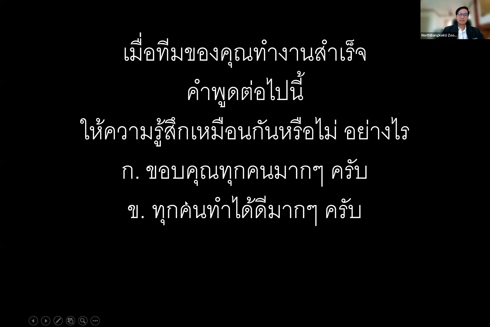

ต้องถามใหม่ นักศึกษารู้สึกดีกับคำพูดไหนมากกว่ากันครับ เอ่อ แบบนี้เดี๋ยวทางศึกษาเป็นสมาชิกในทีมนะครับ ขอไข่ ขอไข่ค่ะ ขอไข่ ทำไมอ่ะทำไมทำไมส่วนใหญ่ตอบขอใครครับ ส่วนใหญ่คนทำงานมันจะด้วยใครขึ้นมาค่ะถ้าได้คำชม

## [00:01:48]
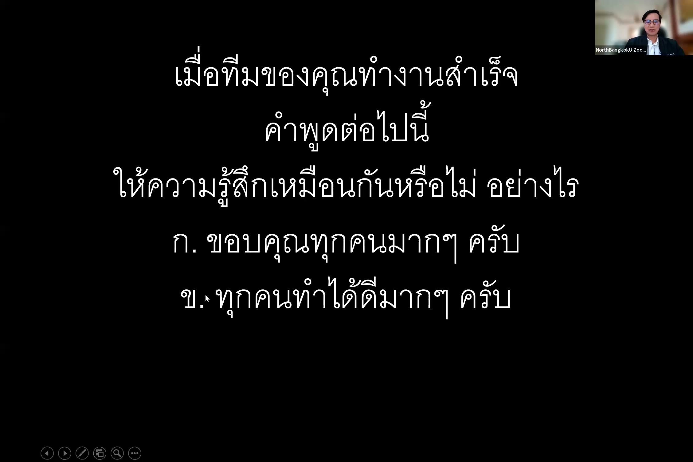

นักศึกษาเปลี่ยนเอาความรู้สึกของตัวเองมาพูดได้ไหม นักศึกษาตอบว่าฉันรู้สึกดีกว่าเมื่อได้ยินคำว่าทุกคนทำดีมากๆนะครับ ทำไมเรารู้สึกคำนี้ดีกว่าเพราะอะไรครับ เอาความรู้สึกมาพูดดิ เหมือนเรามีส่วนร่วม ทำให้งานสำเร็จ นักบริหารทรัพยากรมนุษย์ นัก HR เขาแนะนำมาว่าถ้าทีมงานของคุณทำงานสำเร็จ

## [00:02:18]
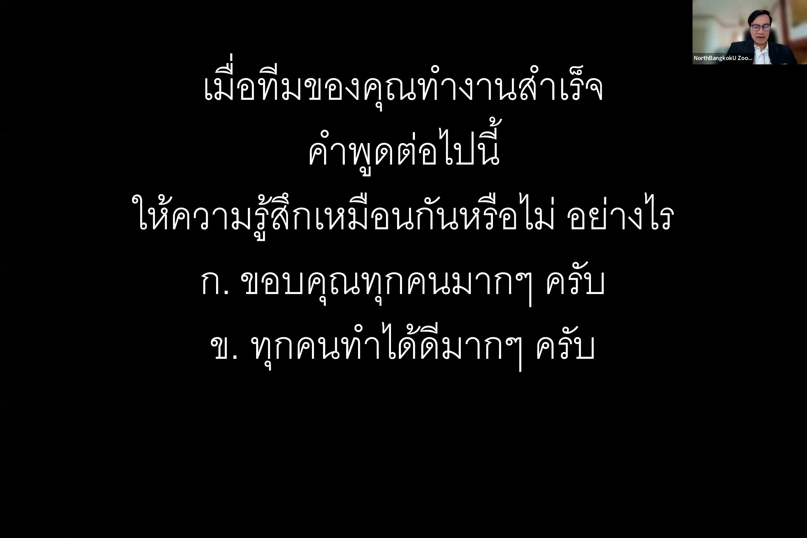

คำที่ควรพูดก่อนคำแรกไม่ใช่คำขอบคุณนะครับ นัก HR บอกว่าควรพูดคำว่าทุกคนทำดีมาก ๆ นะครับ เขาให้เหตุผลเหมือนเมื่อกี้เลยครับ ถ้าคำพูดกอไก่เนี้ย ขอบคุณมากมากครับ เหมือนกับว่าเขาทำหน้าที่ของเขา จบ จบ ใช่ ใช่ จบแค่นั้นครับเหมือนเราขอบคุณที่เขาทำงานให้เราอะครับ

## [00:02:48]
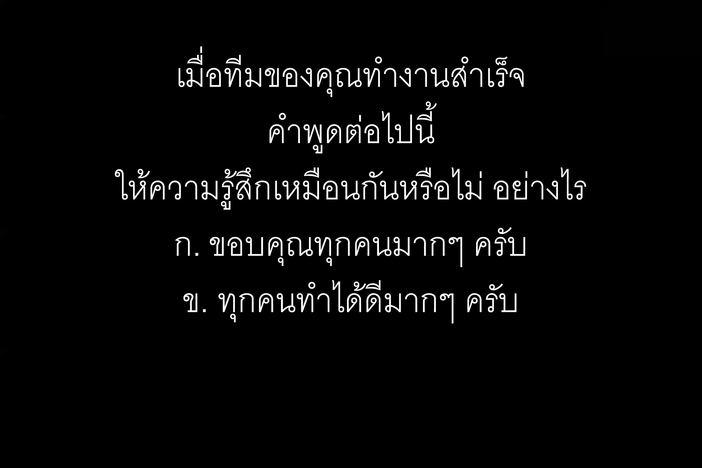

เหมือนเราขอบคุณที่เขาทำงานให้เรา ใช่ครับ มันจบ แต่ถ้าบอกทุกคนทำดีมาก ๆ ครับ มันหมายถึงเรากับเขามีส่วนร่วมทำงานด้วยกัน มีส่วนร่วมทำงานให้มันสำเร็จด้วยกัน ทุกคนนำดีมาก ๆ ครับ นัก HR เขาแนะนำให้สบตาของทีมงานเรานะ ถ้าทีมงานไม่เยอะนะ 10 คนไม่เกิน 10 สบตามองหน้าเขา แล้วก็ทุกคนทำดีมาก ๆ ครับ แล้วก็ปรบมือ ทุกคนทำดีมาก ๆ ครับ ทุกคนทำดีมาก ๆ

## [00:03:18]

แล้วค่อยขอบคุณอะไรก็ว่าไปแต่ให้เริ่มต้นด้วยคำว่าทุกคนทำนี้มากครับ แค่คำพูดแค่อันเนี้ยนักศึกษาอาจารย์ครับผมมีความเห็นในข้อขอข่ายครับ ครับ ในประโยคที่บอกว่าทุกคนทำดีมากๆแล้วเนี่ยมันใช้ได้กับกรณีงานสำเร็จหรือไม่ก็ตาม ที่ผมใช้ประจำนะเพราะว่าทุกคนมีความมุ่งมั่นมีความตั้งใจ บางครั้งอาจจะมีข้อผิดพลาดบ้างนะครับ

## [00:03:48]
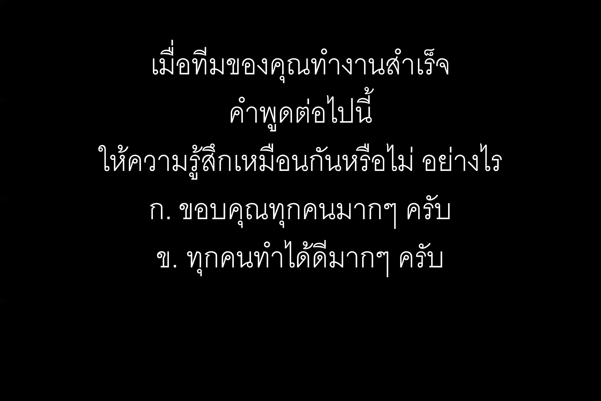

แต่เรามองเห็นความตั้งใจที่จะทำ ถึงไม่สำเร็จโอเคได้ได้ ครับ ดีครับ ดีมากครับถึงไม่สำเร็จก็ตามครับทุกคนทำดีมากมากครับ ทุกคนทำดีแล้วครับทุกคนทำดีมากมากแล้วครับ ดีครับ ก็เหมือนถ้าเปลี่ยนเพศกีฬาก็เหมือนทีมฟุตบอลแพ้นี่แหละครับ อืมอะไรประมาณนั้นครับจ้า ครับ ดีครับ เพราะฉะนั้นความรู้สึกมันไม่เหมือนกันนะครับ เวลาเราทำงานเป็นทีม ทำงานเป็นกลุ่มนะครับ คำขอบคุณมันเหมือนปกตินะครับ แต่ถ้ามากกว่าคำขอบคุณก็คือ เชิญชมแบบ

## [00:04:18]

ให้เขารู้สึกว่าเขาเป็นส่วนหนึ่งเขามีส่วนร่วมนะครับ ยิ่งถ้าเป็นงานยิ่งสำเร็จจะภูมิใจมากกว่า ถ้าหัวหน้าพูดว่าทุกคนทำดีมาก ๆ ครับ แล้วก็สบตาเขานะครับ เพราะฉะนั้นคำชื่นชมนักศึกษาถึงบวกพลังของคำชื่นชมนี่แหละ มันสร้างวัฒนธรรมองค์กรที่ดีมาก ๆ นะครับเพราะฉะนั้นถ้าใครยังไม่เป็นหัวหน้านะครับ แล้วยังไม่เคยพูดคำนี้ลองพูดดูนะครับ ลองพูดดูนักศึกษาแล้วก็มันจะ ติดเป็นคำพูดติดปากเราไปเลยว่าโอ้โหลทำดีมากมาก ขอบคุณมากมากเป็นเรื่องปกติเหมือนทำงานเสร็จก็ ก็จบ ที่เมื่อกี้อาจารย์ทิ้งไว้ว่า

## [00:04:48]

## [00:04:58]
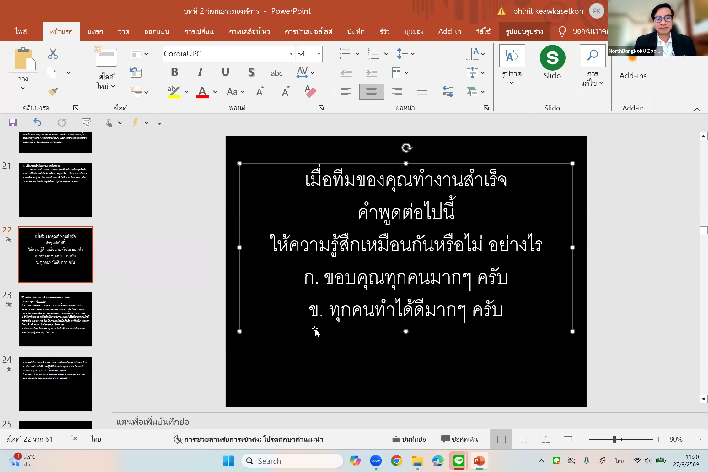

นัก HR ที่เก่งที่สุดที่ญี่ปุ่นเขาชื่นชมนะครับ องค์กรในวงการธุรกิจนะครับ ก็คือคุณโคโนซูเกะ มาซูชิตะ แต่คุณมาซูชิตะ คุณโคโนซูเกะ เขาก่อตั้ง Panasonic นะครับ เค้าคิดว่าเครื่องมือในการบริหารองค์กรที่สุดคือคน คือทุนมนุษย์นั่นแหละครับ เค้าเป็นคนแรกที่ทำให้บริษัทญี่ปุ่น

## [00:05:28]
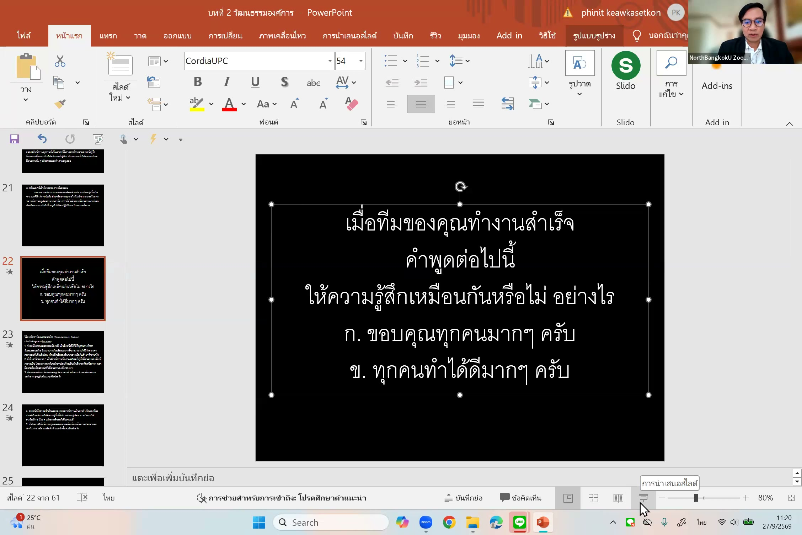

เปลี่ยนวันหยุดจากวันหนึ่งเป็นสองวันนะครับนั่นคือเขาคนแรกนะครับ เปลี่ยนจากหนึ่งวันเป็นสองวันเมื่อก่อนญี่ปุ่นแพ้สงครามใหม่ใหม่ต้องทำงานหนัก ทุกคนต้องทำงานหนักมากนะครับพอทำงานหนักมากมากก็ หยุดแค่วันเดียวพอนะครับอย่าหยุดหลายวัน

## [00:05:43]
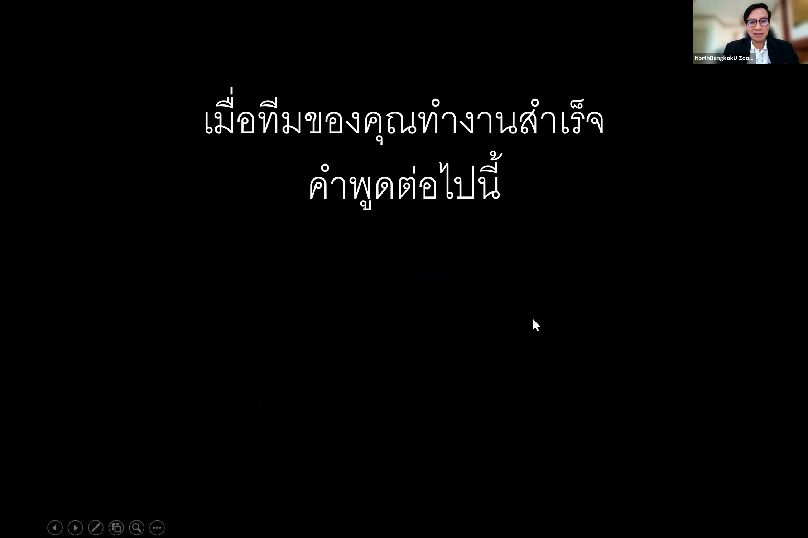

หยุดหลายวันมันเสียเวลาทำงานนะครับ ให้นักศึกษาสังเกตนะ สังคมญี่ปุ่นคนที่สูงอายุมาก ๆ เขาจะบอกว่าเขาพัฒนาประเทศนี้มามากพอแล้ว คือเขาช่วยประเทศนี้เจริญก้าวหน้ามาจนเขาอายุมากแล้ว คนเหล่านี้ก็จะเป็นคนแก่ที่คือจะชอบดื่มเบียร์ พักผ่อน ชอบหาความสุข

## [00:06:13]
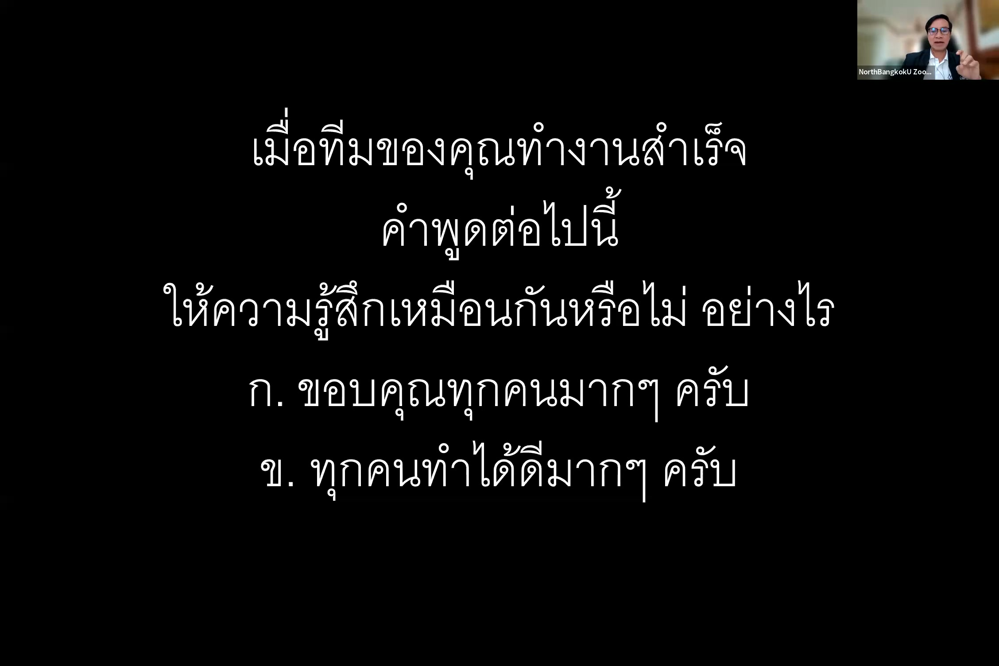

ทำงานหนักมาทั้งชีวิตแล้วเขาบอกเขาช่วยเหลือประเทศนี้พัฒนามายุคหนึ่งที่ประเทศญี่ปุ่นแพ้สงครามนักศึกษาคนหนึ่ง โอเคนักศึกษาต่อครับผมกำลังจะอธิบายนักศึกษาฟังเรื่องนี้ครับ การรักษาวัฒนามงกรไว้เมื่อกี้สร้างมาแล้วเนอะ พอสร้างเสร็จจะรักษาต่อนะครับ จะรักษาต่อเริ่มต้นกับอันนี้เลยครับ ข้อหนึ่งครับเวลาจะจ้างพนักงานใหม่ ต้องจ้างอย่างระมัดระวังนะ เป็นอีกวิธีหนึ่งที่ดีที่สุดในการรักษาพันธมงกรนะครับ เราอาจต้องเข้มงวดมากขึ้นตรวจสอบให้ดีว่าพวกเขาเหมาะสมกับทีมเดิมไหมเพื่อหลีกเลี่ยงอคติบางอย่างเมื่อรับเข้ามาทำงานจริง ก็เลยมีคำว่าทดลองงานเนี่ยนักศึกษาครับ

## [00:06:43]
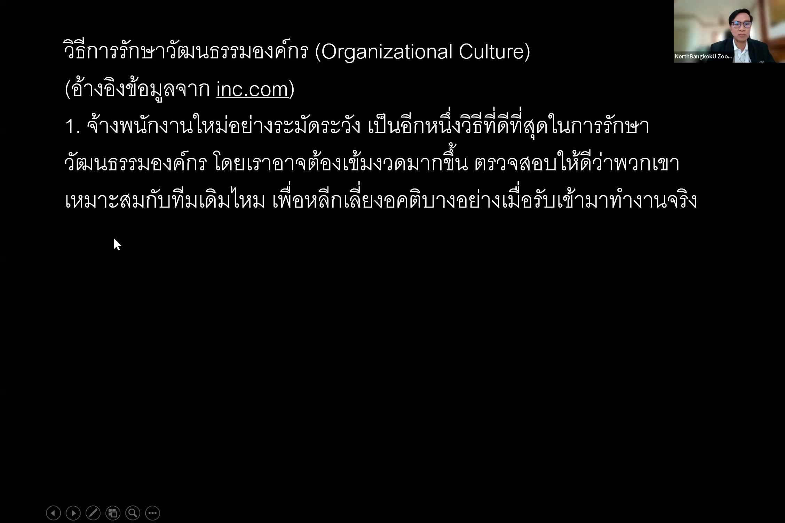

ทุกคนที่กำลังเรียนอาจารย์ทุกคนทำงานแล้วใช่ไหมนักศึกษารู้ไหมว่ากฎหมายทดลองงานไม่มีอยู่จริงนะครับนักศึกษารู้ใช่ไหม เราให้เงินเดือนพนักงานอ่ะสมมุติผมให้หมื่นสองสมมุตินะพนักงานเด็กจบใหม่มาผมให้หมื่นสอง

## [00:07:13]
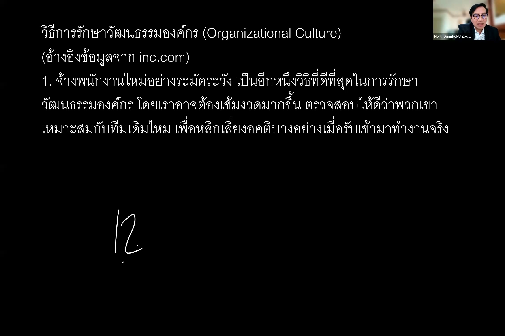

แล้วผมก็บอกว่าทดลองงานก่อน ถ้าผ่านทดลองงานเนี่ยจะปรับขึ้นเป็น 15,000 นักศึกษารู้ไหมว่ากฎหมายไม่มีอยู่จริงครับ ไม่มีจริงนักศึกษา บริษัทคิดกันเองนะครับอันนี้ หาช่องโหว่ของกฎหมาย แต่จริง ๆ พนักงานคนนั้นได้เงินเดือนไม่เกี่ยวกับทดลองงานนะครับ เงินเดือนตามที่ตกลงไม่เกี่ยวกับทดลองงานเลยนะครับ สมมุติว่าเราตกลงที่ 15,000 แล้วเราไปบอกว่าตอนนี้ให้ 12,000 ก่อน แล้วทดลองงานผ่านก็จะให้ 15,000 อันนี้ผิดกฎหมายนะครับ แต่เราจะไม่ใช้คำนั้นครับ แต่ไม่ใช้คำนั้น เราก็จะกำหนดว่าให้ 12,000 ก่อน แล้วค่อยปรับเป็น 15,000 หลังจากทดลองงานเสร็จ ไม่ได้ไปบอกว่าให้ 15,000 ตั้งแต่แรกนะครับ

## [00:07:43]
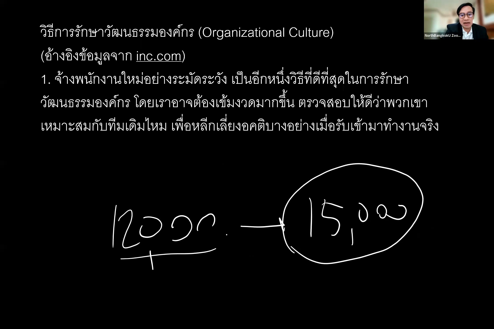

เพราะฉะนั้นการทดลองงานนั่นแหละเป็นอย่างหนึ่งที่เรากำลังจะดูว่าพนักงานคนนั้นเหมาะสม เหมาะกับพระมงกรของเราหรือเปล่า แต่เราจะใช้เวลาทดลองงาน บางทีมันก็อาจจะทำให้พนักงานทำงานขยันขันแข็ง

## [00:08:13]

เพราะว่ากำลังถูกทดลองงานเฉย ๆ แต่พอเขาได้เป็นพนักงานแล้วเขาอาจจะไม่ได้ขยันอย่างที่เห็นก็ได้ นั่นแหละมันก็เลยกลายเป็นข้อเสียของการทดลองงาน บางครั้งเราจะไปดูแค่สัมภาษณ์ครึ่งชั่วโมง รู้เลยว่าพนักงานคนนี้เก่งไม่เก่งก็ดูยากครึ่งชั่วโมงก็ดูยาก เพราะฉะนั้น เขาจ้างพนักงานใหม่อย่างระมัดระวัง แล้วจะดูยังไง มันดูยากจริง ๆ นะ สำหรับพนักงานใหม่ กว่าจะรู้ว่า เป็นอย่างที่เราต้องการหรือเปล่าเนี่ย บางทีต้องใช้เวลานะครับ ก็ไม่เป็นไร ก็ต้องจ้างอย่างมาระวัง ส่วนใหญ่ก็ดูโปรไฟล์ ดูว่ามีประสบการณ์ไหม แต่ถ้าหากเป็นพนักงานระดับสูงนะ เป็นผู้บริหารมาสมัครงานเนี่ย อันนี้ไม่ยากครับ เราสามารถดูโปรไฟล์หรือสืบ

## [00:08:43]
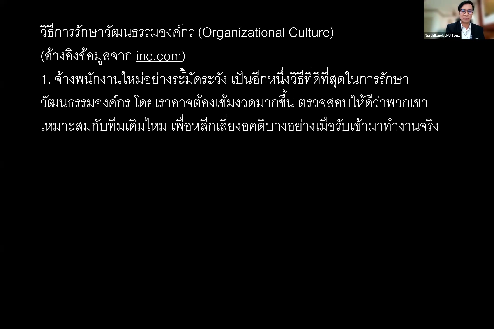

มันมีวงการ นักศึกษาวงการ HR เขาสืบได้ครับพนักงานคนนี้ออกมาบวกหรือลบ ออกมาดีหรือไม่ดี ออกมาแบบไหน อันนี้สำหรับผู้บริหารนะ สืบไม่ยากนะครับ แต่ถ้าเป็นพนักงานทั่วไปก็ไม่เป็นไร ถ้ามันไม่ใช่ฟันเฟืองที่ใหญ่พอจะขับเคลื่อนองค์กรให้เห็นชัด ๆ ได้ ถ้าเป็นพนักงานระดับ Operate ก็ไม่เป็นไร ไม่ต้องสนใจ แต่ถ้าเป็นพนักงานระดับ

## [00:09:13]
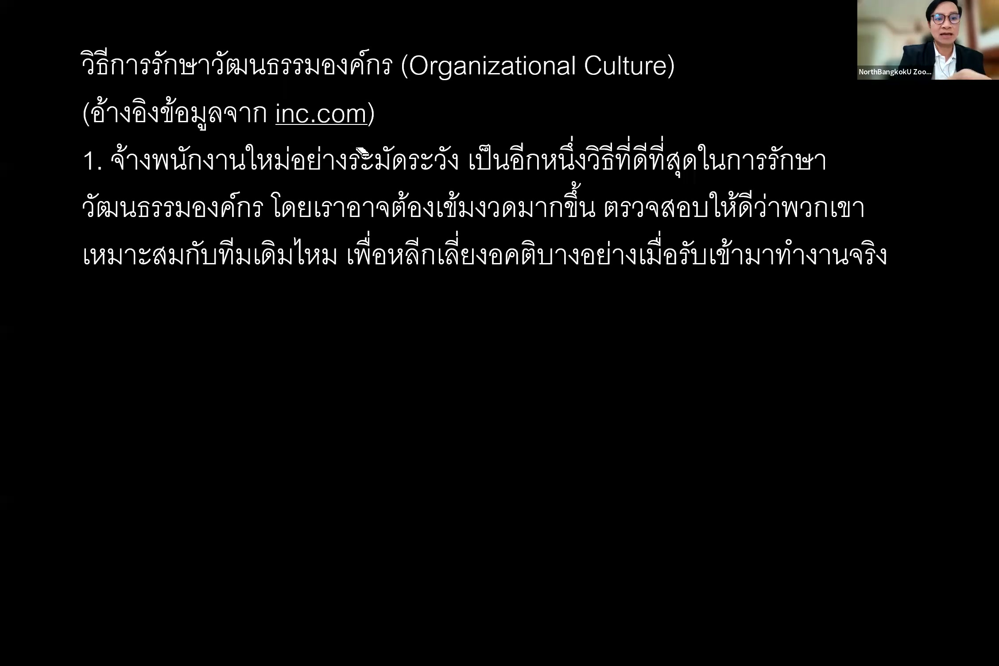

ระดับบริหาร ระดับจัดการต้องจ้างอย่างระมัดระวัง ย้ำถึงค่านิยมบ่อย ๆ เพื่อให้พนักงานทั้งเก่าและใหม่รับรู้ถึงวัฒนธรรมองค์กรที่ควรจะเป็น โดยเฉพาะพูดกับพนักงานใหม่ ก็จะเป็นการคัดเลือกระดับหนึ่งว่าพวกเขามีความคิดเห็นอย่างไรกับพระราชบังกรของเรา บางทีพูดเรื่องพระราชบังกรไปว่าคุณเห็นอย่างไร ก็พยายามให้มีคำตอบที่มันสามารถทดสอบได้

## [00:09:43]
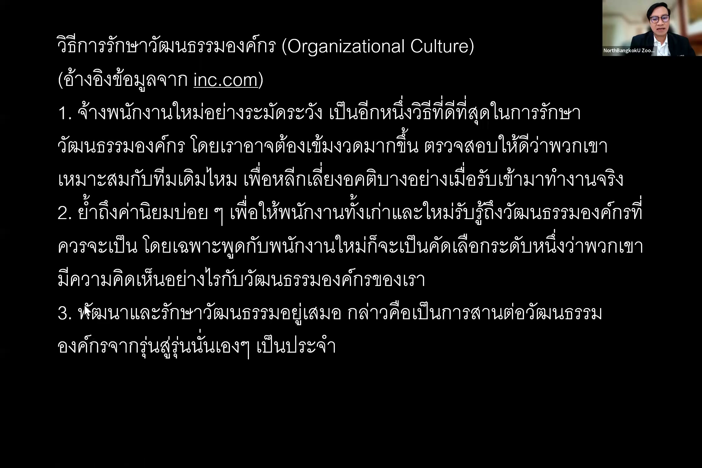

อันนี้มันมีนักศึกษา นัก HR เขาคิดไว้แล้วครับ คำถามไหนทดสอบอะไร คำถามนี้ทดสอบอะไร นักศึกษาก็ได้ระดับดึก ข้อ 3 คือการพัฒนารักษามันทำอยู่เสมอ กล่าวคือเป็นการสานต่อมันทำองค์กรจากรุ่นสู่รุ่นนั่นเองครับ เป็นประจำ ตามนั้น

## [00:09:57]

อันตรงนี้นักศึกษาอ่านเองนะไปหาข้อมูลเพิ่มเติมเอาเองนักศึกษาครับ มันมีข้อ เนี่ย นักศึกษาตระหนักถึงความสำเร็จ และผลงานของพนักงานเป็นประจำก็ยังเน้นข้อนี้อยู่ สิ่งเหล่านี้ช่วยมัดใจพนักงานให้มีความรู้สึกที่ดี เพราะฉะนั้นเน้นหลายเรื่อง เน้นหลายรอบแล้วว่าการชื่นชมเป็นเรื่องสำคัญมาก ชื่นชมพนักงานอยู่เสมอ การให้รางวัลเล็ก ๆ น้อย ๆ อย่างการชื่นชมก็เพียงพอ อย่างเมื่อกี้ที่เขาแนะนำว่าอย่าไปใช้คำว่าขอบคุณ ให้ใช้คำว่าทุกคนทำดีมาก คุณทำดีมาก

## [00:10:27]
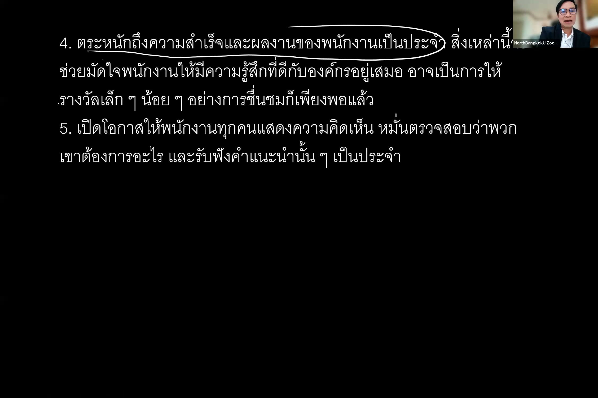

วันนี้คุณทำดีมากนะครับ มันมีหนังเกาหลีอยู่เรื่องนะฮะผมอยากแนะนำให้นักศึกษาดู แต่มันไม่ได้อยู่ในเน็ต มันไม่ได้อยู่ในเน็ตฟิคนะฮะ มันอยู่ใน อะไรนะ จำชื่อไม่ได้ชื่อเรื่อง The Negotiator

## [00:10:57]
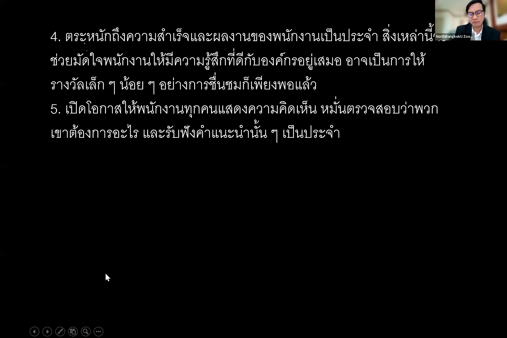

The negotiation ศิลปะการเจรจรร้องนะครับ เรื่องนี้หนังสนุกมากนะครับ นักธุรกิจควรดูแล้วมันสร้างมาจากตำราเลยนะครับ เวลาผมดูผมจะรู้เลย สิ่งที่เขาทำคือข้อนี้ สิ่งที่เขาทำคือ คือทฤษฎีข้อนี้เลยนักศึกษา สนุกมากเลยนักศึกษา The Negotiate แนะนำให้ดูเลยนักศึกษาครับ เดี๋ยวหาเจอแล้วบอก ทีนี้นักศึกษาครับ

## [00:11:27]
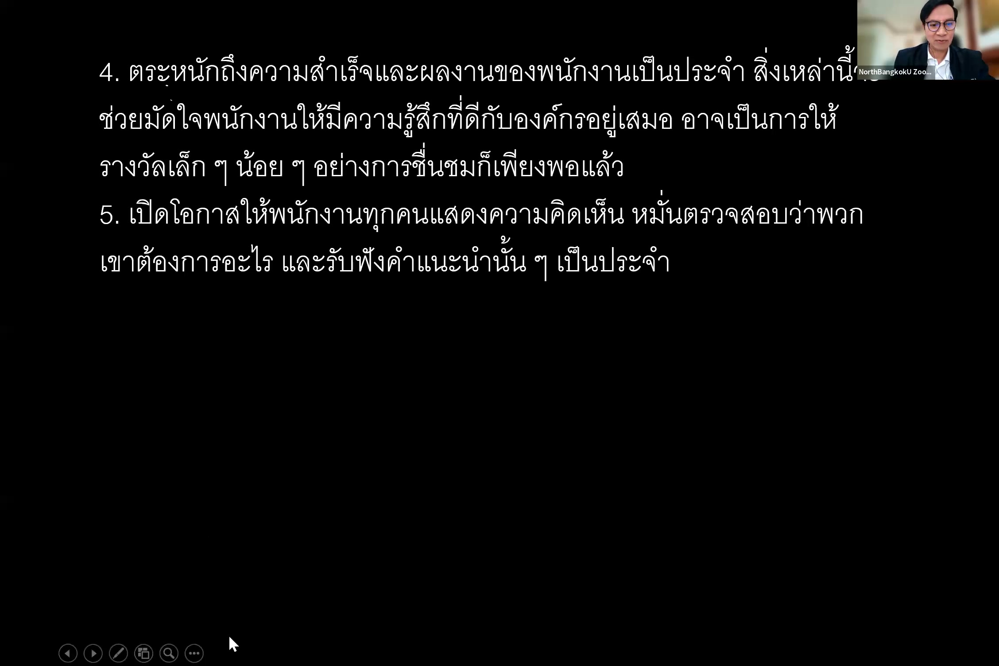

## [00:11:32]
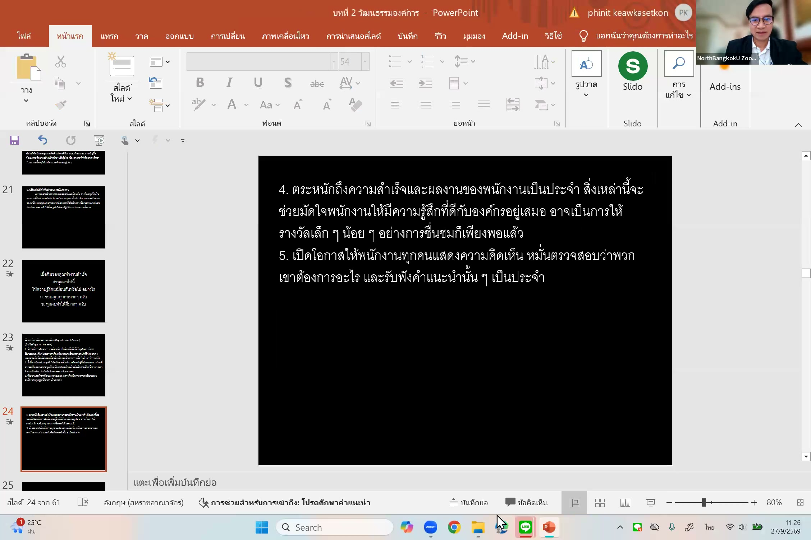

## [00:11:37]
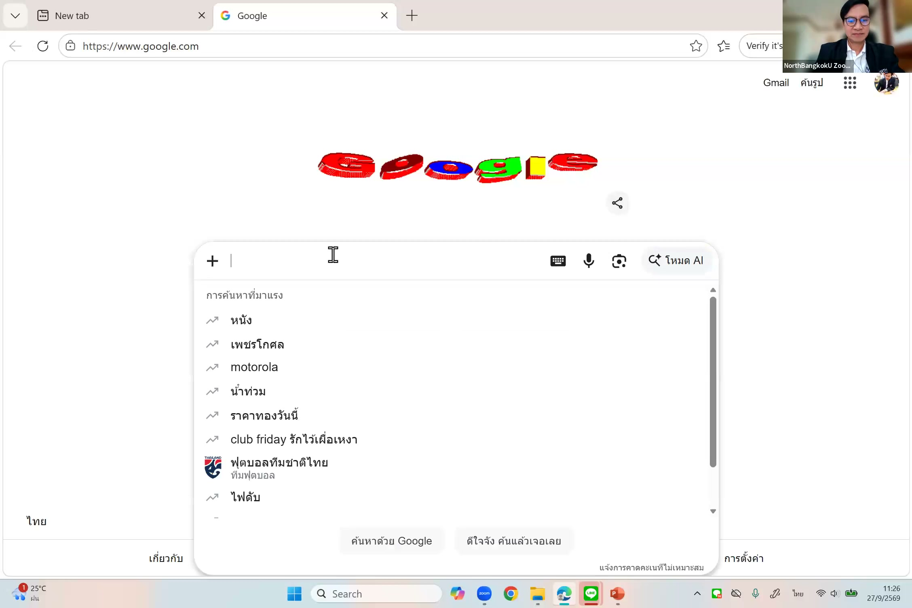

## [00:11:47]
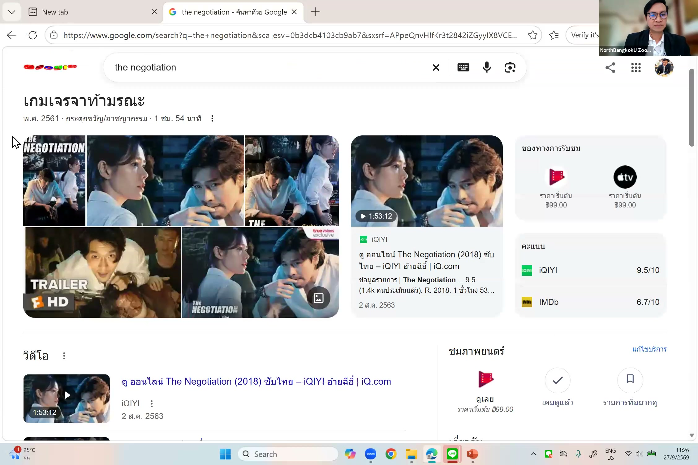

## [00:11:52]
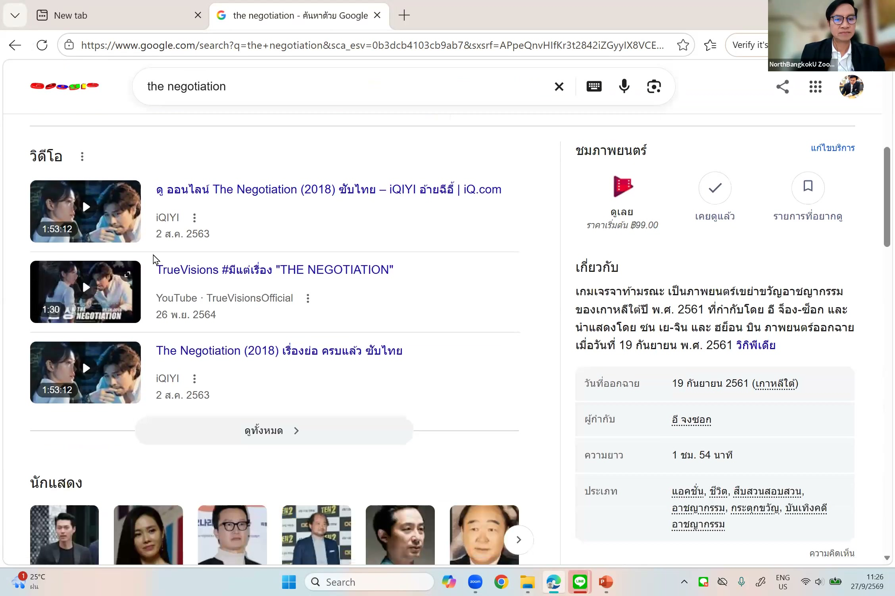

## [00:11:55]
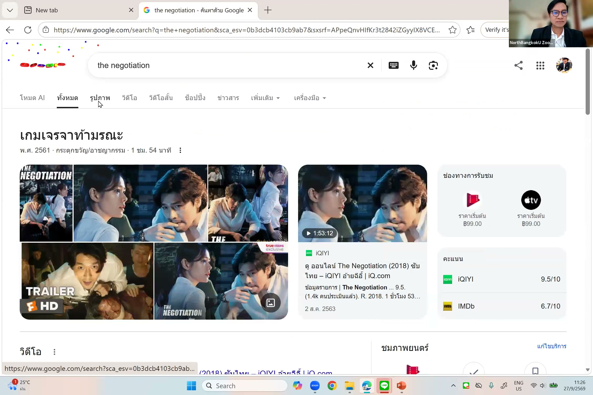

## [00:12:00]
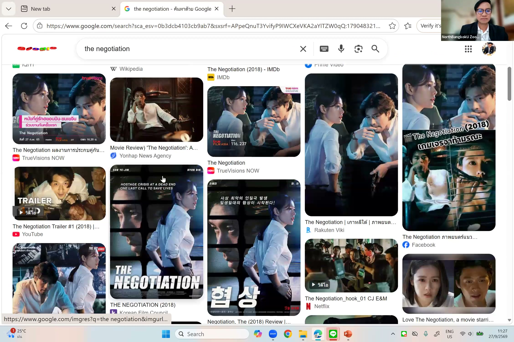

## [00:12:03]
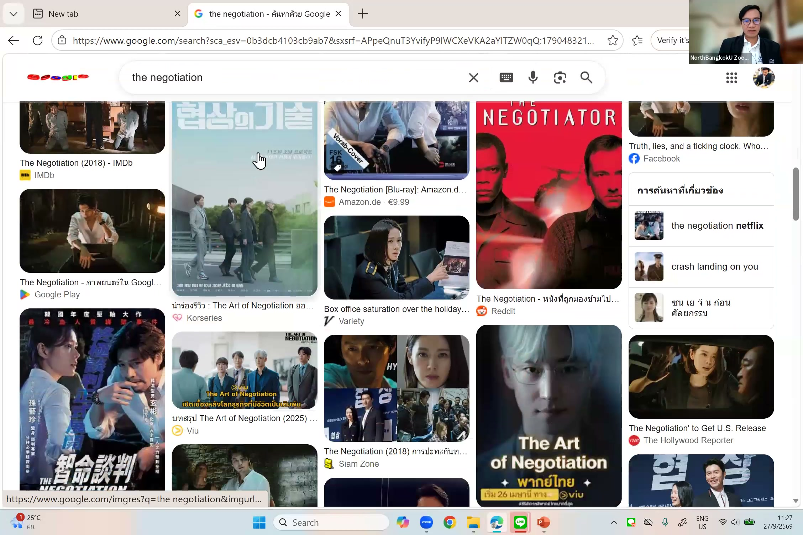

## [00:12:06]
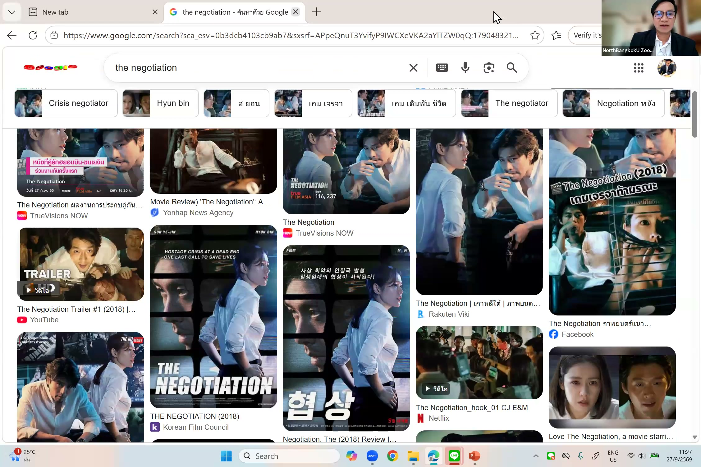

บทนี้วัฒนธรรมวงกรเนี่ยมันมีแคดดิกต์มันสั้นๆ มันไม่เยอะนะครับ อาจารย์แนะนำให้นักศึกษาไปหาข้อมูลอ่านเพิ่มเติมนะครับ แต่ผมจะหาตัวอย่างแบบนี้นะครับ

## [00:12:09]

แล้วก็ทางมังกรที่มันสำเร็จแล้ว คนที่เขาสร้างทางมังกรจนสำเร็จแล้วในโลกของ HR เนี่ยเขามีที่ไหนบ้างนะครับ เรามาลองดูกันนะศาสตร์ที่ไหนบ้างที่ถูกยกเป็น Case Study นะครับ

## [00:12:37]

## [00:12:43]

## [00:12:47]
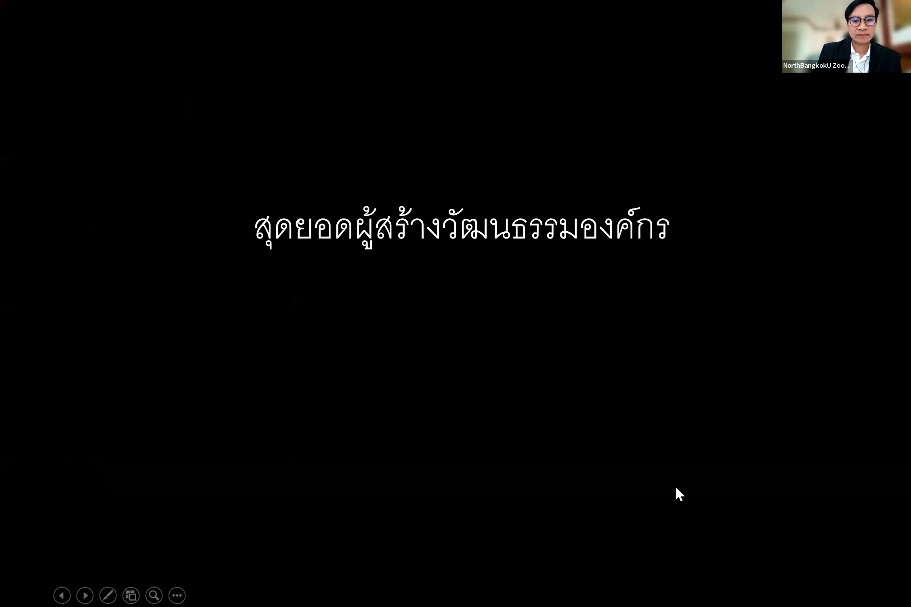

คนแรกทำนักศึกษาที่มักจะถูกพูดถึงบ่อยๆ ผมก็พูดถึงบ่อยครับ กับเขาคนนี้นักศึกษา Honda นะครับ ว่าทำของ Honda นักศึกษาครับ

## [00:12:53]
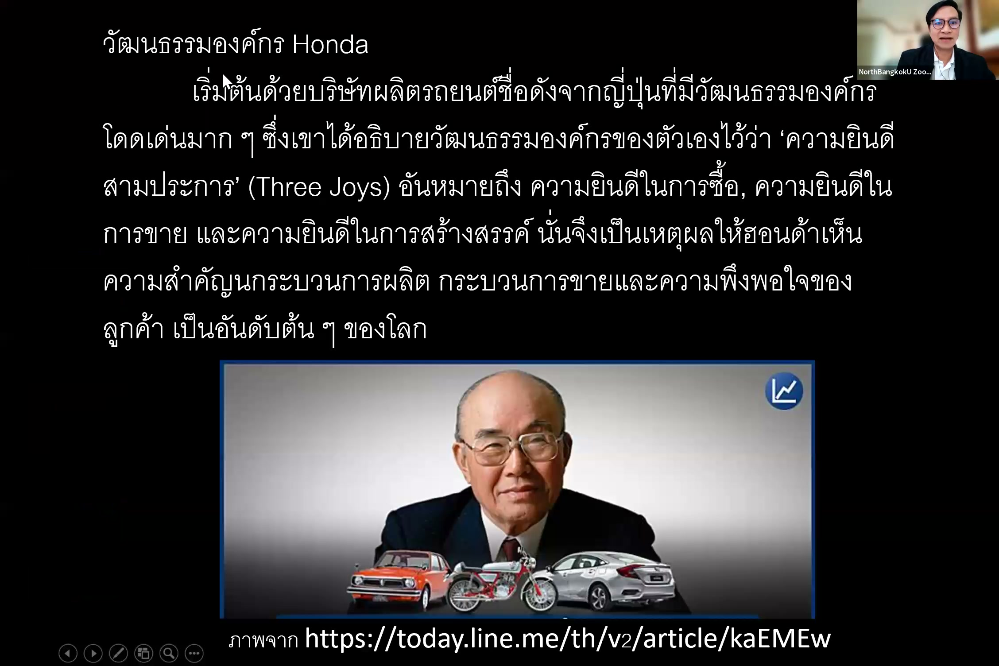

เริ่มต้นด้วยการผลิตรถยนต์ชื่อดังจากญี่ปุ่น ที่มีพระธาตุมงคลที่โดดเด่นมาก ๆ ซึ่งเขาได้อธิบายพระธาตุมงคลของเขาไว้ด้วย 3 คำนะครับ เขาเรียก Tree Joy 3 ความสุขนะครับ สามความสนุกอ่ะพี่จอยหนึ่งคือความยินดี ยินดีความยินดีสามประการนะครับความยินดีในการซื้อ ความยินดีในการขาย

## [00:13:23]
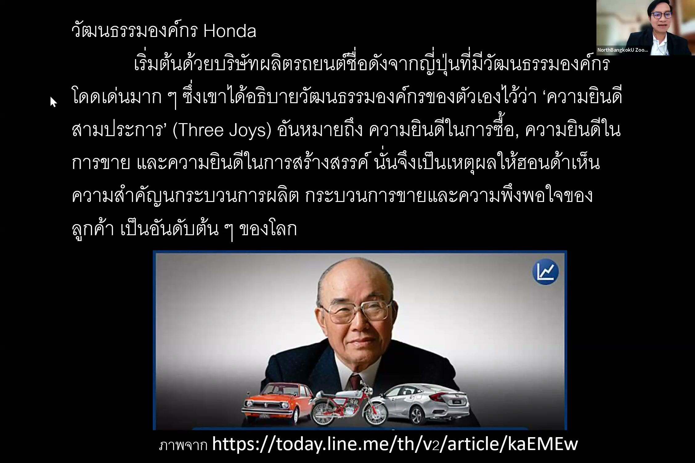

ก็แปลก ๆ เขาคิดได้ ความยินดีในการซื้อ ความยินดีในการขาย และความยินดีในการสร้างสรรค์ ที่ Honda เขาคิดไว้เป็นวัฒนธรรมมงกรที่แข็งแรงมาก ความยินดีในการซื้อก็คือความมั่นใจนะครับ ผมเชื่อนะครับ ใครใช้รถยนต์ฮอนด้าอยู่นะ คันต่อไปเนี่ย ถ้าไม่นึกถึงรถยนต์ไฟฟ้านะ ของจีนนะ นักศึกษาก็จะซื้อฮอนด้าเหมือนเดิมนะ ผมเชื่อนะ ความยินดีในการซื้อการขายและความยินดีในการสร้างสรรค์อันนี้ของฮอนด้านะครับ คือเขาไม่เหมือนโตโยต้าอย่างหนึ่งนะสำหรับโตโยต้าเนี้ยเขาพยายามลดต้นทุน

## [00:13:53]

## [00:13:58]

โตโยต้าเป็นเจ้าพ่อแห่งการทำต้นทุนต่ำ การผลิตแบบต้นทุนต่ำ โตโยต้าต้องยอมรับเขาจริง ๆ เขาทำคุณภาพให้สูงที่สุดเท่าที่ต้นทุนเขากำหนดไว้ สมมุติว่าต้นทุนเขา 500,000 มันภายใน 500,000 ทำยังไงให้คุณภาพมันดีที่สุดในราคา 500,000 ได้ เขาจะทำให้ได้ ไม่เหมือนกับยุโรปนะยุโรปเขาจะตั้งคุณภาพก่อน คุณภาพเขาอยากได้ระดับนี้

## [00:14:28]
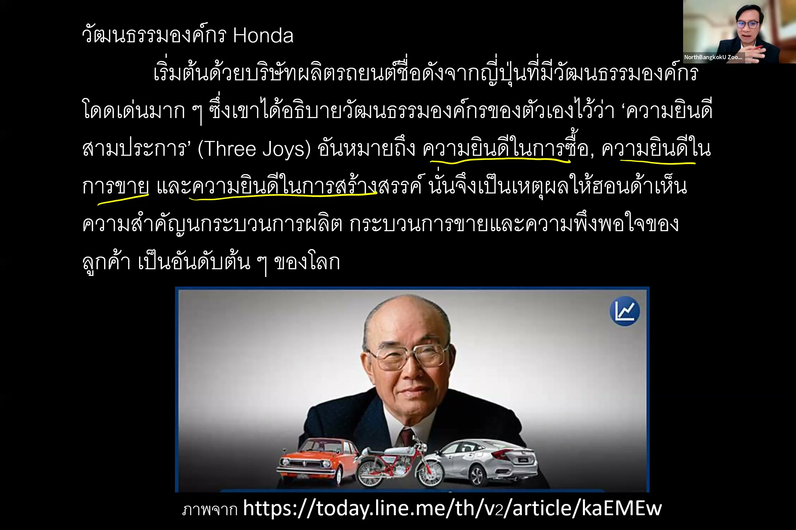

แล้วเขาจะไปดูต้นทุนทีหลังต้นทุนกี่ล้านก็ว่าไปเพราะรถยุโรปมันขายแพงได้จริงไหม แต่รถญี่ปุ่นมันขายแพงไม่ได้ในระดับหนึ่งอ่ะมันขายได้แค่นี้ เพราะฉะนั้น toyotaเขาจะบอกว่าต้นทุนเขาห้าแสนเขาจะขายอยู่ที่ หกแสนสมมุตินะ เพราะฉะนั้นห้าแสนต้นทุนจะทำยังไงให้คุณภาพมันดีที่สุดเท่าที่ต้นทุนมี แต่ถ้าเป็นรถเน้นคุณภาพรถยุโรปเขาก็จะบอกว่าอยากได้คุณภาพเท่านี้ต้องใช้ต้นทุนเท่าไหร่

## [00:14:58]
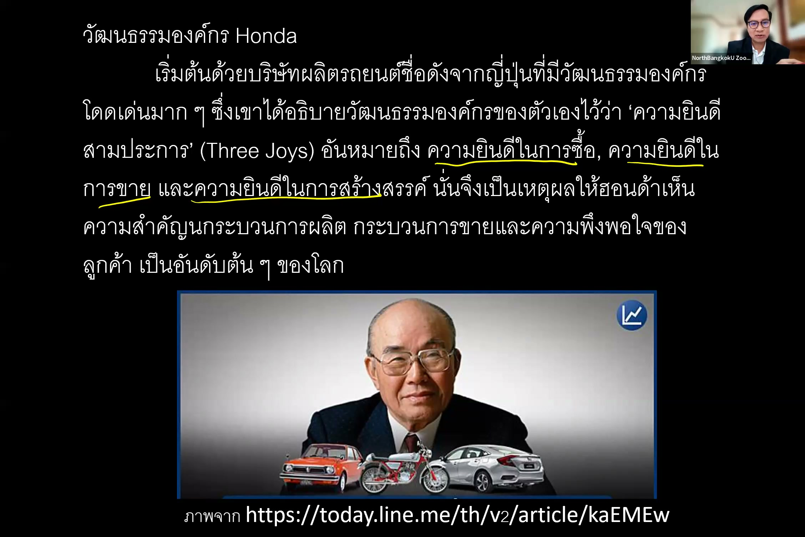

ถ้าอยากได้คุณภาพตรงนี้ต้องใช้ต้นทุน 2 ล้าน เขาก็ทำ 2 ล้านคุณภาพก็ได้ตามนั้น แล้วก็ไปตั้งราคาขายตามการยอมรับได้ของลูกค้า แต่ Honda เขาไม่เหมือน Toyota Honda เขาจะไม่เน้นต้นทุนต่ำก่อน เขาเน้นคุณภาพด้วย เขาจะเอาคุณภาพด้วยว่า เขาอยากได้คุณภาพเท่านี้ อยากได้วัสดุภายในดีแบบนี้ เขาต้องใช้ต้นทุนเท่าไหร่ เพื่อให้ลูกค้ามีความยินดีในการซื้อนั่นเอง นั่นคือ Honda แต่ Toyota นี้ ผมก็ต้องยอมรับว่าเขาเน้นลดส้นทุนจริง ๆ ถามว่า

## [00:15:28]

ลูกค้า Toyota เขายินดีกับการซื้อ บางทีบางจุดไม่นะครับ ผมจะรู้สึกว่าภายในมันทำได้แย่มาก ภายในของ Toyota ห้องโดยสารทำไม่ดี แต่ทำไมคนยังยอมรับ ยังยอมซื้อ เพราะว่ามันคุ้มค่ากับราคาที่ซื้อนะครับ มันคุ้มค่ากับราคา แต่ Honda ไม่ใช่ครับ ถ้าเปรียบเทียบห้องโดยสาร Honda ดีกว่าเยอะนะครับ

## [00:15:58]
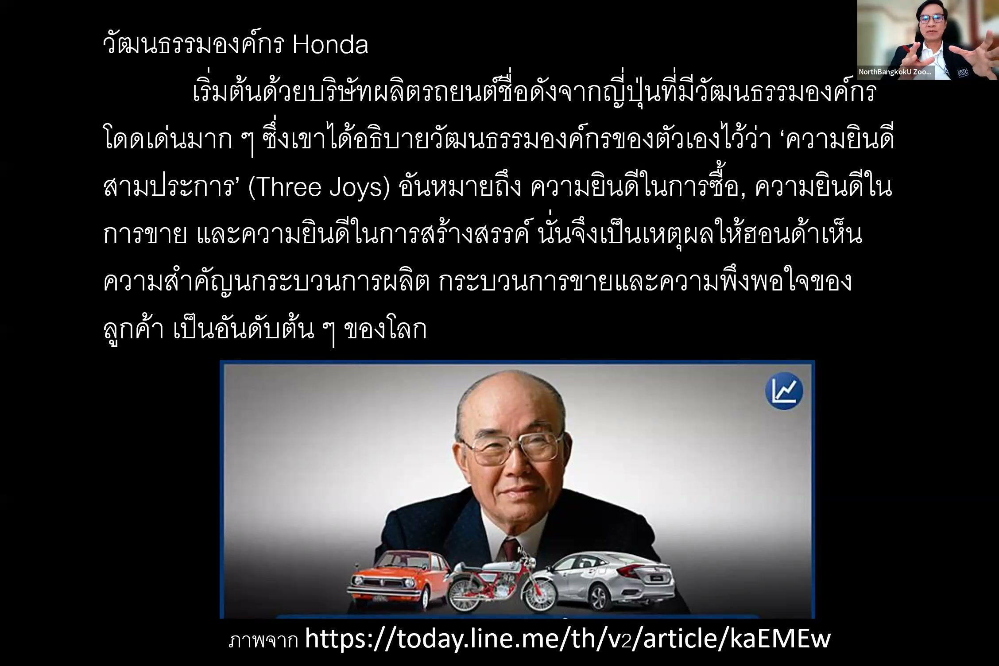

คนซื้อยินดีที่จะซื้อครับ คนยินดีที่ได้ซื้อครับ ต่อไปครับ พระมงกรของปลท ผมข้ามเลยแล้วกัน ผมไม่พูดแล้วกัน ปลท

## [00:16:09]
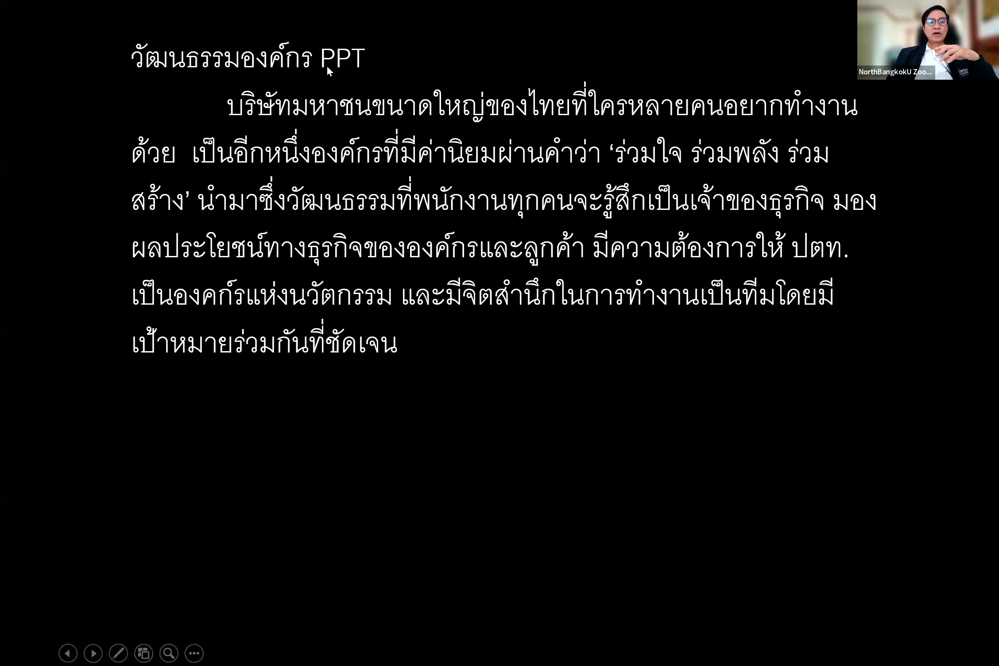

ข้ามแล้วกัน รู้สึกพูดไปมันย้อนแย้งนักศึกษาครับ อันนี้ความรู้สึกผมนักศึกษาครับ นี่ถ้าพูดในห้องไม่บันทึกเทปนักศึกษาคงรู้แล้วว่าทำไมผมถึงไม่พูดปตท.นักศึกษาครับ ย้อนแย้งจริงเลย ย้อนแย้งครับ ผมข้ามเลยแล้วกันนะอาสา เอาที่ไม่ย้อนดีกว่านะอาสา ดิสนีย์ครับ วัดครามองค์กรของดิสนีย์นะอาสา วอลล์ดิสนีย์

## [00:16:35]

พันธกิจขององค์กรนี่คือการสร้างประสบการณ์ความสุขและความสนุกที่มาจากความคิดสร้างศาลนวัตกรรม อะ ผมเล่าแบบนี้นักศึกษา เวลาบิสนี่เขาจะรับพนักงานเนี่ย เขาจะดูพนักงานว่า มันเข้ากับธรรมเขาหรือเปล่า เขาจะเฟ้นคัดเลือก หลายขั้นตอนมากจนรู้ว่าพนักงานคนนี้มีความสุขที่จะให้ความสุขคนอื่นจริง ๆ เพราะพนักงานบางคนจะต้องทำงานซ้ำๆ ใส่ชุดเจ้าหญิง ใส่ชุดเจ้าชายซ้ำๆ ทุกวัน

## [00:17:05]

ถ้าไม่ได้มีความสุขจริงจริงจากใจเนี่ยแววตาออกมาไม่มีความสุขจริงเนี่ย มัน มันทำให้คนที่เขามาเที่ยว เด็กเด็กอะ เขารู้สึกได้ เออ งั้นวีสนีย์เขาจะคัดเลือกพนักงานอย่างเข้มงวดมากมากหลายขั้นตอนมากมาก เหมือนเดบิ้วอ่ะ กว่าคุณจะได้ไปแต่งชุดในขบวนพาเลทอย่างเดียว คุณต้องทำ ต้องซ้อมเป็นกี่ปี เป็นเดือน หกเดือน ครึ่งปี หนึ่งปี สาม

## [00:17:35]

ถ้าใครไม่ไหวเขาจะค่อย ๆ ออก ใครไม่ไหวออกไปเอง ไม่ไหวออกไปเอง จนเหลือคนที่ตั้งใจอยากทำงานจริง ๆ ความสุขและความสนุกที่มาจากความคิดสร้างสรรค์และนวัตกรรมผ่านสินค้าและบริการหลายรูปแบบ ฉะนั้นวัฒนธรรมหลักของดิสนีย์คือการสืบทอดกันมาตั้งแต่สมัยวอลล์ดิสนีย์ ยังเป็นผู้บริหาร คือคำพูดสองคำเท่านั้นครับ คือการสร้างความสุขครับ คลีเอท แฮปปี้เนส นั่นเอง สร้างความสุข

## [00:18:05]
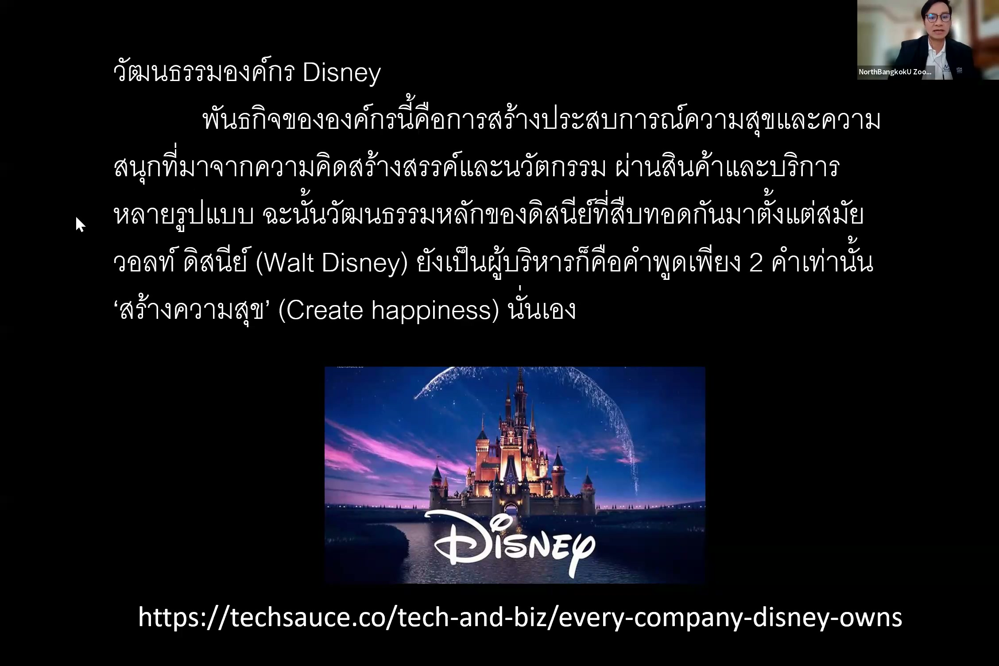

ใครเคยไปเที่ยววอลล์ดิสนี่นักศึกษาจะรู้ว่า ที่ดิสนี่แลนด์อ่ะ รอคิวเนี่ย โอ้โห นักศึกษาครับ ก็รอนะ ชั่วโมงนึงก็รอนะนักศึกษาครับ รอนานมาก อ่ะ ต่อไปกลุ่มเครือซีเมนไทยนักศึกษาครับ

## [00:18:25]
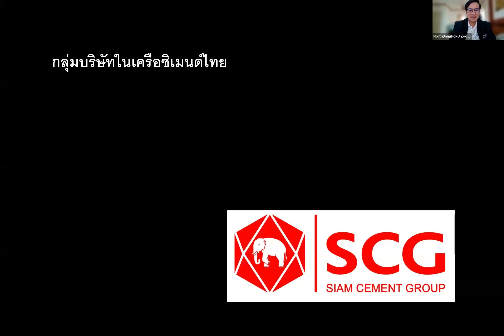

กลุ่มเครือซีเมนต์ไทย ตอนที่ประเทศไทยเราเพิ่งจะรู้จักปูนใหม่ ๆ เมื่อก่อนใช้ไม้ นักศึกษา ถ้าใครเกิดยุคผม จะรู้เลยว่าเวลาเราไปคุยว่าบ้าน 2 ชั้น ชั้นบนไม้ร่างปูน จะรู้สึกว่าบ้านมีรวย อันนี้ความรู้สึกไม่รู้ นักศึกษาอาจจะไม่รู้นะ แต่ถ้าคนต่างจังหวัด ยุค 90 อย่างผมเนี่ย จะรู้แล้วว่าบ้านไหน ข้างบนไม้ ข้างล่างปูเนี่ย รู้สึกบ้านนั้นทันสมัยแล้ว เพราะฉะนั้นช่วงที่ ยุคที่สร้างบ้านกันใหม่ๆ นะครับ ต่างประเทศเนี่ย

## [00:18:55]

ถ้าต่างประเทศมาเป็นผู้ประกอบการ เป็นเจ้าของ ราคามันควบคุมไม่ได้ พระมหากษัตริย์ไทยในยุคนั้นอาสา ยุคราชการที่ 4 ที่ 5 ก็เลยบอกว่า งั้นธุรกิจอันนี้เราขอดูแล คือรัฐบาลดูแล รัฐบาลดูแลเอง วัฒนประสงค์หลักคือจะได้ควบคุมราคาได้

## [00:19:25]

คนไทยจะได้ประโยชน์ตรงที่ว่าราคาจะได้ไม่แพง รัฐบาลก็ดูแลเอง มันมีสินค้าหลายอย่างที่รัฐบาลดูแลเองนะครับ ไม่ว่าจะเป็นเหล้า สุรา สรรพากรก็ลงกัน บุหรี่ โรงงานยาสูบ รัฐบาลดูแลเพื่อควบคุมได้ ทุกอย่างถ้าต้องการควบคุมได้ รัฐบาลจะทำเอง อันนี้คือเจตนาดีมาก สมัยนั้นยุครัชกาลที่ 4-6 เจตนาดีมาก ๆ

## [00:19:55]

แต่ไงมาถึงวันนี้มันเพียรไปหมดแล้วสักหน่อย อันนี้ข้าม วัฒนธรรมของ CP ครับน้องสาว เป็นวัฒนธรรมองกรที่อยู่ในรูปแบบของปรัชญา

## [00:20:04]
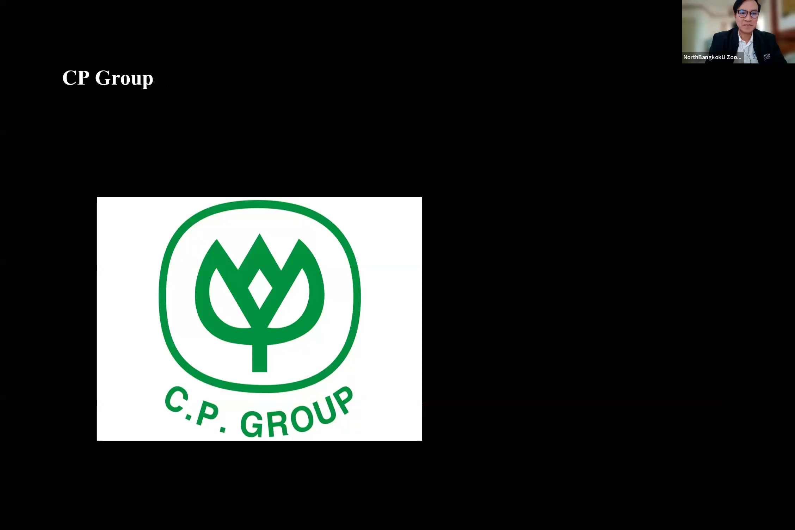

Philosophy นักศึกษาครับมีปรัชญาในการดำเนินธุรกิจที่ว่าให้นึกถึงคนอื่นก่อน แบบเนี่ยคุณธนินทร์ จิรวนนท์ให้นึกถึงคนอื่นก่อน

## [00:20:23]
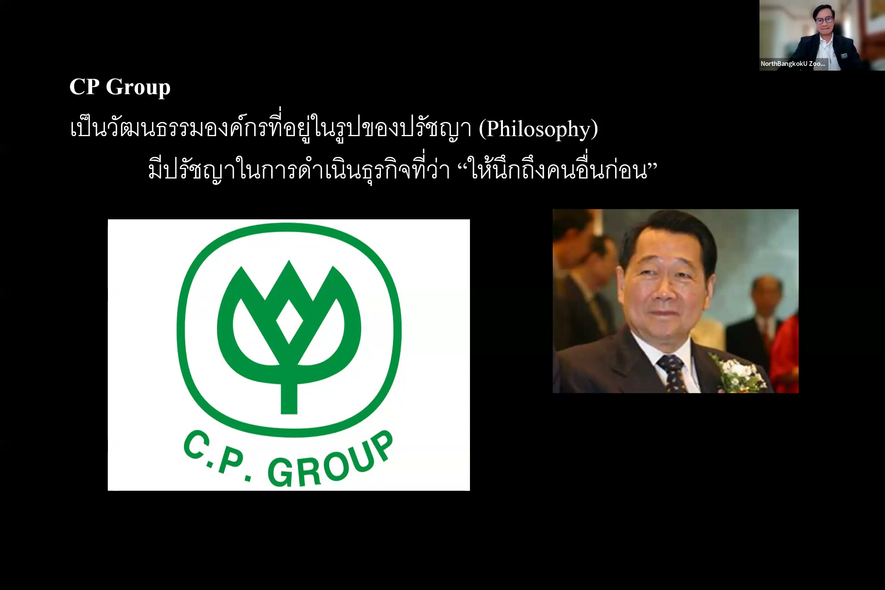

ก็คือถ้าเป็นวันนี้ก็คือนึกถึงลูกค้าก่อนลูกค้าต้องการอะไรเราจะทำทุกอย่างให้ตรงตามที่ลูกค้าต้องการ ลูกค้าต้องการสินค้าที่หลากหลายภายในเวลาการซื้ออันรวดเร็วเขาก็เลยทำเซเว่นขึ้นมา ใช้เวลาในเซเว่น ไม่เกิน 5 นาที หมดเป็นร้อย ได้ของครบ 7-11 นั่นแหละ นึกถึงคนอื่นก่อน คุณธนินทร์ จิวานนท์ แต่คนที่เก่งอีกคนนึงก็คือลูกน้องเขาครับ

## [00:20:53]

คนที่เป็นมือขวาเขาชื่อคุณ นามสกุลชัยรัศมีศักดิ์ กรอบศักดิ์ คุณกรอบศักดิ์ ชัยรัศมีศักดิ์ คนนั้นก็เก่งจริง ฉะนั้นซื้อตัวมาจากต่างประเทศเลยนะ เป็นซีอีโออยู่ที่ต่างประเทศ เป็นผู้บริหารรับสกุลต่างประเทศ บริษัทอะไรนะ ไม่แน่ใจนะ จำไม่ได้ ซื้อมา UCP ครับ เพื่อมาทำงานเป็นสมองแทนคุณ แทนตัวเอง แทนคุณตนเอง

## [00:21:23]

## [00:21:27]
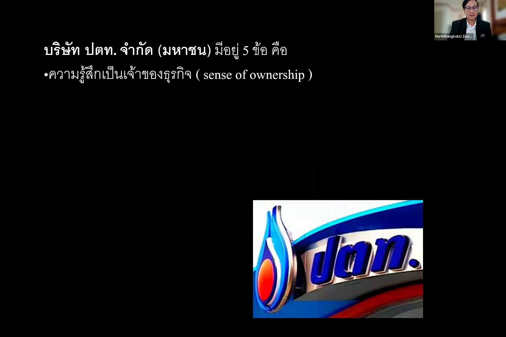

ปท ข้ามไปแล้วนักศึกษา อันนี้ก็ไม่อยากพูดถึงเท่าไหร่นักศึกษา สุดยอดผู้นำองค์กรแบบเผด็จการของโลกฮิตเลอร์นักศึกษา ไม่เอา ไม่พูด แกฆ่าคนตายเยอะนักศึกษา แต่มันน่าสนใจตรงนี้ครับนักศึกษาครับ

## [00:21:30]
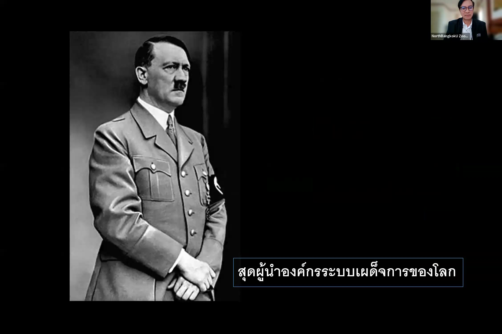

## [00:21:41]
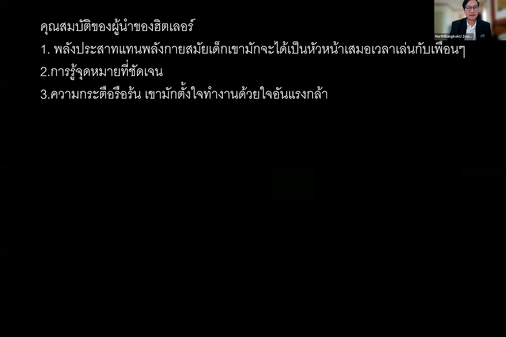

## [00:21:48]
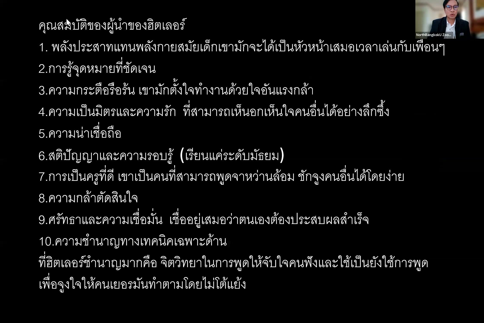

คุณสมบัติของฮิตเลอร์ ใช้พลังประสาทแทนพลังกาย สมัยเด็กเขามักจะได้เป็นหัวหน้าเสมอเวลาเล่นกับเพื่อน การรู้จักจุดหมายที่ชัดเจน กระตือรือล้น มักตั้งใจทำงานด้วยอัลแลงก้า ความเป็นมิตรและความรัก มีความเห็นอกเห็นใจ ใช้คำว่า Empathy ความเห็นอกเห็นใจ รู้กลัวคนอื่นคิดยังไงสติปัญญาดี เป็นคนที่มีพลังศรัทธามีความเชื่อมั่น อะ โอเค ข้ามจริงเขาฆ่าคนไม่อยากพูดถึง นี่ คนนี้ดีกว่า

## [00:22:18]
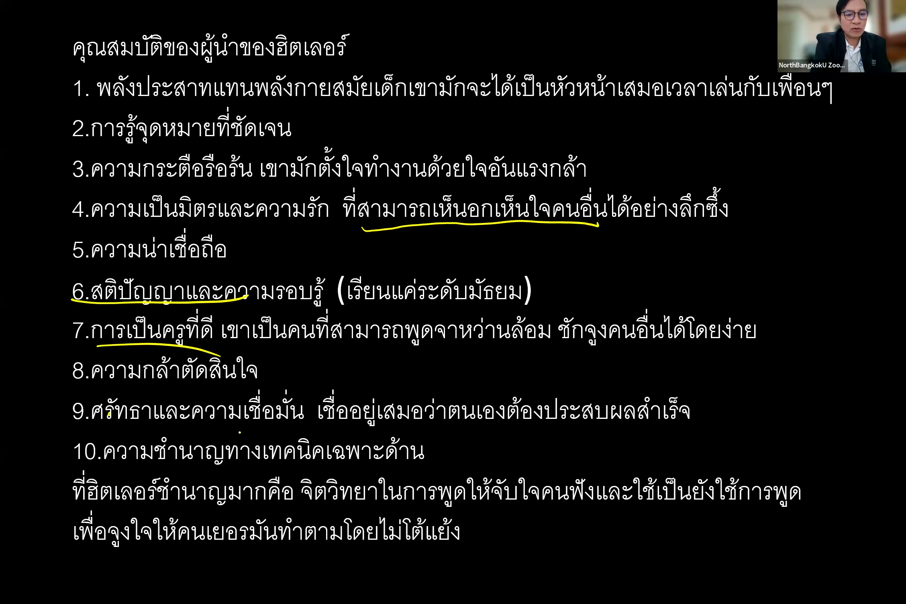

## [00:22:24]
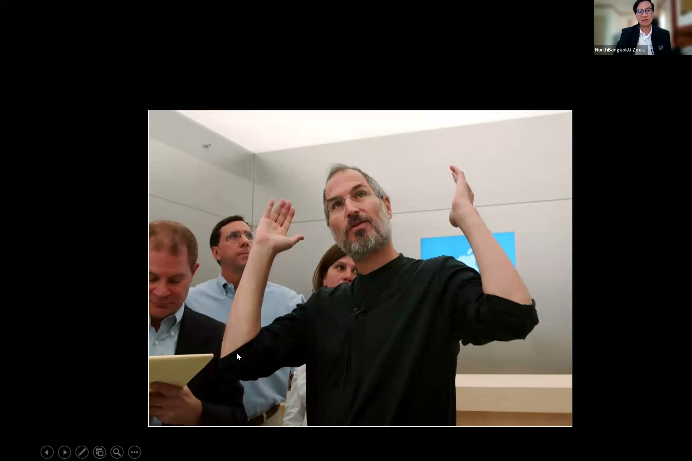

ไม่ได้ห้าคน แต่ห้าเงินในกระเป๋าตังค์ภรรยาเราได้ คนที่ดูดเงินจากกระเป๋าตังค์เราได้ มีใครไปจองหรือยังครับ iphone สิบแปด

## [00:22:36]
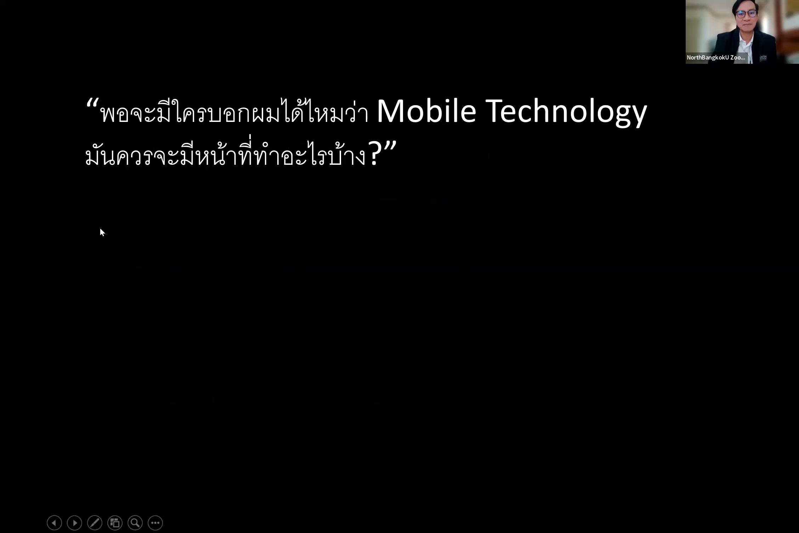

ยังไม่มีนะครับนักศึกษาอย่าให้เห็นถืออยู่นะครับนักศึกษา อย่ามาถือใกล้ใกล้ รอเพจค่ะอาจารย์ถึงจะคุ้ม อืมใช่ ต้องแลก ต้องเปลี่ยนรุ่น ต้องเปลี่ยนแล้วจะได้ส่วนลด ใช่ ตอนนี้ผมใช้ 14 Pro Max อยู่ เขาให้ราคาเท่าไหร่นะ แบบ 20,000 นะ มาดูคำนักศึกษาครับ มีคำพูดอยู่คำนึงที่นัก HR มักจะยกมาพูด

## [00:23:06]
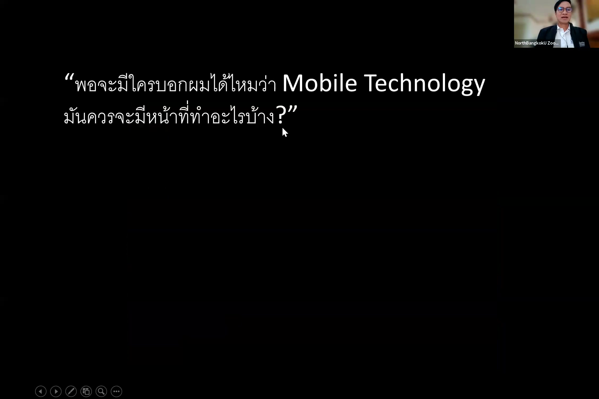

คำพูดของ Steve Jobs ครับ เขาจะถามพนักงานว่า พอจะมีใครบอกผมได้ไหมว่า Mobile Technology มันควรมีหน้าที่ทำอะไรได้บ้าง เขาถามในห้องประชุมเขา แล้วพนักงานที่ฟังอยู่ คนอื่นที่ฟังอยู่ในห้องประชุมก็ตอบว่ามันควรทำแบบนู้นได้ มันควรทำแบบนี้ได้ มันควรทำแบบนู้นได้นะครับ

## [00:23:36]
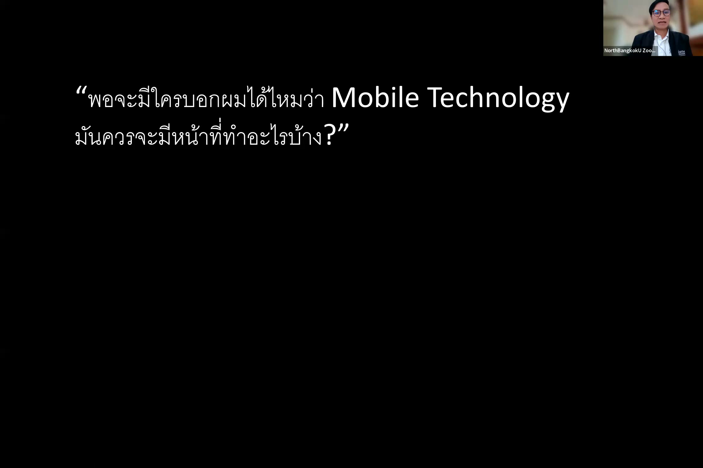

แต่สิ่งที่สตีฟจ๊อบเขาถามคำนี้เขาไม่ได้ต้องการคำตอบเหล่านั้นนะครับเขาไม่อยากรู้หรอกครับน้องสา เขาเลยสวนกลับไปเขาเลยตอบกลับไปว่าหลังจากพนักงานทุกคนเขียนมาแล้วว่าจะทำอะไรได้บ้างนะครับ เขาพูดกลับไปว่า แล้วทำไมมันถึงยังไม่ได้ทำแบบนั้นครับ นักศึกษาว่า พนักงานรู้สึกอย่างไร ถ้านักศึกษาเป็นพนักงานนักศึกษาจะรู้สึกอย่างไร ถ้าถูกตอบกลับไปว่า แล้วทำไมมันถึงยังไม่ได้ทำแบบนั้นครับ

## [00:24:06]
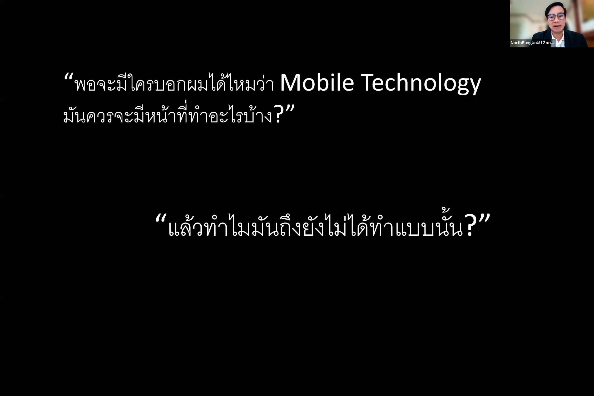

เหมือนเรายังทำได้ไม่ดีพออย่างนี้ไหมคะอาจารย์ เออ ใช่ ถ้าผมเป็นพนักงานนะ แล้วตอนแรกสตีฟ จ๊อบถามว่าโมบายเทคโนโลยีมันควรทำอะไรได้บ้าง แล้วผมก็จะตอบควรทำอย่างคุณได้อย่างนี้ได้ มันรู้สึกภูมิใจว่าที่เราตอบได้ แต่กลายเป็นว่าที่เราตอบไปมันไม่ใช่สิ่งที่ Steve Jobs เขาต้องการ เขาก็ถามกลับมาว่าเอาแล้วที่คุณตอบมาทำไมมันยังทำไม่ได้

## [00:24:36]

อือ แสดงว่ามันเป็นการบ้านแล้วมันคือการบ้านชิ้นใหญ่ที่เราต้องไปทำแล้วอะครับ นึกออกไหมครับเหมือนผมถาม ถ้าผมถามนักศึกษาว่าวันนี้ผมถามว่าโทรศัพท์มือถืออนาคต มันควรเป็นอย่างไรมันก็ต้องทำอะไรได้อีกน่ะนักศึกษาคำเนี้ยผมเคยถามย้อนกลับไปประมาณสักห้าปีสิบปีแล้วผมก็เคยถามนักศึกษาเรื่องนี้นะครับนักศึกษาก็ตอบมาแล้วเขาหัวเราะ เขาหัวเราะเพราะมันเป็นคำตอบที่ตลกในวันนั้นนะครับ

## [00:25:06]
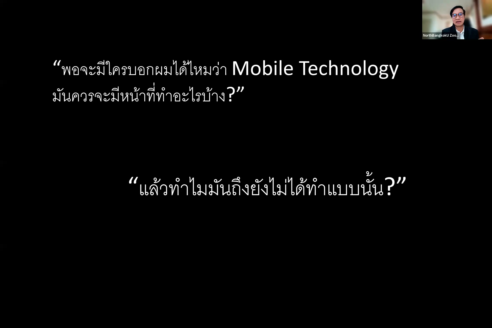

วันนี้ทำได้แล้ว คำตอบไหนที่มันตลกคำตอบนั้นแหละครับนักศึกษาเป็นคำตอบที่ดีทำไมรู้ไหม คำตอบที่ตลกคนหัวเราะแสดงว่าเป็นคำตอบที่มันแปลก แปลกมาก ๆ ใช่ มันแปลกมาก ๆ อะ จนคนหัวเราะอะครับนักศึกษาครับ ถ้าย้อนไปประมาณสัก 5 ปีที่แล้ว มีคนบอกว่าโทรศัพท์มือถืออนาคตข้างหน้าจะทำอะไรได้บ้าง มีนักศึกษายกมือตอบ อาจารย์ครับ มันจะจุดไฟแช็คได้ มันจะติดบุหรี่ได้

## [00:25:36]
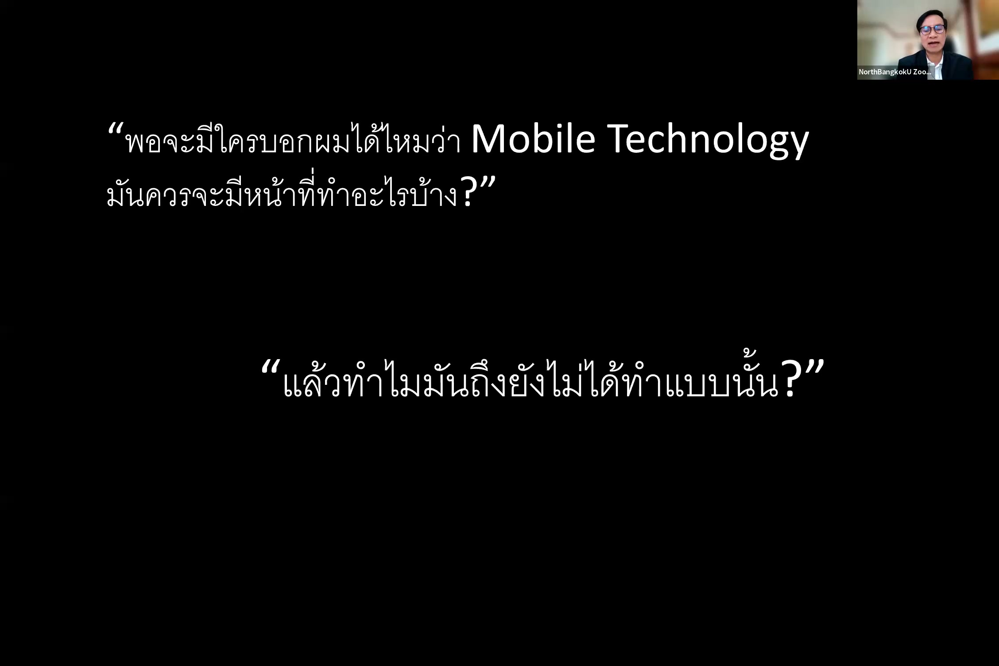

มันต่อบุหรี่ได้ครับอาจารย์จุดบุหรี่ได้ครับ นักศึกษามีคนตอบแล้วเพื่อนหัวเราะเขานะนักศึกษาเพื่อนหัวเราะเขา นักศึกษาว่าวันนี้โทรศัพท์มือถือจุดบุหรี่ได้ไหมครับ งง งงสิ นักศึกษาว่ามันโทรศัพท์มือถือจุดบุหรี่ได้ไหมครับอยากรู้ไหมครับ เซิร์ชดีครับ นักศึกษาเซิร์ชดีครับโทรศัพท์มือถือจุดบุหรี่ครับ มันจุดได้แล้วครับแต่ที่เขายังไม่ทำออกมาจริงจริงครับนักศึกษาเพราะอะไรรู้ไหมฮะ นักศึกษา

## [00:26:06]

นักศึกษารู้ไหมทำไมเขาไม่ทำออกมาจริงจริงไม่ทำออกมาขายจริงจริงนะครับโทรศัพท์มันไปถึงที่จุดบุรีได้ เอาหน้าจอเนี้ยนักศึกษาครับแล้วก็บุรีเนี้ยจี้ไปที่จุดจุดหนึ่ง เป็นระเบิดใช่ครับ มันเป็นอาวุธ ใช่ มันเป็นอาวุธ มันจะขึ้นเครื่องบินไม่ได้เลยนักศึกษาแล้วมันจะเข้าสถานที่ราชการไม่ได้ มันสามารถใช้เป็นจุดระเบิดได้ครับมันใช้เทคนิคอะไรนักศึกษา ประจุไฟฟ้า นักศึกษาลอง ทุกคนเสิร์ชนักศึกษาครับเสิร์ชเองนะ

## [00:26:36]
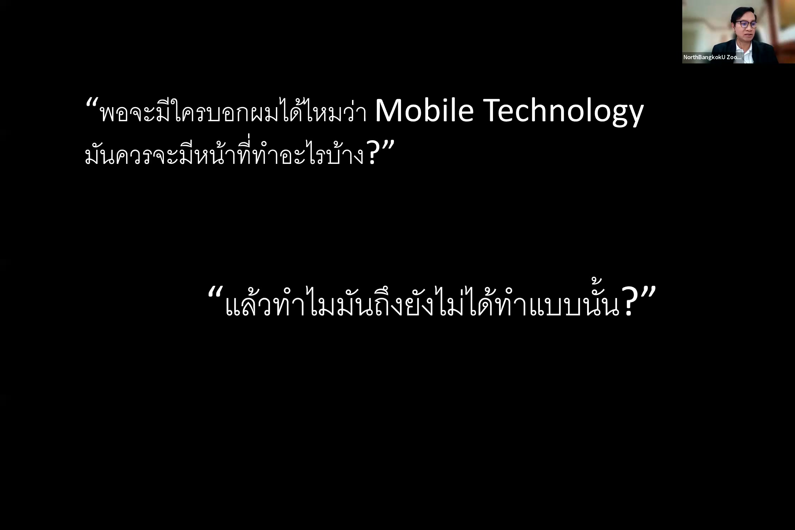

หรือจะให้ผมเสิร์ชในหน้าจอผมขี้เกียจสวิตช์จอ โทรศัพท์มือถือจุดบุหรี่ได้ครับโทรศัพท์มือถือจุดบุหรี่ได้ มันจะเป็นแอปพลิเคชันตัวหนึ่งที่ทำให้

## [00:27:06]

จุดนั้นมัน นี่ฮะ มันเป็นอุปกรณ์เสริมเข้ามานักศึกษา อ่ะ หวังว่าทุกคนคงเห็นแล้วนะนั่นแหละครับนักศึกษาครับ แต่มันเป็นอาวุธ มัน มันไม่ปลอดภัยต่อ

## [00:27:36]

ต่อสถานที่บางสถานที่นะฮะ ก็เลยยกเลิก แต่กลายเป็นว่าไอ้เด็กที่พูดเล่นวันนั้นนะฮะ วันนี้ทำได้จริงนะฮะ โทรศัพท์มันถือจุดบุหรี่ได้จริงๆ เพราะฉะนั้นถ้าวันนี้ผมถามอีกนะฮะ แล้ว คำตอบไหนตลกเดี๋ยวอีก 5 ปีข้างหน้าจะมีคนทำนะ สาธารณะ อะ โอเค เพราะฉะนั้นสตีฟ จอปป์เนี่ยเขาบอกว่าแล้วทำไมมันถึงยังทำไม่ได้ ก็คือเขากำลังกดดันลูกน้องอยู่ เพราะฉะนั้นวัฒนธรรมองค์กรที่สตีฟ จอปป์เขาเคยสร้างไว้เนี่ย มันเป็นวัฒนธรรมกรที่หลายคนรับไม่ได้นะครับ เพราะว่าสตีฟจ๊อบเขาจะรู้สึกว่าความคิดอยู่ในหัวเนี่ย มันจะไม่มีประโยชน์จนกว่าจะดึงมันมาใช้ให้เร็วที่สุดนะครับ

## [00:28:06]

เพราะฉะนั้นพนักงานทุกคนจะต้องทำงานหนัก คิดแล้วก็ทำ คิดแล้วก็ทำ ต่อให้เสีย ต่อให้พัง ต่อให้ ต่อให้โมเดลต้นแบบมันล้มเหลว เขาก็ยอม เพราะฉะนั้นสินค้าที่ Steve Jobs เวลาพนักงานทำออกมาแล้วแล้วมันไม่ดี เขาจะไม่ด่า เขาจะไม่ต่อว่า เขาจะไม่ตำหนิ ถ้าคุณเป็นพนักงาน

## [00:28:36]

คุณจะต้องอธิบายเหตุผลต่างๆ หากมีอะไรผิดพลาดนะครับ ต้องอธิบายเหตุผลนะ ถ้าเป็นพนักงานนะ แต่ถ้าเป็นผู้บริหารรับสูง คุณจะไม่ต้องทำอย่างนั้น ณ จุด ๆ หนึ่ง เหตุผลก็ไม่จำเป็นอีกต่อไป นักศึกษาครับ หัวหน้าแบบนี้ นักศึกษารู้สึกยังไงบ้าง Steve Jobs เขาเป็นแบบนี้นะครับ เขาบอกว่าบางทีเขาขี้เกียจอธิบาย เขาขี้เกียจเพราะสิ่งที่เขาอธิบายเนี่ยพนักงานอาจจะนึกไม่ถึง ไม่เข้าใจ และไม่คิดว่ามันจะเป็นไปได้เขาก็เลยว่า งั้นได้ไม่อธิบายดีกว่า ขี้เกียจ

## [00:29:06]

เพราะฉะนั้นคุณแค่ทำตามก็พอ นั่นแหละครับ เพราะฉะนั้นประโยคนี้เลยครับ ณ จุด ๆ หนึ่ง หมายถึง ณ วันที่คุณอยู่จุดที่สูงที่สุด เหตุผลก็ไม่จำเป็นอีกต่อไป นี่แหละว่าทางมังกรของติ๊กจ๊อบตอนนั้นนะครับ คุณทิมคุกตอนนั้นเป็นลูกน้องนะครับ เป็นมือขวาของสตีฟจ๊อบ เป็นผู้ซีอีโอคนหนึ่งนะครับ พอสตีฟจ๊อบเขาเสียชีวิตไปนะครับ ทิมคุกขึ้นมาเนี่ย คือเขาพยายามเปลี่ยนหลายอย่าง เขาพยายามเปลี่ยนหลายอย่างนะครับ โอเค ตามกันนะครับ

## [00:29:36]

## [00:29:42]

มาดูสินค้าเสีย ผลิตภัณฑ์ที่ออกมาแล้วมันเจ๊ง ล้มเหลว ของ Steve Jobs มีอะไรบ้าง เยอะนะ เยอะมาก ตัวแรกครับ Apple Tree

## [00:29:51]

Apple Tree ก็คือออกมาก็ขายไม่ได้นะครับ แพ้ IBM ต่อไป Lisa คอมพิวเตอร์มันก็เจ๊งนะครับ Next Computer ปี 89 ก็เจ๊ง เม้าส์ ผลิตเม้าส์มาปี 1998 ก็เจ๊งนะครับ

## [00:29:55]

## [00:29:58]

## [00:30:01]

## [00:30:06]

ปีสองพันครับนักศึกษาครับ ก็คือซีพียูอ่ะซีพียูนะครับ เจ๊งเหมือนกันนักศึกษาครับต่อไปไอจูนของไอจูน ไอจูนก็คือของไอโฟนเนี้ยไปรวมร่วมมือกับโมโตรล่า

## [00:30:13]

ทำเป็นเป็นโทรศัพท์ที่เป็นฟังเพลงได้ไอจูน่ะ ก็เจ๊งทั้งคู่น่ะครับโบโทรล่าก็เจ๊งไปด้วย แอปเปิ้ลทีวี แอปเปิ้ลทีวีโทรทัศน์นะครับ แอปเปิ้ลโทรทัศน์ปีสองพันเจ็ดก็เจ๊งน่ะครับ

## [00:30:28]

## [00:30:34]

หมายถึงวัฒนธรรมองค์กร สินค้าที่เจ๊งของแอปเปิลเยอะมาก แต่สตีฟจอร์กเขาบอกไม่เป็นไร มันต้องดีสักอันหนึ่ง เพราะฉะนั้น เจ๊งสัก 10 อัน ดี 1 อัน ก็โอเค สำเร็จแล้วนักศึกษาครับ ต่อไป นักศึกษาหัวข้อสุดท้ายครับ หัวข้อนี้ครับ

## [00:30:50]

กรอบแนวคิดด้านวัฒนธรรมองค์กรของ โอยูชิ ด้านนี้นะครับ อันนี้ออกสอบหน่อยนะครับ ออกสอบนิดนึงนะครับ ไปอ่านเยอะ ๆ เลยนะครับ กรอบแนวคิดด้านวัฒนธรรมองค์กร โอยูชินะครับ เขาเป็นคนญี่ปุ่น แต่ไปทำงานที่อเมริกา เขาก็เลยได้วัฒนธรรมองค์กรสองอย่าง สองที่เลยครับ อเมริกาด้วย ญี่ปุ่นด้วย แล้วเขารู้สึกว่ามันมีข้อแตกต่าง มันมีความแตกต่าง วัฒนธรรมองค์กรของญี่ปุ่นกับอเมริกามีความแตกต่าง และเขาก็เลยดึงเอาข้อดีของญี่ปุ่นและข้อดีของอเมริกามารวมกัน กลายเป็นวัฒนธรรมองค์กรที่อยู่ตรงกลาง ก็เลยเรียกว่าทฤษฎีซี วัฒนธรรมองค์กรแบบ Z

## [00:31:20]

## [00:31:28]

นั่นแหละครับ นักศึกษาดูบนมอนิเตอร์นักศึกษาครับ องค์กรกระทำของอเมริกาเนี่ย อเมริกาตัว A ตัวแรกใช่ไหม ภาษาอังกฤษตัว A เขาเรียก A Type A รูปแบบ A นักศึกษา แต่พอ J ก็เรียกว่า Type J เขาทำองค์กรแบบ J-PAN นักศึกษาตัว J เอาข้อ D ของ A ข้อ D ของ J มารวมกันกลายเป็น C C คือตัว Z นะครับ เป็นวงการแบบ C บนมอนิเตอร์เลยครับ ท้าย J ท้าย A แล้วก็ท้าย C ท้าย Z มาดูวัฒนธรรมองค์ก่อนของ Japan ก่อนครับนักศึกษา โดยดูจากความผูกพันต่อพนักงานก่อน

## [00:31:58]

ปัจจัยตั้งความผูกพันก่อน ที่ญี่ปุ่นจะเน้นความผูกพัน จ้างงานตลอดชีวิต ใครทำงานกับญี่ปุ่น บริษัทไหนอยู่ยาวอย่างเกษียณ แต่อเมริกาจะไม่ แตกต่าง อเมริกาจะจ้างระยะสั้น จบโปรเจกต์บางทีก็เปลี่ยนเลยนักศึกษา แล้วพนักงานก็ไม่แคร์ด้วยนักศึกษา ออกก็หางานใหม่แบบนี้นักศึกษา ไม่มีความผูกพันกับองค์กรนั่นเองครับ ส่วนไทยแซทก็เลือกเอาที่ดีมา นักศึกษาคิดว่าอันไหนดีครับ ระหว่างจ้างเงินตลอดชีวิตกับระยะสั้น อันไหนดี คิดว่าดีไหม จ้างเงินตลอดชีวิต มีข้อดีไหม มีครับ ข้อเสียมีไหม มี ระยะสั้นก็ข้อดี มีข้อเสียมี นักศึกษาเขาก็เลยบอก อัน ระยะยาวนักศึกษา ไม่ถึงกับตลอดชีวิตครับ แต่เป็นระยะยาว

## [00:32:28]

ระยะปานกลางถึงยาวก็หลัก 5 ปีขึ้นไป 7 ปี 8 ปี 10 ปี ถือว่าระยะยาว แต่ไม่ถึงกับจ้างตลอดชีวิตนะ ต่อไปการประเมินงาน เวลาประเมินผลงาน Type J ประเมินเป็นทีม ดูงานระยะยาว ประเมินทั้งกลุ่ม ประเมินทุกคน

## [00:32:58]

เวลาที่อเมริกานักศึกษาครับเขาจะประเมินตามผลงาน ประเมินตามผลงานไม่ได้ประเมินดูระยะยาวนักศึกษาครับ พอ Job นี้เสร็จประเมินเลยครับนักศึกษาครับพอ Type Z ก็คือเอาประเมินระยะกลางแล้วกันนะ ต่อไปเส้นทางอาชีพครับ career path ที่เขาชอบพูดกัน นัก HR ชอบพูดเส้นทางอาชีพ ถ้าเป็นที่ญี่ปุ่นจะย้ายตำแหน่งได้หลากหลาย เพราะว่าเขาจ้างงานตลอดชีวิต เขากลัวพนักงานเบื่อ ก็เลยจะ Rotate วนไปเรื่อย ๆ

## [00:33:28]

แต่ที่อเมริกาไม่ เก่งอะไรก็ทำอันนั้นแหละ ทำไปเลย ทำจนคนจะเบื่อก็ลากออกไปเองนะครับ จะย้ายตำแหน่งเฉพาะด้านเท่านั้นนะครับ ฉะนั้นข้อดีข้อเสียของอเมริกากับญี่ปุ่นก็เลยถูกรวมว่าย้ายตำแหน่งตามความสามารถครับ ดูความสามารถแล้วก็ย้ายไป ถ้าคุณดูความสามารถคุณเปลี่ยนแปลงไป คุณไปพัฒนาตัวเองไป Hard Skills Soft Skills แล้วคุณมีความสามารถอื่นก็คุณสามารถย้ายตำแหน่งได้

## [00:33:58]

ต่อไปการตัดสินใจครับ ที่ญี่ปุ่นนี่จะทำโดยกลุ่ม ตัดสินใจโดยกลุ่ม แต่อเมริกาเนี่ยโดยบุคคลครับ คนเดียวตัดสินใจได้เลยครับ ข้อดีก็คือดึงเอาแบบกลุ่มมาใช้เป็น Type C ครับ ต่อไปเรื่องความรับผิดชอบครับ ญี่ปุ่นรับผิดชอบโดยกลุ่ม อเมริการับผิดชอบโดยคนเดียว บุคคลคนรับผิดชอบโดยคนเดียว ส่วนไทย C ก็คือรับผิดชอบโดยบุคคล ไทย Z ทำไมคิดว่ารับผิดชอบโดยบุคคลดีกว่า ไม่ใช่รับผิดชอบเพราะเป็นทีม

## [00:34:28]

ก็คือคนที่ทำหน้าที่รับผิดชอบใครเป็นผู้รับผิดชอบก็หัวหน้าหรืออะไรก็รับผิดชอบไปนะครับต่อไปการดูแลพนักงานครับ การดูแลพนักงาน ถ้าเป็นญี่ปุ่นจะเอาใจใส่ทุกเรื่องนะครับ ไม่ว่าจะเป็นเรื่อง work-life balance ของพนักงานด้วย ต้องดูทุกเรื่อง แต่อเมริกาไม่สนใจ เอาเฉพาะงานอย่างเดียวครับ คุณจะเป็นไงอะไรไม่สนขอให้งานดูที่งานอย่างเดียว ท้ายซีก็เลยเอาข้อดีของเอาใจใส่ทุกเรื่องมาใช้ดีกว่าครับนั่นแหละนั่นแหละนักศึกษาครับ

## [00:34:58]

โอเคนักศึกษาครับ เพราะฉะนั้นตรงนี้นักศึกษาไปศึกษาเพิ่มเติมนะ อาจารย์มีตัวอย่างมาให้ดูครับนักศึกษา ให้นักศึกษาดูภาพนี้ครับ ทุกคนเคยดูการ์ตูนเรื่องโดเรมอนนะ คุณรู้หรือไม่ว่าพ่อของโดมีตะเนี่ยมีรายได้ถึงปีละ

## [00:35:11]

หนึ่งล้านเจ็ดแสนแปดหมื่นเลยนะครับหนึ่งล้านบาทนะ หนึ่งล้านเจ็ดนะครับนักศึกษาครับ ลองหาดีเดือนเท่าไหร่นักศึกษาครับพ่อโดมิตะนะ เห็นอย่างนั้นแหละนักศึกษา เห็นมึน ๆ แบบนั้นแหละนักศึกษาครับ แล้วทำงานเหมือนจะไม่ใช่เป็นผู้บริหารอะไรเลยนะครับ เป็นพนักงานคนหนึ่งนะครับ แต่เขาเหมือนที่บอกจ้างงานตลอดชีวิต เขาทำงานบริษัทนี้มานานก็ขึ้นทุกปีนะครับ 1,780,000 หาร 12

## [00:35:41]

เดือนละแสนสี่ หนึ่งแสนสี่หมื่นแปดพันนี่ก็เดือนพ่อรวิตะ รถยนต์แทบจะไม่เคยเห็นเขาขับ เขาจะเดินไปทำงาน แล้วก็ไปขึ้นรถไฟฟ้าอะไรของเขาไป อันนี้วัฒนธรรมกรของญี่ปุ่นถ่ายทอดโดยการ์ตูน ให้เห็นชัด ๆ เลยว่าทำงานหนักมาก เวลากลับมาเขาก็ต้องการการพักผ่อนเต็มที่ บางทีในการ์ตูนจะเห็นเขานั่งสูบบุหรี่กินเบียร์ แสดงให้เห็นว่าคนญี่ปุ่นเวลาทำงานหนักกลับมาบ้าน ต้องได้รับการพักผ่อน ได้รับการดูแลจากแม่บ้านอย่างเต็มที่

## [00:36:11]

## [00:36:14]

## [00:36:23]

ต่อไปหัวข้อนี้ ประเภทของการปรับของวัฒนธรรมองค์กร วัฒนธรรมองค์กรมีอย่างเช่น ประเภทของวัฒนธรรมองค์กร ประเภทแรก เป็นวัฒนธรรมองค์กรแบบ Adaptive Adaptive ก็คือปรับตัว วัฒนธรรมองค์กรแบบปรับได้ครับ เกิดขึ้นจากการที่ผู้นำเชิงกลยุทธ์เกิดขึ้นจากผู้นำถ้ามีการเปลี่ยนแปลงนะครับ สภาพแวดล้อมมีการเปลี่ยนแปลงจากภายนอกก็สามารถปรับได้ พนักงานองค์กรจึงได้รับความอิสระในการตัดสินใจเองและพร้อมลงมือปฏิบัติได้ทันที ผู้นำมีบทบาทสำคัญต่อการสร้างความเปลี่ยนแปลงให้เกิดขึ้น

## [00:36:53]

อันนี้เป็นพระมงกรที่สามารถเปลี่ยนแปลงได้ตามผู้นำ ตามสถานการณ์ แล้วก็ผู้นำเป็นผู้ที่เปลี่ยนแปลงก่อน อันนี้ปรับตัว อันนี้ออกสอบเน้น

## [00:37:18]

ต่อไปก็ทำองค์กรแบบมุ่งผลสำเร็จครับ มุ่งผลสำเร็จ คือมีเสร็จทันที่ชัดเจนของเป้าหมาย เป้าหมายชัดเจนว่าต้องการสำเร็จแบบไหน แล้วผู้นำเนี่ยมุ่งผลสำเร็จตามเป้าหมาย เช่น ดูตัวเลขเป็นหลัก ดูยอด ดูส่วนแบ่งตลาดเป็นหลักนะครับ มุ่งให้บริการลูกค้าพิเศษเฉพาะกลุ่มในภาวะแวดล้อมภายนอกแต่ไม่เห็นความจำเป็นที่ต้องมีความยืดหยุ่นและเปลี่ยนแปลงอย่างรวดเร็ว คือเน้นความสำเร็จแต่ไม่มีการเปลี่ยนแปลงนะครับไม่เน้นนะครับ เน้นค่านิยมแบบแข่งขันเชิงรุก ความสามารถริเริ่มของบุคคล มีการพึงพอใจต่อการทำงานหนักในระยะยาวจนบรรลุเป้าหมาย สุดท้ายครับ เรียกว่าทำแบบเครือญาติ ให้ความสำคัญกับการมีส่วนร่วมของพนักงาน

## [00:37:48]

## [00:37:53]

เน้นความต้องการของพนักงานเป็นหลักก็คือดูแลเหมือนญาติ ดูแลเหมือนพี่น้อง เอาใจใส่ เอื้ออาทร สามแบบ แบบสุดท้ายเป็นแบบราชการ แบบราชการมุ่งเน้นวิธีการ มีระเบียบ ยึดความเป็นระเบียบ 4 ข้อนะครับ

## [00:38:22]

## [00:38:28]

## [00:38:36]

