# 02-พฤติกรรมกลุ่ม ep1

_[?] = ช่วงที่ระบบถอดเสียงไม่มั่นใจ ควรเทียบกับวิดีโอ_

## [00:00:00]
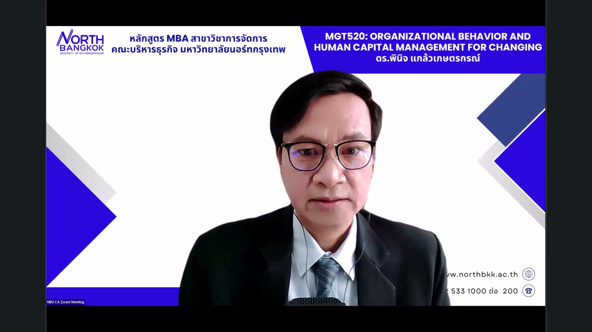

สวัสดีครับ ยินดีต้อนรับเข้าสู่ห้องเรียนออนไลน์ครับ สาขาวิชาการจัดการ MBA หลักสูตรเปรียโทนะครับ วิชานี้คือวิชา MGT520 พฤติกรรมองค์การนะครับ แต่ชื่อเต็มยาวหน่อยครับ พฤติกรรมองค์การเนี่ยมันชื่อเต็มว่า Organizational Behavior and Human Capital Management for Change ก็คือ [?] พฤติกรรมองค์กรแล้วก็ทุนมนุษย์สำหรับเพื่อการเปลี่ยนแปลงนั่นแหละครับนักศึกษาแต่หลักใหญ่ใจความวิชานี้ก็คือวิชาพฤติกรรมองค์กรครับเราเรียกย่อยๆว่า OB ครับที่เราเรียนกันมาเนี่ยสรุปโครงร่างโครงสร้างของวิชานี้นะครับโครงสร้างวิชานี้เนี่ยมันประกอบไปด้วยพฤติกรรมของระดับบุคคลแล้วก็

## [00:00:30]
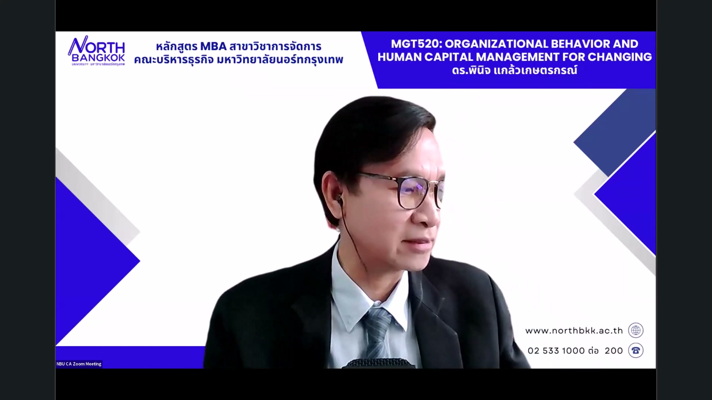

[?] เราเรียนกันไปหนักๆช่วงแรกๆในนักศึกษาก่อนสอบกลางภาคเนี่ยจะเป็นพฤติกรรมบุคคลส่วนใหญ่เลยครับนักศึกษาพฤติกรรมบุคคลนะครับพฤติกรรมบุคคลก็คือเรียนรู้เกี่ยวกับอะไรบ้างนักศึกษาเกี่ยวกับเรื่องสมรรถนะเรื่องทุนมนุษย์เรื่องความแตกต่างของคุณนักศึกษาส่วนบุคคลนั่นคือ

## [00:01:00]
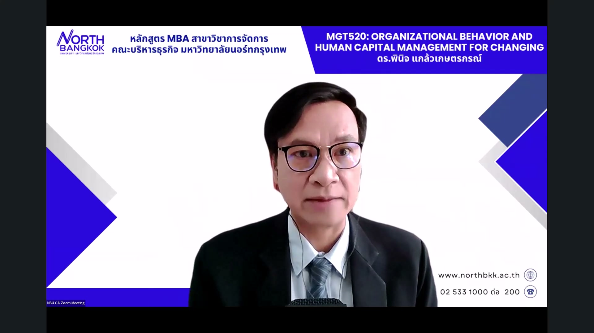

[?] ทั้งหมดที่เรียนช่วงต้นซึ่งเยอะหน่อยนักศึกษามันหนักหน่อยเพราะว่าพฤติกรรมบุคคลนั่นแหละครับเป็นจุดเริ่มต้น พอพฤติกรรมบุคคลเราเข้าใจพฤติกรรมบุคคลแล้วมันก็เมื่อเมื่อบุคคลเหล่านั้นมันรวมตัวกันเป็นกลุ่ม มันก็จะจะทำให้เราวิเคราะห์ได้ไม่ยากนักศึกษาว่าเกิดอะไรขึ้นในใ

## [00:01:30]

[?] ให้ดูแชร์หน้าจอแล้วกันนะ เรื่องที่จะเรียนต่อในวันนี้ครับ โอเคครับ ทุกคนเห็นหน้าจอแล้วนะ จริงๆผมอยากเฉลย อยากวิเคราะห์ ร่วมกันวิเคราะห์ ที่สอบเมื่อสัปดาห์ที่แล้วผมอยากฟัง คือเขียนคำตอบลงไปในกระดาษ กับมาวิเคราะห์กัน มา Discuss กัน

## [00:01:52]
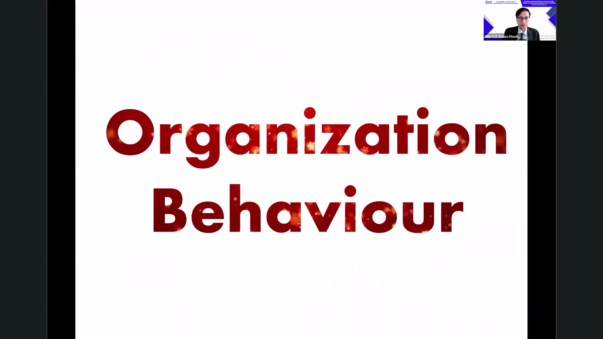

[?] ถกเถียงกันนะครับมาถกเถียงแบบสร้างสรรค์กันน่ะมันมันจะสนุกกว่านักศึกษามันจะสนุกกว่า อย่างเช่นเอาตัวอย่างง่ายง่ายเลยครับโอเคคนไม่สอบก็ยังไม่สอบก็ก็แล้วแต่ละกันยังไงข้อสอบผมเปลี่ยนอยู่แล้วครับนักศึกษาครับข้อสอบเปลี่ยนแน่นอนอยู่แล้ว อย่างเช่นข้อแรกนะครับผมให้ดูข้อแรกข้อ

## [00:02:22]
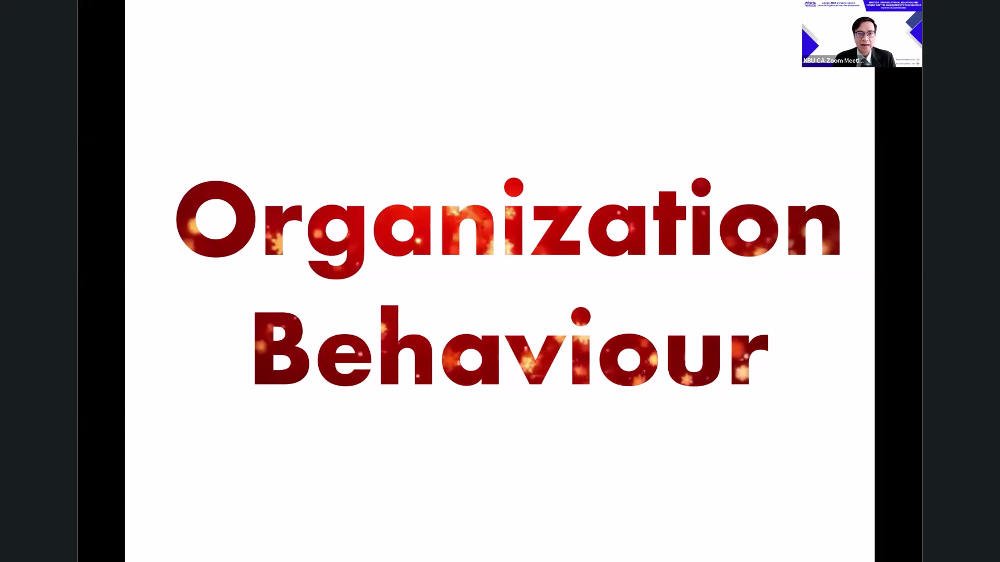

ลืมลืมหมดแล้วอธิบายทำนายควบคุมนะคะ เรื่องราวเป็นไงเหตุการณ์เหตุการณ์เป็นไงมันเกิดเรื่องปวดหัวอะไรขึ้นในในในกรณีศึกษา 6 บรรทัด มีโรงงานทำผลไม้กระป๋องที่ทำผิดสูตรอ่ะค่ะก็เลยเอา

## [00:02:52]
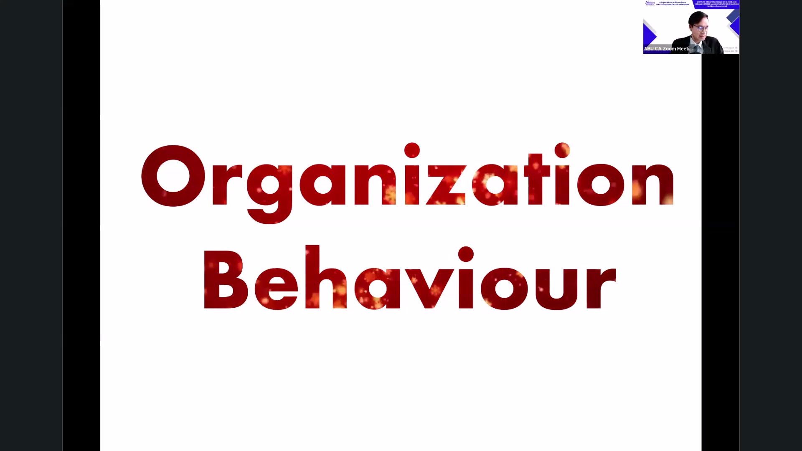

อ่าตัวผิดสูตรไปขายให้พนักงานในราคาที่ถูกกว่าอ่าทางตลาดแล้วคือมีคนนึงเขาเหมาไปหมดเพื่อที่จะแบบว่าเอาไปให้พวกญาติอะไรอย่างงี้แต่จริงจริงแล้วใครอ่ะใครใครเหมาไป [?] สมหนูจำไม่ได้หน้าที่เขาตำแหน่งตำแหน่งเขา เขาเป็นผู้จัดการเป็นผู้จัดการเลยนะครับระดับผู้จัดการเลยนะครับ อืม ใช่เขาก็เหมาไปหมดแล้วก็เอาไปใช้โดยใช้รถของบริษัทว่าจะเอาไปให้ญาติ อ่า เราก็ใช้รถใช้รถของของบริษัทด้วยใช้รถของบริษัทด้วยนะครับ ใช่ค่ะใช่ใช้รถของ เออ นั่นแหละดี เออ นี่นี่ถ้าอยู่ในห้องนะ

## [00:03:22]
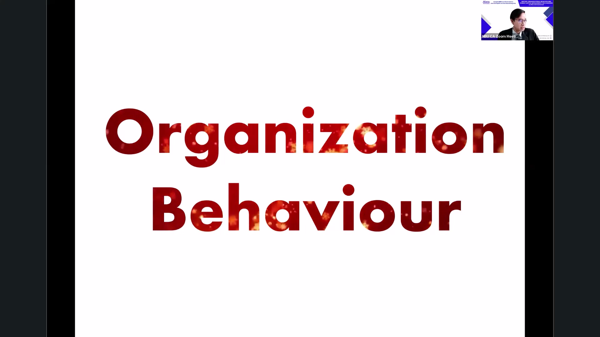

[?] ทำให้เกิดความแตกแยกอ่ะครับนักศึกษาแตกแยกอย่างสร้างสรรค์นะ เราวิเคราะห์กันแตกแยกอย่างสร้างสรรค์มันจะกลายเป็น เกิด เอ่อความความคิดเห็นได้แตกต่างทันทีนักศึกษาเรื่องเนี้ย ว่าตกลงไอ้ไอ้สมเจตน์เนี้ยคุณสมเจตน์เขาทำถูกเปล่านะครับ น่าสนใจนะครับเรื่องนี้แล้วมันเป็นเรื่องจริงที่เก

## [00:03:52]
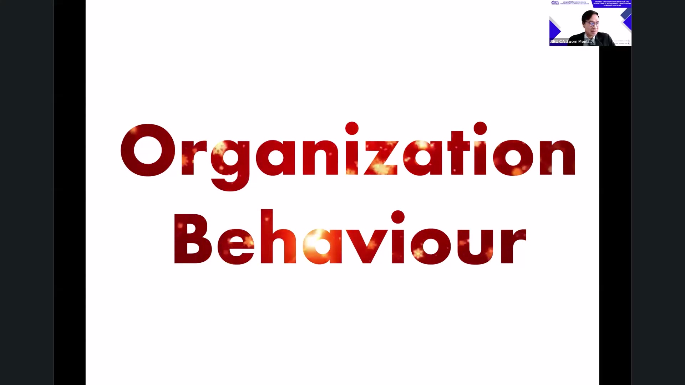

[?] ก็หลายมุมมองครับนักศึกษาครับสิ่งของวางอยู่ตรงหน้านะครับ แต่คนมองด้านข้างก็มองอีกแบบหนึ่งคนมองด้านหน้าก็มองเห็นอีกสีหนึ่งนะครับ คนมองด้านหลังก็เห็นอีกสีหนึ่งแต่สุดท้ายแล้วไม่ว่าคุณมองด้านไหนก็ตามนะครับ มัน มันจะต้องวิเคราะห์ให้ได้นะครับด้วยเหตุและผล เอ่อ ใช้คำ คำนี้ครับนักศึกษา

## [00:04:22]
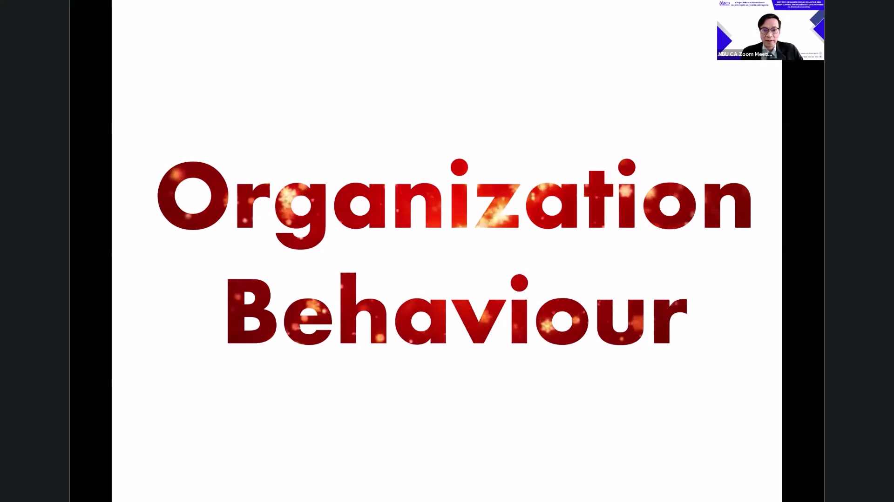

[?] เดี๋ยวหลับก่อนนะครับเขาเรียกว่า management by objective mbo นักศึกษาครับไม่รู้ใครเคยได้ยินคำนี้หรือเปล่าเนอะเด็กการจัดการเคยได้ยินไหมถ้าไม่เคยได้ยินทุกคนพร้อมกันหมดครับนักศึกษาครับเราเราอยู่จุดเดียวกันนักศึกษาเราเรียกว่า mbo นักศึกษาครับ management by objective

## [00:04:52]

[?] ตัวภาษาอังกฤษด้านหน้าก็เอามารวมกันนักศึกษาครับ mbo พูดสั้นๆเลยนักศึกษาครับ เป็นวิธีการบริหารจัดการโดยไม่สนใจครับมองวัตถุประสงค์เป็นหลัก มองวัตถุประสงค์เป็นหลักครับนักศึกษาครับแต่เราไม่สนใจกระบวนการ ไม่สนใจ process ไม่สนใจ ส่วนใหญ่แล้วเนี่ยผู้บริหารระดับสูงเนี่ยเข

## [00:05:22]

[?] ถ้าสำเร็จตามทรัพย์ส่งก็ก็พอแค่นั้นน่ะศาสตร์ครับ นั่นแหละเขาเรียก mbo made by objective น่ะศาสตร์ครับ แต่ถ้าหากว่า เรา อยากไปซื้อซิมล่ะ เน็ตใช้ไม่ได้แล้วล่ะ เน็ตใช้ไม่ได้หรอครับ โอเค ไม่เป็นไร ไม่เป็นไร เน็ตใช้ไม่ได้ครับ อยากซื้อซิมเลย โอ้โห น่ะศาสตร์ อะ หนูไปดูคลิปย้อนหลังเอาก็ได้นะ โ

## [00:05:52]
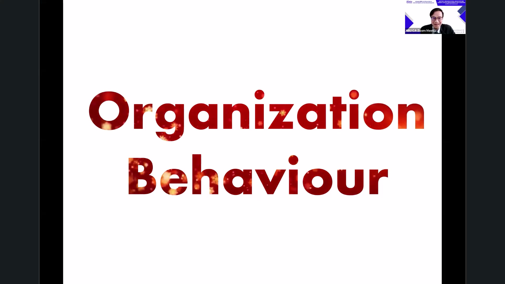

[?] สะดวกเดินทางมาฟังก็ก็เดินทางมาก็อยากเป็นแบบนี้จริงจริงนะแต่ในเมื่อทางทางหลักสูตรเขาออกแบบมาให้สลับออนไซต์ออนไทยออนไลน์นะศาสตร์ก็ก็ต้องทำตามนั้นนะศาสตร์ครับตอนเนี้ยผมไม่ได้สอนในห้องใหญ่นะศาสตร์นึกภาพนะถ้าห้องใหญ่เปิดแอร์สองตัวเปิดไฟล์เปิดอะไรหมดแล้วนั่งกันอยู่สองคนอย่างเงี้ยนะศ [?] มันมีปัญหาในอนาคตศาสตร์แต่แต่ก็ก็เลยก็เลยผมมาสอนในห้องอนาคตศาสตร์ในห้องในห้องทำงานผมเองนะครับอ่ะ management by objective ครับเราไม่สนใจว่า process เป็นยังไงแต่เราสนใจวัตถุประสงค์เป็นหลักถ้า output ไม่ใช่ output ล่ะอนาคตศาสตร์เป็น outcome ล่ะ outcome ผลลัพธ์อ่ะถ้ามันออกมาเป็นไปตามวัตถุประสงค์อนาคตศาสตร์ก็จบเราเรียกว่า

## [00:06:22]
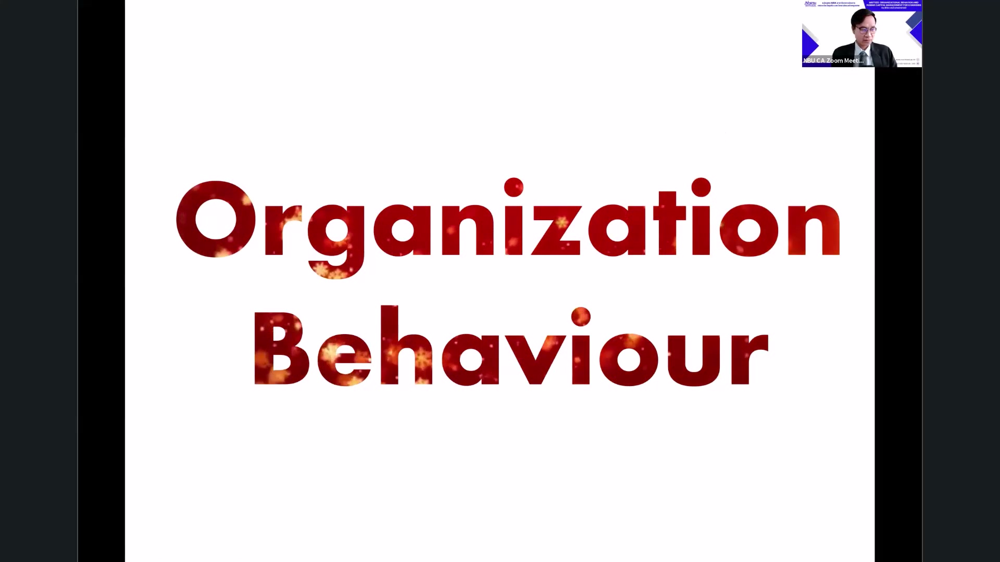

[?] เพราะฉะนั้นเรื่องเนี้ยนักศึกษาครับถ้าเราถ้าเรายังไม่ไม่ผมไม่อยากให้นักศึกษาไปสนใจเรื่องวัตถุประสงค์ก่อนนะให้นักศึกษาวิเคราะห์ตามมุมมองตัวเองก่อนจะสนุกกว่านักศึกษาครับอ่านักศึกษาว่าคุณสมเจ็จทำผิดไหมนักศึกษาครับมีใครว่าคุณสมเจ็จทำผิดแชทมานักศึกษาครับกดหนึ

## [00:06:52]
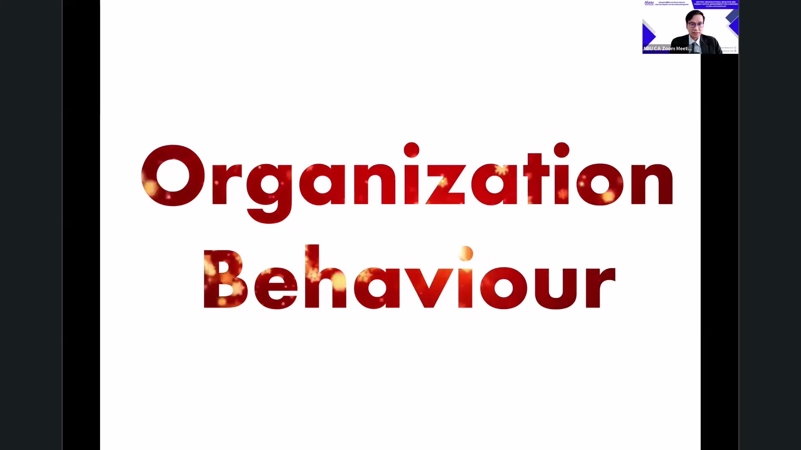

## [00:07:22]
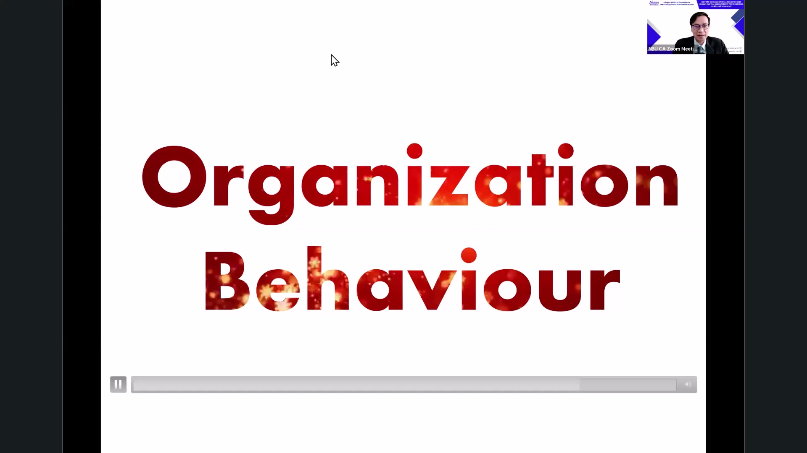

[?] นัชยาวีครับ ผิด ผมได้ยินเสียงเลยนะครับ เลขหนึ่งคำเดียว แต่ฟังน้ำเสียงออกว่าผิดชัดเจนเลยครับ นัชยาวีเลขหนึ่งตัวเดียวนี่แหละ มีสองครับ มีคนตอบสองครับ ไปดูในแชทนะครับว่าใครตอบนะครับ มีแย้งนะครับ ผมไม่อยากบอกชื่อเพราะว่าหนึ่งเยอะกว่านะครับ หนึ่งเยอะกว่า นัชยาวีบอกว่า [?] ไม่ผิดนะครับ เดี๋ยวเราฟังเหตุผลกันครับนักศึกษาครับ มีอรูณี อรูณีก็บอกผิดค่านะครับ เสียงมั่นใจมากนะครับ เลขหนึ่งตัวเดียวอธิบายเสียงได้นักศึกษาครับ ผิดค่าเลยนักศึกษาครับ โอเค มีอีกมั้ยครับถ้าใครคิดว่าคุณสมเจตน์เนี่ย เรื่องราวมันมีอยู่ว่า อันนี้ผมจะบอกเรื่องอีกที

## [00:07:52]

[?] เป็นซื้อไปขายรถใหญ่อย่างเงี้ยนะครับเป็นอันเนี้ยเป็นโรงงานผลิตผลไม้กระป๋องเขาก็เลยผลิตให้ลูกค้าคนนั้นไปผิดสูตรครับ ลูกค้าตีกลับครับตามสัญญายังไงก็ต้องตีกลับครับเขาไม่รับเขาไม่รับของ ทางโรงงานเนี้ยก็จึงเก็บสินค้านั้นไว้รอการสั่งซื้อจากลูกค้ารายอื่นเผื่อลูกค้ารายอื่นมีสั่งสูตร

## [00:08:22]
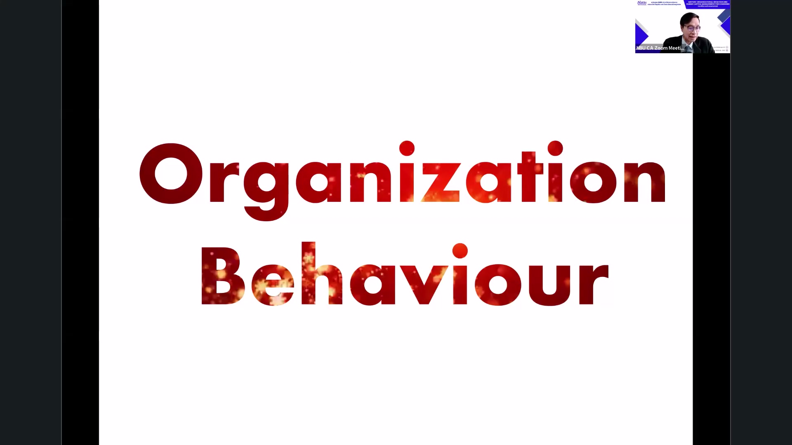

[?] ก็เลยเอางี้ดีกว่านำมาขายให้พนักงานราคาทุน มีบวกค่าดำเนินการนิดหน่อยด้วยนะครับ อาจจะทุนเป๊ะก็ไม่ได้เนาะ ทำไมอ่ะ มีบวกกำไรนิดหน่อยด้วยนะครับ ถ้ามองในแง่ผู้ประกอบการผมเชื่อว่าเรื่องปกติครับ เรื่องปกติบวกนิดหน่อยครับ ถือเป็นแนวทางปฏิบัติมาตลอดนะครับ อันนี้เน้นนะ

## [00:08:52]

[?] เอามาขายให้พนักงานบวกทุนนิดหน่อยบวกกำไรนิดหน่อยนักศึกษาเป็นแนวทางปฏิบัติปกติที่ทำมาตลอดครับ เนื่องจากมีจำนวนมากนะพนักงานเนื่องจากมีจำนวนมาก สินค้ามีจำนวนมากพนักงานซื้อไม่หมดครับคุณสมเจตน์ผู้จัดการก็มาเลยครับนักศึกษาตัวสำคัญของเราครับ ผู้จัดการโรงงานก็เลยขอเหมาที่เหลือทั้งหมด

## [00:09:22]

[?] ขีดเส้นใต้ตรงนี้นะครับผมเห็นคนหลายคนนะครับมีนักศึกษาหลายคนไฮไลท์ตรงนี้เลยนักศึกษาไฮไลท์ตรงว่านำรถบรรทุกของบริษัทไปขนนะครับต่อมามีพนักงานในบริษัทเห็นผลไม้กระป๋องนั้นวางขายอยู่ในตลาดนัดนักศึกษาครับเดินตลาดนัดตอนเย็นกันไหมล่ะก็ไปเจอให้นี่มันผลไม้กระป๋องของของ

## [00:09:52]
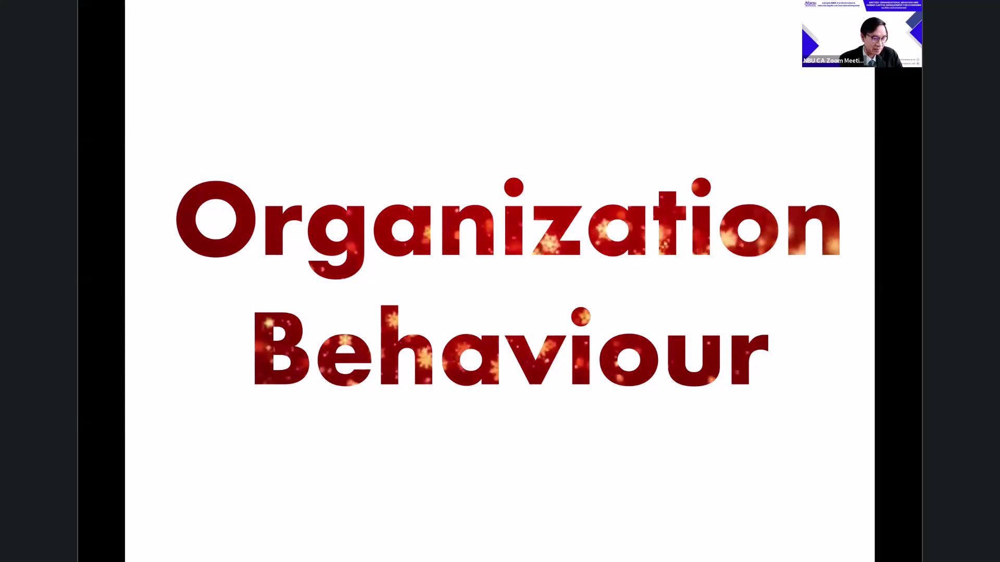

[?] ขี้ฟองนะฮะ ซื้อมากระป๋องนึงด้วยนะฮะซื้อติดมือมาด้วยเป็นหลักฐานกลัวผู้บริหารนะ กลัวผู้บริหารไม่เชื่อนะครับซื้อติดมาด้วยครับ แล้วก็ถ่ายคลิปวิดีโอด้วยนะตอนที่ซื้อนะฮะ อันนี้ยาวไป ผมก็เลยตัดออกนะครับพอคิดว่าสิ่งที่คุณสมเด็จทำอาจเป็นเรื่องที่ผิดกฎระเบียบ [?] น่ะเรื่องมีแค่นั้นน่ะสาหรับจบแค่นั้นน่ะสาหรับส่วนส่วนคำถามผมไม่ถามน่ะผมผมจะไม่ถามน่ะสาหรับผมจะให้วิเคราะห์ตามนี้เลยครับน่ะสาหรับวิเคราะห์ตามนี้ส่วนไอ้คำถามผมไม่ถามเพราะมีคนยังไม่ได้สอบน่ะสาหรับแต่คนที่ไม่ได้สอบไม่ใช่เคสนี้น่ะอ่ะแล้วก็ไม่ใช่ข้อแบบนี้ด้วยน่ะสาหรับอ่าโอเคน่ะสาหร

## [00:10:22]
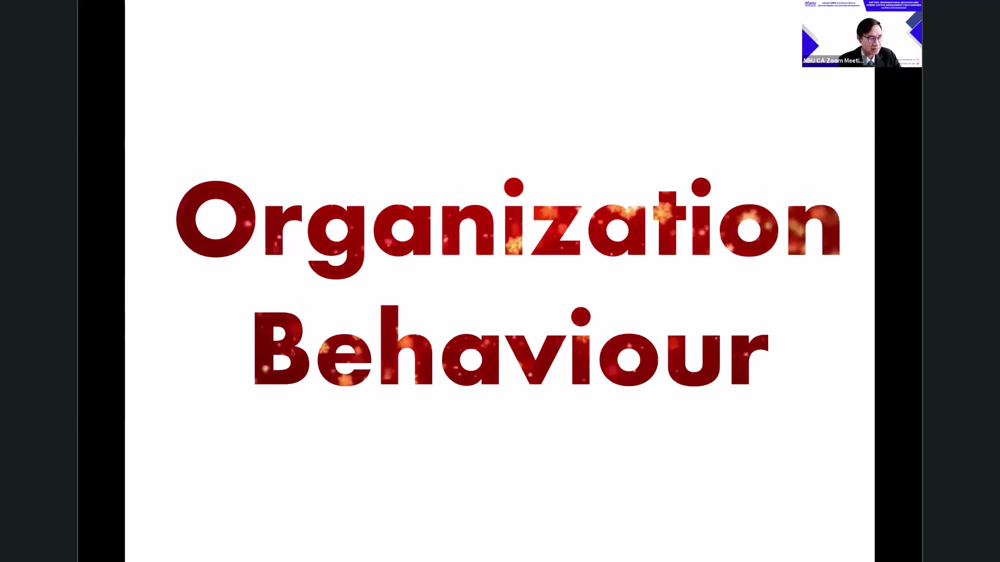

นัชยาวีครับคนแรกที่ตอบมานัชยาวีครับ ทำผิดกรณีใช้รถของบริษัทอ่ะค่ะเพราะว่า

## [00:10:52]
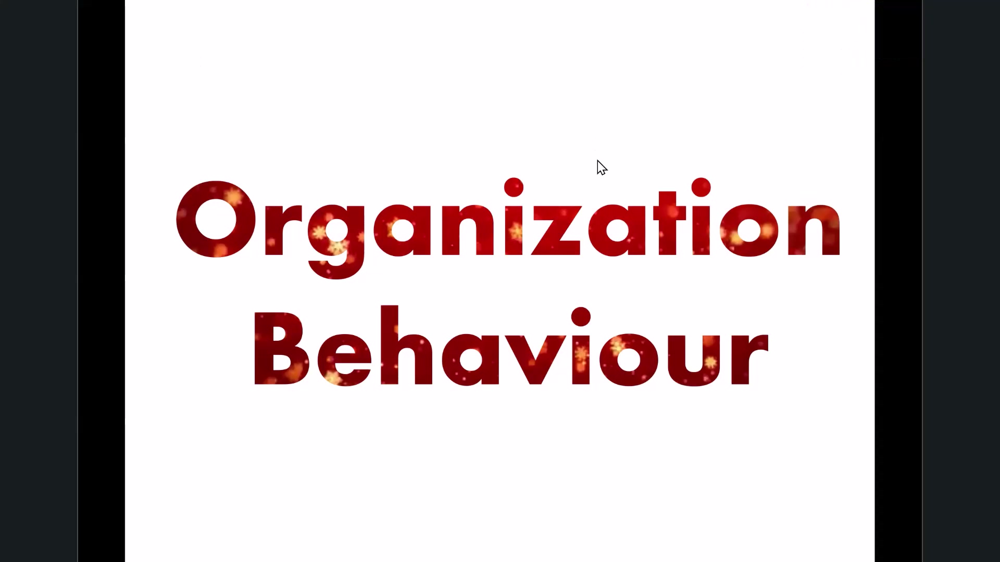

[?] คุณสมชายถ้าเหมาซื้อ เอ่อสมเจตถ้าเหมาซื้อแล้วก็ควรจะต้องใช้รถของตัวเองอันนี้เหมือนใช้รถในองค์กร ครับ แต่กรณีที่เขานำไปวางจำหน่ายเนี่ยอันนั้นมันเป็นสิทธิของเขาแล้วในเมื่อเขาซื้อแล้วเหมาซื้อแล้วเขาจะเอาไปแจก หรือจะนำไปจำหน่ายหรือจะไปอะไรก็อันนั้นก็เป็นสิทธิของเขาค่ะเพราะว่าเขาซื้อในราค

## [00:11:22]
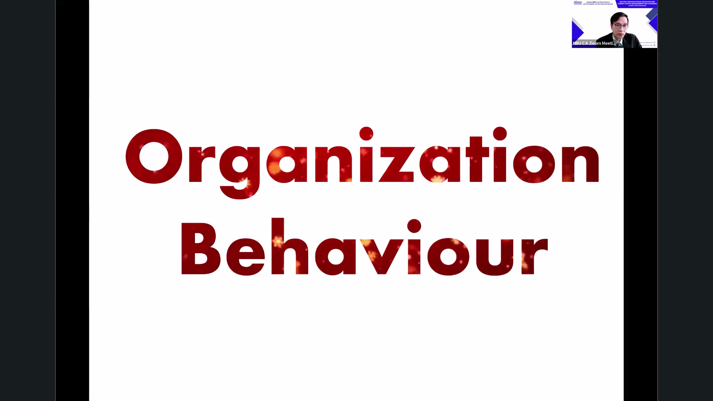

[?] เอาเอาคนที่เอาคนที่เห็นตอบหนึ่งก่อนน่ะเอาคนที่คิดว่าคุณสมเด็จทำถูกก่อนน่ะ เอ้า ทวดิ คุณสมเด็จทำผิดก่อนน่ะหนึ่งนี่คือทำผิดนะครับ ใช่ไหม หนึ่งคือทำผิดน่ะ อ่า ใช่ไหมครับคุณนัชยาวีใช่ใช่ไหมนัชยาวีหมายถึงเห็นเห็นว่าผิดใช่ไหมครับ ใช่ค่ะ ผิดกรณีผิดเป็นแค่กรณีใช้นำรถของบริษัทไป [?] ไอ้ที่เหมาไปแล้วเอาไปขายเนี่ยไม่ผิด เรื่องของเขาเขาซื้อแล้วเขาไปทำอะไรก็เรื่องของเขาแต่ไอ้ที่ผิดคืนเอารถบริษัท ไปใช้ อืมมีใครเห็นด้วยไหมครับมีใครเห็นด้วยหรือเห็นด้วยแต่ไม่ทั้งหมด หนูเห็นด้วยแต่ไม่ทั้งหมดค่ะ

## [00:11:52]

[?] อืมเห็นด้วยแต่มันทั้งหมดว่าหนูมีอีกหัวข้อเออหนูมีอีกอย่างหนึ่งที่หนูคิดถ้าเกิดว่าโรงงานอ่ะทำผิดสูตรแล้วต้องมานั่งขายอย่างงี้เรื่อยเรื่อยแล้วเขาเป็นผู้จัดการอ่ะหนูคิดว่าเขามีโอกาสที่จะทำให้โรงงานมันทำอะไรผิดสูตรเลยเพื่อที่จะเขาเอาไปขายกินกำไรอีกเหมือนตั้งใจใช่ไหมครับตั้งใจทำให้ผิดเพราะเห็นลู่ทาง

## [00:12:22]
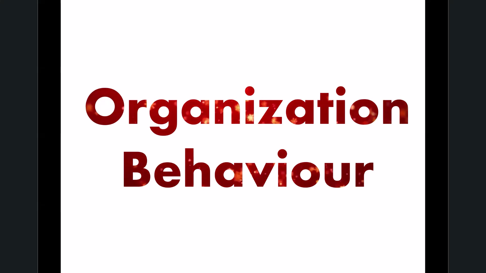

[?] ผู้จัดการผู้ผลิตกับฝ่ายขายคนละท่านกันรู้เปล่าคะ อ่ากรณีนี้รบกวนถามอาจารย์ว่าคุณ คุณสมเด็จเนี่ยเป็นผู้จัดการ ผู้จัดการโรงงานครับ โรงงาน ใช่เป็นผู้จัดการโรงงานเลยครับดูแลฝ่ายผลิตด้วยครับ ใช่ครับ ดูแลฝ่ายผลิตด้วยก็คือใหญ่สุดแล้วครับ ใหญ่สุดในโรงงานนะใหญ่สุดในส่วนผลิตนะครับ

## [00:12:52]
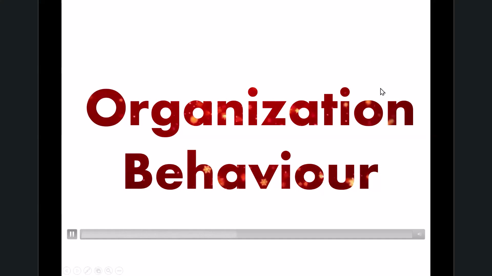

[?] ผมจะพูดในมุมมองของผู้ผู้บริหารบางคนที่ขี้ระแวงแล้วกันนะครับ มีคนแบบนี้อยู่จริงนักศึกษาเราหลีกเลี่ยงไม่ได้เราปฏิเสธไม่ได้หรอกครับ เขาขี้ระแวง มันจริงนะครับ มันมีคนผู้บริหารเขาเขาอาจจะระแวงว่า อ้าว แล้วตกลงตั้งใจผิดหรือผิดจริงเนี่ย อืม ตั้งใจผิดหรือผิดจริงเนี่ย แล้วผมเชื่อนะคร

## [00:13:22]

[?] ไม่ไม่ไม่ใช่เอาตัวเองมามาเป็นกำหนดตัวกำหนดนะนักศึกษาแต่ผมจะจะมองในมุมมองของผู้บริหารเขาเป็นคนที่มันคิดได้อ่ะครับมันคิดได้จริงจริงอ่ะครับนักศึกษาเคยไหมอ่ะผมเคยไว้ใจพนักงานคนนึงมากมากอ่ะแต่

## [00:13:52]

[?] มารู้ทีหลังว่าไม่รู้ก็คือมาจับได้ทีหลังก็มันก็มันก็คิดได้เนอะ แต่เอางี้ผมผมคุยกับคุณนัชญาวีเรื่องนี้ก่อนไอ้เรื่องที่คุณนัชวีไฮไลท์ไว้ว่าใช้รถบรรทุกของบริษัททำไมคุณนัชวีว่าผิดอ่ะครับ กรณีนี้ผู้จัดการเขาเหมาซื้อแล้วก็ควรจะใส่รถตัวเองบรรทุกไปที่ตลาดที่เขาไปวาง แล้วถ้าถ้า

## [00:14:22]
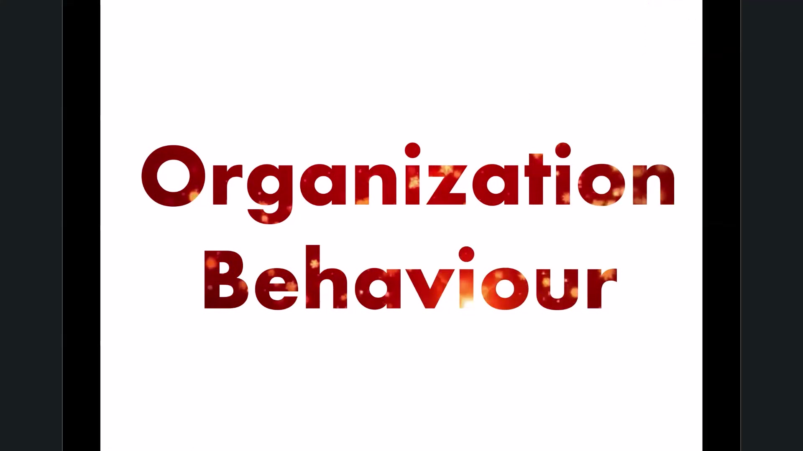

[?] ถ้าเป็นคนอื่นครับ ถ้าเป็นคนอื่น ถ้าเป็นคนอื่นซื้อใช่ ถ้าเป็นคนนอกมาเหมาซื้อครับ เราไม่มีบริบริการขนส่งมันมันไม่ได้หรอกครับ ขึ้นอยู่กับเงื่อนไขเขาต้องลงเคสใบเคสไปค่ะ เออแล้วถ้าคุณสมเจกเขาบอกว่า งั้นยังไงเราก็ต้องส่งให้ลูกค้าอยู่แล้วถ้าเขาซื้อเยอะขนาดนี้เขา ถามว่าตอนเนี้ยการซื้อสิ

## [00:14:52]

ถ้าเราอยากระบาย ถ้าเราเป็นเจ้าของบริษัทหรือเป็นผู้บริหารอันดับสูง คิดว่าเราขนส่งให้เขาด้วย มันจะดีไหมครับ ถามว่าจริง ๆ มันก็ดีนะคะ จริง ๆ มันก็ได้ค่ะ อันนี้ก็คือมันเป็นมุมมอง [?] ที่จะแบ่งเป็นสองมุมมองได้ได้ทั้งถูกและผิดถามว่าถ้าถูกได้ไหมก็ได้อยู่เพราะว่าโอเคบริษัทต้องการระบายสินค้าใช่ทีนี้ก็อาจจะโอเคผู้จัดการเหมาใช่ไหมงั้นก็ใช้รถของบริษัทไปส่งยังก็ได้อยู่มันเป็นได้ทั้งสองมุมมองเลยค่ะนั่นสิครับเออใช่ใช่

## [00:15:22]
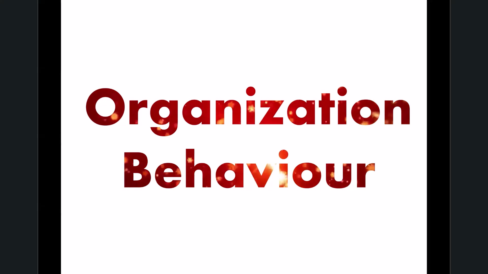

[?] มันก็ถ้าทำไม่ใช่คุณสมเด็จถ้าเป็นลูกค้าคนอื่นแล้วเขาก็เหมาเยอะเหมาขนาดนี้เราก็ได้ระบายหมดเลยนะเขาเหมาอะ ใช่ใช่ เอองั้นเราบริการดีกว่าเขาอุตส่าห์เหมาให้เราแล้วอะมันช่วยเหลือไม่ให้ของมันมาตกค้างเสียราคาโรงงานอย่างเงี้ยเออ งั้นลดบรรทุกไปขนส่งให้เขาดีกว่าก็ได้นะครับแบบนั้นก็ได้นะ

## [00:15:52]
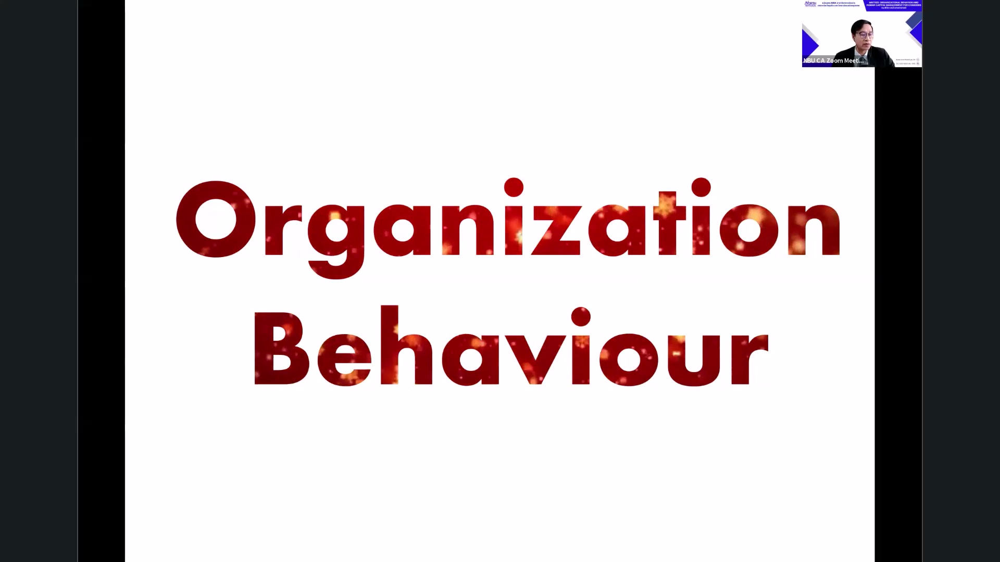

[?] อืม แต่ถ้า พอเป็น พอเป็นผู้จัดการเขาเองเลยดูรู้สึกว่าเหมือน ใช่ ใช่ มันเป็นผู้จัดการสิ ใช่ มันเป็นผู้จัดการน่ะสิ ใช่ ใช่ มันไม่ใช่คนนอกอะดิ เออ มันดันเป็นผู้จัดการ ถ้าในแง่ของความมารยาทอ่ะ [?] การก็คือจริงๆมันก็มองไปอีกมุมนึงมันก็เหมือนใช้สิทธิ์พิเศษเลยค่ะ แต่ถ้าเป็นในแง่ของลูกค้านั่นคือการบริการลูกค้า แต่ในแง่ของมารยาทผู้จัดการก็ในความรู้สึกของหนูนะคะก็คือไม่ถูกต้องแล้วก็ อันนี้ถ้าเป็นนักชาร์ลวีเป็นผู้บริหารเลยนะคะ เดี๋ยวแป๊บนึงนะครับ ขอโทษทุกคนด้วยนะครับ ขอโท

## [00:16:22]

[?] โอเคนักศึกษาครับเพราะงั้นเนี่ยถ้านัชวีเป็นไม่ใช่ผู้จัดการแล้วกันนะเป็นผู้บริหารเลยครับเป็นผู้บริหารนัชวีจะตัดสินยังไงเรื่องนี้ กรณีนี้ถ้าจะเป็นการแก้แก้ไขและป้องกันปัญหาที่จะเกิดใหม่ในครั้งต่อไปก็คือเรียกประชุมทุกแผนก อ่าแล้ววางนโยบายใหม่ว่าฝ่ายผลิตฝ่ายขายอ่าฝ่ายขนส่งทุ

## [00:16:52]
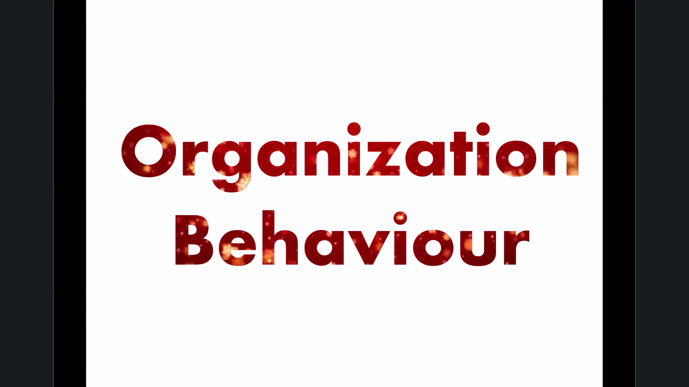

[?] ผลิตผิดบ่อยเนี่ยมันมันไม่ใช่เรื่องปกติแล้ว อืม ตรงนี้นะคะ แล้วจะวางมาตรการวางมาตรการยังไงดี อ่า งั้นคนคนอื่นบ้างนะ อ่า โอเค ผมจะจบที่เรียกประชุมแล้วนะเรียกประชุมนะครับ ตอนนี้เรียกประชุมแล้วนะ แล้วคิดว่าเรื่องนี้ปล่อยผ่านไม่ได้นะครับปล่อยผ่านไม่ได้นะ อ่า ต่อไป ชญนันครับ ชญนันครับ ชญนันอยู่

## [00:17:22]
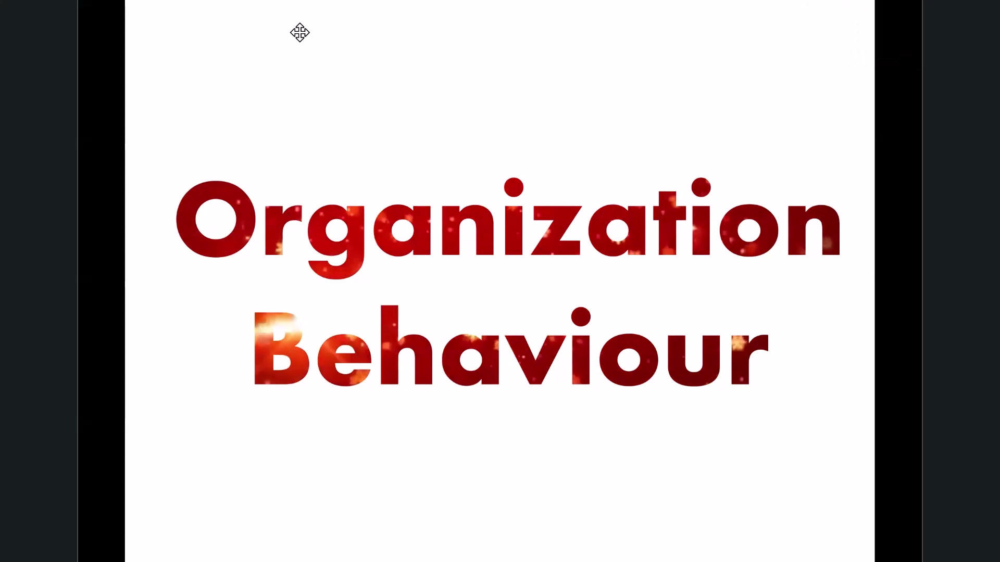

[?] เห็นด้วยไหมเห็นด้วยกับเห็นด้วยอยู่แล้วนะครับเราพิมพ์หนึ่งมาว่า เออ อะ โอเคมีอะไรเพิ่มเติมไหมครับ ถ้าหลังจากเรียกประชุมใช่ไหมครับก็คิดว่าน่าจะต้อง ทำการตรวจสอบครับตรวจสอบกระบวนการการตั้งแต่การผลิตครับว่า เหตุผลอะไรบ้างที่ทำให้เกิดการผิดพลาดในการในการผลิตนั้นนะครับ เพราะว่าที่บอกว่า ตัว

## [00:17:52]
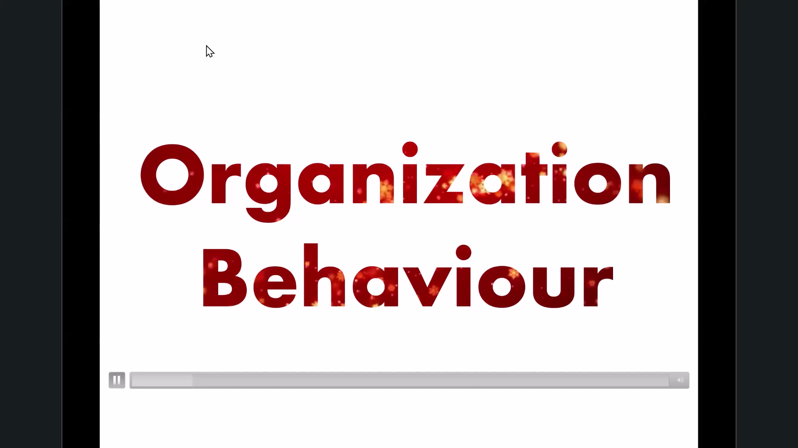

[?] ต้องหาครับ ต้องหาตัวนี้ หาสาเหตุนะครับเพราะฉะนั้นต่อไปนี้ถ้ามี มีผลิตผิดสูตรนะครับที่ลูกค้าสั่งนะครับ ผิดตามที่ลูกค้าสั่งไปดูเสื้อสาเหตุมาจากไหน ระบุสาเหตุให้ชัดเจนแล้วทุกคนรับทราบเซ็นยอมรับด้วยนะครับ พอรู้ว่าสาเหตุมันมาจากไหนเราก็มาวีเคราะห์สาเหตุนั้นว่าสาเหตุนั้นมัน มัน

## [00:18:22]
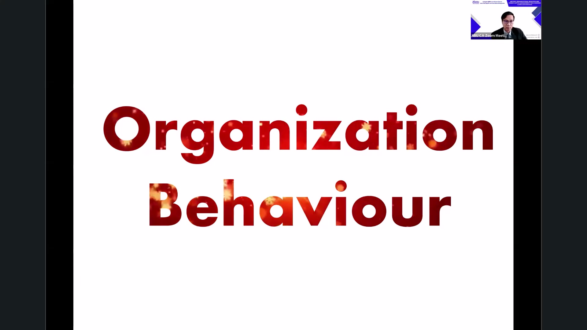

[?] มีอะไรบางอย่างเออมันอาจจะมีอะไรบางอย่างถ้าผิดแบบสาเหตุรู้สาเหตุแล้วเออมันมัน มันผิดจริงสอบสวนแล้วสืบสวนแล้วผิดจริงก็ต้องลงโทษด้วยนะครับไม่ใช่ไม่ลงโทษนะครับ ลงโทษคุณสมเจตน์ด้วยลงโทษหัวหน้าแผนกด้วยแล้วลงโทษ อ่ะ กะนั้น กะนั้นใครเป็นหัวหน้าแผนกกะนั้นใครเป็นซูเปอร์ไวเซ

## [00:18:52]

แล้วก็ลงโทษด้วยนะครับ ลงโทษตามลำดับความหนักเบานะครับ ตามความหนักเบาเนอะ อะ โอเคนะครับ แล้วก็ มาตรการที่สำคัญที่ไม่ควรเกิดเลยก็คือจะต้องไม่มีวิธีการให้คนภายในเหมาซื้อแบบ

## [00:19:22]
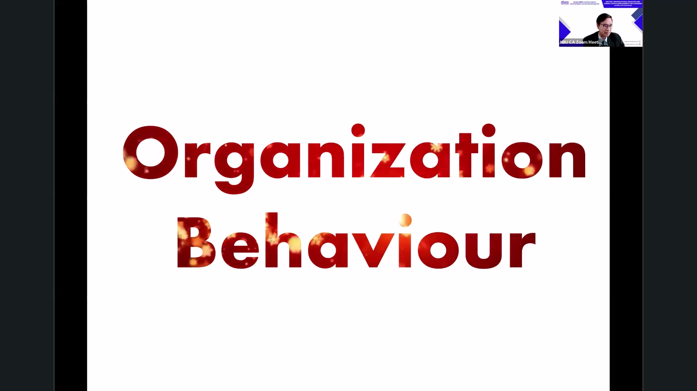

[?] แบบไม่มีขั้นตอนอีกแล้วครับก็คือเหมาซื้อแบบตามสะดวกแล้วอ่ะนักศึกษาครับ ทุกอย่างต้องมีกระบวนการต้องมีลงชื่อแต่ไอ้ส่วนเขาจะไปขายต่อไปอะไรนักศึกษาครับ ผม ผมอยากให้ใครมีมุมมองตรงเรื่องเอาไปขายต่อบ้าง มี มีคนอื่นไหมครับใครมีมุมมองเรื่องเอาไปขายต่อบ้างครับ เรื่องอะไรบ้าง เป็นห่วงเรื่องอะไรบ้างครับก

## [00:19:52]
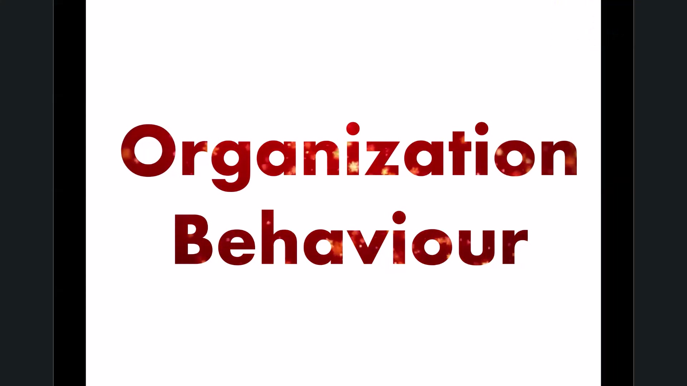

สำหรับหนูค่ะ ก็คือหนูมองว่าการที่เขาเหมาไปไม่ผิด แต่ว่าอย่างในโจทย์ตอนแรก คือผู้จัดการเขาบอกว่าคือเขาเหมาเพื่อที่เขาจะเอาไปแจก ไปแจกญาติ ไปแจกคนนอกอะไรอย่างนี้ค่ะ [?] ท้ายที่สุดแล้วพอไปเห็น ปรากฏว่าเอาไปวางที่ตลาดอะไรอย่างนี้ แล้วราคาที่ขายมันก็จะเป็นราคาที่เขาแบบเอาไปบวกกำไร ซึ่งก็ไม่แน่ใจว่ามันเป็นราคาที่ทางบริษัทต้องการจะขายราคานี้จริงหรือเปล่า แล้วถ้าเกิดว่า

## [00:20:22]
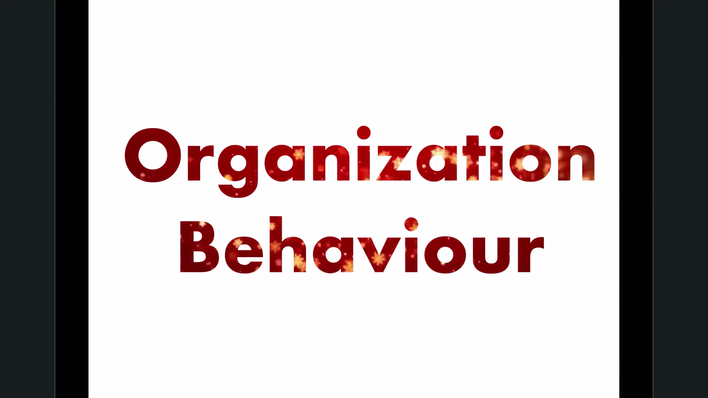

[?] อย่างที่พี่ ๆ เขาพูดกันมาค่ะว่า ถ้าพอผู้จัดการเขาเห็นช่องโหว่ว่า เฮ้ย ถ้าเขาทำพลาดมีของออกมาอีก เขาก็สามารถเอาตรงนี้ไปขายเพื่อเก็งกำไรเข้าเขาได้ แล้วผู้บริโภคอะค่ะ ก็จะ อาจจะบางส่วนนะคะ ก็อาจจะแบบรู้สึกว่า เฮ้ย พอไปเจอราคาจริง ๆ มันแพง แต่ว่า งั้นรอเวลาโรงงานมาเทอย่างนี้ดีกว

## [00:20:52]
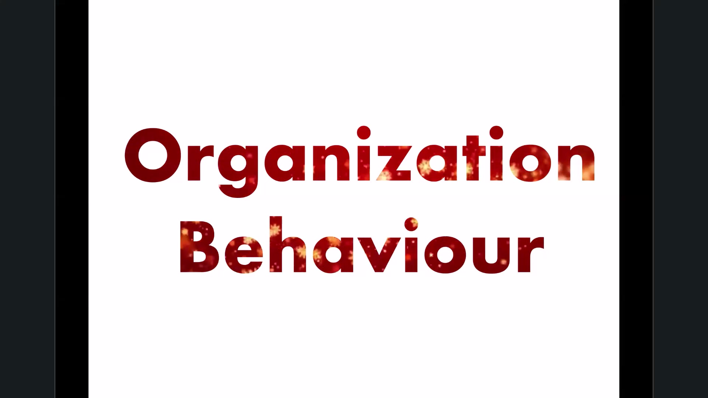

[?] มีเรื่องราคาเข้ามาได้อะค่ะ แล้วถ้าสมมุติว่าเขาไปขายแพง หมายถึงเขาไปขายแพงได้ไหมครับ คิดว่าเขาขายแพงกว่าได้ไหม ก็ได้ค่ะ แต่ว่าหนูว่ามันน่าจะแพงกว่าราคาที่โรงงานเขาขายปกติ

## [00:21:22]
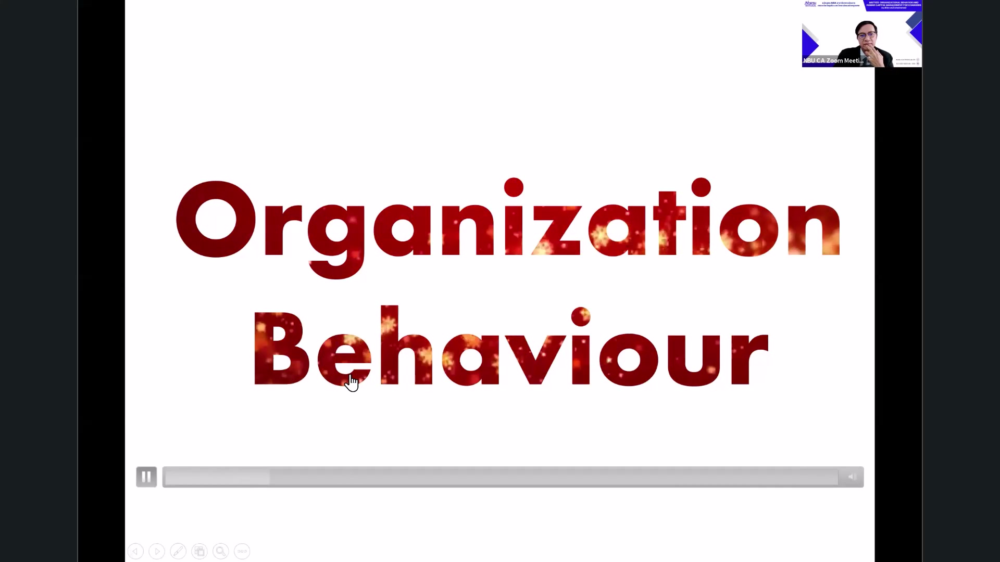

[?] ไม่ได้ไหม เพราะว่าไม่งั้นคนก็น่าจะไม่ค่อยซื้อ เขาเรียกว่าสินค้าอ่อนไหว สินค้าอ่อนไหวต่อราคา ราคาแพงขึ้น ปริมาณซื้อลดลงนะครับ เรื่องเศรษฐศาสตร์อะเนาะ คือผมไม่เป็นห่วงเรื่องขายแพงหรอกครับ ผมเป็นห่วงเรื่องเขาขายถูก ใช่ค่ะ แต่ถ้าขายถูกเขาก็แค่ระบายของ เอางี้นะศาครับ ผมใช้คำนี้

## [00:21:52]
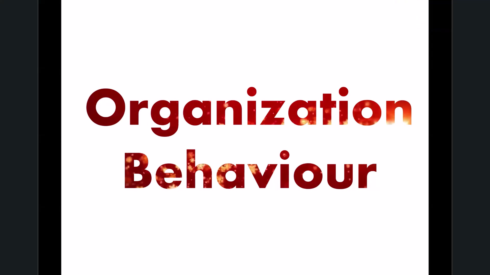

[?] ในมุมของศิรินุชนะคะอาจารย์ หนูมองว่าถ้าเกิดว่าสินค้าตัวนี้ถูกไปวางขายที่ตามตลาดใช่ไหมคะ แล้วทีนี้ภาพลักษณ์ของผู้บริโภคขาดซื้อสินค้าตัวนี้ไป ก็จะกลายเป็นภาพลักษณ์ที่สินค้าคุณภาพที่มันเป็น ขายถูก ของถูก กลายเป็นสินค้าของถูกไปเลย

## [00:22:22]
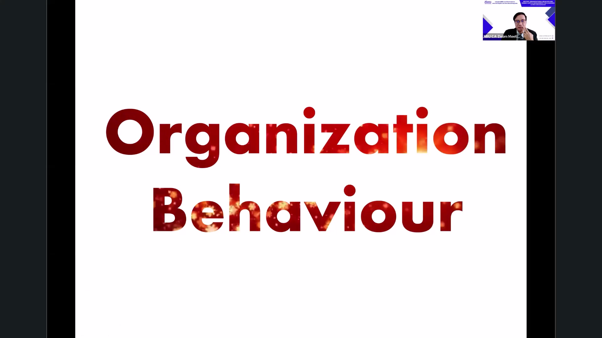

[?] อ่า ผลิตผิดสูตรแล้วก็เลยภาพลักษณ์ของผู้บริโภคอะค่ะเขาจะเป็นจากสูตรตัวเนี้ย ว่าบริษัทนี้หรือว่าสินค้าตัวเนี้ยของบริษัทนี้แบรนด์นี้เป็น เป็นตัวนี้แล้วนะคะเป็นคนที่สูตรผิดไปแล้วอย่างเงี้ยค่ะ โอเค เข้าใจแล้วใช้คำว่าภาพลักษณ์เลย ภาพลักษณ์นั่นแหละอธิบายได้ทั้งหมด

## [00:22:52]
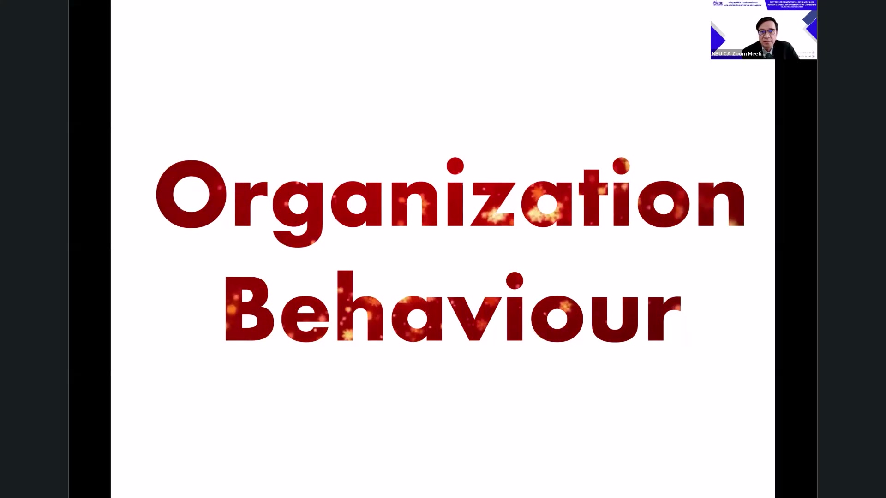

[?] นั่นแหละครับงั้นส่วนผิดสูตรเนี้ยเราไม่มีดีเทลนะฮะผมไม่ได้พิมพ์บอกไว้ว่าไอ้ผิดสูตรมันไม่ได้ผิดสูตรจนเสียไม่ใช่หมายถึงลูกค้าที่เขาเคยสั่งซื้อรถรถครั้งแรกลูกค้าคนแรกเขาสั่งซื้อรถส้มสมมุตินะแต่กลายเป็นส่งรถสตรอว์เบอร์รี่ให้เขาอันนี้ประมาณนี้นะฮะ มันมันไม่ได้ของเสียนะครับมั

## [00:23:22]

[?] ของใกล้หมดอายุมาขายหรือเปล่าอ่ะเพราะฉะนั้นนักศึกษาต้องคิดอย่างเมื่อกี้พัฒนันอ่ะเปิดมาได้ดีมาก ทุกคนเปิดมาได้ดีมากครับตั้งแต่นัตติยา นิติยานะครับตั้งแต่นิติยา ตั้งแต่นัชยาวีนักศึกษาเรื่องราวมัน มันมาตามลำดับขั้นนะครับนี่ถ้าสอนในห้องสนุกมากนักศึกษา [?] จะเสียเวลาประมาณชั่วโมงนึงผมเชื่อนะครับเรื่องนี้นักศึกษาครับ แต่มันสนุกจริงๆนะครับ เออว่า อ่า หนูขอนิดนึง เติมนิดนึง คือจริงๆแล้วข้อนี้มันสามารถเขียนได้หลายมุมมองเลย แต่เวลามันไม่ถูกอาจารย์ หนูต้องไปทำข้ออื่นต่อ มันเขียนอีก ผมก็ไม่ได้ต้องการ นัชยาภีฟังนะลูกนะ ผมใส่ไว้ให

## [00:23:52]
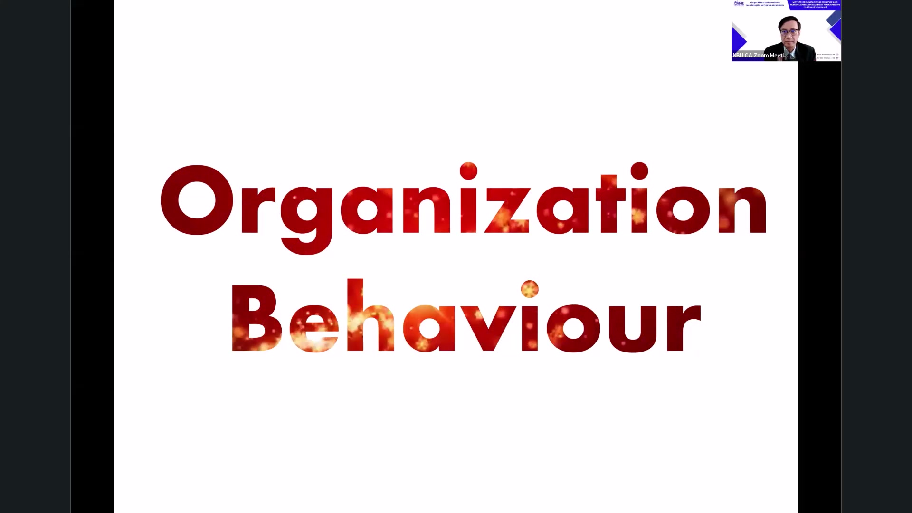

[?] อืม โอเค ใช่ครับ แค่นั้นเลยครับ ขอแค่ได้ทำงานความคิดเห็นวิเคราะห์ออกเลยนะ ใช่ครับ เรื่องนี้ผมไม่ได้ต้องการให้นักศึกษามาตัดสินผิดถูกภายในข้อสอบ 5 แค่ข้อสอบภายในเวลาแค่ 2 ชั่วโมงนะครับ นักศึกษาตัดสินผิดถูกไม่ได้อยู่แล้ว แต่เราจะเชื่อมโยงกับวิชาพฤติกรรมองค์กรด้วยจำ 3 คำ

## [00:24:22]
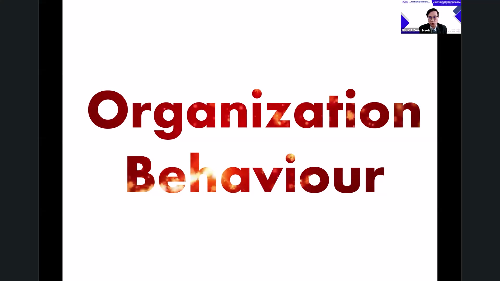

[?] จำได้ไหมครับวัตถุประสงค์ของการเรียนใช่ใช่นักศึกษารู้ไหมว่าเทอมก่อนก่อนเนี้ยผมไม่ใส่ด้วยนะครับไอ้สามคำเนี้ยสามคำเนี้ยผมไม่ใส่ด้วยนะครับ [?] นี่ผมใส่ให้ด้วยนะครับเพราะฉะนั้นผมไม่ได้ต้องการให้นักศึกษามาตัดสินผิดถูก เพราะฉะนั้นนักศึกษาครับข้อสอบอาจารย์เนี่ยเน้นคือผมวัดหลายอย่าง วัดนักศึกษาทำแม่นจริง นักศึกษาทำเร็วครับแต่ถ้านักศึกษามามัวนั่ง เอ๊ะ เอ๊ะ คิด คิด เอ๊ะ ใช่ไหมนักศึกษาครับ ยังไงก็ทำ

## [00:24:52]

ใส่คำถามใส่คำตอบไปปุ๊บเนี่ยมันจะตรงกับที่เรื่องที่วิชานี้อธิบายวิชาเนี่ยได้อธิบายทำนายควบคุมไว้เลยนักศึกษาครับเพราะเนี่ยนักศึกษา [?] ไม่มีทางตัดสินถูกผิดได้ภายในเวลาสองชั่วโมงแน่นอนครับเขาประชุมกันเป็นเดือนนะ เรื่องนี้นักศึกษาครับเพราะฉะนั้นผมไม่ได้ต้องการแต่ผมแค่จะเอามาให้นักศึกษาคุยมากกว่าข้อสอบผมสรุปเลยละกัน สรุปเลยกันไม่ให้มันไปมากกว่านี้เพราะมันสอนออนไลน์ถ้าสอนในห้องเนี่ยมันมันคอนโทรลได้ ผมคอนโทรลได

## [00:25:22]
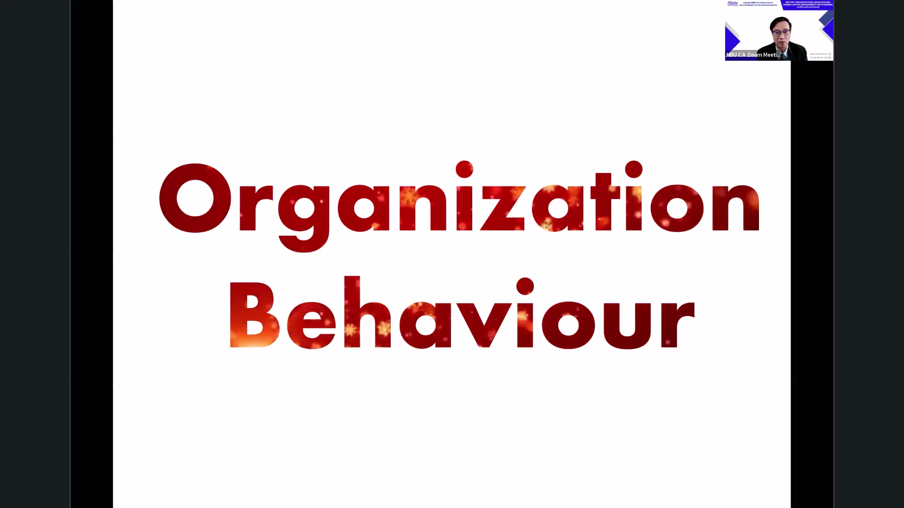

[?] มันไม่เห็นกิริยาท่าทางไม่เห็นหน้าไม่เห็นอะไรมันมันยากนักศึกษาเข้าใจใช่ไหมพิมพ์คุยกับพูดคุยจริงอ่ะนักศึกษามันคนละเรื่องเพราะฉะนั้นผมสรุปเลยครับนักศึกษาครับเรื่องเนี้ยนักศึกษาครับเอาไม่ให้สรุปตามข้อสอบนะไม่ให้สรุปตามคำถามข้อสอบนะผมสรุปตามเหตุการณ์จริงนะครับที่เอชอาระดั

## [00:25:52]
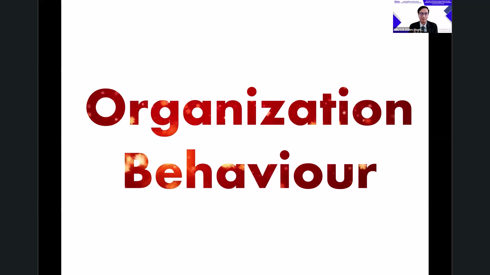

[?] ผู้บริหารเนี่ยเขาคุยกันว่าสุดท้ายเรื่องเนี้ยเนี่ยเขาจะออกมาตรการเหมือนที่ เอ่อเมื่อกี้ไม่มีใครพูดนะจะออกประชุมแล้วออกมาตรการเลยว่าต่อไปนี้ต้องมีการสืบสวนสอบสวนทุกครั้งที่มีการทำส่งสินค้าให้ลูกค้าผิดไปจากที่ลูกค้าสั่งแล้วข้อสองครับ เขานอกจากสอบสวนนะข้อสองคือเขาจะบอกว่าถ้าจะเอาสินค้าไปขายจ

## [00:26:22]
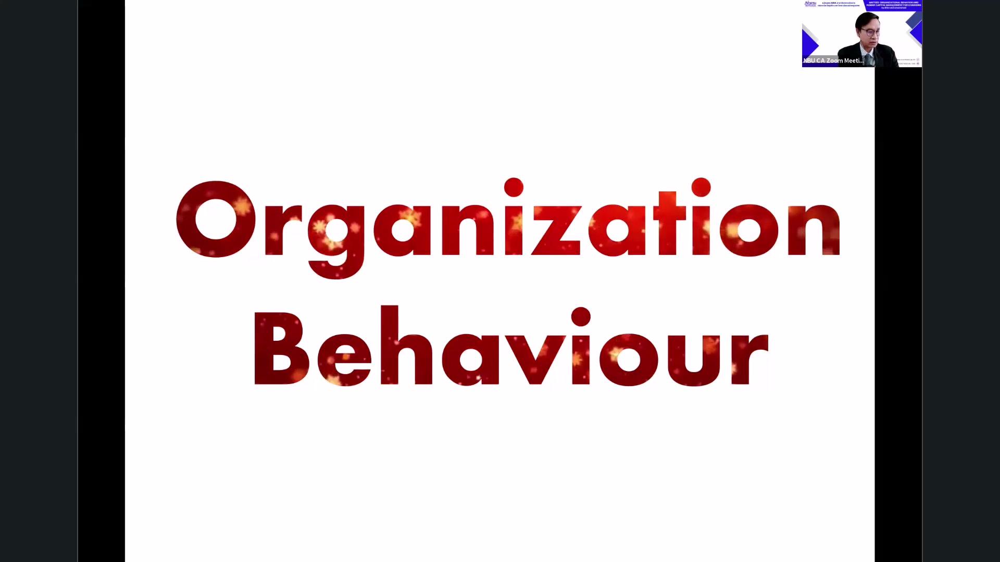

ไม่ต้องเปลี่ยนก็ได้ อยู่ภายในบ้าน ภายในครอบครัว [?] ไปแจกคนในครอบครัวนะ เพราะฉะนั้นผู้ซื้อต้องลงทำสัญญานะครับผู้ซื้อต้องทำสัญญา ต้องเซ็นสัญญายินยอมเหมือน MOU อะนะครับ เหมือน MOU อะ แต่ถ้าจะไปขายบริษัทไม่ว่านะครับแต่ต้องเปลี่ยนฉลากครับ เอาฉลากออกหรือปกปิดฉลากไว้นะครับ ไม่ใช่แค่เอากระดาษมาทับนะ เดี๋ยวลูกค้าซื้อเผื่อเขาแกะเขาเห็นต้องดึ

## [00:26:52]
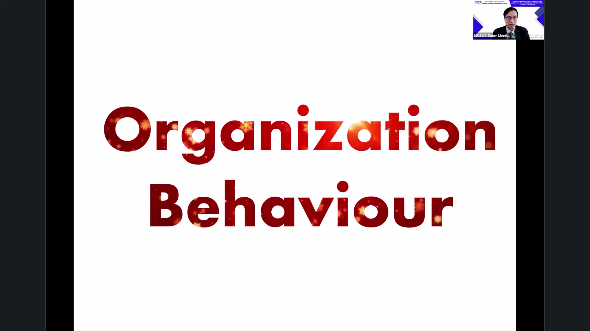

[?] ก็ไม่เป็นไรแล้วนะครับเขาออกมาตรการแบบนี้ครับสุดท้ายรู้ไหมเขาออกมาตรการให้มันเข้มงวดเพราะอะไรเขาไม่อยากให้ซื้อไปขายสุดท้ายสมมุติว่าผมตั้งใจว่าเดี๋ยวผมจะซื้อไปขายแต่ดู mouดูเงื่อนไขแล้วเนี่ยโอ้โหเยอะมาก ไม่เอาดีกว่ามันต้องไปลงทุนเพิ่มผมไม่ซื้อละ ผมไม่ซื้อละพอผมไม่ซื้อปุ๊บนะครับ

## [00:27:22]

[?] มันก็จะเป็นโดมิโนย้อนกลับครับนักศึกษามันเป็น ไม่ใช่ โดมิโน โทษที เป็น เป็น มันย้อนกลับไปตรงไหนรู้ไหมย้อนกลับไปตรงที่ว่า ไอ้ฝ่ายผลิตเนี่ยมันจะไม่กล้าทำผิดอีกนักศึกษาครับ เพราะว่าเมื่อทำผิดปุ๊บมันจะไม่มีใครกล้าซื้อ ไม่กล้าเหมา [?] ไม่กล้าเหมาไปขาย ไม่กล้าเหมาไปแจกนะฮะ เพราะฉะนั้นส่วนแจกส่วนขายบางทีเราก็ไม่ได้ไปสืบสวนจริงๆหรอก นอกจากฟลุ๊ค มีพนักงานคนหนึ่งฟลุ๊คไปเจอแล้วมาฟ้องนั่นแหละนะฮะ แต่ถ้าหากว่าเราไม่รู้จริงก็ไม่เป็นไร แต่เงื่อนไขนั้นเนี่ย กฎหมาย กฎระเบียบบริษัทมันออกมาแล้วมีมาตรการลงโทษด้วยว่า

## [00:27:52]
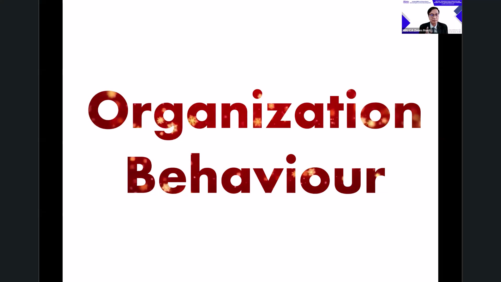

[?] เพราะฉะนั้นการรับผิดชอบเนี่ยเขาไม่ได้รับผิดชอบให้มาซื้อนะครับ ฝ่ายผลิตให้มาช่วยกันซื้อไม่ใช่นะครับ เขาทำลายทิ้งนะครับมาตรการที่เขาออกมาคือทำลายทิ้งนะครับ แล้วฝ่ายผลิตกับพนักงานกะนั้นหลังจากสอบสวนเสร็จเรียบร้อยมีการเซ็นยอมว่าผิดจริงเนี่ย พนักงานชุดนั้นกลุ่มนั้นต้องรับผิด

## [00:28:22]
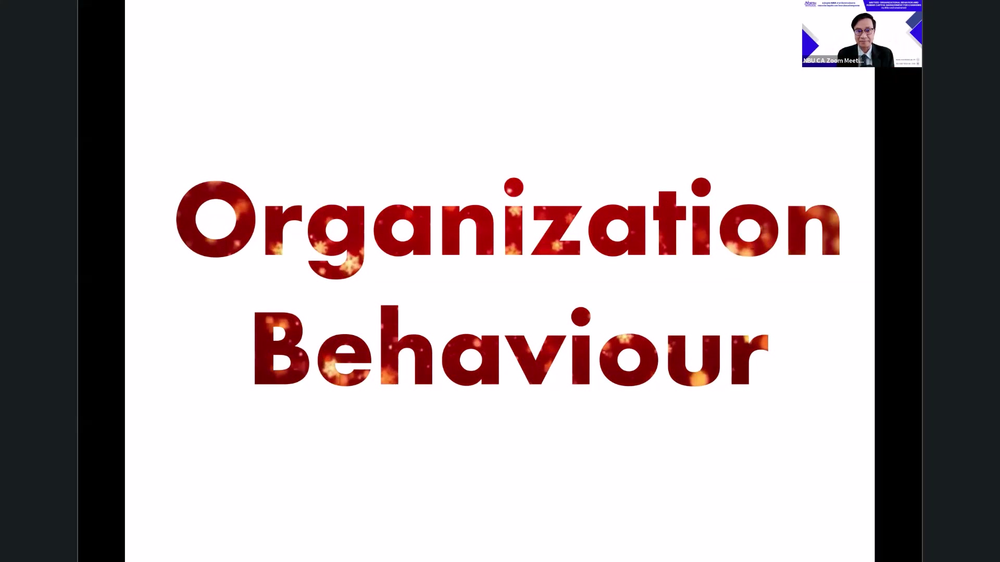

[?] แบบเนี้ยบริษัทหลายบริษัททำครับยกตัวอย่างง่ายง่ายนักศึกษาบริษัทบีเอ็มดับเบิ้ลยูนะครับ บริษัทบีเอ็มดับเบิ้ลยูเนี่ยเวลาที่ผลิตเอ่อ ชิ้นส่วนรถยนต์เอ่อ ที่ผลิตเอ่อกระจกมองข้างตอนนั้นผมผมผม กระจกมองข้างรถยนต์บีเอ็มดับเบิ้ลยูอ่ะเขาผลิตผิดนะครับ ผิดสเปกนักศึกษ

## [00:28:52]
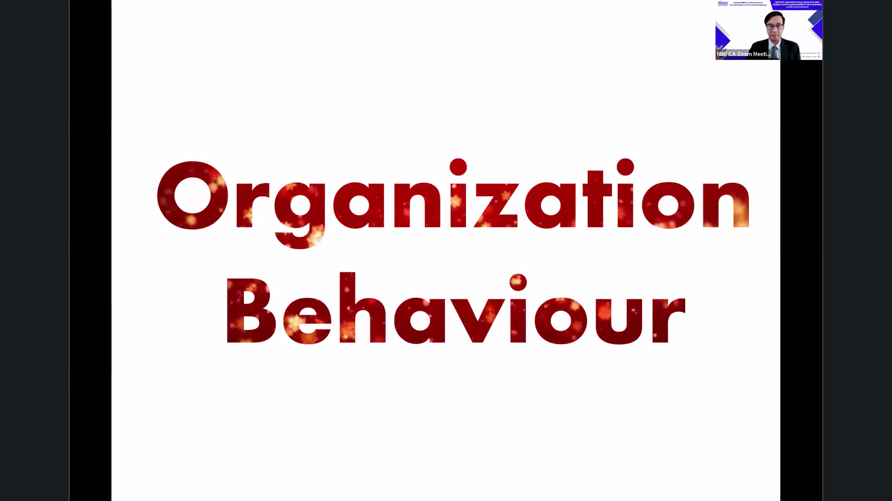

[?] เครื่องยนต์ที่กำลังจะใส่ไปในห้องเครื่องอ่ะผลิตเครื่องยนต์อ่ะในในรายการผลิตประกอบในรายการประกอบอ่ะ เครื่องยนต์ตัวเนี้ยเออนำเออนำมาสุ่มสุ่มตัวอย่างมาเช็ค แล้วมันไม่ตรงสเปกครับเขาทำลายทิ้งครับ มันจะมีเครื่องอัดเครื่องอัดเหล็กขนาดใหญ่ปึ้มจน จนพังอ่ะแล้วเขาก็จะไปหลอมเหล็

## [00:29:22]
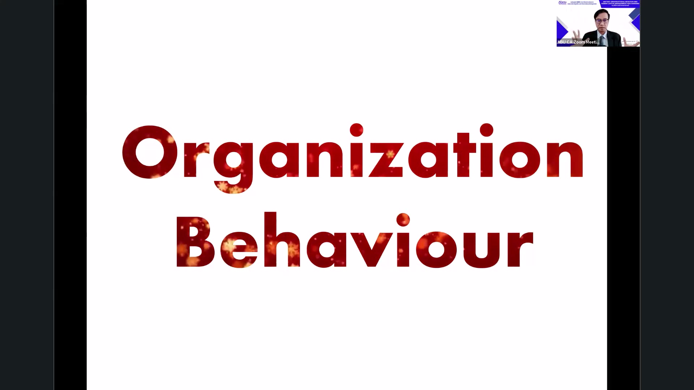

[?] อันนั้นทำลายทิ้งเลยครับนักศึกษาแต่กระจกมองข้างสิผมก็เลยถามว่ามันมันก็ไม่ได้เสียหายอะไรมากนะ มันสามารถเอาไปขายอะไหล่เป็นอะไหล่ได้ไหมมันก็ไม่ได้เสียหายมาก มันใช้ได้นะครับมันแค่ผิดนิดเดียวเองนักศึกษา ผมก็เลยได้คำตอบจากเขาว่าถ้าหากว่าคนที่ไปซื้ออะไหล่เชียงกงแล้วรู้ว่าไอ้ชิ้นส่วนตัว

## [00:29:52]
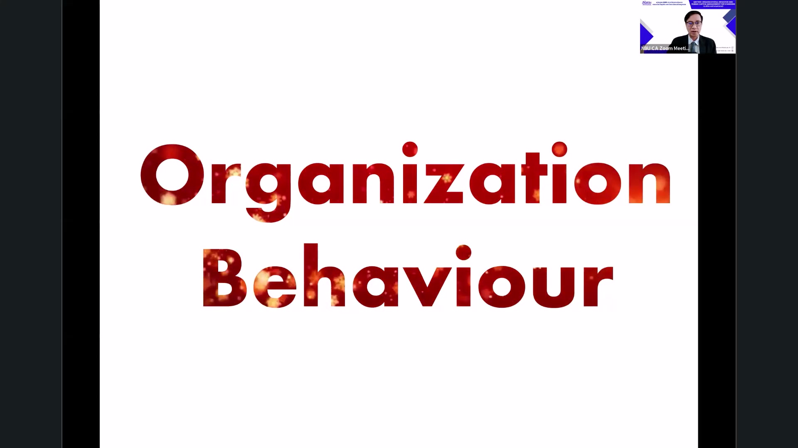

[?] ใครจะไปซื้อของที่ศูนย์เขาก็จะไปซื้อเชียงโกงกันหมด เขาทำลายทิ้ง นั่นแหละครับ อีกครั้งหนึ่งตอนน้ำท่วมปีห้าสี่น้ำท่วมปีห้าสี่ ฮอนด้าครับนักศึกษาครับ โรงงานฮอนด้าถ้าใครจำข่าวได้ปีห้าสี่ น้ำท่วมรถยนต์ล็อตใหญ่เลยนักศึกษาครับ เก้าร้อยเก้าร้อยกว่าคันเกือบพันคันน่ะ

## [00:30:22]
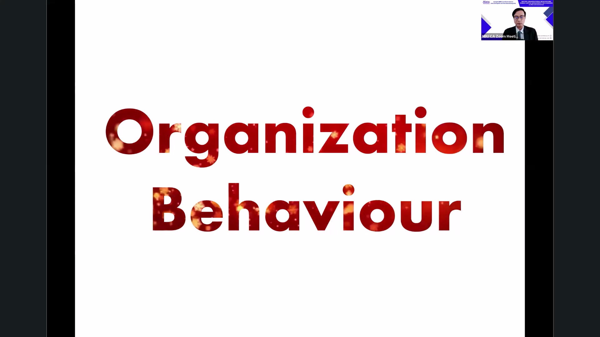

[?] คือจะเอารถยนต์เหล่าเนี้ยมอบให้กับ เอ่อ โรงเรียนอาชีวะ โรงเรียนเทคโนเทคโนเทคนิคชั่งยนต์อ่ะเพื่อเอาไปให้เด็กนักเรียนได้ใช้ เอ่อ ในเวิร์คช็อปการเรียนการสอน เออเขาก็บอกแบบ เอ่อ นโยบายเขาแบบนี้ครับแล้วก็แจกไปตามโรงเรียนอาชีวะต่างต่างหนึ่งพันคันเลยนะครับ เพื่อให้นักเรียนได้ใช้เวิร์

## [00:30:52]
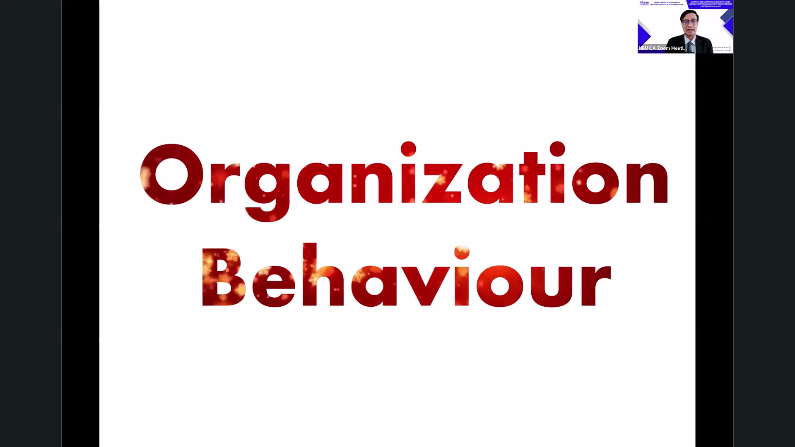

[?] นั่นเองสุดท้ายเปลี่ยนใจทำลายทิ้งผมก็เลยไปหาข้อมูลนักศึกษาว่าทำไมเขาเขาไม่เลือกที่จะให้โรงเรียนเทคนิคเทคโนเพื่อเด็กช่างยนต์ไปฝึกเขาคำตอบเขาก็บอกว่าเขากลัวว่ารถยนต์เหล่านี้จะไม่ได้ถูกนำไปใช้ตามวัตถุประสงค์ครับนักศึกษารู้ไหมว่าเขากังวลเรื่องอะไรไม่ได้ถูกใช้ตามวัตถุประสงค์เวลาถ้าแจกไปต

## [00:31:22]
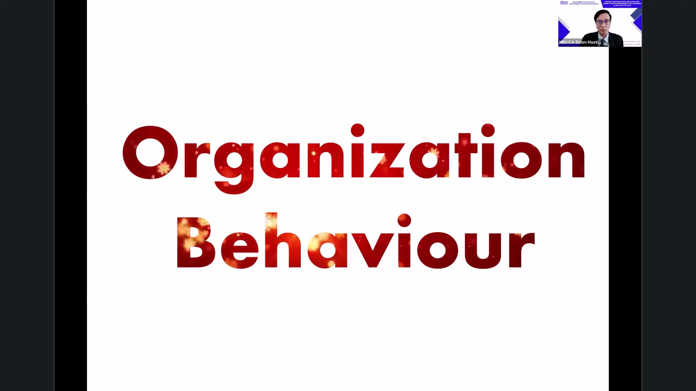

[?] ถูกซ่อมนำไปใช้นักศึกษาครับหมายถึงไม่ได้ลงเวิร์คช็อปครับนักศึกษาจะถูกไปใช้เป็นรถประจำตำแหน่งของผู้บริหารโรงเรียนพวกอะไรพวกนี้นักศึกษาครับแล้วก็ถูกซ่อมนำไปขายซ่อมเสร็จนำไปขายอะครับ เพื่อเอาเงินมาใช้ในในวิธีอื่นเอาไปเงินไปใช้อย่างอื่นอย่างเช่นนำเงินมา เอ่อสร้างอาคารเรียนอะไรพวก

## [00:31:52]
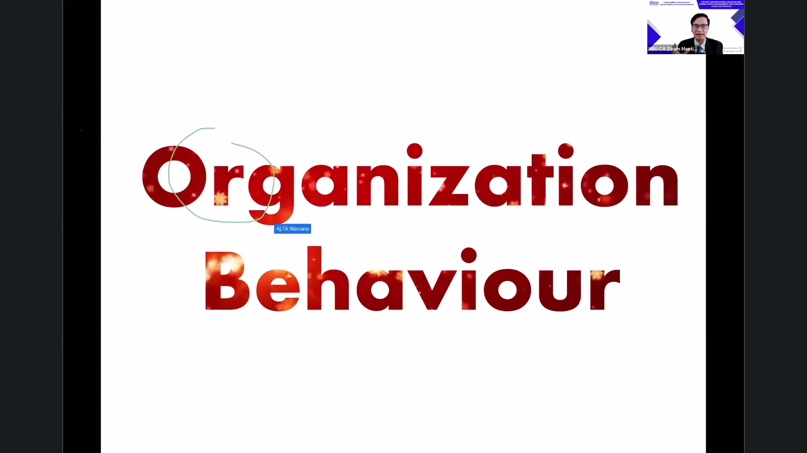

[?] นักศึกษาครับช่างไทยเก่งมากมากนะครับรถจมน้ำนี่เรื่องเล็กเล็กเลยนักศึกษาครับช่างไทยซ่อมได้นะครับ honda ก็เลยกลัวว่าเดี๋ยวโรงเรียนเทคโนเทคนิคเหล่านั้นเนี่ยเอาไปซ่อมแล้วไปขายเอาเงินมาใช้ประโยชน์อย่างอื่นที่สำคัญกว่าเพราะมันน่าจะมีเยอะแล้วอ่ะครับรถยนต์รถยนต์เวิร์คช็อปมันน่าจะมี

## [00:32:22]

[?] รถยนต์เลขแชทซีนี้ หมายเลขนี้ แล้วเขาก็ทำให้ลูกค้าตรวจสอบได้เลยนะครับว่ารถยนต์ที่ถูกทำลายทิ้งเนี่ย เป็นรถยนต์รุ่น เอ่อ รุ่นนี้หมายเลขแชทซีนี้ จะไม่เจอในท้องตลาดอีกเลยนักศึกษาเขาก็เลยทำลายทิ้ง เราก็ [?] เอาข้อมูลลงข้อมูลเซ็นเตอร์ส่วนกลางด้วยครับไปเช็คได้เลยครับ คนที่ซื้อรถยนต์ฮอนด้ารุ่นนั้นสามารถเช็คได้ว่ารถยนต์ตัวเองที่ซื้อใหม่เนี้ยไม่ใช่รถยนต์ที่ถูกทำลายทิ้ง นั่นเองครับนักศึกษาครับ เพราะฉะนั้นเรื่องนี้เรื่องบริษัทนี้เขาก็สรุปแบบนี้เลยครับ ไอบริษัทผลไม้ผลิตผลไม้กระป�

## [00:32:52]

[?] ผมเชื่อว่าฝ่ายผลิตจะทำงานเข้มงวดมากขึ้นนะครับ ฝ่ายผลิตฝ่ายการตลาดคุยกับลูกค้าก็ต้องเข้มงวดมากขึ้น เมื่อกี้เหมือนมีใครพูดนะ นัชยาวี ใครถามนะว่าตกลงฝ่ายการตลาดกับฝ่ายผลิต

## [00:33:22]

[?] ทำงานด้วยกันหรือเปล่า เป็นคำถามที่ดีมาก ใช่ไหมท่านชาวี หนูถามว่าผู้จัดการนี้เป็นผู้จัดการระดับไหน สำคัญมากครับ เพราะฉะนั้นต่อไปนี้ ผู้จัดการฝ่ายผลิตกับฝ่ายการตลาดต้องประสานงานกัน ต้องคุยกัน เพราะฉะนั้นออเดอร์ที่ลูกค้าคุยมา เขาไม่ได้คุยกับฝ่ายผลิตใช่ไหมท่านชาวี เขาคุยกับ�

## [00:33:52]

[?] ใช่ครับ ฝ่ายการตลาด เพราะฉะนั้นเนี่ยฝ่ายการตลาดก็ต้องมั่นใจตัวเอกสารใบทำข้อตกลงซื้อขายนั่นแหละครับ เพราะฉะนั้นฝ่ายผลิตกับฝ่ายการตลาดก็ต้องประสานงานกันนะครับ มั่นใจ เพราะฉะนั้นต่อไปนี้ถ้าหากว่าฝ่ายการตลาดส่งออเดอร์มาแล้วฝ่ายผลิตผิด ต้องดูด้วยว่าฝ่ายการตลาดผิดด้วย

## [00:34:22]

[?] ตัวไหนที่เป็นที่ต้องการของตลาดอ่า ก็จะต้องทำรายละเอียดมาเพื่อมาคุยในประชุมฝ่ายผลิตก็จะได้แบบไปตรงไปตรงจุดนั้นอะค่ะ ผลิตจุดนั้นที่เยอะที่สุดค่ะ เพราะฉะนั้นสุดท้ายผมอยากให้นักศึกษาลองไปดูไปดูคำว่า mbo นะครับนักศึกษาใครมีเล็กเชอร์ก็เล็กเชอร์ไว้ mbo management by objective ครับลองไปศึกษารายละเอี

## [00:34:52]

[?] สุดท้ายแล้วนะครับ ตกลงเราควรมองแบบไหนนะครับ ถ้าเป็นผู้บริหารรับสูงเขาอาจจะไม่ได้มองดีเทลแล้วเขาอาจจะมองวัตถุประสงค์ขององค์กรเป็นหลัก คือถ้าคุณจะไปขายเพื่อให้มันมันเคลียร์ของหมดก็อันนั้นเป็นเรื่องของฝ่ายผลิตแล้วแต่เจ้าของเขาจะมองว่าไม่อยากให้ผิดตั้งแต่แรกครับ มันควรจะเป็นขั้นตอนลูกค้าสั่ง ผลิตให้ตรง ส่ง ลูกค้าแฮปปี้ จบแค่นี้ เจ้าของมองแค่นี้ครับ เจ้าของเขาบอกว่ามึงไม่ควรผิดตั้งแต่แรก ไม่ควรผิดตั้งแต่แรกแค่นั้น เจ้าของ MBO ครับ Management by objective ครับ โอเคนะ ข้อต่อไปอาจารย์ไม่พูดแล้วกันนะครับ มีอีกหลายข้อเลยที่อยากคุยด้วยนะสาธารณะ

## [00:35:22]

[?] พี่อยากคุยหลายข้อ อะ โอเคก็วัน อาทิตย์ อาทิตย์หน้าดีกว่าอาทิตย์หน้ามีกิจกรรมกลุ่มนักศึกษาครับ กิจกรรมกลุ่มอาทิตย์หน้านักศึกษาครับ สนุกมากนะครับผมบอกเลยนักศึกษา เตรียม น้ำมะนาว เตรียมอะไรคือไม่รู้เล่นเกม เล่นกิจกรรมกลุ่มแบบ แบบไหนไม่รู้ตั้งแต่เจ็บคอมากนั

## [00:35:52]

[?] จัดกลุ่มให้มันผมอยากให้จัดจัดกันเองอ่ะนักศึกษาเดี๋ยวผมจัดให้แล้วกันสัปดาห์หน้าขอให้มาครบทุกคนแล้วกันนักศึกษาครับอ่ะวันนี้เรื่องที่เราจะเรียนกันนักศึกษาครับเรื่องนี้ครับพฤติกรรมกลุ่มนักศึกษาครับก็คือเอาคนมารวมกันเป็นกลุ่มละเป็นแผนกละนักศึกษาครับเพราะฉะนั้นก

## [00:36:11]

[?] ทำงานเดียวกับทำงานกลุ่มนะครับ ปัญหามันไม่เหมือนกันนะครับ ปัญหามันไม่เหมือนกันเดียวก็ปัญหาหนึ่ง แต่ทำงานกลุ่มก็อีกปัญหาหนึ่งแต่ทำงานกลุ่มมันจะมีปัญหาใหม่เพิ่มเข้ามานะครับ มันไม่ใช่แค่ปัญหาเรื่องงานนะครับ มันปัญหาเรื่องคน [?] เรื่องใจนะครับ เรื่องไม่ใช่แค่ปัญหาที่งานแล้ว ปัญหาที่คนแล้วนะครับ ไม่ใช่เหนื่อยแค่กายแล้วนะครับ เหนื่อยใจด้วยนะครับ ทำเดี่ยวเนี่ย ทำงานเดี่ยวนะครับ มันอาจจะเหนื่อยกายนะครับ แต่ไม่เหนื่อยใจ แต่พอทำงานกลุ่มเนี่ย บางทีเหนื่อย ไม่เหนื่อยกายนะครับ แต่มันดันเหนื่อยใจนะครับ ในฐานะที่ผมชอบวิ่งนะ มันมีคนชอบพูดว

## [00:36:41]

[?] กับเพื่อนวิ่งหลายคนเนี่ยอาจวิ่งไม่เร็วนะ แต่วิ่งได้ไกลกว่า ไม่รู้นักศึกษาได้ยินคำนี้เคยได้ยินไหมนักศึกษาได้ยินครับ เป็นภาษาอังกฤษอาจารย์ อ่า ว่าว่า ใช่ if you want to go fast go alone if you want to go far go away ครับ โห เยี่ยมมาก คุณพิรพงษ์นักกีฬาครับผมเชื่อว่านักกีฬาน่าจะได้ยินคำนี้บ่อย คุณพ

## [00:37:11]

[?] เอ่อจริงจริงโจทย์อันเนี้ยมันเป็นคำเปรียบเทียบในกลุ่มธุรกิจที่ผมพูดคุยกันอยู่ประจำนะครับเขาบอกว่าก็มันคำศัพท์มันก็แปลตรงไปตรงมาอาจารย์ถ้าคุณต้องการไปด้วยได้ได้ไกลอ่ะ ไอ้คุณไปได้เร็วอ่ะคุณก็ไปด้วยคุณเอง เอออยากจะไปด้วยใครต้องไปกันเป็นทีมครับ ก็ต้องไปพร้อมกัน เออเวลาอ�

## [00:37:41]

[?] สร้างลูกค้าให้เป็นเครือข่ายไม่รู้เคยได้ยินคำนี้หรือเปล่าเนอะ เปลี่ยนคู่แข่งให้เป็นคู่ค้าเปลี่ยนลูกค้าให้เป็นเครือข่าย แต่ถ้าเป็นกีฬาเนี่ยเป็นวิ่งเนี่ยนะ ถ้าวิ่งคนเดียวเนี่ยมันวิ่งเร็วแต่ถ้าวิ่งหลายคนเราวิ่งเร็วไม่ได้เพราะเราต้องรอทีมด้วย เพื่อนบางคนวิ่งไม่เร็วเท่าเราใช่ไหมครับเราก็ต้

## [00:38:11]

[?] เราก็ต้องลดลดความเร็วเราลงมาเพื่อประคองเพื่อดันกันเพื่อเพื่อลากกันเพื่อช่วยเหลือกันเผื่อเขาไม่ไหวอะไรอย่างเงี้ยจะได้ช่วยเหลือกันมันก็จะช้าลงหน่อยแต่มันจะไปได้ไกลกว่าที่มันไปได้ไกลกว่าเพราะความช่วยเหลือกันนี่แหละครับกำลังใจที่ให้กันนี่แหละครับช่วยเหลือกันนี่แหละครับมันก็เลยเปรียบเทียบว่าธุรกิจ

## [00:38:41]

[?] ไม่ได้ใส่ใจแค่ยูนิตเรายูนิตเดียว ไม่ได้ใส่ใจแค่ส่วนกลาง เขาเรียกว่า Manufacturing Unit นะครับ ผู้ที่อยู่ตรงกลางเนี่ย ผู้ดำเนินงานเนี่ย ผู้ผลิตนะครับ แต่เราต้องใส่ใจคนข้างหลังด้วย งั้นคนข้างหลังคือใคร คนข้างหลังก็คือ Supplier คนข้างหน้าเราด้วยครับ ก็คือลูกค้าเรา คนข้างๆเราด้วยครับ คนข้างๆเราก็คือคู่แข่งเราน

## [00:39:11]

[?] เดี๋ยวอธิบายไปกลายเป็นวิชาการตลาดเอาไว้ก่อนแล้วกันนักศึกษาครับ เพราะเนี่ยการทำงานเป็นกลุ่มนักศึกษาครับ ถ้ามันจะ มันอาจจะช้าหน่อยแต่มันได้หลายมุมมองมันช่วยเหลือกัน เพราะฉะนั้นพฤติกรรมกลุ่มครับ Group behaviorผมจะพูดเฉพาะปัญหาที่เกิดกับการทำงานเป็นกลุ่มนะครับนักศึกษา ส่วนข้อ

## [00:39:40]

[?] ลึกกว่าเดี่ยวใช่ไหมครับเพราะพฤติกรรมกลุ่มเนี้ยบางครั้งเนี้ยนักศึกษาครับเราเราไม่รู้ว่าตกลงใครมีอิทธิพลในกลุ่มทั้งทั้งที่มีตำแหน่งนะแต่คนที่ไม่มีตำแหน่งดันมีอิทธิพลมากกว่าคนมีตำแหน่งในกลุ่มแบบเนี้ยมันมีหลายมิตินี่ยกตัวอย่างนี่ยกตัวอย่างนักศึกษาเพราะฉะนั้นการการท

## [00:40:10]

[?] ไอความหมายนี่นะศาสตร์ไปดูเองนะมันมีคนตั้งแต่สองคนไปมีโครงสร้างที่มั่นคงมีสมาชิกมีผลประโยชน์เป้าหมายร่วมกันตามนั้นมีการยอมรับมีการรับรู้จักสมาชิกอันนั้นความหมายของกลุ่มนี้คือกลุ่มแบบในองค์กรนะศาสตร์ครับทุกคนต้องรู้เป้าหมาย

## [00:40:29]

[?] ตรงกัน ยอมรับและรับรู้จากสมาชิกต้องยอมรับนะครับ ถ้าคนไหนไม่ถูกยอมรับถือว่าก็ก็ยังยังไม่ใช่กลุ่มที่เป็นทางการอย่างแท้จริง เพราะฉะนั้นอาจารย์เมื่อกี้พูดแล้วกลุ่มเป็นทางการเนี่ยครับ กลุ่มเป็นทางการจัดขึ้นโดยองค์กรนะครับ เพื่อให้สมาชิกปฏิบัติตามวัตถุประสงค์ไม่ได้จัดขึ้นเองนะคร

## [00:40:46]

[?] กลุ่มทำงานนะเป็นกลุ่มที่เกิดขึ้นมาเฉพาะเจาะจงตามงานเฉพาะกิจ กลุ่มไม่เป็นทางการนักศึกษานี้เกิดขึ้นโดยสนใจมีความสนใจเหมือนกันนะครับ มีผลประโยชน์นอกเหนือจากวัตถุประสงค์ขององค์กรที่เป็นผลประโยชน์อื่นเหมือนกันนะครับ อย่างเช่นชอบเรื่องเดียวกันนะครับชอบสะสม การ์ด เหมือนกันนะครับ

## [00:41:05]

[?] มันมีอยู่เรื่องหนึ่งนักศึกษาครับที่ผมเพิ่ง เพิ่งเข้าใจนะครับว่ามีคนบอกว่าทำงานเป็นทีมเป็นเรื่องที่ดี ทำงานเป็นทีมเป็นเรื่องที่ดีแต่ผมมาเข้าใจทีหลังว่าการทำงานเป็นทีมก็ไม่ใช่เรื่องที่ดีเสมอไปนะ ทำเดี่ยวดีกว่าทำเดี่ยวดีกว่า นักศึกษาครับมันจะมีคำพูดอยู่คำเข้าใจคำว่าสำเร็จแบบโดดเดี่ยวกับผิ

## [00:41:35]

## [00:42:05]

[?] คำนี้ครับ สำเร็จแบบโดดเดี่ยวหมายถึงเราทำงานคนเดียววันแมนโชว์ แล้วก็สำเร็จ แต่ในทีมไม่มีคนปรบมือปรบตามมารยาทเฉยเฉย คนที่ทำงานอยู่ในองค์กรนั้นก็ตบตามมารยาทนะครับ คนสำเร็จนั้นถูกเรียกให้ยืนแล้วก็ผู้บริหารเจ้าของก็ชื่นชม คนนี้ทำงานสำเร็จ

## [00:42:35]

[?] แล้วก็ให้ทุกคนในห้องประชุมปรบมือให้ทุกคนก็ปรบมือนักศึกษาครับ ทุกคนปรบมือแต่ทุกคนไม่ได้รู้สึกเหมือนกับคนสำเร็จนักศึกษาเขาไม่ได้ผิดนะครับ ไอ้คนที่ปรบมือไม่ได้ผิดคนอื่นที่ไม่ได้ทำเขาก็ไม่ได้ผิดนะครับ เพราะเขารู้สึกไม่อินด้วยนักศึกษาเขาไม่ได้อินเขาเขาไม่ได้มีส่วนร่วมเขาไม่ได้มีส [?] แล้วคนที่สำเร็จก็นั่งลง แล้วก็ภูมิใจอะไรก็เรื่องของเขา จะภูมิใจคนเดียวก็ตามใจนักศึกษาครับ แต่เขาภูมิใจแน่ เรื่องนี้ก็ไม่ผิดนะ ไม่เป็นไรนักศึกษาครับ แต่ถ้านักศึกษาทำงานเป็นทีม แล้วทำงานไม่สำเร็จแล้วกันนักศึกษา อะ ไม่สำเร็จก่อนนะ แล้วก็มีคนให้กำลังใจ มีคนปรบมือให้กำลังใจ

## [00:43:05]

เคยเจอเหตุการณ์แบบนี้ไหมนะครับ แล้วรู้สึกยังไง คือมันตอบยากนะครับ มันอยู่ที่คนนะครับ ถ้าบางคนบอกว่าก็ไม่เป็นไร ผมสำเร็จคนเดียวก็พอ เพราะว่ามันเป็นผลงาน ได้รับการประเมิน ได้รับ

## [00:43:35]

[?] ค่าตอบแทนก็ครอบครัวเราก็ได้เราก็เลี้ยงครอบครัวดูแลครอบครัวได้ดีขึ้น เพราะฉะนั้นเราไม่สนใจอย่างอื่นเลยไม่สนใจเราก็ทำงานเพราะว่าเราได้รับมอบหมายมาให้ทำงานคนเดียวแต่ถ้าไม่ได้รับมอบหมายคนเดียวล่ะเขาได้รับมอบหมายให้ทำเป็นทีมแต่เราไม่ได้ไปกระจายงานเราทำคนเดียวเราคิดคนเดียวเราไม่ได้มอบหมายคนอื่นให้ทำแล้วเราก็สำเร็จ

## [00:44:05]

[?] เออ แบบเนี้ยน่าคิดน่ะ แบบเนี้ยน่าคิด นักศึกษาครับ เพราะงั้นเนี้ยการทำงานเป็นกลุ่มมันก็เลยกลายเป็นเรื่องที่ซับซ้อนมากกว่าทำงานคนเดียวแบบรายบุคคลนักศึกษาครับ ผมค้นพบแบบนี้นักศึกษาครับการทำงานเป็นทีมเป็นเรื่องที่ดี แต่ขั้นตอนแรกสำคัญที่สุดครับตอนพัฒนากลุ่มการเริ่มต้นเ

## [00:44:35]

[?] พัฒนากลุ่มไม่เป็น ทำงานเป็นทีมไม่ดีครับนักศึกษาครับ ไม่ดีครับ ช้ากว่าเดิมด้วยซ้ำเสร็จไม่ทันด้วย ช้ากว่าเดิมด้วย ทะเลาะกันด้วย กลายเป็นงานก็เพิ่ม ศัตรูก็เพิ่มแล้วยังงี้ งานก็เพิ่ม ศัตรูก็เพิ่มนักศึกษาจริงไหม ไว้มาดูครับ การพัฒนากลุ่มเพื่อการบริหารงานให้มีประสิทธิ�

## [00:45:05]

[?] งานก็ งานก็เยอะอยู่ครับ ผู้บริหารไม่ควรมีความผูกพันกับกลุ่มมากเกินไปจากประโยชน์ดังกล่าวเห็นด้วยหรือไม่ หรือไม่เห็นด้วยนักศึกษาคิดว่ายังไงครับผู้บริหารไม่ควรมีความผูกพันกับกลุ่มมากเกินไปทำไมเขาแนะนำแบบนี้ครับ ควรรักษาความเป็นกลางลดการลำเอียงอะไรประมาณนี้ไหมคะอาจารย์ เอ่อ

## [00:45:35]

[?] ไม่เป็นไรครับ ความเห็นครับเป็นความเห็นครับ แล้วจะช่วยสร้างความไว้วางใจให้กับฝ่ายอื่นอื่นคนอื่นอื่นโดยรวมด้วยค่ะ เพราะว่าถ้าเกิดว่าเขาไปสนิทอีกในในในกลุ่มหกคนเนี้ย ผู้บริหารระดับบิ๊กบอสเนี้ยสนิทกับคนใดคนหนึ่งอย่างเงี้ย มันก็รู้สึกว่า อือ เอนเอียงแล้วค่ะ เหมือนเหมือนเคยเจอนะ

## [00:46:05]

[?] ผู้บริหารเขาก็เขาก็แค่ก็แค่อยากปฏิสัมพันธ์อ่ะ อยากปฏิสัมพันธ์อ่ะเขาผิดตรงไหนอ่ะ แต่กลายเป็นว่ามันมีแบบนี้ครับนักศึกษาครับผมเป็นอาจารย์ใช่ไหม มีนักศึกษาบางคนทักทายผมวิ่งเข้าหาอย่างเงี้ย อาจารย์เป็นไงบ้างแต่นักศึกษากับบางคนไม่กล้าถามว่าเขาอยากเข้ามาคุยไหม อยากแต่เขาไม

## [00:46:35]

[?] มันก็กลายเป็นว่าบางคนบางกลุ่มก็คิดว่าผมลำเอียงผมก็เลยบอกว่าผมไม่ได้ลำเอียง ก็คุณไม่เคยเข้ามาหาผมเลยจะให้ผมทำยังไงอ่ะ จะให้ผมเข้าไปหาก่อนหรอ ไม่ได้ ผม ผมมันมีระยะห่าง ผม ผมมีระยะห่างแต่คนนี้ไอ้เด็กคนนี้มันเข้ามาหาบ่อย เขามาหาเองจะให้ผมทำยังไงนะ ผมก็ ผมก็เลยไม่รู้จะทำยังไงเออ แต่กลายเป็นว่าพอผม

## [00:47:05]

[?] ผมต้องมาสอนเรื่องนี้ผมก็มาเจอเรื่องนี้ทฤษฎีเนี้ยมันก็เลยตรงว่าเออมันเรื่องจริงเนอะ เพราะฉะนั้นผู้บริหารควรไม่ควรผูกพันกับกลุ่มมากเกินไป แต่หนูว่า อ่าหนูดูจากการที่อาจารย์ให้สอบมิดเทอมที่ผ่านมา ครับไม่มีการเอนเองใดใดทั้งสิ้น อันนี้คือ มันไม่มี มองได้เลยว่านี่คือคุณใช้ความสามารถของ

## [00:47:35]

[?] คือถ้าผมจะให้เปิดโทรศัพท์ผมจะอนุญาตให้ทุกคนเปิดถ้าผมจะให้ใช้เอไอผมจะบอกทุกคนใช้เอไอได้ ผมจะให้ทุกคนทำเหมือนกันหมดแต่ถ้าไม่ใช่คนใดคนหนึ่งทำอ่ะ ผมจะ ผมจะไม่อยากให้เกิด ผม อ่ะ โอเคน่ะสักครับก็ทุกอย่างเป็นไปตาม วัตถุประสงค์ผมแล้วกันเนอะผมอยากให้ทุกคนทำตามด้วยความสามารถตัวเองสัดส่วนวิชาอื่นจะเปิดได้แ

## [00:48:05]

[?] ไม่มีใครทำแบบนั้นต้องไม่มีนักศึกษาครับ ต้องไม่มี อะ โอเคครับกลับมาที่เรื่องนี้ เพราะฉะนั้นนักศึกษาครับคำเตือนเลยนะครับ ผู้บริหารถ้าคุณเป็นผู้บริหารแล้วคุณต้องยอมโดดเดี่ยวนะครับ คุณต้องรับสภาพความโดดเดี่ยวให้ได้นักศึกษาครับคุณอาจจะต้อง ชีวิตประจำวันคุณอาจจะต้องอยู่ในพื

## [00:48:35]

[?] มันไม่มันไม่ใช่พื้นที่ตอนที่เหมือนคุณอยู่เป็นเป็นหัวหน้าแผนกที่มีเพื่อนเยอะเยอะมีอะไรเงี้ย ไม่ใช่แล้ววันหนึ่งคุณเป็นผู้บริหารสูงคุณต้องยอมรับคุณต้องโดดเดี่ยว เพราะฉะนั้นงานก็งานเรื่องส่วนตัวก็เรื่องส่วนตัว เพราะฉะนั้นผู้บริหารไม่ควรผูกพันกับสมัยกลั้นมากเกินไปนี่แหละครับไม่ควรผูกพ

## [00:49:05]

[?] ทำงานยากมากนะครับ แค่นี้พอ ผู้บริหารไม่ควรมีความผูกพันกับกลุ่มมากเกินไปคุณต้องยอมรับว่าคุณจะต้อง อาจจะต้อง ถ้าหากว่าคุณอยากปฏิสัมพันธ์ต้องทำเป็นกลาง เช่น จัดเลี้ยง เออ นัดเลย เย็นวันศุกร์นี้ทุกคนเจอกันร้านอาหารญี่ปุ่นของสอง เมื่อวันก่อนเพิ่งไปกินมาบุฟเฟ่ต์เบียร์ฟรี

## [00:49:35]

[?] อันนี้ไม่ได้แอบโฆษณานักศึกษาครับอย่างเงี้ย เพราะฉะนั้นผู้บริหารก็ต้องใช้โอกาสแบบนี้ไม่ใช่ส่วนตัวนักศึกษาเพราะทุกคนจะได้รับคำเชิญหมด ฉะนั้นส่วนใครไม่ไปอันนี้ว่ากันไม่ได้แล้วครับแต่ผู้บริหารชวนเนี่ย ต้องไปนะครับไม่เสียมารยาทต้องไปนะครับ อันนี้วัฒนธรรมญี่ปุ่นนะครับวัฒนธร

## [00:50:05]

[?] ความแปลกของประเทศไทยแล้วเรื่องลีซ่านะครับที่ไปออกรายการดังมากมากที่อเมริการายการนี้ สูงอันดับต้นต้นเลยนะท็อปท็อปทรีเลยนะครับแล้วก็เกิดกระแสประเทศอื่นชื่นชมนะครับแต่ไทยดราม่านะศาสตร์ครับ งงมากนะครับถ้าผมไม่รู้ว่าลีซ่าเขารู้สึกน้อยใจหรือเปล่าเนอะแต่เขาคงเข้าใจแหละว่าเรื่องแบบนี้นะศ

## [00:50:35]

[?] ไทยเบียร์ เบียร์ช้าง เขาใช้คำว่าไทยเบียร์พี่ก่อน เขาใช้คำว่าไทยเบียร์ แล้วประเทศไทยก็เลยดราม่าว่ามันผิดกฎนะ ผิดกฎกฎหมายการโฆษณาสัมพันธ์เครื่องดื่มแอลกอฮอล์นะ ในภาษาไทยก็เลยดราม่านะ ใครติดตามเรื่องนี้น่าจะเข้าใจนะว่าแปลกๆ แต่ที่สำคัญคือ [?] มันมีคนได้ประโยชน์มันมีคนเสียประโยชน์นะครับจากการโปรโมทเบียร์ช้างครั้งนี้ครับนักศึกษาอ่ะ ข้อต่อไปครับนักศึกษาครับขั้นตอนการพัฒนากลุ่มครับมันเริ่มต้นขั้นแรกนักศึกษาสำคัญที่สุดครับ หลายครั้งการจัดกลุ่มอย่างเช่นอาจารย์ให้นักศึกษาแบ่งกลุ่มแล้วก็บอกแบ่งกันเอง

## [00:51:05]

## [00:51:08]

[?] เพราะฉะนั้นเนี่ยขั้นแรกนักศึกษาครับสำคัญสุดหนึ่งคือขั้นสร้างกลุ่มforming state นักศึกษาการสร้างกลุ่มขั้นตอนนี้สำคัญที่สุดแล้วนักศึกษาครับ กลุ่มจะทำงานได้ตามเป้าหมายหรือไม่ตามเป้าหมายเนี่ยอยู่ที่ขั้นนี้ครับforming state ทำความรู้จักคุ้นเคยกันก่อนนักศึกษาอย่างเช่นถ้าผมบอกจัดกลุ่มรวมกันโด

## [00:51:38]

[?] แล้วถามว่านักศึกษาจัดกันเองนักศึกษาก็จัดเฉพาะคนสนิทใช่ไหมนักศึกษาครับแต่ถ้ามันไม่พอล่ะนักศึกษาต้องเอาคนที่ไม่สนิทเข้ามาอยู่ด้วยมีปัญหาไหม มีครับ อ่ะงั้นอาจารย์จัดให้ดีกว่าพอจัดให้ปุ๊บนักศึกษาไม่สนิทกันมาอยู่กลุ่มเดียวกันจะไปต่อกันยังไงนักศึกษา เพราะฉ

## [00:52:08]

[?] ขั้นตอนน่ะมี process ในการให้คนที่กำลังจะมาทำงานเป็นทีมมารวมกันเนี่ยทำความรู้จักคุ้นเคยกันก่อนนะครับ เพราะฉะนั้นขั้นตอนเนี้ยพอมารวมกลุ่มไปปุ๊บนะครับมันจะต้องเผชิญมรสุมครับ สตอร์มมิ่งนะครับไม่ใช่ฟอร์มมิ่งแล้วนะ ฟอร์มมิ่งคือสร้างกลุ่มนะครับเราพอเรารวมกลุ่มกันปุ๊บนะครับ ทำความรู้จั

## [00:52:38]

[?] อย่าเพิ่งคุยเรื่องงานเลยนะครับในขั้นตอนฟอร์มมิ่งนะ ห้ามคุยเรื่องงานเด็ดขาดนะครับ ให้ทำความรู้จักคุ้นเคยแสวงหากฎเกณฑ์ยอมรับบทบาทของสมาชิกก่อนเพราะฉะนั้นการแสวงหากฎเกณฑ์ตรงเนี้ยอาจจะไม่ใช่กฎเกณฑ์ตายตัวเป็นกฎเกณฑ์ทางการนะครับ ไม่ใช่นะครับแต่กฎเกณฑ์ตรงเนี้ยอาจจะไม่ใช่การ [?] ก่อนกลางภาคก็คือเรื่องพฤติกรรมส่วนบุคคลครับ เพศ อายุ สารภาพ หรือเป็นเรื่องความแตกต่างในตัวบุคคลนะครับ เรื่องความคิด เรื่องมุมมองทางสังคม เรื่องอะไรนะครับ นั่นแหละครับ เพราะฉะนั้นถ้าหากว่าเรามามองที่มุมเราก่อนนะครับ ว่าถ้าคนอื่นทำแบบนี้เราจะรู้สึกยังไง

## [00:53:08]

## [00:53:38]

[?] ถ้าเขารู้สึกไม่ดี เราเองก็ต้องไปทำแบบนั้น ถ้าคนอื่นทำแบบนี้แล้วเรารู้สึกดี ชอบ ถ้าคนอื่นเขาแสดงอาการแบบนี้นะ ทำแบบนี้เรารู้สึก เออ ดี เรายอมรับเขา เราก็ต้องทำแบบนั้นออกไปด้วยนักศึกษาครับ เพราะฉะนั้นนักศึกษาให้มองในมุมมองว่ามันมีมอนิเตอร์ครับ มันมีกระจก เพราะฉะนั้นการแสวงหากฎเก

## [00:54:08]

[?] ยังไงก็ต้องเกิดมรสุมยังไงก็ต้องเกิดความขัดแย้งยังไงก็เกิดนักศึกษาครับ ผมฟันธงอะไรยังไงก็เกิดเราเลยเรียกช่วงนี้นักศึกษาคุณบลูซน่ะนักศึกษา บลูซทักแมนเนี่ยเป็นคนคิดเรื่องนี้นะครับเขาเลยบอกว่าช่วงนี้แหละ เจอพายุ มรสุมแน่นอนเจอมรสุมแน่นอนครับแล้วมันเป็นจริ

## [00:54:38]

[?] มันก็ต้องเจอมรสุมอ่ะยังไงก็แตกต่างยังไงก็ทะเลาะไม่ใช่ เอ่อยังไงก็ความเห็นไม่ตรงกันแน่ยังไงก็มีความไม่พอใจกันแน่แน่นักศึกษาครับ นั่นแหละครับเกิดความขัดแย้งต่อต้านการควบคุมและแสดงปฏิปักษ์ต่อกันนักศึกษาครับ นี่อยู่กลุ่มเดียวกันแล้วนะครับอยู่กลุ่มเดียวกันแล

## [00:55:08]

[?] ออนไลน์ผมอ่ะผมเป็นผู้ดูแลเป็นอาจารย์เป็นหัวหน้าสาขาเนอะพอถึงเวลาจริงๆมีปัญหาเนี่ยอาจารย์ห้องสอบห้องไหนเนี่ยมันไม่ควรมาถามผมตอนนี้นะครับผมก็ส่งไปในกลุ่มแล้วไม่อ่านขอโทษนะขอระบายหน่อยแล้วกันนะขอโทษขอกินเวลานิดนึงอ่ะมากลับมาที่เรื่องขั้นเผชิญมรสุมอ่ะต่อไปนี้นักศึกษาได้เรียน

## [00:55:38]

[?] ทะเลาะกันขัดแย้งกันให้นักศึกษารู้เลยว่านักศึกษาต้องตบโต๊ะเลยนะครับว่าแล้ว ต้องใช้คำนี้หรือไม่ต้องตบโต๊ะคิดในใจก็ได้นะให้นักศึกษาดีดนิ้วในใจเลยนะว่า อ๋อ มันเป็นอย่างงี้นี่เองมันเป็นเรื่องปกติ นักศึกษาจะได้รู้ครับว่ามันเป็นเรื่องปกติแล้วนักศึกษาจะได้หาวิธีแก้ท

## [00:56:08]

[?] ตามนั้นครับนักศึกษาครับเดี๋ยวเราไปเรียนเรื่องความขัดแย้งในบทอื่นนักศึกษาครับในบทต่อไปเรื่องการบริหารความขัดแย้งนะครับเดี๋ยวค่อยว่ากันนะครับ อ่าหลังจากนักศึกษาเผชิญมรสุมแล้วครับแล้วก็จูนเข้าหากันแล้ว กลับเข้าหากันแล้วนักศึกษาครับสร้างบรรทัดฐานแล้วขั้นตอนที่สามครับ

## [00:56:38]

[?] เรื่องการสร้างความขัดแย้งบทนั้น มันจะมีอธิบายว่ามีวิธีอย่างไร งั้นผมพูดเลยแล้วกัน ผมเครียดรอนะครับ ใจร้อนผม ไม่อยากรอ ถ้าเรื่องแบบนี้ความรู้ นักศึกษารู้ได้เลยครับ นักศึกษาจะเห็นคำว่ายอมรับบรรทัดฐานบทบาท เห็นคำนี้ไหม มันหลายครั้งที่นักศึกษารวมทีมกัน แล้วไม่มีการกำหนดหน้าที่

## [00:57:08]

[?] ไม่มีหัวหน้ากลุ่มอันนี้ถ้าหากว่าทำงานในบริษัทนักศึกษามันจะมีผู้จัดการหัวหน้าแผนก อันนั้นแหละเขาคือหัวหน้ากลุ่มแต่นักศึกษาไม่ยอมรับเขา นักศึกษาไม่ยอมรับเขา นั่นแหละครับแสดงว่านักศึกษายังอยู่ในขั้นเผชิญมรสุมอยู่ สตอร์มที่ว่ามรสพายุอะครับนักศึกษายังอยู่ใน

## [00:57:38]

[?] นักศึกษาครับ คำว่ายอมรับบรรทัดฐาน ยอมรับบทบาทนักศึกษาต้องยอมรับเขาคือหัวหน้า ต้องยอมรับเขา ผิดเขาก็ต้องรับ ถูกก็ควรให้เขารับผิดชอบด้วยนักศึกษา รับทั้งผิดรับทั้งชอบด้วยนักศึกษาครับ เพราะฉะนั้นเนี่ยพนักงานที่อยู่ในทีมทำผิดเวลาคนรับผิดชอบคนแรกก็คื

## [00:58:08]

[?] โดนด่าหัวหน้า โดนตำหนิ หัวหน้าต้องโดนกอดนักศึกษา เพราะฉะนั้นนักศึกษาต้องยอมรับตรงนี้อย่างเช่นผมบอกว่า ผมเข้ามาทำงานในบริษัทเนี่ย ผมมาตัวเปล่ากับความรู้ในหัวก็แทบไม่ได้ลงทุน อะ ถือว่าลงทุนความรู้แล้วกัน เรียนมาทั้งหมดนักศึกษาแต่มันมาตัวเปล่า แต่เจ้าของบริษัท

## [00:58:38]

บางทีเราเดินมาตัวเปล่า นักศึกษานึกออกใช่ไหมครับ เดินตัวเปล่าเข้ามาสมัครงาน นักศึกษาเขารับด้วยความสามารถ เราก็ไปทำงาน ถ้าหากว่าบริษัท [?] เราทำไม่ได้ เราก็ออกไปทำงานที่อื่นจนหาที่ที่เหมาะสมได้ แต่บริษัทเนี่ยเขาลงทุนเยอะนักศึกษาครับ หัวหน้าแผนก เออเจ้าของบริษัทเนี่ยลงทุนเยอะ เพราะฉะนั้นเขาก็จะกดดันไปตามลำดับขั้นกรรมบัญชานักศึกษา เพราะฉะนั้นเนี่ยลูกน้องต้องยอมรับว่าคนที่รับผิดชอบก็คือหัวหน้าทีม และหั

## [00:59:08]

[?] แล้วค่อยช่วงที่สี่ครับ ดำเนินงานเลยครับ Performing stage เลยครับ ช่วงดำเนินงานก็ลุยงานเลย ทีนี้คุยเรื่องงานเยอะกว่า สัดส่วนของการคุยกันก็คือคุยเรื่องงานเกือบร้อยเปอร์เซ็นต์ล่ะนักศึกษาที่เหลือ เราผ่านกันหมดหมดแล้วผ่านกันสามสเตทแล้วนักศึกษาครับ สามสเตทแล้ว นักศึกษาครับผมก็เพิ่งมาเข้

## [00:59:38]

[?] เข้าใจตอนมาสอนวิชานี้นะครับ สอนมาเยอะแล้วนะ สอนมาหลายปีแล้วนะ สอนวิชานี้ว่า ขั้นสุดท้ายที่คุณทักแมนเขาพูดไว้เนี่ย ผมไม่เคยใส่ใจมันเลยนะครับ ขั้นตอนสุดท้ายเนี่ย คือขั้นนี้ครับ สลายตัว Adjoining state นะครับ Adjoining ขั้นสลายตัว ผมไม่เคยคิดเลยครับเรื่องนี้ ก่อนที่จะมาสอนวิชานี้นะครับ ไม่เคยรู้เลยว่าขั้นนี้มันสำคัญด้วย

## [01:00:08]

[?] ตระเตรียมการสลายกลุ่มเมื่องานใกล้เสร็จนะครับ รู้ไหมว่าในในองค์กรของคนไทยเรามันมีขั้นนี้ด้วยนะครับมันมีขั้นห้าด้วยนะ แต่ผมคิดว่ามันคิดว่ามันเป็นเรื่องเรื่องไม่ได้ไม่ได้เกี่ยวกับกระบวนการอ่ะ

## [01:00:38]

[?] มันเป็นเรื่องปกติไม่น่าเกี่ยวกับกระบวนการแต่กายนึกว่าคุณทักแมนบอกใช่ มันอยู่ในกระบวนการนักศึกษารู้ไหม ขั้นที่ห้า คนไทยเราอ่ะ บริษัทในประเทศไทยในเมืองไทยอ่ะ เขาทำอะไรกัน ขั้นที่ห้า ตะเตรียมการสลายกลุ่มเมื่องานใกล้เสร็จอ่ะเขาทำอะไรกัน บริษัทก็ทำนะราชการก็ทำนะ เอกชนก็ทำ สรุ

## [01:01:08]

[?] ไม่ใช่ครับ เลี้ยงส่ง เลี้ยงครับ เลี้ยงฉลอง เออ เลี้ยงฉลอง เลี้ยงฉลองงานใกล้เสร็จอะ นักศึกษามีมั้ย เอกชนมีมั้ย คือคนนี้จะออก หรือจะสลายตัว หรือเลี้ยง เลี้ยงฉลอง งานเสร็จ เลี้ยงฉลองเนี่ย มีมั้ย มีค่ะ มีค่ะ มี ถ้าเป็นรัฐบาลก็คืองานอะไรนะ เขาเรียกงานอะไรนะ [?] งานเกษียณอายุใช่ไหม เกษียณใช่ครับ เออ ใช่ งานเกษียณอายุใช่ไหม เออ งานเกษียณ แล้วก็งานเขาเรียกงานอะไรน่ะ มันมีภาษาเป็นทางการมากมากอ่ะ งานอะไรน่ะ ท่านราชการอ่ะ ราชการเกษียณน่ะ เขาทำอ่ะ มุทิตาจิต เออ เออ เออ ใช่ ใช่ นักศึกษาเคยได้ยินคำนี้ไหม ใช่ไหม อาจารย์พูดถูกเปล่าไม่

## [01:01:38]

[?] แฟร์เวล เป็นความรู้ใหม่ ขอบคุณมากผมได้ความรู้ใหม่ วันนี้แชร์ผมได้ข้อมูลด้วย งานมฤตาจิตภาษาอังกฤษคือแฟร์เวล แฟร์เวลครับ เออ นักศึกษาครับ ทีนี้คุณทักแมนเขาบอกว่าไอ้ขั้นสลายกลุ่มเนี่ย อย่าไปทำตอนที่มันเสร็จแล้วสิ เหมือนคนไทยอ่ะ ทำตอนมันเสร็จแล้วแล้วมาเลี้ยงฉลอง

## [01:02:08]

[?] ขั้นตอนการเตรียมตัวสลายกลุ่มเมื่องานใกล้เสร็จนะครับ เช่น เช่น เอ่อ มันงานมันใกล้เสร็จใช่ไหมช่วงนี้ก็จะมีงาน เอ่อ ปาร์ตี้ตอนเย็นบ่อยขึ้นหลังจาก ทำงานปุ๊บ อ่าไปกินข้าวกันบ่อยขึ้นอันนี้คืองานยังไม่เสร็จนะ แต่มั่นใจว่าเสร็จแน่นอน สำเร็จแน่นอนหัวหน้าทีมที่เรียนเรื่องนี้มาเนี่ย เรียน

## [01:02:38]

[?] การพัฒนากลุ่มเนี่ยแล้วเขาก็รู้แล้วว่าขั้นตอนการสลายกลุ่มมันเป็นเรื่องสำคัญนะ เราควรควรทำขั้นตอนนี้นะไม่ใช่ตอนเสร็จแล้วเลี้ยงฉลองปาร์ตี้ทั่วไปอ่ะ แล้วคิดว่ามันเป็นมันเป็นเรื่องปกติไม่ใช่นะครับมันเป็นขั้นตอนนะครับ เป็นกระบวนการที่ห้าขั้นตอนที่ห้าน่ะนักศึกษาครับ เพราะอะไรรู้ไหมนักศึกษาครับ

## [01:03:08]

[?] ทีมอาจจะสลายแล้วเราเป็นโปรเจกต์เนอะพอโปรเจกต์เสร็จแยกย้ายแล้ว แล้วทีมเนี้ยแข็งแกร่งมากทีมเนี้ยมีความมีความมั่น เอ่อความเก่งมาก ทีมนี้มีความเหนียวแน่นมาก แข็งแกร่งมาก เก่งมาก งานสำเร็จ แบบเอ็กซ์เซอเรนท์น่ะนักศึกษาครับแล้วไม่มีขั้นตอนการสลายกลุ่มครับ แล้วผมสลายสลายแล้

## [01:03:38]

[?] หมายถึงสลายตัวแล้วแยกย้ายไปอย่างเงี้ย ใช่ครับ แล้วไม่มีการทำการสลายตัวไม่มีการใช้ขั้นตอนนี้ ไม่มีการทำขั้นตอนที่ห้า ไม่มีครับจบ งานจบ แยกย้าย แล้วก็ไปทำโปรเจกต์ใหม่ แล้วผมไปอยู่ทีมใหม่นักศึกษารู้ไหมว่าสิ่งที่ติดตัวไปกับผมเป็นข้อเสียเวลาไปทำงานกลุ่มใหม่คืออะไร มีคำพูดนะครับมันมีคำ คำ

## [01:04:08]

[?] มันอาจจะทรง อธิบายหน่อย อธิบายหน่อย มัน อ่า พี่นัชบีก่อนก็ได้ค่ะ อ่า หนูเรื่อยเรื่อยลูก ขอโทษ อ่า โอเค คือสำหรับ สำหรับงานงานของฝั่งราชการอะค่ะก่อนที่เราจะมีการแยกย้ายใช่ไหมค่ะ เราก็ไอ้ส่งต่อข้อมูลอ่ะแน่นอนอยู่แล้วแต่สัมพันธภาพที่มีอยู่ในนั้นนะคะมันเหมือนกับ อ่าการรู้จัก

## [01:04:38]

[?] อ่าไปเริ่มอันใหม่ไม่มีสัมพันธภาพกันภายในหน่วยงานเดิมอะไรประมาณเนี้ยค่ะถ้าถ้าฝั่งนี้นะคะ ครับ อ่า ก็ขอเสริมนะคะ ความสัมพันธ์ปฏิสัมพันธ์อะไรอย่างเงี้ยค่ะ ขอบคุณค่ะ อ่า ได้อีกคำหนึ่งสัมพันธภาพ อ่าต่อมีใครเสริม เชิญเลยครับ เสริมตรงที่อาจารย์เน้นจุด ตรงที่ว่าการเลี้ยงฉ

## [01:05:08]

[?] มันก็ยังจะเหลือ ตรงนี้ไว้ต่อไหมเพื่อจะไปต่อยอดงานต่อไป อะ โอเค นักศึกษาครับงั้นผมพูด จากที่ผมจบไว้เมื่อกี้ผมจบไว้คือผมไปอยู่ทีมใหม่แล้ว มันจะมีคำอยู่คำหนึ่งครับเขาเรียกว่ายึดติด สถาบัน ประโยคสำคัญที่ผมพูดไว้เมื่อกี้คือทีมเดิมผมอ่ะ แข็งแกร่งมาก แข็งแกร่งมากมีความผูกพันมาก

## [01:05:38]

## [01:06:08]

[?] เวลาผมต้องไปอยู่ทีมใหม่เนี่ยผมจะยึดติดกับทีมเดิมคำนักศึกษาครับแล้วผมอาจจะมองทีมใหม่ไม่ดี อาจจะมองทีมใหม่แบบดูแคลนอาจจะมองทีมใหม่ว่าไม่เก่งเท่าทีมเดิม คำนักศึกษาเข้าใจคำนี้นะเหมือนสละตัวตนเดิมไม่ได้อย่างเงี้ยแหละ ใช่ ประมาณนั้นครับ ยึดติด [?] ผมก็เลยไม่ยอมรับ ไม่ยอมรับผมจะไม่ยอมรับทีมใหม่เกิดความไม่ยอมรับ นี่น่าเสียครับ มันก็เลยยังอยู่ในช่วงการสร้างกลุ่มกับทีมใหม่นะ กับโปรเจกต์ใหม่นะครับ นั่นแหละครับเพราะฉะนั้นคุณทักแมนก็เลยให้คำอธิบายว่าการเตรียมตัวสลายกลุ่มหมายถึงให้ทุกคนทำใจว่าจบคือจบ น่าเสียครับจบที่งาน

## [01:06:38]

[?] เพราะฉะนั้นคุณก็อย่าเอาเรื่องส่วนตัวมาเกี่ยวกับงานด้วยนะเวลาคุณไปอยู่ทีมใหม่คุณก็แยกนั่นคืองาน เพราะฉะนั้นเนี่ยผมจะต้องยอมรับให้ได้ว่างานมันจบแล้วนะต่อให้งานทีมคุณแข็งแกร่งขนาดไหน มีความเหนียวแน่น มีความผูกพัน มีความสัมพันธ์ขนาดไหนงานคืองานมันจบเราก็ต้องยอมรับว่าเวลาคุ

## [01:07:08]

คุณทักแมนเขาเลยอธิบายว่าการเตรียมตัวสลายกลุ่มทำก็คือทำให้สมาชิกภายในกลุ่มยอมรับ ยอมรับว่าต่อให้เดินส่งกันพันลี้ยังไงก็ต้องจากกันอยู่ดีอ่ะ ต้องยอมรับและคุณจะต้องไม่ยึดติด

## [01:07:38]

[?] ไม่ยึดติดกับทีมเดิมที่ที่อาจารย์พูดว่าผมมีข้อเสียตรงไหนก็คือเหมือนประมาณว่าคือการยึดติดใช่ไหมค่ะ ใช่ ถูกครับ นั่นแหละ ยึดติด ยึดติด ยึดติดทีมเดิมแล้วเราจะเอาบรรทัดฐานนะศักดิ์เห็นคำว่านี่แหละ บรรทัดฐานเราจะเอาบรรทัดฐาน ของทีมเดิม มาตัดสิน มาตัดสิน ทีมใหม่ ใช่ครับ

## [01:08:08]

ไม่รู้ตัว ผมก็เป็นไม่รู้ตัว [?] เคยอยู่บริษัทที่มันเข้มแข็งทีมมันเข้มแข็งพอมาอยู่ทีมใหม่ปุ๊บเราจะมาตัดสินที่นี่โอ้ยเห็นจะดีเลย ทำไมไม่ทำแบบนี้อ่ะทำไมไม่ทำแบบที่ผมเคยทำมาเราจะเผลอพูดว่าตอนอยู่ที่เดิมเนี้ย ประโยคนี้นักศึกษาผมอยากจะหยิกแก้มมากคนชอบพูดแบบเนี้ย ตอนอยู่ที่เดิมเขาทำแบบนี้ตอนอยู่ที่นั่นเขาทำแบบนั้นทำไมไม่ทำแบบนั้นนัก�

## [01:08:38]

[?] ยังเอ่อ มันมันไม่ถูกขั้นตอนที่ห้ายังไม่ไม่ถูกสร้างเพราะนักศึกษาขั้นตอนที่ห้าการสลายตัวนักศึกษาการตะเตรียมนักศึกษาไปหารายละเอียดเพิ่มเติมเอาเนอะว่ามันมีวิธียังไงบ้างอันนี้ผมพูดเป็นแนวคิดนะครับแต่รายละเอียดนักศึกษาไปดูนะบลูซดับเบิ้ลยูทักแมนเขาพูดว่ายังไงนัก

## [01:09:08]

[?] เลี้ยงส่งนะครับ งานนั่นแหละครับก็ตามนั้น เพราะฉะนั้นนักศึกษาครับ ต่อไปนี้นะครับใครพูดว่าทำงานเป็นทีมเป็นเรื่องที่ดีนักศึกษาครับ นักศึกษาต้องใช้ขั้นตอนการพัฒนากลุ่มให้ขั้นตอนนี้ด้วยนะครับไม่ใช่รวมตัวเป็นทีมแล้วคิดว่าจะดีเสมอไป ไม่ดีนะครับ บางครั้งผมอยากทำงานเดี่ยวมากกว่าด้วยซ้ำนะ

## [01:09:38]

[?] เหมือนเหมือนผมไปวิ่งผมก็วิ่งคนเดียวดีกว่าอย่างเงี้ยนะครับวิ่งหลายคนต้องรอเขาอ่ะ มันไม่ใช่ความเร็วของเราอ่ะมันไม่ใช่สปีดขาของเรา มันไม่ใช่รอบขาเราอ่ะ เพราะฉะนั้นวิ่งคนเดียวดีกว่าแยกกันวิ่งดีกว่า แล้วก็ไปเจอกันที่เซนชัยก็บอกแบบนี้นะครับ อันนี้นิสัยส่วนตัวนะนะครับอย่าเอามาเปรียบเทีย

## [01:10:08]

[?] ไม่ได้ แกไม่ได้ อายุมากแล้วนักศึกษา 50 แล้ว งั้นก็เลือกยืนในที่ที่เหมาะสมกับเราดีกว่า คือตอนนี้ผมอายุ 50 แล้ว บางทีเลิกเกรงใจ เลิกไม่เป็นเรื่องแล้ว คือคนอายุเยอะจะเข้าใจนักศึกษาว่าบางทีเราต้องเลิกถืออะไรมันแบกหนักๆไว้ก็เลิกถือบ้าง เลิกเกรงใจในเรื่องที่ไม่ควรเกรงใจ

## [01:10:38]

[?] บางครั้ง อ่ะ น้าสาภาพนี้จะทำให้น้าสาเห็นภาพชัดเจนน้าสาครับ โอเคนะ ก็เมื่อกี้แหละน้าสาฟอร์มมิ่งสเตทนะครับ เขาทำอะไรบ้างเนอะ ช่วงนี้ตื่นเต้นกับโครงการใหม่ เออ จริงจริงนะครับ ประณีประนอมไม่แน่ใจในบทบาท น้าสาเป็นไหม อ่ะ เป็น น้าสาครับนี่ อ่ะ เป็นครับ ทุกคนเป็นนะครับ ช่วง

## [01:10:48]

[?] ยอมอ่ะนักศึกษาครับทำทำเหมือนยอมรับอ่ะใช่ไหมนักศึกษาใช้คำนี้ได้ไหมทำเหมือนยอมรับได้อ่ะ แต่จริงจริงในใจไม่ยอมรับหรอกครับแต่ประนีประนอมไงก็เพิ่งเจอกันไงนักศึกษาครับ นั่นแหละครับ นั่นแหละช่วงนี้นักศึกษาครับแต่พอสตอร์มมี่อ่ะพายุเห็นไหมครับนักศึกษาครับ ขัดใ

## [01:11:18]

[?] พอนอมมิ่งครับอาสาเริ่มยอมรับซึ่งกันและกันและหาข้อตกลงในการทำงานร่วมกันแล้วอาสาครับเราจะรู้ รู้เองนะอาสาว่าทำแบบนี้เราไม่ชอบคนอื่นก็ไม่น่าชอบหรอกถ้าทำแบบนี้คนอื่นชอบเราก็น่าจะชอบก็คือนั่นแหละครับยอมรับข้อตกลงร่วมกันและ

## [01:11:48]

[?] แล้วก็ Performing ลุยและปฏิบัติงานเลยครับทำงานด้วยกันอย่างมีประสิทธิภาพสื่อสารตรงไปตรงมานี่พูดตรงไปตรงมาได้แล้วนะครับ ช่วงนี้ครับ เพราะเราทะเลาะกันมาแล้วฮะนักศึกษาครับงั้นเราพูดตรงไปตรงมาได้ละ ไม่ต้อง มันไม่ต้องประนีประนอมบางครั้งนะครับบางครั้งพูดตรงตรงเลย ตรงตรงเลย เฮ้ย คุยตรงตรงกับเรา

## [01:12:18]

[?] มันมีอะไรคิดว่ามันไม่ดีบอกเลย พูดเลย พูดรีบพูดตอนนี้ รีบพูดตอนนี้เลย แบบนี้ครับเพราะเราไว้ใจ เราไว้ใจกัน อาจารย์ แล้วช่วงท้ายกับ นักศึกษามีเอกสารชุดนี้แล้วเนอะ นักศึกษาก็แคปลงไปใน AI ก็ได้ครับให้ไง ยกตัวอย่างให้ดูก็ได้นักศึกษา ยังไม่มีค่ะอาจารย์ อ้าวเหรอ ใช่ค่ะ มีเป็

## [01:12:39]

## [01:12:46]

[?] นิดเดียวไฟล์นี้มันมีแค่ไม่กี่หน้านะเดี๋ยวผมส่งให้แล้วกันนะครับนักศึกษาเดี๋ยวผมส่งให้แล้วกันแล้วก็มีในคลิปวิดีโอเนี้ยนักศึกษาย้อนไปดูได้นะครับ

## [01:13:04]

[?] นักศึกษามีการเตรียมการสลายกลุ่มไหมมีวิธีการเตรียมสลายกลุ่มอย่างไรบ้างนักศึกษา เพราะฉะนั้นวิธีการเตรียมการสลายกลุ่มเนี่ยมันเป็นวิธีเนอะแต่ละกลุ่มมันใช้ไม่เหมือนกันแต่ละโปรเจกต์ไม่เหมือนกันแต่ละงานไม่เหมือนกันนักศึกษา เพราะฉะนั้นเนี่ยอาจารย์อยากให้นักศึกษา

## [01:13:34]

[?] หัวหน้าทีมพยายามเลี้ยงกินตอนเย็นแล้วก็พยายามบอกให้ทุกคนรู้ว่ามีกำหนดที่ชัดเจนนะครับว่าเราจะจบโปรเจกต์นี้เมื่อไหร่ จบโปรเจกต์นี้เมื่อไหร่แล้วก็งานมีการ follow เป็นระยะไม่ถี่เหมือนเมื่อก่อนนะฮะ เปลี่ยนจากการรายงานความคืบหน้าเป็นการสอบถามกันแบบไม่เป็นทางการมากขึ้นนะฮะ เตรียมสลายกลุ่ม

## [01:14:04]

[?] แต่ถ้าเอาวิธีทั่วไปก็คือจัดเลี้ยงนะฮะจัดเลี้ยง มีพิธี เอ่อ มีงานงานเลี้ยงนะครับ งานเลี้ยง ปิดโครงการนะฮะแต่อย่าไปทำวันปิดนะครับ อย่า อย่ารอเสร็จแล้วค่อยทำนะครับงานเลี้ยงควรทำก่อนปิดโครงการนะครับ อืม อย่างเช่น ในวิชาพฤติกรรมกลุ่มเวลาที่ เรามั่นใจแล้วอีกเดือนหน้าโครงการเสร็จเนี่ย [?] ก่อนโครงการเสร็จก็เริ่มเริ่มคุยเรื่อง ยกตัวอย่าง งานเลี้ยงแล้วครับ งานเลี้ยง ไปกิจกรรมนอกสถานที่อะไรก็ว่ากันไปนะฮะ แต่มันมีอยู่ข้อหนึ่งน่าสนใจ คุณทักแมนบอกว่า ไอ้อาการคิดถึง คิดถึงเพื่อน คิดถึงบรรยากาศกลุ่มเดิมนะฮะ นี่แหละมันอาจจะทำให้เราสลัดไม่ออก แล้วก็ยกมันไป ยกมันไปใช้ตัด

## [01:14:34]

[?] ในช่วงขั้นขั้นก็คือจำแนกบทบาทตามในองค์กรเนี้ยบางครั้งเนี้ยมันแยกไม่ถูก บางทีเราเป็นผู้นำเราเป็นหัวหน้าแผนกเราก็แยกไม่ถูกน่ะนักศึกษาไปไปทำเกินกว่าบทบาทเกินกว่าหน้าที่อ่ะ งั้นนักศึกษาต้องเข้าใจโครงสร้างกลุ่มแบบนี้ครับโครงสร้างกลุ่มเนี้ยมันมีการแบ่งนักศึกษาบทบ

## [01:15:04]

## [01:15:17]

[?] จำแนกบทบาทในองค์กรตามแบบของผู้นำนะฮะตามแบบของผู้นำ เพราะฉะนั้นผู้นำมีสามแบบนะฮะจำไว้นะ ให้ทันนะฮะ ผู้นำในในองค์กรในวิชาพฤติกรรมองค์กรน่ะเขาแบ่งไว้สามแบบ แบบแรกคือผู้นำแบบเน้น เน้นงานมุ่งงานเป็นหลัก มุ่งงาน แบบที่สองเป็นผู้นำที่มุ่งความสัมพันธ์แบบที่สามม

## [01:15:47]

[?] ผู้นำที่มุ่งงานเนี้ยนักศึกษาลักษณะง่ายง่ายนักศึกษาไม่ไม่ไม่ซับซ้อนนักศึกษาฟังตอนอาจารย์สรุปมาให้แล้วนะครับมุ่งงานก็คือผู้ให้เป็นผู้ให้ที่สร้างสรรค์ผู้แสวงหาข้อมูลผู้ให้ความเห็นผู้เติมพลังอันนี้คือมุ่งงานเพื่อให้ทุกคนทำงานเพื่อให้ทุกคนทำงานเน้นที่งานครับเป็นผู้ให้ที่สร้

## [01:16:17]

[?] อยากให้ทุกคนในทีมทำงานกันอย่างมีความสุข ประนีประนอม เป็นผู้ประนีประนอม ผู้กระตุ้นให้กำลังใจ แล้วก็ผู้เดินทาง ใช้คำนี้นะครับ ผู้เดินทางก็หมายถึงร่วมเดินทางไปด้วย ร่วมคือจะรู้ว่าพนักงานแต่ละคนเป็นยังไง รู้สึกยังไงตลอดเส้นทางการทำงานนะครับ [?] แต่หัวหน้าแบบมุ่งตนเองเนี่ยคือจะขัดขวาง ขัดขวางเมื่อไม่ตรงกับที่เราต้องการนะครับ ขัดขวางเมื่อลูกน้องคิดหรือทำไม่ตรงกับที่ต้องการ ขัดขวางทันที แสวงหาการยอมรับให้ ยอมรับเราอะครับ ให้ยอมรับเรา ยอมรับผู้นำอะครับ แสวงหาการยอมรับพยายามทำให้ทุกอย่างให้ลูกน้องยอมรับตัวเรา แล้วก็ครอบงำ

## [01:16:47]

[?] หลบหลีกหมายถึงหลบหลีกปัญหานะครับถ้าจะเกิดปัญหาอะไรหลบเลี่ยงได้เป็นเลี่ยง เลี่ยงปัญหาเพราะเน้นตัวเองไม่ให้ตัวเองมีปัญหา พยายามหลบเลี่ยงมีสามแบบ เพราะฉะนั้นบทบาทผู้นำถ้าเราเข้าใจบทบาทแบบไหนหัวหน้าเราเป็นแบบไหนหรือตัวเราเป็นแบบไหนถ้าเรายอมรับตัวเองได้ เราจะรู้ว่าสิ่งที่เราปฏิบัต

## [01:17:17]

## [01:17:33]

[?] แบบไม่เป็นทางการเพื่อช่วยให้การดำเนินชีวิตภายในกลุ่มเป็นไปด้วยความเรียบร้อยนะครับ ตามนั้นนะครับนักศึกษาดูตรงกันท่านๆ นะ เป็นข้อตกลงร่วมกันแบบไม่เป็นทางการเพื่อช่วยให้การดำเนินชีวิตภายในกลุ่มเป็นไปด้วยความเรียบร้อย เช่น เช่นนักศึกษาไม่รู้ใครเคยเจอนะ เราคุยกับเพื่อนในทีมว่า

## [01:18:03]

[?] ถ้าใครตอบไม่มีนะครับ ฟังผมชัดๆครับ มีคนแบบนี้อยู่จริงนะครับ เขาซื้อเข้ามากินนะ ผมล่ะงงมากนะครับว่าเขาคิดอะไรอยู่นะครับ หรือเขาอาจไม่คิดก็ได้นะครับ จนสุดท้ายหัวหน้าทีมครับก็เลยพูดว่า ต่อไปนี้ห้ามเอาของกินมากินในห้องทำงาน ไม่ใช่คือเขาไม่อยากบอกระบุตัว ระบุชัดเจนว่าห้ามนำทุเรียนมากินนะ

## [01:18:33]

[?] ข้าวกลางวันน่ะมากินในห้องทำงานถ้ากินไปกินพื้นที่จัดไว้ภายนอกแต่จริงจริงเขาอยาก อยากพูดตรงตรงว่าห้ามคนนี้เอาทุเรียนมากินนะ แต่ก็ออกกฎรวมครอบทั้งหมดไปเลยดีกว่าอันเนี้ยเป็นการตกลงร่วมกันอันนี้ไม่เป็นทางการนะครับ เขาไม่ได้มีระเบียบแบบนั้นแต่ก็เลยบอกอันนี้ข้อตกลงร่วมกันแบบไม่เป็นทางการ

## [01:19:03]

[?] นักศึกษาครับ ถ้านักศึกษาเห็นคำว่าเกิดเป็นความรับรู้ของสมาชิกในกลุ่มหรือจากผู้อื่น ถ้านักศึกษาเจอคำนี้นะผมจะให้นักศึกษานึกภาพอะไรบางอย่าง มันจะมีอยู่แผนกหนึ่งในโรงงาน แผนกเนี้ยในโรงงานเนี้ยทุกโรงงานมีหมดอ่ะ หรือบางองค์กรก็จะมีแผนกเนี้ยคนทั่วไปในโรงงานจะไม่ชอบ

## [01:19:33]

[?] ไม่ได้เป็นการรู้จักส่วนตัวด้วยนะแต่แค่รู้ว่าติดป้ายถ้าเขียนแผนกนี้มาไม่ชอบ นักศึกษาลองเดาแผนกไหน ฝ่ายไหน แผนกไหน คิวซีค่ะ บัญชี ใช่เป๊ะเลยคิวซีกับบัญชีนักศึกษาทำไมรู้อ่ะ ทำไมรู้อ่ะนักศึกษาครับคิวซีก่อนนะ เอาบัญชีไว้ทีหลังนักศึกษาครับ เอาคิวซีก่อนนะครับทำไม

## [01:20:03]

[?] ทำไมพนักงานในองค์กรที่ไม่ได้อยู่แผนก QC หรือออดิตส์รู้สึกไม่ชอบ เพราะเขาเดินมาทีไรมีปัญหาทุกที เหมือนมาจับผิด เขามีหน้าที่จับผิดค่ะ ใช่ เขามีหน้าที่เขา หน้าที่เขาคือจับผิด จริง ๆ นักศึกษาฝ่าย QC หรือฝ่าย QA นักศึกษาหน้าที่คือเขาหาของเสียนะครับ ไม่ใช่หาของดีนะครับ หาข

## [01:20:33]

ไม่ใช่หาของดี คัดของเสียออกจากของดี ณ แผนก QC เพราะฉะนั้นพนักงาน ฝ่ายผลิตจะไม่ชอบ รู้สึกว่าถ้าเขาเจอเมื่อไหร่เรางานเข้า เราต้องแก้ไข นักสถานะนั่นแหละครับ เขาเรียกว่าเกิดความรับรู้ของสมาชิกในกลุ่มหรือจากผู้อื่น นักสถานะภาพ [?] หรือฐานะเขาเรียกว่าศาสนภาพหรือฐานะของกลุ่มนั่นเองครับนักศึกษาครับ บางกลุ่มเนี่ยเดินมาเนี่ยโอ้โห มันดูมีเกียรติมีศักดิ์ศรีเหลือเกินมันดูชนชั้นมันแตกต่าง ลำดับชั้นมันแตกต่างกับแผนกอื่นเหลือเกินทั้งที่จริงอยู่เดียวกันนะ อยู่ระดับเดียวกันนะครับ เป็นแนวนอนนะครับ

## [01:21:03]

ไม่ใช่ลำดับขั้นที่สูงกว่าเลยนะครับแต่ทำไมทุกคนจะ อ่ะ บัญชีกันเช่นเดียวกันนะครับพอรู้ว่าเนี่ยเป็น เป็น เป็นพนักงานจากฝ่ายบัญชีมานะครับ ก็เราก็จะรู้สึกเหมือนว่าเขาจะรู้

## [01:21:33]

[?] เขาจะรู้ว่าเงินเดือนเราจะขึ้นเท่าไหร่ เขาจะรู้ว่าเงินเดือนเราเท่าไหร่ เขาจะรู้ว่าเราโดนหักเท่าไหร่ เขาจะรู้ ฝ่ายบัญชีเขารู้ แต่เขาทำเป็นไม่รู้ เขาเห็นหน้าเรา เขารู้ว่าไอ้นี่โดนหักแน่นอน ไอ้นี่เงินเดือนขึ้นน้อยที่สุดแน่นอน แต่เขาทำเป็นไม่รู้ เขาก็จะนั่งกินข้าวออกไป เพราะฉะนั้นเราจะฝังไปในใจ

## [01:22:03]

[?] พนักงานบัญชีก็เป็นนะครับ แต่ถ้าเป็นโรงงานอุตสาหกรรมที่หนักสุดโดนหนักสุดก็คือฝ่าย QC ฝ่าย QA นั่นแหละโดนหนักสุดนะครับ นั่นแหละสถานะของกลุ่ม เนี่ยครับเขาอธิบายไว้อำนาจที่คนหนึ่งมีเหนือผู้อื่นนั่นเองนะครับ อำนาจที่คนหนึ่งมีเหนืออีกคนหนึ่งมีเหนือผู้อื่นนะครับ ความสามารถของบุ

## [01:22:33]

[?] คอมพิวเตอรี่หลักอ่ะไม่ใช่คอมพิวเตอรี่หลักน่ะเขาเขามีมากกว่านั้นอย่างเช่นเขาเก่งเรื่องคอมพิวเตอร์ทั้งที่เขาอยู่ในแผนกการตลาดแต่เขาเก่งคอมพิวเตอร์มากทุกคนก็จะให้ให้ให้เกียรติเขาเขาทุกคนจะรู้สึกกับเขาว่าเออต้องถามคนนี้เรื่องนี้คนนี้เก่งอย่างสำหรับเนี้ยสามจุดสองสามจุดสามคุณภาษาพิ

## [01:23:03]

[?] นักศึกษาครับผมไม่อยากพูดเรื่องนี้เลยเนอะพูดได้ไหม ผู้หญิงเยอะด้วยห้องนี้ ถือว่าเป็นการศึกษาการเรียนการศึกษาครับท่าน ทำไมทำไมผมเป็น ผมโดนเคยโดนภรรยาด่าดุดุนะตำหนินะโดนก็เกือบทะเลาะกันนะทำไมเราเห็น [?] คนขับรถแบบเนี้ยแล้วเราเดาว่าผู้หญิงขับรักษาเป็นไหมแล้วผมโดนข้างข้างภรรยาผมก็เลยจัดใส่เลยทำไมต้องพูดแบบนี้ด้วยแล้วผู้หญิงขับแล้วเป็นไง อ๋อยาวเลยผมเลยไม่กล้าพูดอีกเลยทำไมเราต้องคิดแบบนั้นด้วยอ่ะ เออเป็นความคิดทำไมต้องต้องคิดแบบนั้นด้วยน่ะรักษาเพศครับเรื่องเพศ

## [01:23:33]

[?] นึกจะเลี้ยวก็เลี้ยว ผู้หญิงแน่นอนโดนอีกแล้ว ผมโดนอีกแล้ว ผมก็เลยไม่อ่ะ ผมไม่ไม่เกี่ยวกับเพศล่ะ มันอยู่ที่คนล่ะ ผมก็เข้าใจอ่ะ ผู้ชายก็มีนะคะ นึกจะเลี้ยว มีเยอะด้วย ใช่ ผู้ชายก็เยอะด้วย ถูกเนี่ยไง ผมก็โดนอยู่แล้วนักศึกษา เพราะฉะนั้นมันจะมีบางคนที่มองแบบนั้นจริงๆนักศึกษาครับ มั

## [01:24:03]

[?] ทีมหนึ่งครับต้องไปจัดเป็นทีมจัดงานแต่งงานอ่ะแล้ว ขาด ขาดพนักงานจับจีบผ้าขาดพนักงานจับจีบผ้า หัวหน้าทีมก็เลยบอกอ่ะไปประกาศรับสมัครเลยผู้หญิงคนไหนจับจีบผ้าได้ ให้มาร่วมทีมเลยไปประกาศในบริษัทอ่ะนะในบริษัทน่ะ ถ้ามีใครจับจีบผ้าได้มาร่วมทีมโปรเจกต์นี้เลยจัดงานแต่งเป็

## [01:24:33]

[?] ผู้ชายฟังแล้วรู้สึก อ้าวทำไมผู้ชายทำไม่ได้ครับ กลายเป็นไอ้คนสั่งก็เลย สะอึกอะชะงัก อ๋อขอโทษ ขอโทษครับ ขอโทษครับ เอาคำว่าเพศออกเลย เป็นอนุไป พูดใหม่ ใครจับจีบผ้าได้ ดึงมาร่วมทีมได้ มาร่วมมาสมัครในทีมได้เลยนักศึกษาแบบนั้นแหละครับนักศึกษา นั่นแหละ เขาเรียกว่า คุณ

## [01:25:03]

[?] เขาใช้คำว่า Unisex แล้วนักศึกษาก็คือทุกเพศ ทุกเพศทำได้หมด โอเคนะ สี่คือความเหนียวแน่นของกลุ่มนักศึกษาความเหนียวแน่นมาจากระยะเวลาขนาดของกลุ่มแรงกดดันจากภายนอกระยะเวลานักศึกษาครับ ขนาดของกลุ่มแรงกดดันจากภายนอกงั้นสอง สอง สองตัวแรกก่อนนะเอาระยะเวลาขนาดของกลุ่มเลย

## [01:25:33]

[?] แล้วจะทำให้ความเหนียวแน่นของกลุ่มเยอะขึ้นเอาออกซะนักศึกษาต้องใช้คำว่าเวลาที่เหมาะสมนะครับ ขนาดของกลุ่มก็เช่นเดียวกันไม่ใช่ว่าเล็กว่าใหญ่นักศึกษาขนาดของกลุ่มก็ต้องเหมาะสมไม่ใช่ว่ากลุ่มเล็กจะเหนียวแน่นมาก กลุ่มใหญ่เหนียวแน่นไม่มากไม่ใช่แล้วนักศึกษามันขึ้นอยู่กับว่าห

## [01:26:03]

[?] หัวข้อห้าสเต็ดอ่ะนักศึกษาจำได้ไหมถ้าหัวหน้าทีมทำห้าสเต็ดนั้นดีนักศึกษาไม่ว่าระยะเวลาคุณจะสั้นหรือจะยาวยังไงคุณสร้างความเหนียวแน่นได้แน่นอนถ้าห้าสเต็ดนั้นหัวหน้าทีมทำได้ดีต่อให้ขนาดของกลุ่มคุณเล็กหรือใหญ่ขนาดไหนก็ตามความเหนียวแน่นของกลุ่มก็จะเกิด เพรา

## [01:26:33]

[?] จะบอกว่ากลุ่มเล็กๆดี เหนียวแน่นกัน ไม่เกี่ยวนะครับ ไม่เกี่ยวนะครับ บางทีกลุ่มเล็กก็ทะเลาะกันนะครับ มันขึ้นอยู่กับไอ้ห้าขั้นตอนการพัฒนากลุ่มนะครับ ไปดูขั้นตอนนั้นดีๆนะครับ สำคัญจริงๆนะครับ แต่ตรงนี้ครับ แรงกดดันจากภายนอก อันนี้แหละครับ ถ้าหากว่าแรงกดดันจากภายนอกยิ่งมากนะ

## [01:27:03]

[?] อันนี้นักศึกษาเข้าใจผมเชื่อว่าทุกคนเข้าใจดีถ้าเข้าใจแล้วผมถามคำถามต่อไปเพราะงั้นนักศึกษารู้หรือยังว่าถ้าเราจะให้กลุ่มนี้เหนียวแน่นถ้าเราเป็นคนผู้บริหารนะเราจะให้กลุ่มนี้เหนียวแน่นนักศึกษารู้หรือยังว่านักศึกษาควรทำยังไงให้กลุ่มนี้เหนียวแน่น เพิ่มแรงกดดันครับ ถูกครับ

## [01:27:33]

[?] อย่าให้เขาสนิท อย่าให้สนิทกันแบบเลื่อยเปื่อยนักศึกษาครับสร้างแรงกดดัน เพิ่มแรงกดดัน ถ้าเพิ่มนี่คือมันมีอยู่แล้วแรงกดดันมันมีอยู่แล้วแต่ถ้ายังไม่มีนักศึกษาสร้างขึ้นมาเลยครับสร้างขึ้นมาเลยครับนักศึกษาครับ เพราะฉะนั้นผู้บริหารเขามักจะมีวิธีการสร้างแบบเบสิกสุดคือการสร

## [01:28:03]

[?] กำหนดเดสไลน์นักศึกษาครับกำหนดเดสไลน์ ทันไหม หนึ่งคือสร้างสร้างสร้างการแข่งขันสองกำหนดเดสไลน์ กำหนดระยะเวลาการทำโครงการทำโปรเจกต์อ่ะกำหนดเวลา อย่าให้ชิว และสามอันนี้สำคัญสุดนักศึกษาครับ กำหนดงบประมาณ เอ่อกำหนดงบประมาณนะครับกำหนดงบประมาณให้ งานนี้ผมให้เท่านี้นักศึกษารู้ไหมว่

## [01:28:33]

[?] นักศึกษาว่าสร้างได้ไหมครับงบประมาณสร้างแรงกดดันได้ไหมครับ ได้ครับ ได้ดีด้วยนักศึกษาแรงกดดันผมเชื่อว่าใครทำงานในบริษัทในองค์กรนักศึกษาจะรู้ว่างบประมาณนี่แหละครับตัวสร้างแรงกดดันให้ทีมเลยครับ อย่าให้ชิวนักศึกษาอย่าให้มัน ถ้ามีเงินเยอะเงินมันจะบันดาลทุกสิ่ง

## [01:29:03]

[?] แต่ถ้าเรามีบัดเจ็ตให้เท่าไหร่นักศึกษาครับมันจะเกิดการถกเถียงในทีมมันจะเกิดการทำงานแบบเหนียวแน่นโดยเราจะคุยกันน่ะไม่ใช่ผม ผมจะดูเฉพาะบัดเจ็ตที่ผมได้มาน่ะสมมุติผมอยู่ในทีมแล้วผมทำหน้าที่นี้ผมได้บัดเจ็ตมาเท่านี้ ผมก็จะ

## [01:29:33]

[?] จะเป็นห่วงคนอื่นด้วยคนอื่นก็จะทำเกินงบไหมถ้าคนอื่นเกินงบผมจะถูกตัดด้วย สุดท้ายงานเราจะงานเราจะเกินงบอ่ะจะจะไม่ได้ตามตามแพลนบัดเจ็ตอ่ะ มันก็เลยต้องต้องทำงานแบบมีแรงกดดันด้วยงบมานี่แหละนักศึกษาสำคัญนะ สำคัญนะ แต่ถ้าทีมงานที่ไม่มีเรื่องนี้ผมสนเชื่อว่าทุกคนเข้าใจดีว่าเงินมันจะทำให้

## [01:30:03]

[?] สบายสบายเกินไป อะ โอเคนะความเหนียวแน่นของกลุ่มครับ ระยะเวลา ขนาดกลุ่ม แรงกดดันภายนอกแรงกดดันภายนอกแบ่งเป็นสามตัวนะ หนึ่งเวลา เอ่อ หนึ่งการแข่งขัน สลับได้ไม่เป็นไรหนึ่งการแข่งขัน สองเวลา สามงบประมาณ อืม ถ้า ถ้านักศึกษาเป็นหัวหน้าทีมนักศึกษารู้ว่าเขาให้มา หนึ่ง

## [01:30:33]

[?] อันนี้ผมไม่รู้ผิดหรือถูกนะฮะ นักศึกษาอาจจะไปบอกลูกทีมว่าได้มาแปดพัน นักศึกษามันอันตรายตรงไหนรู้ไหมอีกสองพัน นักศึกษาไม่บอกมันอาจจะเขาจะมองไม่ดีก็ได้เนอะ อาจจะมองว่านักศึกษายักยอกมุบมิบก็ได้เนอะ เพราะฉะนั้นถ้าจริงจริงเรื่องเนี้ยหัวหน้าทีมอาจจะไม่ต้องทำแต่ไอ้ผู้บ

## [01:31:03]

[?] แต่ไม่ได้บอก อันนี้ตัวอย่างง่ายๆนะนักศึกษา ไม่ได้บอกว่าเตรียมไว้ให้ 2,000 ไม่ได้บอก แต่นักศึกษาบอกเขา Budget เนี่ย 8,000 แต่อีก 2,000 เก็บไว้ในใจ เรายืดหยุ่นให้ได้ แต่ไม่ต้องบอกตั้งแต่แรกนักศึกษา เข้าใจไหมครับ ถ้าบอกตั้งแต่แรก เขาจะไม่ได้มอง 8,000 ถ้านักศึกษาบอกทีมนี้ไปว่ามีงบประมาณ 8,

## [01:31:33]

[?] เนี่ยมันเป็นจิตวิญญาณนักศึกษาเพราะฉะนั้นเนี่ยนักศึกษาอย่าไปบอกว่าเออเล่อสองพันนะนักศึกษาบอกเขาว่าแค่แปดพัน แล้วเออเล่อนะเก็บไว้เก็บไว้ในใจนักศึกษาอีกสองพันนั้นเตรียมพร้อมไว้ให้เขาเฉยเฉยนักศึกษา เออคือติดขัดเมื่อไหร่แล้วจำเป็นจริงจริงแล้วจ่ายได้

## [01:32:03]

[?] เรื่องในโรงงานอุตสาหกรรมเนี่ยสร้างแรงกดดันให้พนักงานเนี่ย เขาใช้คำว่าเวลาสั่งให้ตึงตึงไว้ก่อนเวลาทำจริงมันจะหย่อนพอดีพอดี แต่ถ้าหย่อนเลยตั้งแต่คำสั่งแรกเวลาทำจริงมันจะย้วยนักศึกษามันจะย้วย เพราะฉะนั้นสั่งตึงตึงไว้ก่อนนะครับพนักงานอาจจะเครียดหน่อยแต่เดี๋ยวเขาจะรู้เองว่

## [01:32:33]

[?] ได้ครับนักศึกษา โอเคครับ โอ้โหเลย ขอโทษๆ สิบโมงครึ่งนักศึกษา ไป พักเบรกครับ เดี๋ยวกลับมาเจอกันตอนสิบโมงสี่สิบเลยแล้วกันนักศึกษา สิบโมงสี่สิบครับ เชิญครับเดี๋ยวผมส่งสไลด์ให้ด้วยนะครับ ผมส่งสไลด์ให้ตอนนี้เลยครับ

## [01:33:03]

## [01:33:11]

