# 02-พฤติกรรมกลุ่ม ep2

_[?] = ช่วงที่ระบบถอดเสียงไม่มั่นใจ ควรเทียบกับวิดีโอ_

## [00:00:00]
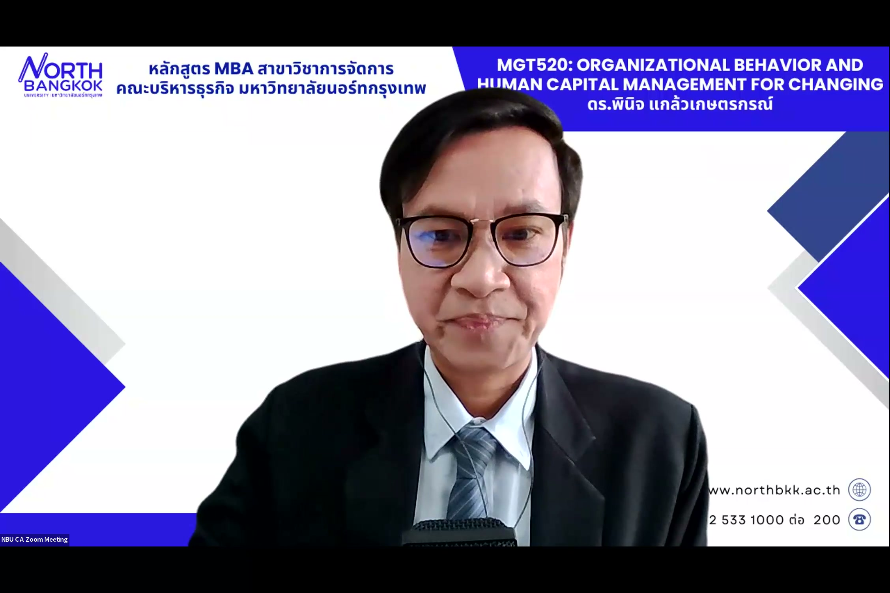

โอเค กลับมานะครับ ที่เราปิดเบรกกันไว้เมื่อสักครู่นะครับ ต่อจากที่เมื่อกี้เลยครับ

## [00:00:13]

## [00:00:16]
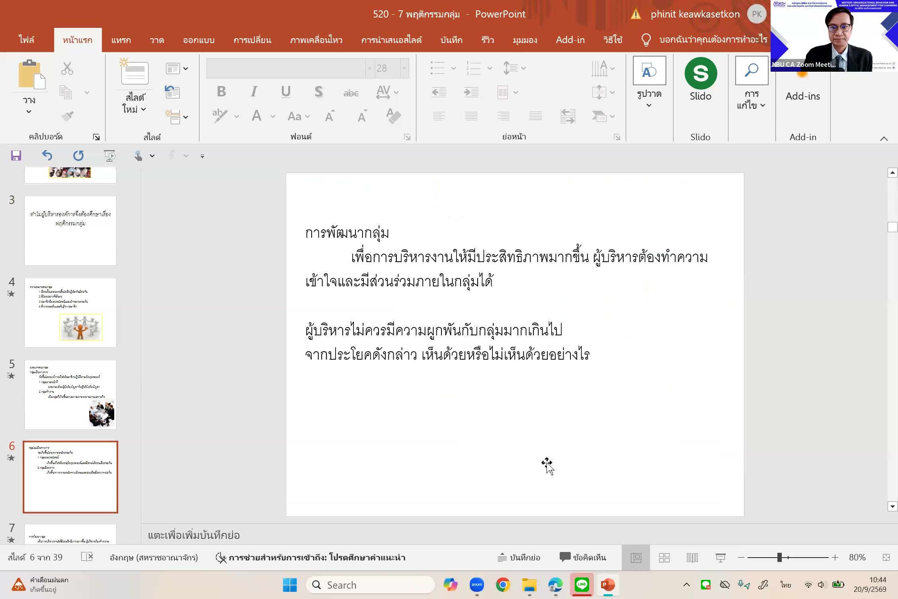

## [00:00:23]
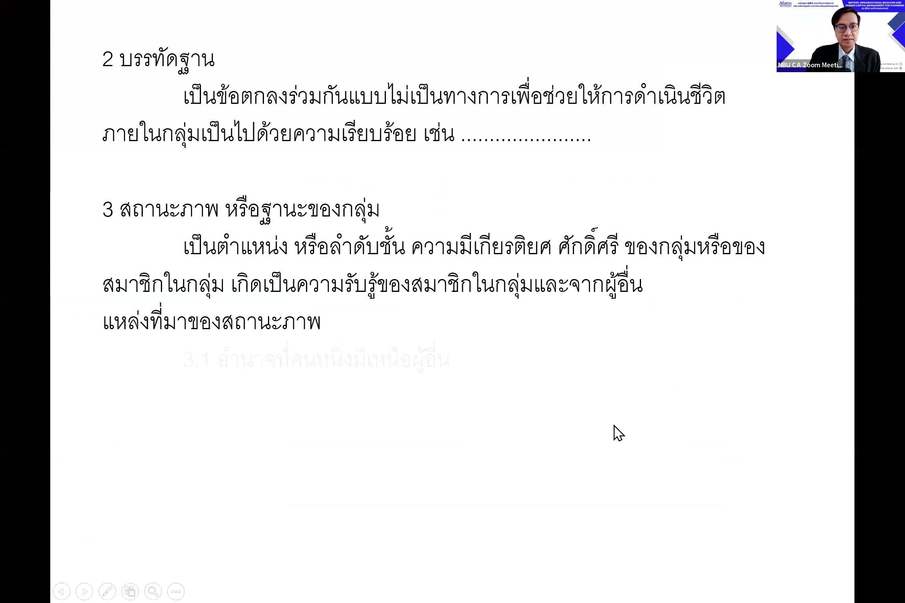

เราจบที่ความเหนียวแน่นของกลุ่มนะครับความเหนียวแน่นของกลุ่มนะครับ สร้างความเหนียวแน่นถ้าเราเป็นหัวหน้ากลุ่มหรือเป็นผู้บริหารนะครับที่ดูแลกลุ่มด้วยนะครับ เป็นดูแลทุกกลุ่มนะครับนักศึกษาถ้าเราเป็นผู้บริหารดูแลทุกกลุ่ม นักศึกษาต้องสร้างแรงกดดันจากอำนาจของเรานะครับ อย่างเช่น นักศึกษากำหนดงบประมาณ กำหนดเวลาในการทำงาน แล้วก็กำหนด กำหนดการแข่งขันนะครับ ให้มีการแข่งขันนะ เพื่อวัตถุประสงค์เราเนี่ย สุดท้ายมันก็จะกลับมาที่ MBO นะครับ Management by objective สุดท้ายก็กลับมาที่ ที่องค์กรแล้วได้ประโยชน์

## [00:00:53]
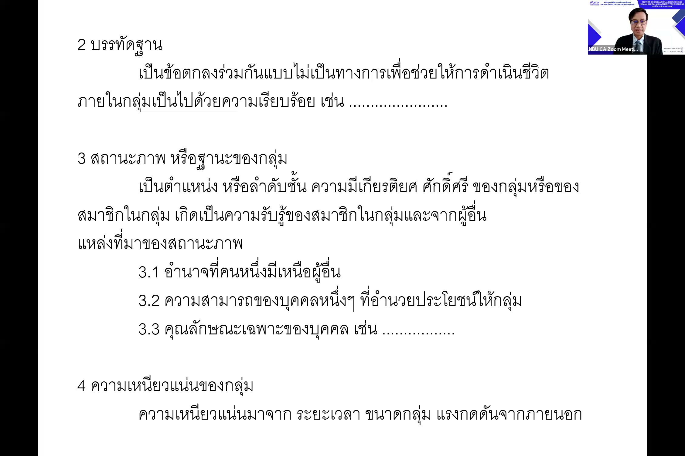

องค์กรได้ประโยชน์สุดท้ายนะครับสุดท้ายคือองค์กรได้ประโยชน์นะครับไม่มีใครได้ประโยชน์ก่อนกว่าองค์กรแล้วนะครับ พอองค์กรได้ประโยชน์ปุ๊บมันก็จะเป็นทฤษฎีเอ่อ เอฟเฟกต์นะ ทฤษฎีไหลรินน้ำน้ำหล่นจากที่สูงอ่ะถ้าองค์กรอยู่ได้มันก็ไหลลงพนักงานก็อยู่ได้นะครับพนักงานอยู่ได้

## [00:01:23]
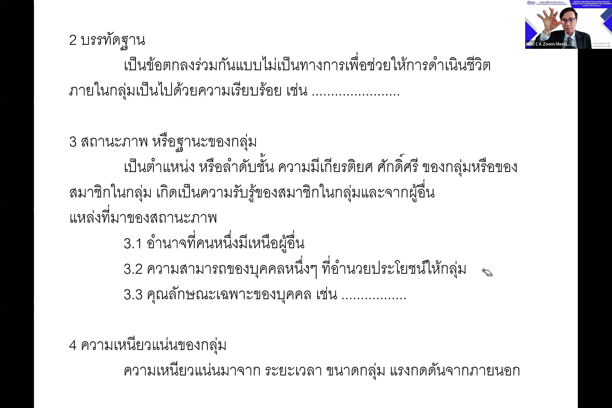

ครอบครัวพนักงานก็มีความสุขตามลำดับ พอครอบครัวสุข พนักงานก็จะมีความสุขไปด้วย พนักงานก็จะทำงานให้องค์กรได้อย่างมีความสุข ผลงานก็ออกมาดี สุดท้ายมันก็กลับขึ้นไปที่องค์กรก็ได้ประโยชน์ สุดท้ายองค์กรได้ประโยชน์ครับ อ่ะ โอเคนักศึกษาครับ เพราะฉะนั้นความเหนียวแน่นครับ อาจารย์มี เมทริกนะครับ เรียกเมทริก

## [00:01:53]
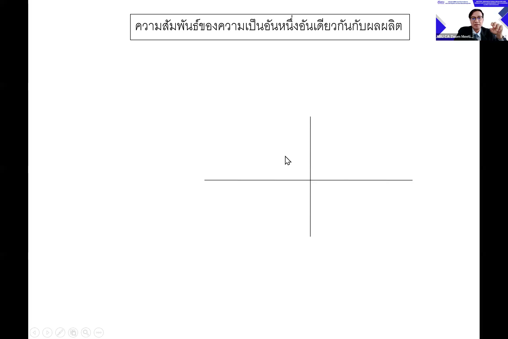

มีปัจจัยสองตัวที่อธิบายถึงความสัมพันธ์ของความเป็นอันหนึ่งอันเดียวกันกับผลผลิตนักศึกษาครับ ความเหนียวแน่นก็คือความเป็นอันหนึ่งอันเดียวกันนะครับความเหนียวแน่นเนอะ นักศึกษามาดู ตารางนี้ครับ ใช้คำว่าตารางก็ได้ครับ ตารางนี้มาดูนะ ตั้งใจดูนะครับ ตารางนี้นะครับ ผลลัพธ์ของมันคือผลผลิตนะครับ ผลลัพธ์คือผลผลิต แต่ความเหนียวแน่นของกลุ่ม

## [00:02:23]
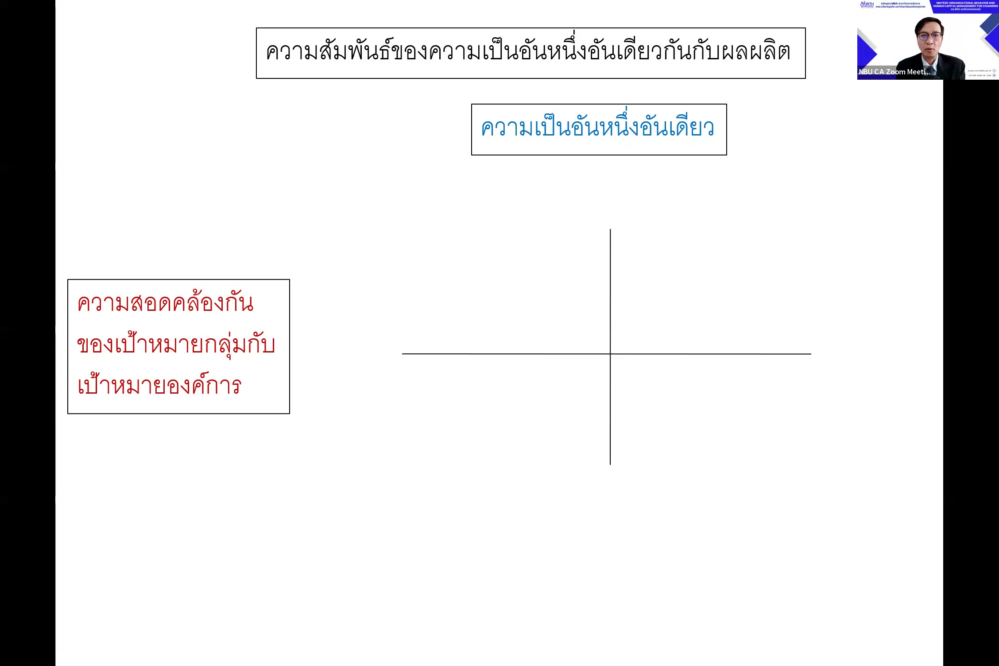

มันจะมีผลหรือส่งผลต่อผลผลิตเมื่อความเหนียวแน่นนั้นมันสอดคล้องกับเป้าหมายของกลุ่มด้วยชัดเจนนะครับ ความเหนียวแน่นส่งผลต่อผลผลิตขององค์กร แต่ความเหนียวแน่นนั้นต้องสอดคล้องกับเป้าหมายองค์กรด้วย นักศึกษาครับก็เลยกลายเป็นสองมิติ

## [00:02:53]
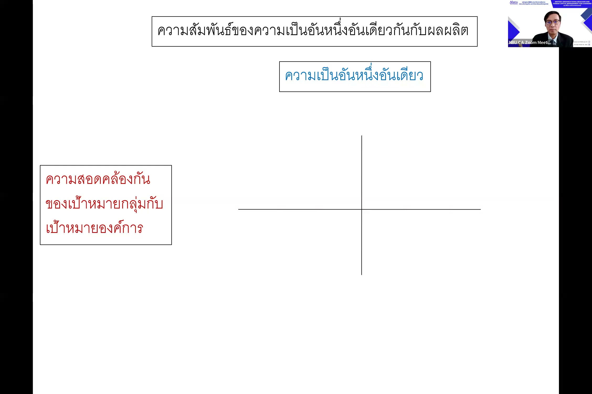

ถ้าภาษาอังกฤษเขาเรียกควอเดรนนะครับควอเดรน อันนี้มิติหนึ่ง อันนี้มิติหนึ่งนะ แล้วก็ภาพนี้อีกมิติหนึ่งมันก็จะอยู่คนละช่องนะครับ เห็นชัดนะครับ แล้วก็มิตินี้ครับ

## [00:03:23]
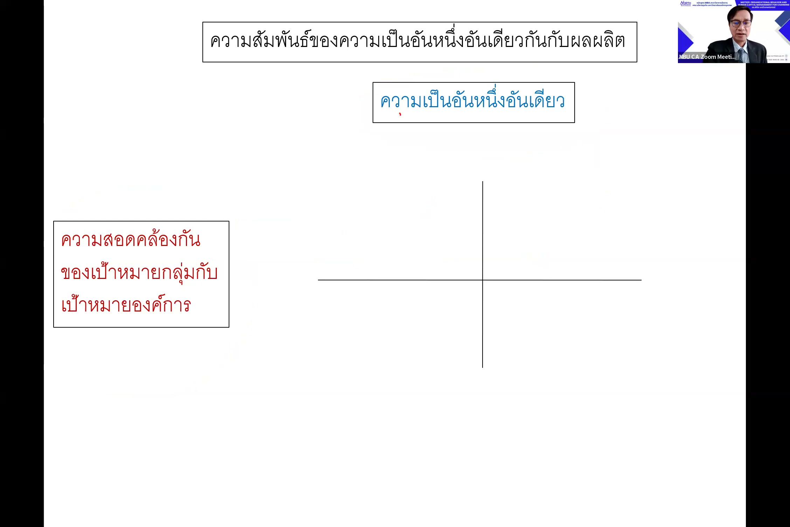

กับมิตินี้ก็อีกช่องหนึ่ง อีกคลอดแรนหนึ่ง แล้วก็สุดท้ายก็อันนี้กับอันนี้ อะ โอเคนักศึกษา งั้นอาจารย์ใช้คำพูดแบบนี้ครับ เริ่มต้นที่ให้นักศึกษาดูความเป็นอันหนึ่งอันเดียวกันก่อนนักศึกษาครับ เริ่มต้นที่สูง เหนียวแน่นมากสามัคคีกันมาก ความเหนียวแน่นมาก สูงต่อไปมาดูด้านความสอดคล้องครับ อีกมิติหนึ่งความสอดคล้องกันของเป้าหมายกลุ่ม

## [00:03:53]
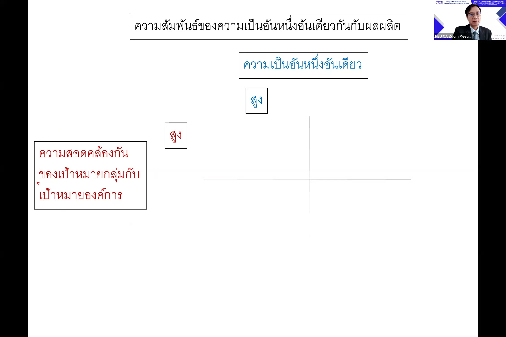

เป้าหมายของกลุ่มกับเป้าหมายองค์กรอันนี้ชัดเจนนะครับ ต้องอธิบายนิดหนึ่งแล้วกัน หมายถึงสิ่งที่กลุ่มทำกับสิ่งที่องค์กรต้องการเป็นเรื่องเดียวกัน เข้าใจ สิ่งที่กลุ่มกำลังทำอยู่ เป็นเรื่องเดียวกันกับที่องค์กรต้องการนั่นก็คือความสอดคล้อง แล้วถ้ามันสูงหมายถึงเรื่องเดียวกัน เป๊ะ เป๊ะ ร้อยเปอร์เซ็นต์ เป๊ะสามัคคี เอ่อ ความเหนียวแน่นก็สูงด้วย ความสอดคล้องก็สูงด้วยเพราะฉะนั้นผลผลิตออกมาสูงแน่นอนครับ ผลผลิตเพิ่มขึ้นสูงแน่นอนต่อไปครับ แต่ถ้าหากว่าความเป็นอันหนึ่งอันเดียวกันความเหนียวแน่นต่ำ ความเหนียวแน่นต่ำ

## [00:04:23]
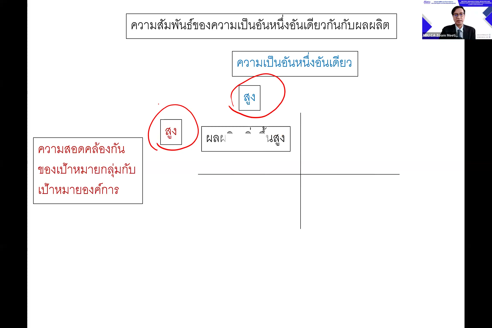

แต่ความสอดคล้องกันของเป้าหมายของกลุ่มกระเป๋าสังกรเนี้ยสูง แต่ความเหนียวแน่นต่ำน่ะครับหมายถึงแต่ละคน แต่ละคนใน ในทีมอ่ะคนละทาง คนละที่คนละทางน่ะครับ ถ้า

## [00:04:53]
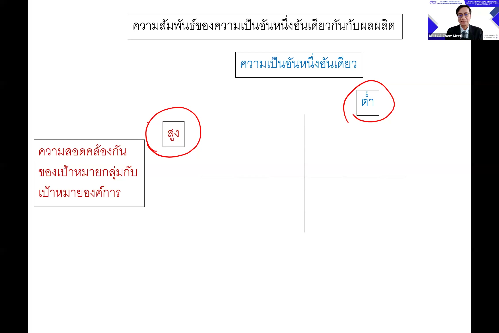

นักศึกษาไม่ดูเอกสารที่อาจารย์ส่งไปให้นะผมจะให้นักศึกษาเดานะครับเดาอย่างมีเหตุผลนะว่าคิดว่าผลผลิตขององค์กรจะเป็นอย่างไรถ้าใครดูแล้วก็ไม่ต้องตอบนะครับแต่ถ้าใครยังไม่ได้ดูหรือหรือกำลังดูไปแล้ว แต่เราจะทำความเข้าใจว่ามันเป็นเพราะอะไรก็ทำไปพร้อมๆกับคำพูดอาจารย์เลยนะ เริ่มต้นให้ดูความเหนียวแน่นของของทีมก่อนความเหนียวแน่นต่ำมากนักศึกษาครับ ไม่ได้มีความเหนียวแน่นถ้านักศึกษาอยากรู้ความเป็นอันหนึ่งหรือความเหนียวแน่นต่ำหมายถึงอะไรนักศึกษาย้อนกลับไปดูหน้าเมื่อกี้นะ หน้าเมื่อกี้นะทำงานชิลให้มีแรงกดดันนักศึกษาแล้วก็ไม่

## [00:05:23]
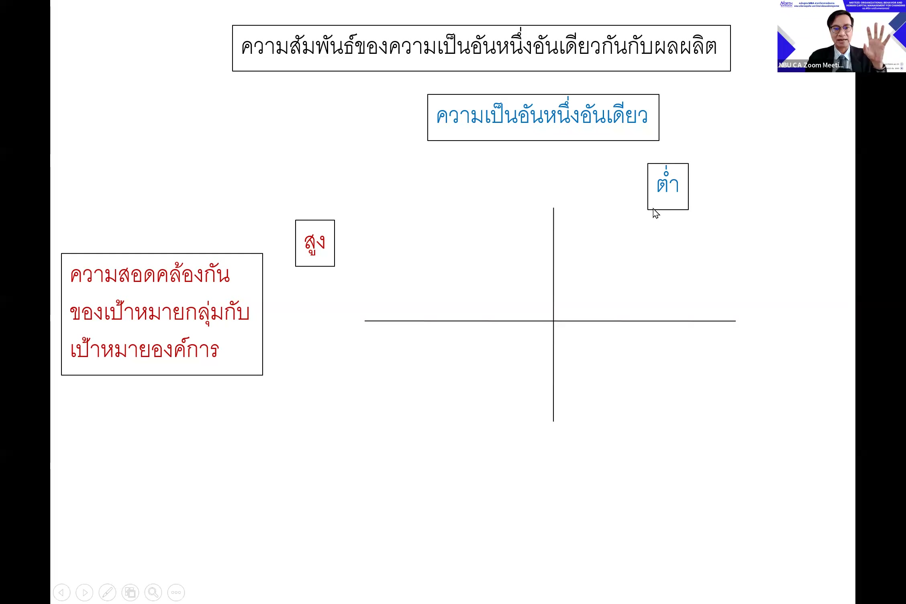

ไม่ได้สามัคคีกันนักศึกษาครับ ไม่ได้สามัคคีกันน่ะ ผลผลิตออกมานักศึกษาเพิ่มขึ้นปานกลางนักศึกษาเพิ่มขึ้นนะครับ เพิ่มขึ้นปานกลางนะครับ เข้าใจไหมครับ นักศึกษาเข้าใจไหมทำไมมันยังเพิ่มขึ้นนะทั้งทั้งที่ กลุ่มไม่ได้เหนียวแน่นเลยนะครับแต่ทำไมผลผลิตยังเพิ่มขึ้นนะครับ เพราะอะไร เป้าหมายเดียวกันไหมฮะความสอดคล้องของเป้าหมายตรงกันทุก

## [00:05:53]
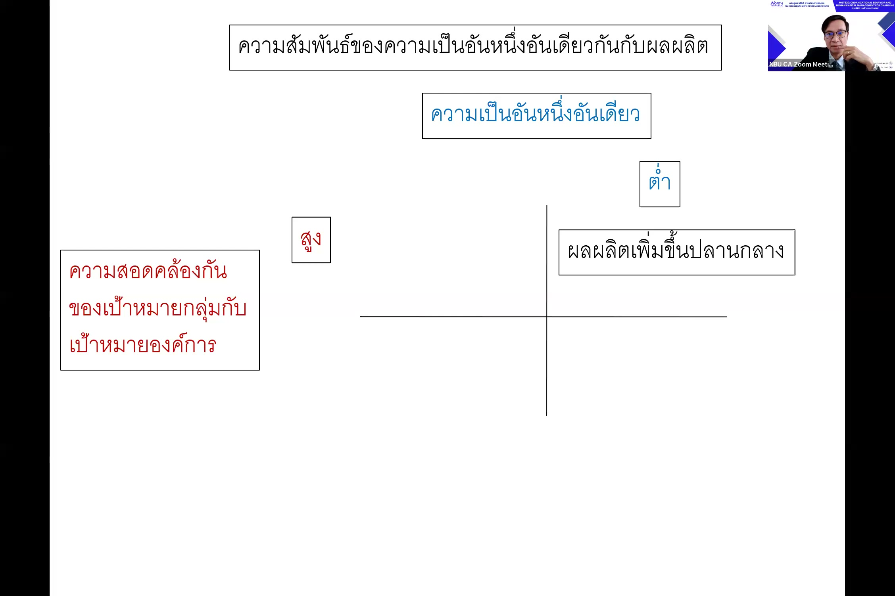

มันสูง ถ้าหากว่าเราจะใช้คำว่าเป้าหมายเดียวกันต้องระบุให้ชัดนะว่าเป้าหมายใคร เออ หนูต้องพูดแบบนี้ เป้าหมาย เป้าหมายใคร เป้าหมายของ เป้าหมายองค์กร ถูกครับ ต้องพูดว่าเป้าหมายองค์กรครับนักศึกษาครับ ถ้าหากว่าคนในทีมอ่ะ สมมุติมีสองคนแล้วกัน ถือว่าเป็นทีมนะครับ มีสองคนแต่ละคนไม่สามัคคีกัน ไม่เหนียวแน่นกันครับ แยกกันเลยนะครับผมแยกกันแบบนี้เลยนะครับ

## [00:06:23]
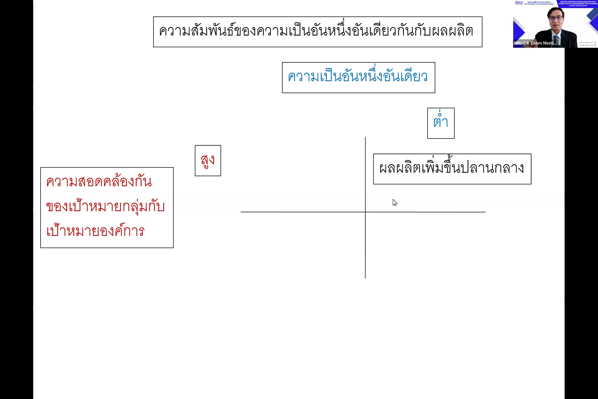

แต่แต่ละคนทำตามเป้าหมายองค์กรครับนักศึกษาครับแต่ละคนทำตามเป้าหมายองค์กร แต่ถามว่านายกอยอมรับในขอไหม ไม่ ไม่ยอมรับ นายก ชอบในขอไม่ก็ไม่ชอบน่ะครับ ไม่ได้ยอมรับแต่ทุกคนทำตามเป้าหมายองค์กรครับน่ะครับ นั่นแหละครับเหตุผลนี้ทำไมผลผลิตยังเพิ่มอะครับ

## [00:06:53]
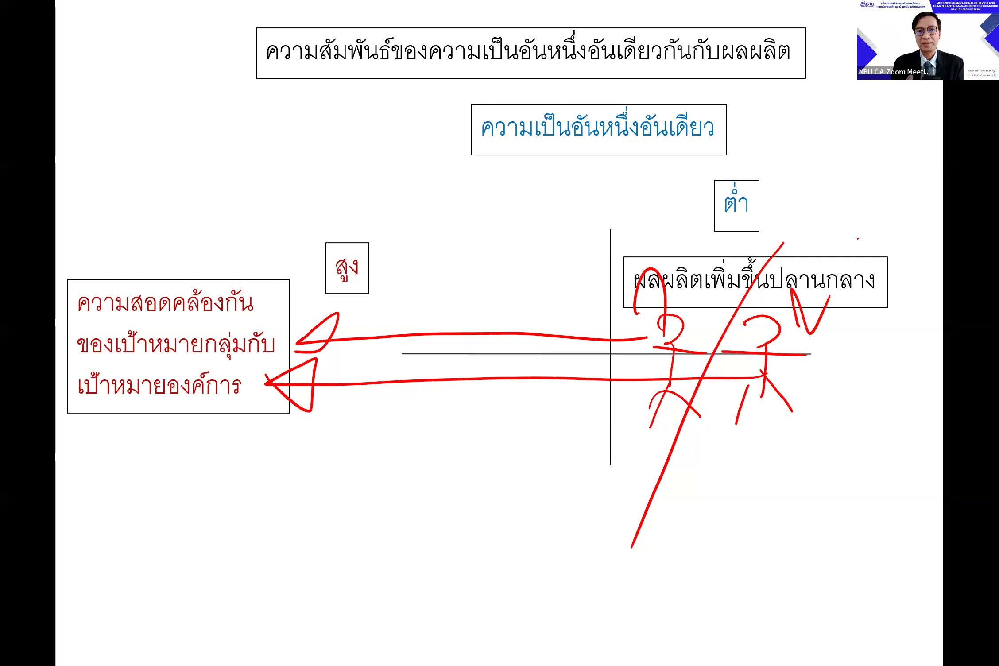

แต่ไม่ได้เพิ่มเยอะนะ 3 แค่นั้น แค่นั้น เหตุผลแค่นั้น เป้าหมายปันการ เข้าใจนะครับ ทันนะ โอเคครับ ต่อครับ ช่องนี้นะครับช่องล่างซ้ายนะครับความเป็นอันหนึ่งอันเดียวกันสูงเหนียวแน่นมากมากนักศึกษาเหนียวแน่นมาก แต่ไม่สอดคล้องกับเป้าหมายองค์กรครับ เป้าหมายกลุ่มไม่สอดคล้องกับเป้าหมายองค์กรครับ ระดับต่ำเลยครับนักศึกษาครับ

## [00:07:23]
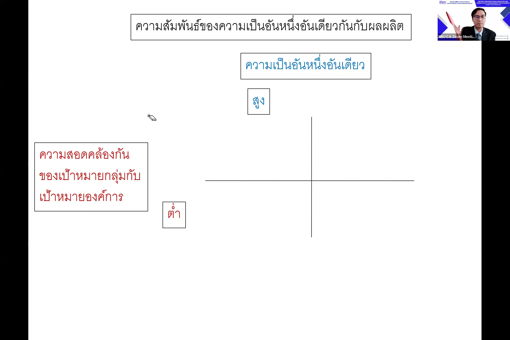

ถ้าใครเห็นแล้วนักศึกษาเห็นแล้วก็หาเหตุผลแล้วกันนะครับแต่ถ้าใครยังไม่เห็นลองเดาซิว่าผลผลิตจะเป็นยังไงถ้าใครไม่เห็นนะยังไม่ได้ดูเอกสารที่ฉันส่งไปนะครับลองเดาดูแล้วก็ตอบในใจก็ได้นะครับนักศึกษาครับคิดว่าจะเป็นยังไง ถ้ามีความเหนียวแน่นในกลุ่มสูงมากนะครับผลงานจะต่ำค่ะ เออผลผลิตลดลงครับนักศึกษาครับ งั้นเหตุผลก็เพราะอะไรนักศึกษาครับถ้าความเหนียวแน่นนั้นเนี่ย ผม

## [00:07:53]
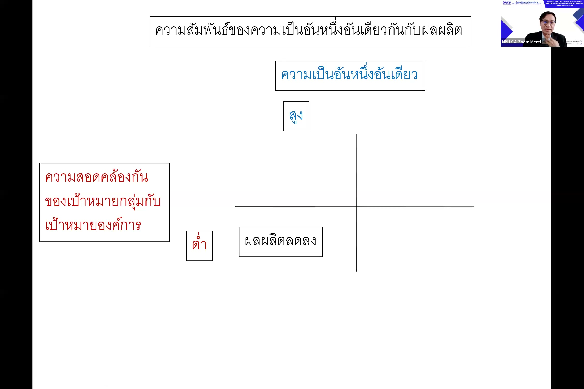

แต่ละคนก็ไม่เห็นด้วยองค์กรไงแต่ละคนไม่เห็นด้วยองค์กรแต่แต่ละคนเห็นด้วยกันเองในกลุ่มอะครับ สามัคคีกันมากเห็นไปในทิศทางเดียวกันกับสิ่งที่ที่ที่คนในกลุ่มคิดแต่ไม่เห็นด้วยกับเป้าหมายองค์กรแบบเนี้ยนักศึกษาครับ รับรองได้ว่าเละแน่นอนนักศึกษาครับ ระดับองค์กรเละนะครับนักศึกษาครับผลผลิตองค์กรเละแน่นอนครับ ต่ำแน่นอนนักศึกษาครับแต่ผลงานในทีมอ่ะ อาจจะดี แต่ไม่ได้เกี่ยวกับองค์กรนักศึกษาครับ

## [00:08:23]
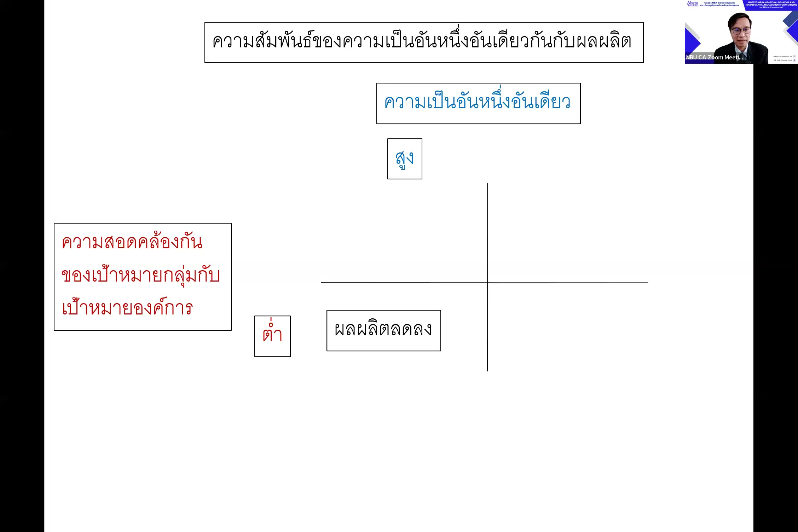

มันไม่ใช่สิ่งที่องค์กรต้องการนะครับนักศึกษาครับ มันเป็นเรื่องอื่น เดี๋ยวอาจารย์ค่อยถาม ค่อยถามแล้วกันนะ ต่อไปสุดท้ายครับ ต่ำทั้งคู่ครับนักศึกษาครับ ความเป็นอันหนึ่งอันเดียวกันก็ต่ำคนในทีมเนี่ยคนละทิศคนละทางน่ะนักศึกษาครับ ไม่ยอมรับกันไม่ไม่ยอมรับบทบาทของกันและกันนักศึกษาครับ แล้วก็เป้าหมายสิ่งที่องค์ทีมต้องการ

## [00:08:53]

ไม่ได้เกี่ยวข้องกับที่องค์กรต้องการนะอาสาครับ ผลออกมาเป็นช็อกเหมือนกันนะครับ ไม่มีผลกระทบครับ ทำไมนะอาสา ทำไมไม่มีผลกระทบนะ

## [00:09:23]
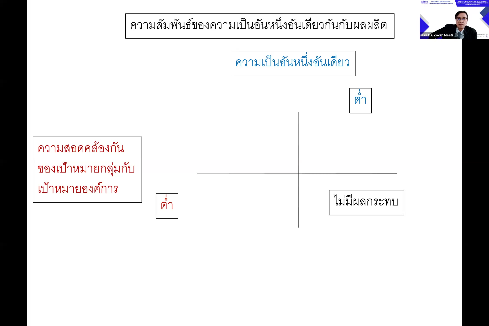

นักรักษาครับ ถ้าหากว่าคนในทีมสองคนนี้ไม่สามัคคีกัน ไม่มีความ ไม่เป็นอันหนึ่งอันเดียวกันนะครับในทีม ไม่ยอมรับกัน อืมแล้วแต่ละคนก็ คือหมายถึงทีมนะครับ ทีมนะครับก็ไม่ได้ทำงานสอดคล้องกับเป้าหมายองค์กรด้วยนะครับ ไม่มีคุณภพอะไร มีใครพอเข้าใจอธิบายให้ฟังหน่อย

## [00:09:53]
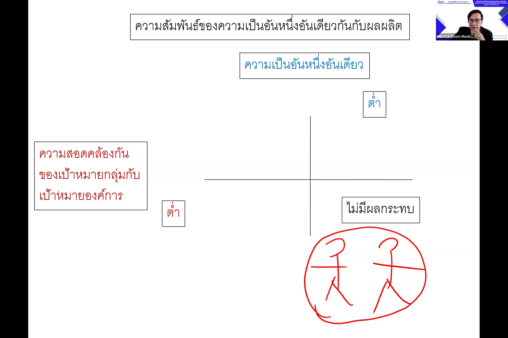

เนื่องจากเป้าหมายขององค์การองค์กรต่ำอยู่แล้วด้วยค่ะอาจารย์เพราะว่าเขาไม่ได้วางเป้าหมายไม่ได้วางแผนว่าว่าตั้งเป้าว่าต้องทำยอดได้เท่านี้เท่านี้น่ะอะไรอย่างเงี้ย เป้ามันเป็นแบบพื้นพื้นว่าสมมุติว่าเดือนที่แล้วเคยทำได้อยู่ประมาณ 20 เปอร์เซ็นต์ แล้วก็เขาก็ไม่ได้ตั้งเป้าอะไรว่าเอ้ยคุณต้องทำเพิ่มมาอีกเป็นห้าสิบเปอร์เซ็นต์นะอะไรอย่างเงี้ยไม่ได้ตั้งเป้าคือเป้ามันต่ำอยู่แล้ว เป้าหมายขององค์กรต่ำอยู่แล้วมันก็เลยไม่มีผลกระทบอะค่ะ

## [00:10:23]
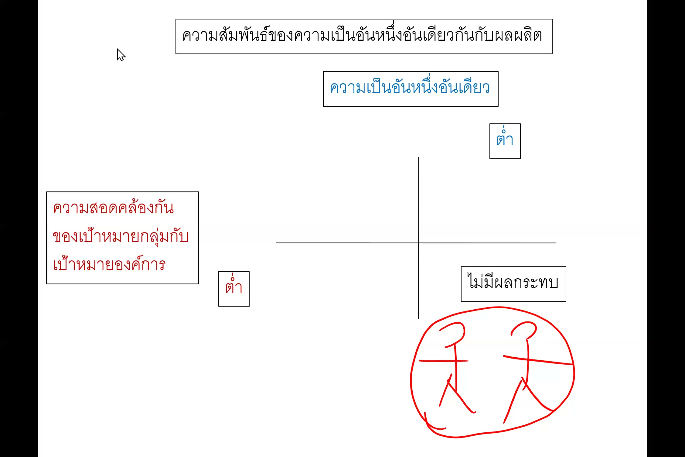

อืม ขอความเป็นอันหนึ่งอันเดียวขอกัน หมายถึงไอ้ช่องนี้นะที่อาจารย์กำลังวงไว้เนี่ย อาจารย์กำลังวงมิติที่บอกว่าเป็นปัจจัยด้านความสอดคล้องกันของเป้าหมายของกลุ่ม กับเป้าหมายองค์กร ถ้ามันต่ำหมายถึงเป้าหมายองค์กร เป้าหมายขององค์กรเนี่ย กับเป้าหมายของกลุ่มเนี่ย มันคนละทาง นักรักษาครับ มันไม่มีผลกระทบ

## [00:10:53]
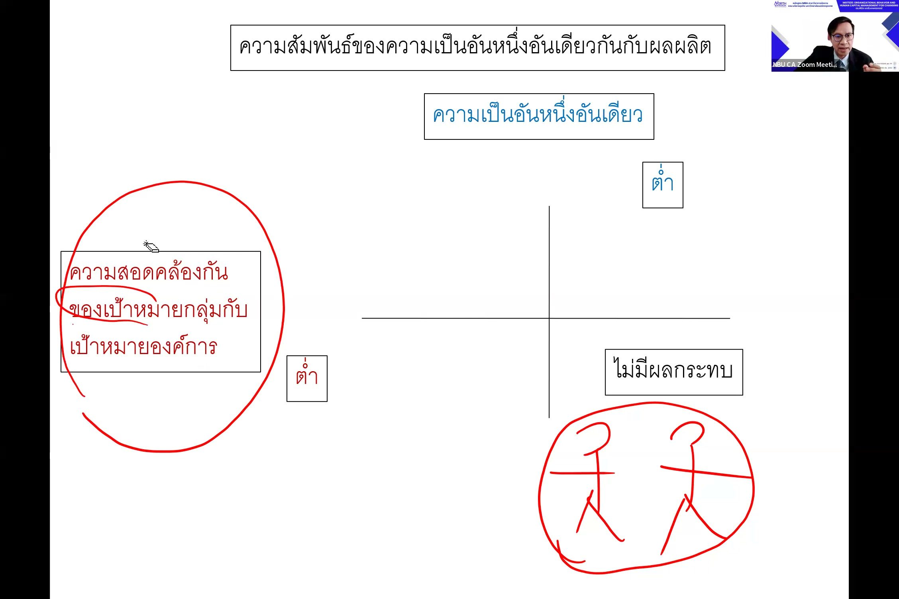

เข้าใจยากคำนี้ผมเปลี่ยนเป็นคำว่าเท่าเดิม เออ ง่ายกว่าไหม ง่ายกว่า เข้าใจง่ายกว่านะแสดงว่า มันก็ไม่ได้ไปทำให้องค์กรมีปัญหานะครับ เพราะว่าไอ้กลุ่มมันไม่สามัคคีกันไอ้คนสองคนเนี้ยมันไม่สามัคคีกัน มันเห็นคนละที่คนละทางในในในทีมเองนั่นแหละแล้วมันก็จะไป

## [00:11:23]

ไป ไปส่งผลต่อ มันก็จะไม่เกี่ยวกับเป้าหมายองค์กรสิ่งที่ทีมเห็น กับสิ่งที่องค์กรต้องการก็คนละ คนละเรื่องผลผลิตที่เคยทำได้เท่าไหร่ มันก็จะทำได้เท่าเดิมครับ มันเคยทำได้เท่านี้ยี่สิบเปอร์เซ็นต์นะครับมันก็จะได้ยี่สิบเปอร์เซ็นต์เท่าเดิม ได้เท่าเดิมใช้คำว่าได้เท่าเดิมก็จะง่ายกว่า ก็จะง่ายกว่า โอเค เข้าใจนะ ทันนะครับ

## [00:11:53]
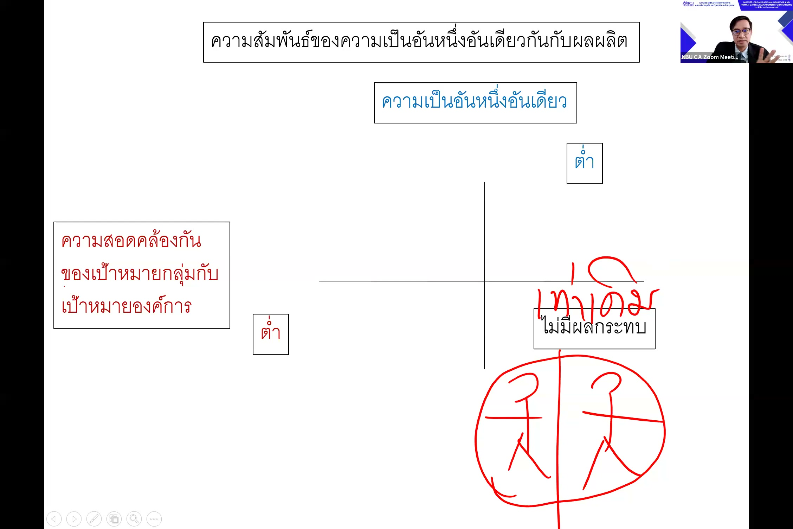

โอเคนะ น่าเชื่อว่าอีกเข้าใจนะทุกคนเข้าใจนะครับ ทันนะครับนักศึกษาครับ ทันนะครับ เพราะฉะนั้นผมจะให้นักศึกษาดูแบบทั้งหมดน่ะในมอนิเตอร์เนี่ยนักศึกษาครับ ให้ดูแบบขึ้นมาทั้งหมดน่ะนักศึกษาว่าแบบไหนอันตรายสุดน่ะ

## [00:12:11]
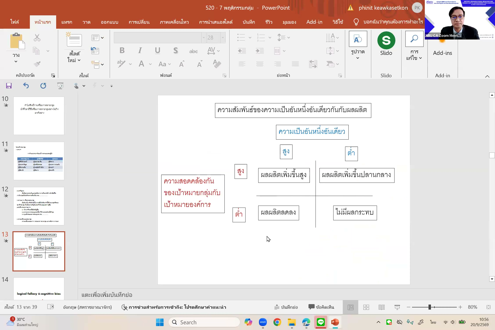

## [00:12:15]
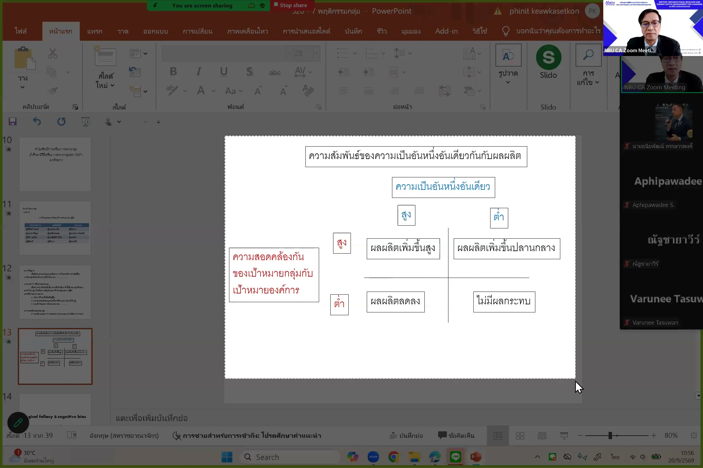

## [00:12:21]

แบบไหนควรเป็นห่วง ผลผลิตลดลงครับ ดูตรงผลผลิตลดลงในอันตรายน่าเป็นห่วงสุดนะครับ เพราะว่าถ้ากลุ่มมีความเหนียวแน่นสูงนะครับ ทีมมีความเหนื่อยแน่นสูงครับแล้วมันทำงาน ปฏิเสธนโยบายองค์กรเนี้ยอันเนี้ยอันตรายนะครับ ไม่เห็นด้วยกับองค์กรแล้วก็คนในทีม

## [00:12:51]
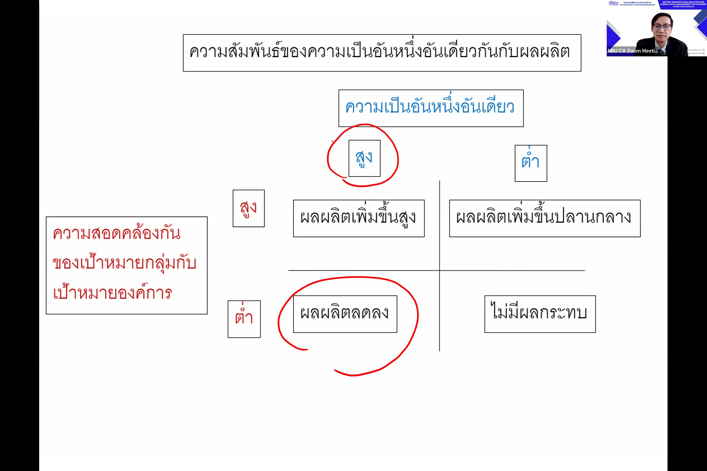

ทิศทางเดียวกันเลยว่าไม่เห็นด้วยกับนโยบายองค์กร อันนี้อันตรายนะครับ อันตรายมันกลายจะเป็นคลื่นใต้น้ำนะครับ เป็นคลื่นใต้น้ำ ตรวจสอบ ต้องตรวจสอบ ตรวจสอบยากนะครับ แต่ก็ต้องตรวจสอบแล้วว่าเป็นเพราะอะไรนะฮะ โอเคนะ งั้นนักศึกษาภาคนี้ก็น่าสนใจนะครับ แต่นักศึกษาต้องอธิบายเพิ่มนะครับ ไป

## [00:13:21]
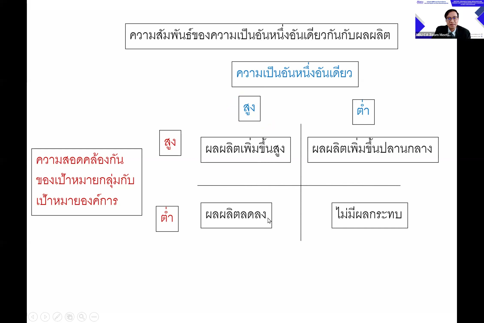

หาข้อมูลเพิ่มเติมนะครับผมทิ้งไว้แค่นี้ เรื่องนี้นะครับ เรื่องความแนวแน่ของกลุ่มกับตารางความสัมพันธ์นะครับ ความเป็นหนึ่งอันเดียวกัน ต่อไป อันนี้น่าสนใจครับนักศึกษาครับ จริงๆก็แล้วแต่น่าสนใจหมดแล้วนะครับ โอเค ปรากฏการณ์ใช้เหตุผลเพี้ยนๆของคนในสังคม เขาใช้คำว่าบิดเบี้ยวนักศึกษา

## [00:13:51]
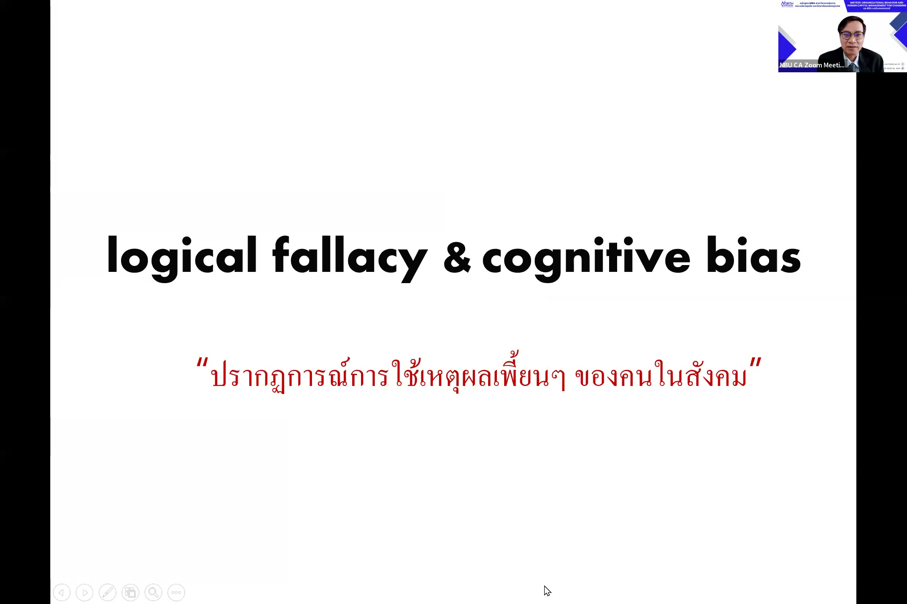

อันนี้อาจารย์หาข้อมูลมาเพิ่มเติมให้นะครับเรื่องนี้ก็คือความบิดเบี้ยวของของโลจิคมันมันไม่ไม่ควรเป็นเป็นอย่างที่มันเป็นน่ะ Forensic Cognitive Bias ความบิดเบี้ยวของเหตุผลของคนในสังคมน่ะสิครับ มีอะไรบ้าง อันนี้อาจารย์จะจะเปรียบเทียบกับว่าในองค์กรมันก็คือสังคมหนึ่งสังคมอ่ะ

## [00:14:21]
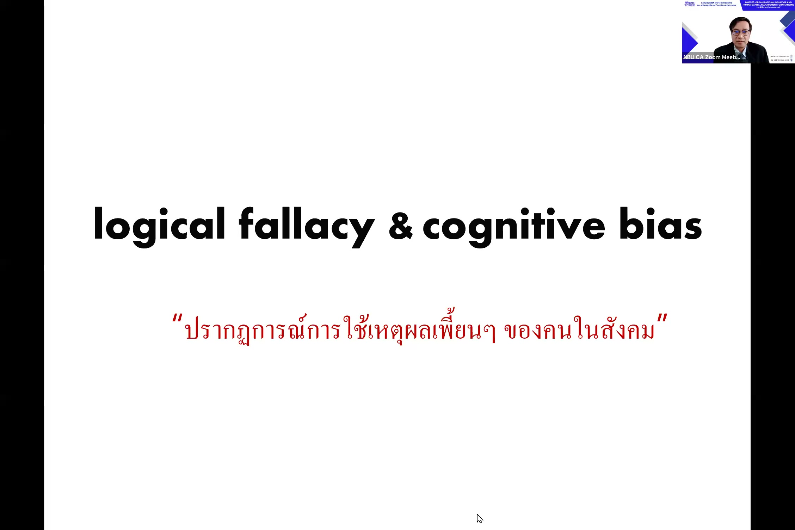

แล้วบางทีเนี้ยนะครับไอ้คำว่าเรียนพฤติกรรมองค์กรเพื่ออธิบายทำนายควบคุมอ่ะ แต่ข้อแรกเลยอ่ะอธิบายอ่ะ บางทีเราอธิบายไม่ได้ครับว่าทำไมพฤติกรรมกลุ่มมันเป็นแบบนี้ ทำไมความคิดมันมันไม่เป็นไปตามเหตุและผลที่มันควรจะเป็นในยุคหนึ่งอ่ะหรือในคำอธิบายหนึ่งในทฤษฎีหนึ่งอ่ะทำไมมันไม่ไม่ไม่เป็นไปตามนั้น

## [00:14:51]
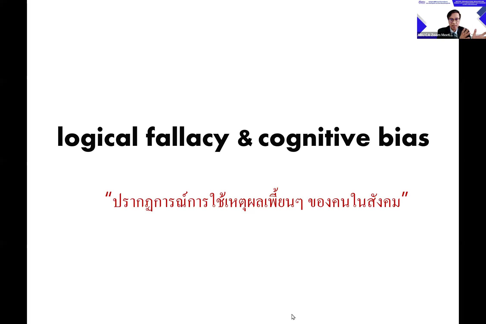

มันแปลกๆ ใช้คำว่าเหตุผลบิดเบี้ยวนักศึกษาครับ logical fallacy นักศึกษา พร้อมนะครับมาดูเหตุผลต่อไปนี้นักศึกษาครับ ใช้ความคิดพื้นฐานของตนเองตัดสินผู้อื่น

## [00:15:10]
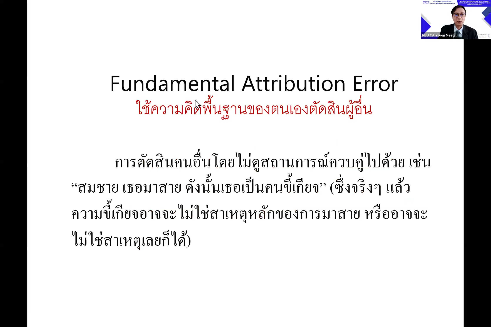

Fundamental Attribution Error นะครับ การตัดสินคนอื่นโดยไม่ดูสถานการณ์ควบคู่ไปด้วย เช่น สมชายเธอมาสาย ดังนั้นเธอเป็นคนขี้เกียจ อันนี้เหตุและผลนะ เหตุผลก็คือ สมชายมาสาย เหตุผลคือ เออ โทษดี ผลคือสมชายเขามาสาย เหตุคือสมชายเขาขี้เกียจซึ่งจริง ๆ แล้วความขี้เกียจอาจไม่ใช่สาเหตุหลักของการมาสายหรืออาจไม่ใช่สาเหตุเลยก็ได้นะครับ

## [00:15:40]
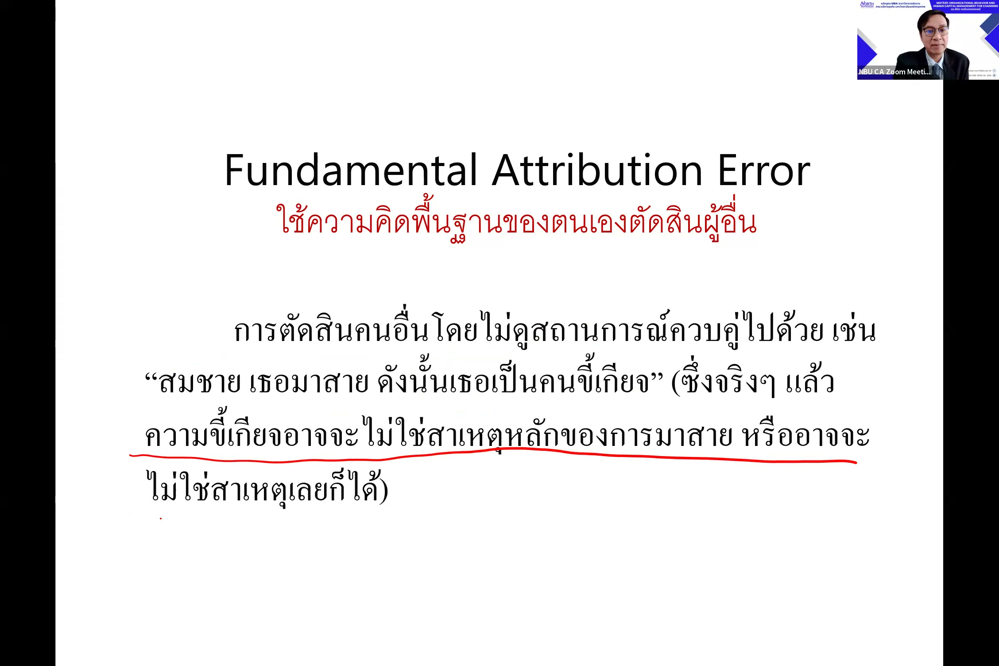

แต่บางทีเราใช้ความคิดพื้นฐานของตนเองไปตัดสินผู้อื่น อ่า อันนี้ง่ายง่ายเนอะ อันนี้ไม่มีอะไรซับซ้อนนักศึกษาครับ อ่ะ ต่อไปครับ คิดเข้าข้างตัวเองครับ เช่น

## [00:15:50]
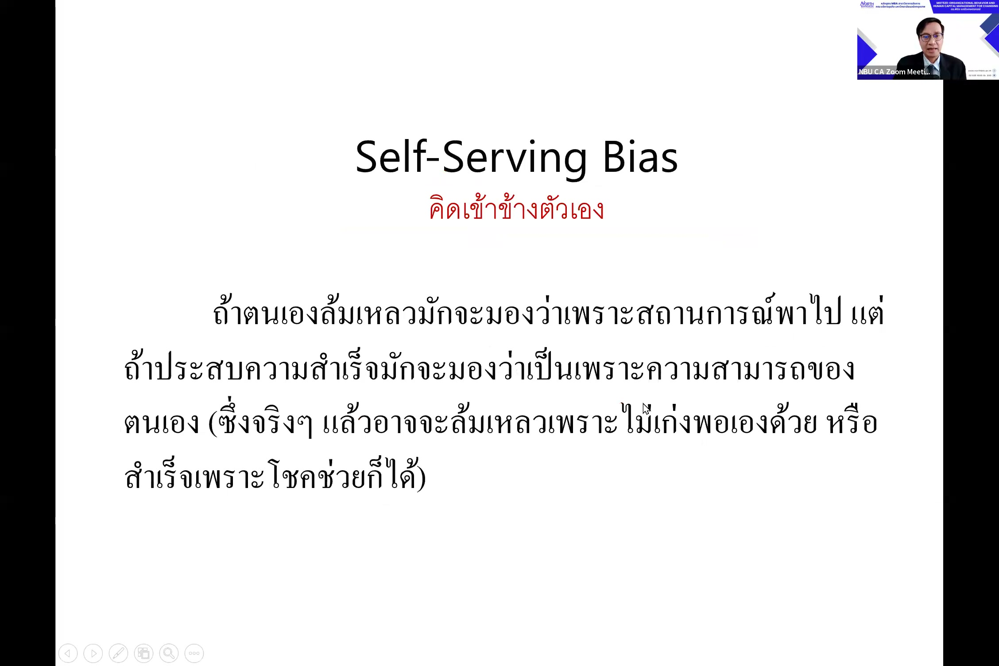

ถ้าตนเองล้มเหลวก็มักจะมองว่าเพราะสถานการณ์มันพาไปแต่ถ้าประสบความสำเร็จก็มักจะมองว่าเป็นเพราะความสามารถของตนเอง ซึ่งจริงจริงแล้วอาจจะล้มเหลวเพราะไม่เก่งพอหรือสำเร็จเพราะโชคช่วยก็ได้นักศึกษาเข้าใจเรื่องนี้ไหม

## [00:16:20]
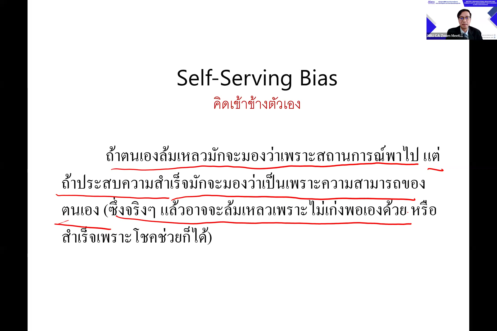

คือผมผมอ่ะโดยผมเป็นสมุดนะจะได้มองเข้าใจง่ายง่าย ถ้าผมไปเปิดร้านขายของตลาดนัดแล้วผมขายไม่ดี ผมก็จะมาบ่นว่าวันนี้ลูกค้าน้อยเนอะ แบบเนี้ย แต่ถ้าขายดีผมก็จะบอกว่าของผมอร่อย นั่นแหละครับ self-serving by ad คลิกเข้าห้างตัวเอง

## [00:16:50]

เวลาขายของไม่ดีก็โทษว่าลูกค้าน้อยวันนี้ลูกค้าน้อยเนอะไม่เยอะเหมือนทุกวันเลย แต่วันไหนขายดีจะบอกว่าเอ้ยของเรามันอร่อยนั่นแหละครับนักศึกษาครับ เนี่ยถ้าตนเองล้มเหลวมักจะมองว่าโภาสนาการพาไปแต่เมื่อไหร่ที่สำเร็จจะมองว่าเราเก่ง นั่นแหละครับเพราะฉะนั้นจริงจริงแล้วที่ล้มเหลวอาจจะเพราะว่าเราไม่เก่งก็ได้หรือที่สำเร็จเพราะอาจจะโชคช่วยก็ได้นั่นแหละครับ อันนี้คือเหตุผลหนึ่งที่เรียกว่า เอ่อ falling out สาม

## [00:17:20]
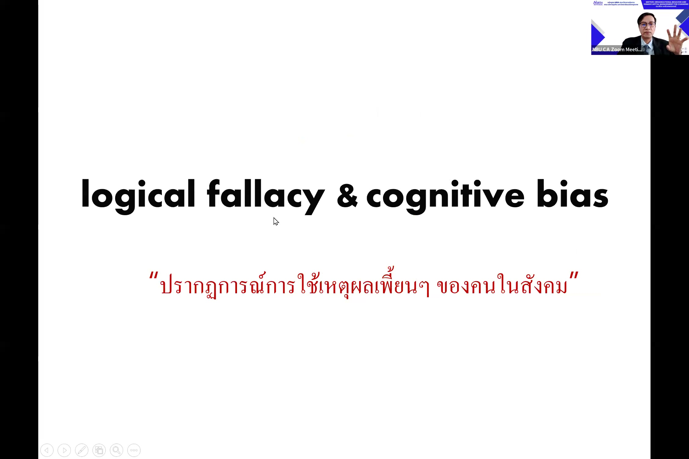

Forensy ครับ ที่เรียกว่าความผิดพลาดนั่นแหละครับ ความผิดพลาดของเหตุผลนั่นแหละครับนักศึกษา คิดข้าง ๆ ตัวเอง เป็นไหมครับนักศึกษาครับ เวลาป่วยไปหาหมอ

## [00:17:24]
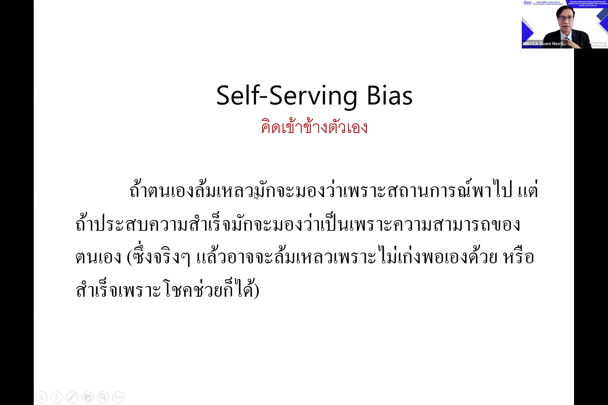

แต่พอหมอรักษาหายไปแก้บ่น แม่มันน่านักนักศาสนาเขตกะโหลกไปเสียเงินให้พระให้เจ้าให้ ให้ผู้มีสิ่งศักดิ์สิทธิ์ทั้งหลายเป็นพันเป็นหมื่นนักศึกษาครับ แต่โรงพยาบาลกลับไม่ได้รับเงินบริจาคนักศึกษา ก็นี่แหละนักศึกษาครับ

## [00:17:54]

เพราะเราคิดว่าที่เราหายเป็นเพราะเราไปบนสิ่งศักดิ์สิทธิ์ไว้ แต่ตอนรักษานี่หมอรักษานะครับ โรงพยาบาลนะครับ ที่โรงพยาบาลรักษา น่าจะการคิดข้องข้างตัวเอง นักศึกษา ถ้าหากว่าเป็นแบบนี้เราลองดูซิว่านักศึกษาเคยเจอเหตุการณ์แบบความคิดแบบนี้ไหม เคยคนอื่นก็ได้นะเจอสถานการณ์ที่คนอื่นเป็นแบบนี้ไหมนะครับ ที่ว่าพอล้มเหลวมักจะโทษ

## [00:18:24]
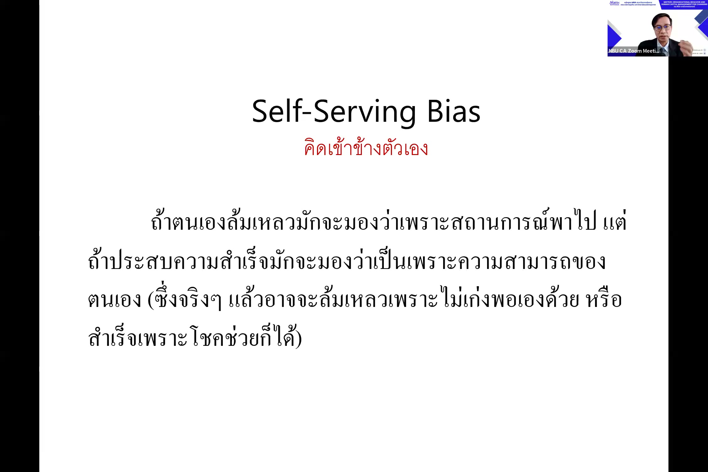

นู่นโทษนี่ โทษอย่างอื่น แต่พอสำเร็จ ก็จะมองว่าเป็นสำเร็จเพราะว่าเราเป็นเพราะเรา เออ แบบเนี้ย อ่า ต่อไปครับ in group forwardism forwardism

## [00:18:39]
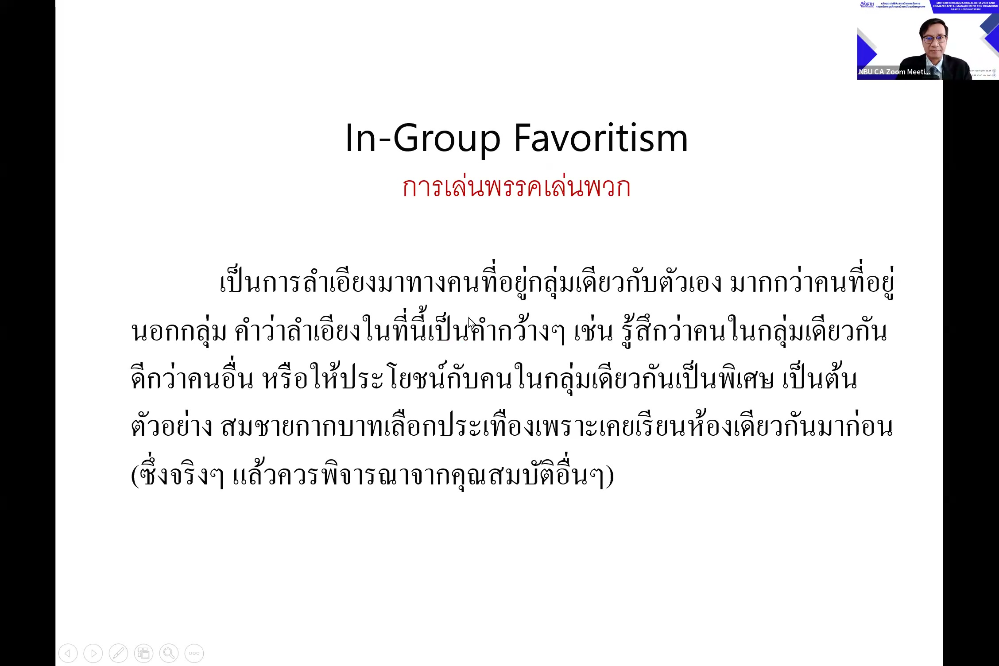

อาจารย์อันผิดขอโทษนะครับเพราะ forward rate นะครับ 3 poverism นักศึกษาการเล่นพรรคเล่นพวกนะครับ อ่านผิดขอโทษด้วยนักศึกษา ingroup นะครับ ingroup เป็นการลำเอียงมาทางคนที่อยู่ในกลุ่มเดียวกับตนเองมากกว่าคนที่อยู่นอกกลุ่ม คำรวดเรียงในที่นี้เป็นคำกว้างๆ เช่น รู้สึกว่าคนในกลุ่มเดียวกันดีกว่าคนอื่นหรือให้ประโยชน์กับคนในกลุ่มเดียวกันเป็นพิเศษ เป็นต้น ตัวอย่างเช่น สมชายกากบาทเลือกประเทืองเพราะเคยเรียนห้องเดียวกันมาก่อน ซึ่งจริงๆแล้ว

## [00:19:09]
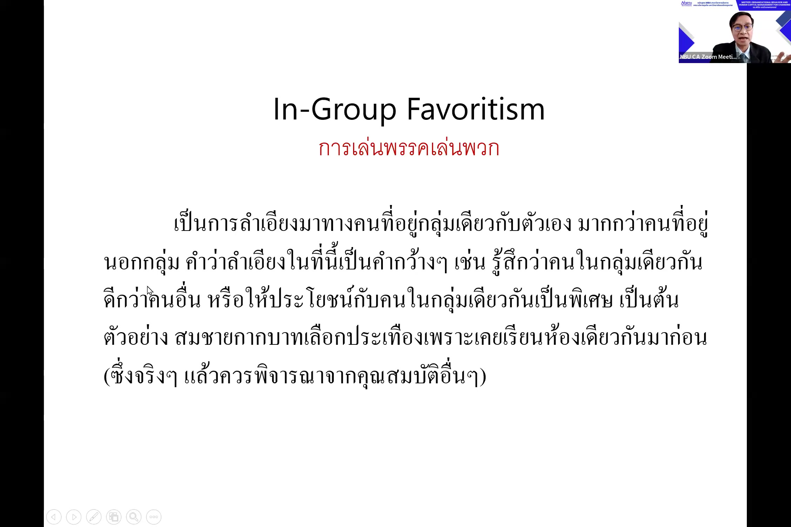

ควรพิจารณาจากคุณสมบัติอื่นมากกว่านะครับ ก็คือ พูดง่ายๆ พวกเราทำผิดเป็นเรื่องเล็กน้อย แต่ถ้าไม่ใช่พวกเราทำผิดเล็กน้อยกลายเป็นเรื่องใหญ่ เออ นั่นแหละครับ ซึ่งเห็นอยู่ทั่วไป ในทุกวันนี้ครับ เข้าใจนะครับ ไปต่อครับ ไม่พูดเยอะครับเรื่องนี้ครับนักศึกษาครับ นี่ครับ Bandwagon Effect นะครับ

## [00:19:35]

Bandwagon Effect ปรากฏการณ์ที่คนเราแห่ทำตามกันนักศึกษาครับ ฟังเรื่องนี้ดีครับนักศึกษาครับ แล้วนักศึกษาลองยกตัวอย่างให้อาจารย์หน่อยนักศึกษาครับ ปรากฏการณ์ที่ชื่อว่า Bandwagon Effect ปรากฏการณ์ที่คนเราแห่ทำตามกัน คือการทำอะไรบางอย่าง เพียงเพราะมีคนทำกันเยอะ นั่นแหละครับ ทำอะไรบางอย่าง คือเราทำอะไรบางอย่าง ซื้ออะไรบางอย่าง ทำอะไรบางอย่าง เพราะคนทำกันเยอะนั่นแหละครับ เช่น ยกตัวอย่างเช่นนั่นแหละครับ

## [00:20:05]

แอ่จองไอโฟนสิบแปดโปรแม็ก ถูกครับ แอ่จองสิบ ไอโฟนสิบแปดโปรแม็กทั้ง ๆ จริง ๆ มัน มันยังไม่จำเป็นต้องซื้ออ่ะ แต่พอเห็นในโซเชียลเนี้ยนักศึกษาครับพออะไรมีใครคนเราไปซื้อเราจะต้องถ่าย ลงโซเชียลเสมอว่าซื้อแล้วนะเนี้ยมันเป็นแบบนี้มานานแล้วนะครับ เป็นตั้งแต่ไอโฟนสี่แล้วนะครับ แล้วเป็นแบบนี้มาเรื่อยๆนักศึกษา เป็นมาเรื่อยๆ เป็นมาเรื่อยๆนักศึกษา คนไทยหรือคนต่างประเทศน่าจะเอเชียเป็นเยอะนักศึกษา ผมว่าอเมริกายุโรปไม่เป็นหรอกครับนักศึกษาเอเชียเป็นเยอะ เกาหลีไทยนักศึกษาครับ เป็นกันเยอะ

## [00:20:35]

[?] พอเห็นในโซเชียลปุ๊บมันเริ่มจิตใจมันเริ่มมุ่งละ เริ่มมุ่งละ เริ่มมุ่งว่าเดี๋ยวต้องซื้อน้องสาวครับ โอ้โห น้องสาวแล้ว แล้วเครื่องนึงมันไม่ใช่ถูกอ่ะแล้วนักศึกษารู้ไว้ว่ามันไม่ได้เปลี่ยนอะไรเลยนอกจากสีอ่ะ ไอโฟนทำไมทำแบบนี้อ่ะ ทำไม เอ้อ นักศึกษาฮับ อ่ะ มีอย่างอื่นไหม มี เหมือนเดิม ใช่ค่ะ มาดูมาแล้ว เหมือนเดิมนักศึกษาฮับ เหมือนเดิม

## [00:21:05]

แต่มันขึ้นชื่อว่าผู้ติดตามมาสาวกเขาใช้คำว่าสาวก สาวกไอโฟนต้องเปลี่ยน ต้องเปลี่ยน ถ้าไม่สิบเจ็ดก็สิบแปดสิบเจ็ดพลาดมาแล้วไม่ได้เปลี่ยน สิบแปดต้องเปลี่ยนล่ะนักศึกษาครับถ้าถ้าสิบแปดไม่เปลี่ยนนักศึกษาสิบเก้าคือคือคำตอบสุดท้ายใครที่เป็นสาวกไอโฟนจะต้องเปลี่ยนตอนสิบเก้าถ้าสิบเจ็ดไม่ได้เปลี่ยนสิบแปดไม่ได้เปลี่ยนสิบเก้าต้องเปลี่ยนเตรียมเสียเงินได้เลยนักศึกษาครับ

## [00:21:35]
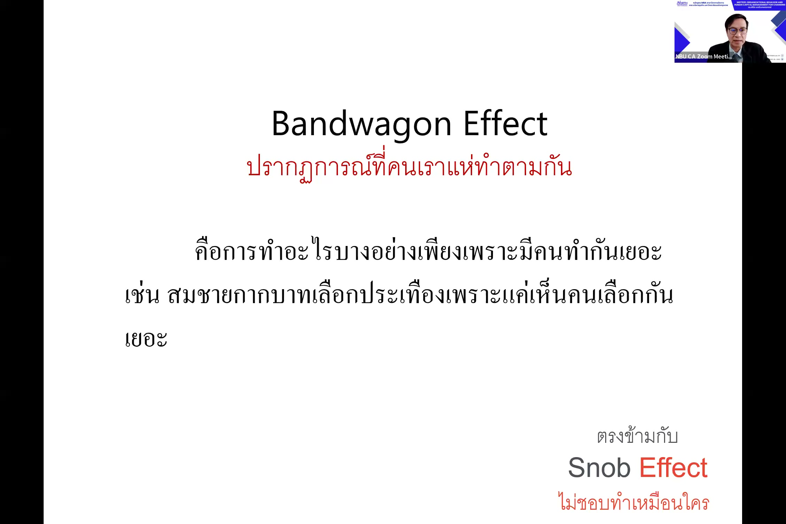

เตรียมขายไตได้เลยนักศึกษาแล้วที่มันเป็นดูโอเป็นฝ่าพับอ่ะ แสนกว่าบาทนักศึกษาครับขายไตก็ไม่พอนักศึกษาครับ อะ โอเคนักศึกษาครับ มีอีกไหมคนแห่ทำตามกันน่ะบางเรื่องไม่น่าเชื่อนะครับ บางเรื่องไม่น่าเชื่อนะ แต่มันเป็นไปแล้วนะครับ ที่ประเทศไทยเรานี่แหละครับ บางเรื่องไม่น่าเชื่อว่าจะเป็น เป็นไปแล้วนะครับ คนแห่ทำตามกันเพราะ คือทำอะไรบางอย่างเพราะเห็นคนอื่นทำมาแล้วคนทำกันเยอะครับ เช่น

## [00:22:05]
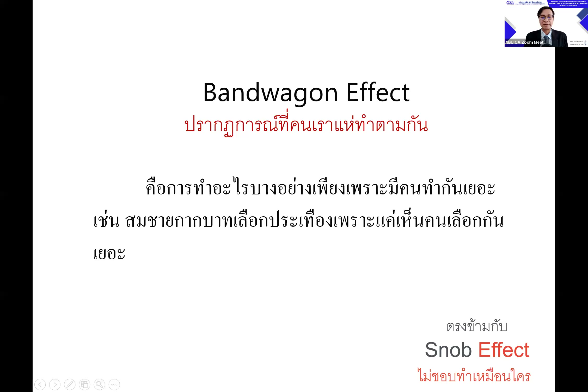

การไปติดตามเป็นติ่งใครสักคนน่ะผมไม่ว่านะครับ ถ้าเป็นติ่งดาราเกาหลีไม่ใช่นะ ไม่เออ ไม่ ไม่ว่านะ ไม่เป็นไรครับ ติ่งดาราพอเขาหล่อ เขาเก่ง เขาเท่ เป็นติ่งก็ตามก็ไม่เป็นไรไม่ว่า แต่ติ่งไอ้สิ่งนี้สินักศึกษาครับ ผมพูดไปเดี๋ยวผมจะโดนดราม่าลงหรือเปล่านักศึกษา น้องหมีเนยนักศึกษาครับ มีใครตามน้องหมีเนยไหมครับ

## [00:22:35]

คือถ้าชอบเพราะเขาน่ารักอะไรก็ไม่เป็นไร แต่ต้องไป ต้องไป หลานเขาต้องไปกิน ต้องไปซื้อ ต้องไปตาม ต้องไปอะไรอย่างเงี้ยนะครับ เออ มันมากด้วย ใช่ มัน มัน พูดไปเดี๋ยวดราม่าเดี๋ยวผมโดนทัวร์ลงนะครับ คือจะว่า แล้วก่อนหน้านั้นทำไมไม่เป็นอ่ะเขามีมานานแล้วนะน้องหมีเนยอ่ะ เป็นแมสคอตที่ร้าน ร้าน เอ่อ ร้าน ร้านเบอร์การี่ร้านหนึ่งชื่อร้านอะไรเนี้ย น่าสงสัยใครนึกออกช่วยบอกผมด้วยผมลืมเพราะ

## [00:23:05]
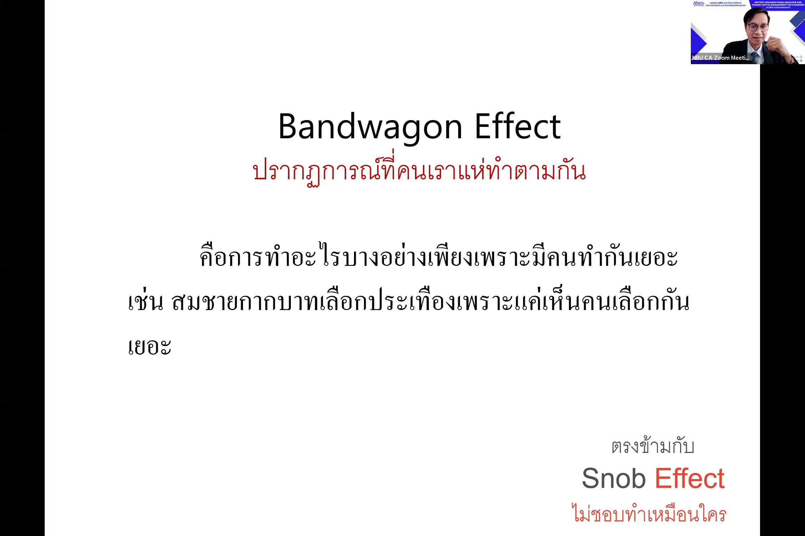

เพราะผมไม่ได้สนใจขนมเขาอ่ะผมสนใจแต่น้องหมีเนยอ่ะครับ หน้าสาด แพ็คเกจจิ้งสวยมากแล้วเบสคอตน้องหมีเนยมีมานานแล้วนะครับ แต่ที่มันดังเพราะว่าคนจีนถ่ายรูปน้องเขาเต้นแล้วก็ไปโพสต์ที่ประเทศจีนมันก็เลยทำให้คนจีนเนี่ยเวลามาก็จะต้องมาดูพอคนจีน โพสต์เยอะเยอะนักศึกษา tiktok กันลงเยอะปุ๊บคนไทยเอาเลยนักศึกษาครับ ก็จะต้องตามเป็นกระแสนักศึกษาเป็นกระแสชื่อร้าน อะไรจำไม่ได้นักศึกษาเป็นกระแสเพราะฉะนั้นเราทำตามเพราะคนอื่นเขาทำกันเยอะนั่นแหละครับ

## [00:23:35]

แบรนด์วากอนเอฟเฟกต์แต่ถ้าตรงข้าม ตรงข้ามกับแบรนด์วากอนเอฟเฟกต์ในภาษาอังกฤษอะไรที่เราเห็นคนทำเยอะเราจะไม่ทำ อันนี้เขาเรียกสนุฟ สน็อป ขอโทษสน็อปเอฟเฟกต์สน็อปเอฟเฟกต์ อันนี้ตรงข้ามกับ แบรนด์วากอนนะนักศึกษาตรงข้ามถ้าแบบแรกคือเห็นคนทำเยอะเราทำบ้าง แต่ถ้า คือถ้าเห็นคนทำเยอะจะไม่ทำนักศึกษามีคนเป็นไหม เห็นไอโฟนคนใช้ไอโฟนเยอะผมจะไม่ใช้

## [00:24:05]
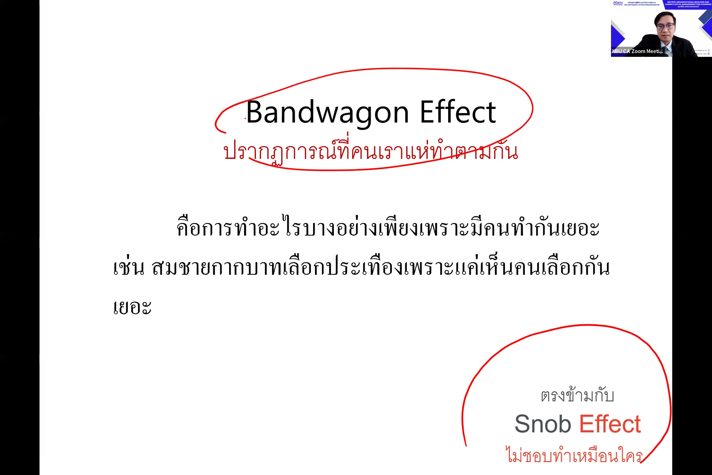

ผมจะไปใช้ซัมซุงมีคนแบบนี้นะ มีนะครับ มีนะครับ แล้วเขาไม่ได้ชอบซัมซุงนะแต่ที่เขาใช้เพราะ เขาเห็นคนใช้ไอโฟนกันเยอะเขาก็เลยไปใช้ซัมซุงมีคนแบบนี้อยู่จริงนะครับ นั่นแหละครับ นี้ทำตรงข้ามกันเนี่ยคือปรากฏการณ์เออเล่อแบบหนึ่งนะครับ จะมีนะคะว่าคือพอไอโฟนสแปดออกปุ๊บซัมซุงราคาลด

## [00:24:35]
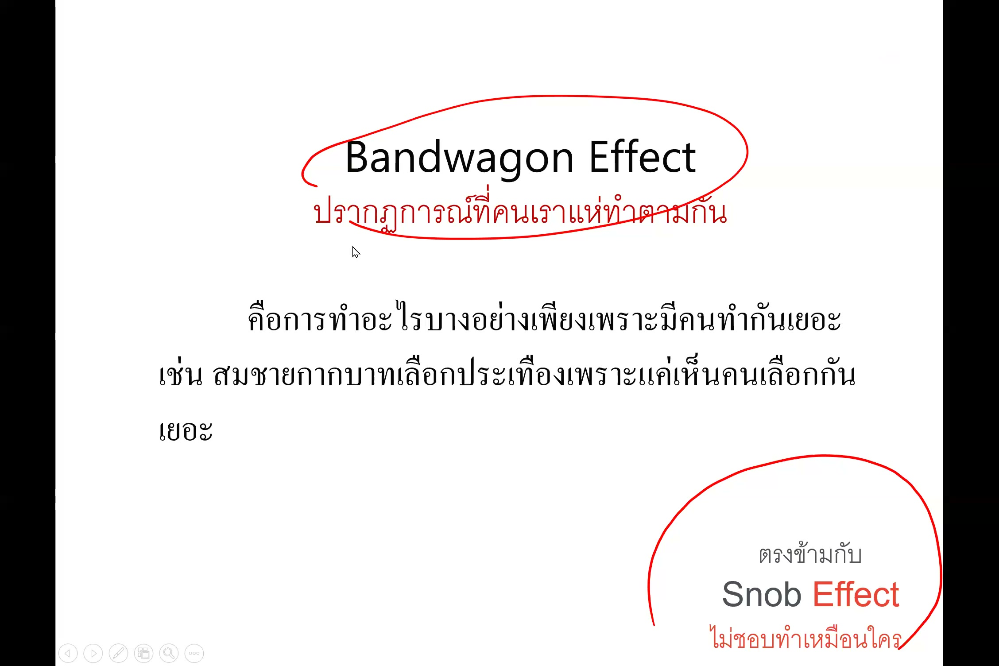

พวกเลยก็คือคนก็ไปเล่นซื้อตัวนั้นมาใช้ เออ เป็นการสร้างสร้างวิกฤตให้เป็นโอกาสนะครับ ใช่ค่ะ ต่อไปครับ กลุ่มจริงคือพวกมากลากันไปครับคือการทำอะไรบางอย่างเพียงเพราะคนในกลุ่มเดียวกันทำเหมือนกันนะครับ ไม่กล้าฉีกครับ ไม่กล้าฉีกเราเห็นคนทำแล้วจริงจริงเราไม่ได้เห็นด้วยนะ แต่เราเห็นคนอื่นเขาเขาไปในทางนั้นแล้วอะครับเราก็เลยไม่กล้าฉีก

## [00:25:05]
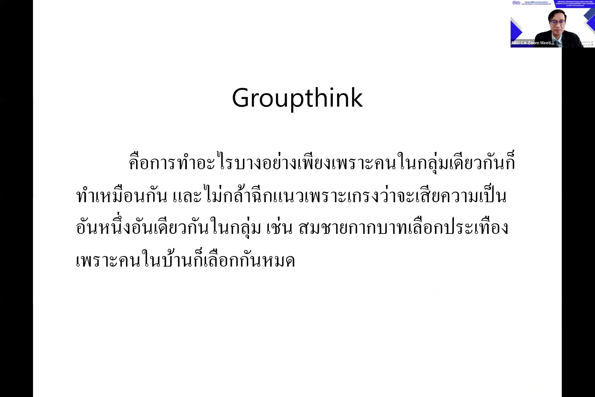

กลัวว่าจะเสียความเป็นอันหนึ่งเดียวกันกลัวเสียความสามัคคี กลัวว่าเราจะทำให้เสียบรรยากาศกลุ่ม เข้าใจไหมครับ เราก็เลย อ่า เห็นด้วยก็ได้ครับ เห็นด้วยแต่เรา เราไม่แสดงออกเรา เราบอกเลยเห็นด้วยครับ เห็นด้วยครับ เห็นด้วยครับ ยกมือครับ เห็นด้วยครับแต่ใจเราไม่เห็นด้วยหรอกนะ แต่เราเห็นคนส่วนใหญ่เขาเลือกไปแล้ว เราก็ อ่า ถามว่าใครอยากเที่ยวทะเล คน 99 คนยกมือยากเที่ยวทะเล แต่เราไม่อยากไปนะ เราอยากไปภูเขา เราก็ยกมือด้วยก็ได้ ทะเลก็ทะเล ใจเราไม่ได้อยากไป แต่เราเห็นคน 99 คนเข้าไปทะเล สุดท้ายแล้วเราก็ไปแบบไม่เต็มใจ

## [00:25:35]
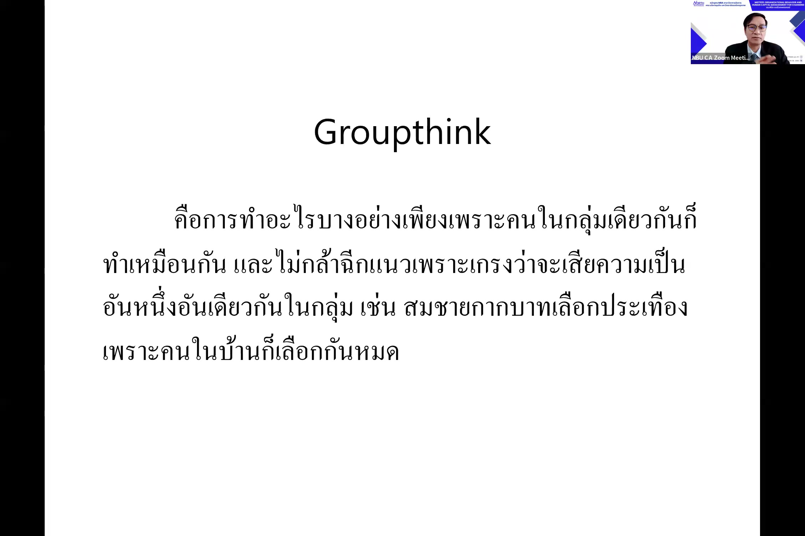

ตอนเริ่มต้นครับ อาจจะไม่เต็มใจตั้งแต่แรกนะฮะ นั่นแหละครับ กลุ่มติง พวกมากละกันไป องค์กรมีเยอะนะฮะ ในบริษัทแบบนี้มีเยอะครับ เยอะมากครับ เยอะมาก ต่อไปครับ ปรากฏการณ์ฮาโรเอฟเฟกต์ครับ ฮาโลเอฟเฟกต์คือการคิดว่าถ้าคนอื่นหรือสิ่งหนึ่งมีอะไรบางอย่างดีอย่างอื่นก็ต้องดีไปด้วย เออ นักศึกษาครับถ้าคิดว่า คนหนึ่งหรือสิ่งหนึ่งมีอะไรบางอย่างที่มันดีโดดเด่นเลยนะครับ เราก็จะคิดเหมารวมไปว่าเขาก็ดีทั้งหมดแหละ ดีทุกอย่างเลย เช่น เราเห็นว่าพระเอกหนังคนนี้เขาเป็นพระเอกหนัง เขาหล่อ เราก็จะเข้าใจว่าพระเอกคนนี้นิสัยดีไปด้วย

## [00:26:05]
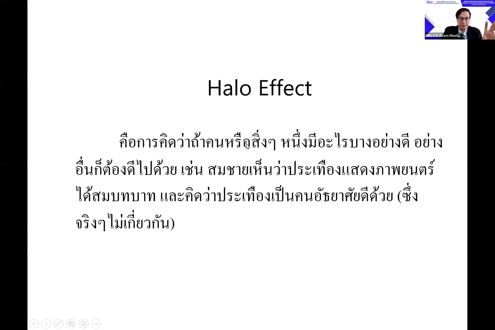

อัธยาศัยดีไปด้วยนักศึกษานึกออกไหมครับ เพราะฉะนั้นเวลาที่พระเอกคนนี้ปรากฏตัวนอกจอนะ ไม่ได้ในหนังนะ นอกบทบาทนะแล้วเขาทำอะไรที่มัน ผิดไปจากที่เราคาดหวังเองอ่ะคาดหวังไปเองอ่ะว่าเขาต้องอัธยาศัยดีต้องเข้าทักทายเราโบกมือต้องทักทายอ่ะแล้วเขาไม่ทักเราอ่ะ เราก็จะไปน้อยอกน้อยใจแล้วจะไปด่าเขาว่ายิงอ่ะ

## [00:26:35]
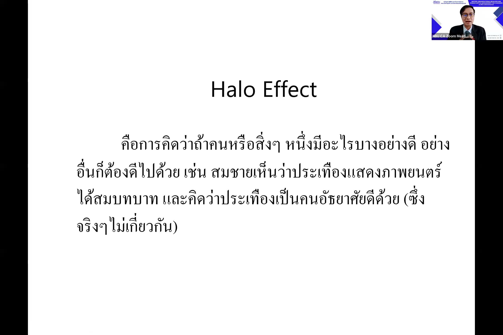

เป็นดาราแล้วยิงนะ นั่นแหละครับ เรา เราโทษเขาไม่ได้นะ เพราะเราเองนั่นแหละ แต่เป็นคาดหวัง เราเองแหละที่ไปคาดหวังเองนักรักษา ทั้งๆจริงเขาอาจจะเป็นคนที่ดีเฉพาะในบทบาท แต่ตัวจริงเขาก็เป็นคนแบบเนี้ย เขาเป็นคนอินเทอร์เวิร์ดอะ เขาติ๊ดอะ เขาไม่สนใจอ่ะ เขาเขาอยากกินข้าวในที่สถานะเขาจะกินข้าว ใครมาทักเขาก็ไม่สนใจเขาเขาคนคนหนึ่งอ่ะ นั่นแหละ แต่เราผิดเองที่เราไปคาดหวังเองนักศึกษาเข้าใจใช่ไหมครับ เพราะฉะนั้นนักศึกษาจะไปด่าว่าเขาหยิ่งไม่ได้

## [00:27:05]
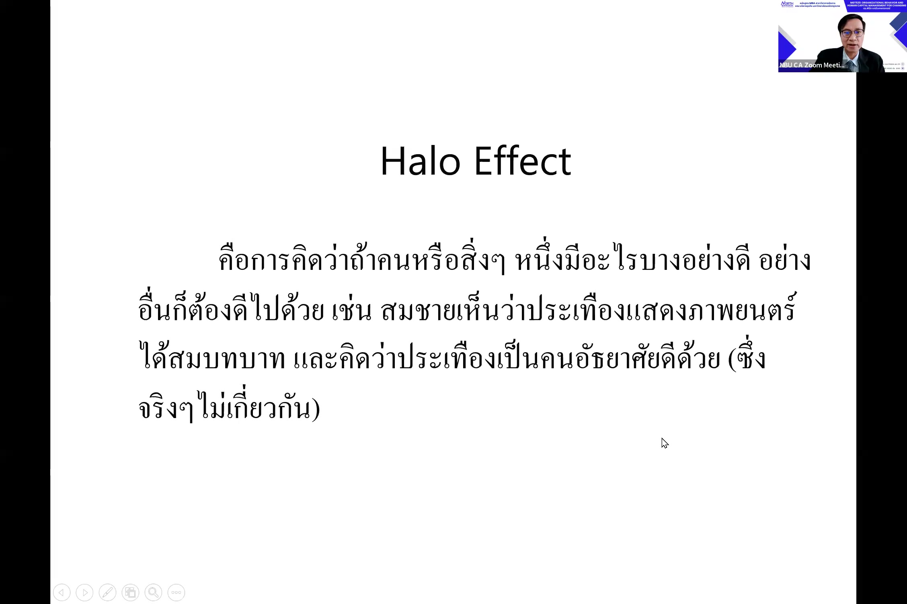

เพราะนักศึกษาไปคาดหวังเองว่าเขาต้องเหมือนพระเอกในละคร นั่นแหละครับเขาเรียกฮาร์โลว์ฮาร์โลว์เอฟเฟกต์ อะมอร์รอลลัค นะมอร์รอลลัค คือการคิดว่าผลลัพธ์ที่ดีกว่าหรือแย่กว่า มาจากการที่คนคนนั้นมีคุณธรรมที่ดีกว่า เอางี้ผมพูดดีกว่าก่อนแล้วกันนะ Moral Effect นะครับ Moral Luck คือการคิดว่าผลลัพธ์ที่ดีกว่า

## [00:27:35]

มาจากการที่คนคนนั้นมีคุณธรรมที่ดีกว่า เช่น สมชายเล่นกีฬาเก่งชนะอยู่เรื่อยเพราะเขาเป็นคนดีมีคุณธรรมกว่าคนอื่น ก็คือเหมือนข้อเมื่อกี้คล้ายคล้ายกันน่ะก็คือมองว่า เขาเป็นคนดี เขาจึง จึงมี มี มีความสำเร็จอ่ะ ประสบสำเร็จเหมือนกันแหละครับพอเขาเป็นคนดี แบบเนี้ย นึกออกไหมครับ false consensus

## [00:28:05]

## [00:28:15]

ไอความคิด Bias ตัวนี้นะครับ มีคนเป็นเยอะนะครับ คือการคิดว่ามีคนจำนวนมาก มีคนจำนวนมาก มีความคิดเห็นหรือพฤติกรรมบางอย่างตรงกับตนเอง แต่จริงจริงแล้วน้อยกว่านั้นครับ ไม่ตรงนะครับ เช่น สมชายคิดว่า ใคร ๆ ก็เห็นว่ากัญชาเป็นสิ่งเลวร้ายนะครับ ฟังดี ๆ นะ สมชายคิดว่า ใคร ๆ ก็เห็นว่ากัญชาเป็นสิ่งเลวร้ายโดยไม่รู้ตัวว่ามีคนจำนวนไม่น้อยแล้วที่มองกัญชาเป็นสิ่งธรรมดาสามัญ

## [00:28:45]

คือสรุปง่าย ๆ ครับ เวลาเราเห็นเราเข้าใจอะไร เราก็คิดว่าคนอื่นเข้าใจเหมือนเราอะครับ เราคิดว่ากัญชาเป็นสิ่งไม่ดี เราก็จะคิดว่าคนอื่นก็จะคิดเหมือนเราว่ากัญชาเป็นสิ่งไม่ดี แต่จริง ๆ ไม่ใช่ อาสาครับ เราคิดของเราอยู่คนเดียวหรือเปล่านะฮะ เพราะฉะนั้นเราอาจจะเหมารวมว่าความคิดเราตรงกับความคิดคนอื่น นั่นแหละครับ เพราะฉะนั้นเวลานักศึกษาจะไปตัดสินใครว่าไม่ดี อย่า อย่าลืมนะ มันมี Buy Ads ตัวนี้อยู่นะครับว่า

## [00:29:15]

บางทีที่เราตัดสินแล้วเอาจากความคิดเราเองหรือเปล่านะครับ แต่อันนี้ผมชอบข้อต่อไปนะนักศึกษาครับเขาเรียกคำสาปของความรู้ครับ คำสาปของความรู้ครับนักศึกษาอันนี้

## [00:29:45]

อาจารย์เป็นบ่อย อาชีพอาจารย์เป็นเยอะนักศึกษาครับ คนอาชีพอาจารย์เป็นเยอะคือการไม่รู้ว่าคนอื่นไม่รู้ นักศึกษาครับคือการไม่รู้ว่าคนอื่นไม่รู้ เช่น สมชายสอนจริยธรรมโดยอ้างอิงตัวอย่างจากหนังสือ ดอนคิโยเต้ โดยทึกทักไปเองว่าทุกคนเคยอ่านหมดแล้วคือการทึกทักไงนักศึกษาครับ อย่างเช่น นักศึกษาครับ ผมสอนเรื่องเรื่องพระผู้นำแล้วผมก็ยกตัวอย่างสามก๊กในพระผู้นำเนี้ยผมยกตัวอย่างแต่สามก๊กอย่างเดียวเลยเพราะผมคิดว่าใครก็ต้องรู้ไหมสามก๊กอ่ะใครก็ต้องเข้าใจว่า

## [00:30:15]

นักเรียนทุกคนต้อง ทุกคนก็ต้องรู้สิสามก๊ก มัน มันเป็นแบบนี้อ่ะทุกคนต้องรู้สิ นั่นแหละครับ นั่นแหละ เขาเรียกว่าคำสาปของความรู้ผมถูกคำสาปครับ อาจารย์ถูกคำสาป ทำให้อาจารย์ทึกทักไปว่าที่อาจารย์กำลังสอนแล้วยกตัวอย่างสามก๊กเนี่ยเรื่องพระองค์ผู้นำแบบสามก๊กสามแบบเนี่ย ทุกคนรู้อยู่แล้ว เวลาผมอธิบายไปผมจะเข้าใจว่าทุกคนเข้าใจผม

## [00:30:45]

แล้วผมจะยิ้มแย้มแจ่มใสว่า เอ้ย วันนี้ผมอธิบายดี นักศึกษาทุกคนเข้าใจดี นี่แหละคำสาปผมถูกคำสาปครับ นักศึกษาเข้าใจนะครับ คำสาปของความรู้ อืออันเนี้ยคนที่เป็นอาชีพอาจารย์อ่ะเป็นเยอะไม่เห็นจะยากเลยเนี้ย ครูสอนกีตาร์ครูเป็นครูสอนกีตาร์นะ อาจารย์สอนครูสอนกีตาร์แล้วก็เล่นให้ดูแล้วก็ให้เด็กทำตามแล้วก็บอกไม่เห็นจะยากเลยเนี้ย

## [00:31:15]

นั่นแหละครับ ก็ไม่ยากสิ มึงเป็นอาจารย์มันก็ง่ายสิ นักศึกษาอันนี้เข้าใจใช่ไหมครับ นั่นแหละ เพราะฉะนั้นต่อไปนี้ผมจะต้อง ถามก่อนว่ามีใครยังไม่รู้เรื่องสามก๊กไหม มีใครไม่เข้าใจสามก๊กไหม ผมจะได้ปูพื้นฐานให้ก่อน ก่อนที่จะเรียนแล้วก็ยกตัวอย่างสามก๊กแบบนี้ ผมจะไม่ทึกทักเอาเองว่าไม่เห็นจะยากเลยทุกคนรู้อยู่แล้วสามก๊กเป็นยังไง ดังจะตายทำไมไม่รู้อย่างเงี้ยเออ เข้าใจนะครับ นักศึกษาครับทำไมไม่รู้อ่ะ ค่าตั๋วรถไฟฟ้า

## [00:31:45]

ทำไมไม่รู้อ่ะมันง่ายตายทำไมนักศึกษาไม่รู้ อ่านักศึกษาจะรู้ได้ไงฉันขับรถยนต์มาทำงาน แต่ผมนั่งรถไฟฟ้าผมก็จ่ายทุกวันผมก็รู้ว่าผมจ่ายค่ารถไฟฟ้ามันเท่าไหร่ นักศึกษาจะไปทึกท่าว่าคนอื่นก็ต้องรู้เหมือนเราไม่ได้นักศึกษาครับ เข้าใจนะครับสปอร์ตไลท์เอฟเฟกต์ครับ ต่อไปครับ คือการคิดว่าตนเองเป็นเป็นจุดสนใจนะ สปอร์ตไลท์เอฟเฟกต์แต่จริงจริงแล้วไม่มีใครสนใจขนาดนั้นหรอกครับ

## [00:32:15]

อืม ไม่กล้าเดินออกไปเลยอ่ะมือไม่มั่นใจ เมื่อวานตัดผมมาแล้วไม่ถูกใจอ่ะคือตัดมาแล้วเสียกำลังใจ เสียความมั่นใจอ่ะช่างตัดไม่ดีอ่ะ ไม่กล้าออกจากบ้านเลยวันเนี้ยไม่ไปดีกว่านักศึกษาครับ เราเราก็เลยจะบอกตรงตรงว่าไม่มีใครสนใจหรอกครับ ไปเถอะ แต่มันแรงไป เดี๋ยวจะโดนสวนกลับจะหนักกว่าที่จะหนักกว่าที่เป็นนักศึกษาครับ เพราะฉะนั้นนักศึกษาเคยเป็นแบบนี้ไหม

## [00:32:45]

คิดว่า คนอื่นสนใจโฟกัสที่เราอ่ะ แต่จริงจริงไม่มีใครสนใจหรอกครับนักศึกษาครับแล้วเราเฟลไปเลยอ่ะ อย่างเช่นวันหนึ่งไปประชุม ไป ไปงานสัมมนา นักศึกษาไปงานสัมมนา แล้ววิทยากรเขาให้เปิดโอกาสถาม แล้วผมยกมือถาม สมมุติว่าผมยกมือถาม แล้วเป็นคำถาม มันเป็นคำถามโง่ ๆ อะ มันรู้ตัวว่า เอ้ย มันไม่ควรถามเลย เราไม่ควรถามเลย ไม่ควรถามอะ แล้วเราก็จะ พอพักเบรกปุ๊บ เราก็จะ

## [00:33:15]

อายไปเลยอะ เรานั่งอายไปเลยอะ ก้มหน้าคมตา ไม่กล้าคุยกับใครเลย เพราะคำถามเมื่อกี้ที่เราถามในห้องสัมมนา เป็นคำถามที่ ที่วิทยากรเขายังบอกเลยว่า เออ คำถามง่ายๆ เราเข้าใจเองว่าเป็นคำถาม ไม่น่าถามเลยว่ะมารู้ทีหลังว่าคำถามง่ายง่ายอ่ะ ตอนวิทยากรเขาเขาพูดเขาอธิบายอ่ะ เฮ้ย ไม่น่าถามเลย พอช่วงพักเบรกปุ๊บผมไม่น่าไม่กล้าคุยกับใคร ก้มหน้าก้มตารู้สึกว่าตัวเองดูภาพรักเสียไปเลยอ่ะ ทั้งจริงจริงนักศึกษาครับ ไม่มีใครสนใจเลยนะครับไม่มีใครสนใจคำถามเราเลยด้วยซ้ำ ไม่มีใครจำได้ด้วยว่าเรายกมือถามอ่ะนักศึกษาครับ แต่เราอ่ะคิดไปเอง นั่นแหละเขาเรียกว่าสปอตไลท์เอฟเฟกต์

## [00:33:45]

คือการคิดว่าตนเองเป็นจุดสนใจอ่ะแต่จริงจริงแล้วไม่มีใครสนใจขนาดนั้นหรอกครับ เข้าใจนะครับสปอร์ตไลท์เอฟเฟกต์ แอลแวริบิลลิตี้ คือการให้ความสำคัญกับสิ่งที่นึกออกก่อน

## [00:34:15]

อันนี้ตอนประเมินงานน่ะ เป็นนักศึกษาตอนประเมินผลงานลูกน้องน่ะ หัวหน้าน่ะ จะเป็น หัวหน้าจะโดนเอ่อเล่อนี้นักศึกษาครับคือการให้ความสำคัญกับสิ่งที่ตัวเองนึกออกก่อนอ่ะ เช่น สมชายเพิ่งเห็นข่าวคึกโครมเมื่อเครื่องบินตกเลย ไปเชียงใหม่ทางรถยนต์แทนจริงจริงแล้วทางไปเครื่องบินเสี่ยงตายน้อยกว่า

## [00:34:45]

คือมันฝังใจ คือนักศึกษาเขาเรียกว่า พนักงานคนนี้เราเห็นเขาทำงานขยันอยู่ครั้งเดียว มันโดนใจครั้งนั้น แล้วเราก็จะจำจนสิ้นปี เราก็จะนึกถึงเรื่องนั้นออก แล้วก็จะประเมินเขาสูง ทั้งที่จริงเราเห็นแค่ครั้งเดียวนะครับ แค่ครั้งเดียวเลยนะครับคนอื่นเนี้ยทำมาทั้งปีนะครับแต่เราไม่ได้เห็นนะครับ อันเนี้ย เอ่อ มี มีผลนะครับ คือการให้ความสำคัญกับสิ่งที่นึกออกก่อนนะครับ อืมต่อไปครับ เรียกว่า

## [00:35:15]

## [00:35:23]

Defensive สมุทิฐานการอ้างเหตุผลป้องกันตัว สมุทิฐานการอ้างเหตุแบบป้องกันตัว เช่น เวลาเจอเหตุการณ์ที่ไม่พึงประสงค์มักโทษฝ่ายที่ไม่เหมือนตัวเอง เช่น สมชายชอบเล่นโทรศัพท์เวลาขับรถ เวลาเจอเหตุการณ์ที่ไม่พึงประสงค์มักโทษฝ่ายที่ไม่ ไม่เห็นเหมือนตัวเองอ่ะคือไม่เห็นด้วยกับตัวเองอ่ะฝ่ายที่ทำตรงข้ามกับตัวเองอ่ะ เช่นนะครับ ดูเช่นดีกว่าจะง่ายกว่าสมชายชอบเล่นโทรศัพท์เวลาขับรถ สมชายชอบเล่นโทรศัพท์มือถือเวลาขับรถประเทืองก็ชอบเหมือนกัน

## [00:35:53]

เพราะสมชายเกิดอุบัติเหตุเพราะเล่นโทรศัพท์ประเทืองแสดงความเห็นว่าคู่กรณีของสมชายเป็นฝ่ายผิด อืม นักศึกษาเข้าใจใช่ไหมครับจริงจริงเหตุการณ์ครั้งนี้ สาเหตุมาจากอะไรครับมาจากเล่นมือถือบนรถ แต่ทำไมประเทืองจึงบอกว่าสาเหตุมาจากคู่กรณีเป็นฝ่ายผิดเพราะอะไรเพราะประเทืองก็ทำเหมือนกัน เพราะประเทืองก็ทำเหมือนกันเข้าใจนะครับ

## [00:36:23]

เหมือนอะไรที่เราทำ คนอื่นทำ เราทำ แล้วมันเกิดมีความผิดพลาดจากสาเหตุนั้นน่ะ เราก็จะอ้างเหตุผลอื่น

## [00:36:53]

เพราะถ้าเป็นเหตุผลจริงจริงคือเรา เราก็จะเป็นคนผิดด้วยไม่มีใครอยากเป็นคนผิดอะครับ just worldhypothesisคิดว่าทำดีได้ดี ทำชั่วได้ชั่วแน่แน่

## [00:37:01]

ซึ่งเอาจริงจริงแล้วการได้ดีอาจไม่ได้เกี่ยวกับเคยทำดีมาก่อนและการได้อะไรไม่ดีอาจจะไม่ได้เกี่ยวกับเคยทำชั่วมาก่อนอืม อันนี้คือเหมือนเขาขัดแย้งกับ กับศาสนาพุทธอะครับศาสนาพุทธคือทำดีได้ดี ทำชั่วได้ชั่วใช่ไหมศาสนาพุทธ ซึ่งเอาจริงจริงแล้วไม่ได้เกี่ยว

## [00:37:31]

ไม่ได้เกี่ยวกับสิ่งที่เคยเกิดมาก่อนนะฮะ อันนี้ก็อันนั้นไปอธิบายนะ คือมันขัดกับความเชื่อผมอันนี้นะฮะ ผมเชื่อว่าทำดีได้ดี ทำชั่วได้ชั่วแน่ๆ ผมเชื่อแบบนี้ครับ

## [00:37:52]

อันนี้เรื่องจุดอ้างอิงครับ นะครับ คือการมีจุดอ้างอิงให้เปรียบเทียบ ผมว่าทุกคนถ้าใครทำธุรกิจจะเชื่อว่าเรื่องนี้มีอยู่จริงนะครับ เชื่อเรื่องนี้มีอยู่จริงก็คือการเปรียบเทียบครับ การเปรียบเทียบสมมุตินักศึกษาครับ เสื้อหนึ่งตัววางตัวเดียวเลยนักศึกษาครับ ราคาหนึ่งพันบาทเราจะบอกว่าเสื้อยืดตัวเนี้ย อ่า เสื้อยืดนะ หนึ่งพันบาทนักศึกษาจะบอกว่าเสื้อยืดตัวเนี้ย แพงแต่ถ้าผมเอาอีกสองตัวมา เอามาวางคู่กันเลย

## [00:38:22]

แล้วสองตัวนั้นน่ะราคาห้าพัน ราคาสองพันก็ได้สามพันก็ได้นักศึกษาครับ เราจะรู้สึกว่าไอ้หนึ่งพันเนี้ยถูกแล้วนักศึกษาจะซื้อโดยที่ไม่รู้สึกผิด นั่นแหละครับ เขาเรียกว่าการมีจุดอ้างอิง นักการตลาดชอบใช้วิธีนี้ครับ นักศึกษาส่วนสูงร่างกายนักศึกษาไม่สูงนะ แต่นักศึกษาไปยืนอยู่กับคนที่

## [00:38:52]

ต่ำกว่า ไม่สูงกว่า คนที่เตี้ยกว่า ขอโทษแล้วกันเอา นักศึกษาคนก็จะรู้สึกว่าเราสูง นี่แหละครับ เขาเรียกว่าการมีจุดอ้างอิง นักการตลาดชอบใช้เรื่องนี้นักศึกษาชอบใช้ คือให้มันมีการเปรียบเทียบไว้อ่ะอย่างเช่น รถยนต์คันนี้ รุ่นเอ ราคาแปดแสนราคาแปดแสน ทำไมไม่ซื้อรุ่นเอพลัสล่ะรุ่นเอพลัสเนี้ย แปดแสนสองเองน่ะ

## [00:39:22]

เพิ่มอีก 20,000 ได้ A Plus แล้วนะครับ นักศึกษาครับ เชื่อเหอะทุกคนก็จะซื้อ A Plus เพิ่มอีก 20,000 ได้รุ่นท็อปมา นักศึกษารุ่นท็อป แบบเนี้ยหาจุดเปรียบเทียบเพราะฉะนั้นเนี้ยถ้าเราเสนอครั้งแรกเอพัทแปดแสนสองนักศึกษาอาจจะไม่ซื้อก็ได้รู้สึกแพงแต่มีรุ่นธรรมดาเปรียบเทียบครับนักศึกษาครับเราจะซื้อรุ่นเอพัททันทีเนี้ยแบบเนี้ยครับนักการตลาดชอบใช้นักศึกษาครับ เช่นสมชายเดินไปเห็นเสื้อกล้ามสีแดงราคาแปดพันบาทจากนั้นเหลือบไปเห็นเสื้อกล้ามสีเขียวแปดร้อยบาทแล้วรู้สึกว่าสีเขียวถูกมาก จึงซื้อตัวเสื้อกล้ามตัวละแปดร้อยทั้งนั้นจริงจริงพอซื้อกลับมา

## [00:39:52]

เสื้อกล้ามตัวละแปดร้อยถามคนอื่นอะ โดนด่าเลยนะ สม สมชายโดนด่าเลยนะซื้อมาทำไมเสื้อกล้ามตัวละแปดร้อย แต่สมชายเขาไม่รู้สึกเพราะเขาไปเปรียบเทียบกับเสื้อกล้ามอีกตัวหนึ่งราคาแปดพันเลยน่ะสัส นั่นแหละครับ

## [00:40:06]

อันนี้ปัจจุบันเรายุค AI กำลังเป็นเลยนะ automation by ad เชื่อใจระบบตัวนู้นมันมากเกินไปจนลืมนึกไปว่าระบบอาจจะผิดพลาดก็ได้คือ AI เชื่อ AI มากเกินไปตอนนี้คนไทยกำลังเป็นทั่วโลกกำลังเป็นเชื่อ AI มากเกินไป จึงไม่มีการตรวจเช็คอย่างรอบคอบอ่ะพอใช้ AI ปุ๊บส่งเลยนักศึกษาไม่ได้ตรวจก่อนนักศึกษา อะ โอเคนักศึกษาครับ นั่นคือเรื่องความคิดใบแอดในสังคมทุกวันนี้นักศึกษาครับ

## [00:40:36]

ความคิด Bias ความคิด Error นักศึกษาครับ โอเคนะ ทันนะครับ มาหัวข้อต่อไปนักศึกษาครับ หัวข้อที่นักจิตวิทยาเขาทำการทดลองเกี่ยวกับพฤติกรรมกลุ่มนักศึกษาครับ

## [00:40:47]

## [00:40:51]

การทดลองเกี่ยวกับพฤติกรรมกลุ่ม คือตอนนี้นักศึกษาครับ การทำงานเป็นทีม การทำงานเป็นกลุ่มในองค์กรเนี่ย มันมีความซับซ้อน การทดลองที่อาจารย์กำลังเล่าต่อไปเนี่ย วันนี้อาจจะอธิบายไม่ได้แล้วก็ได้นะครับ แต่ลองมาดูเป็นพื้นฐานว่าการทดลองในการทดลองกลุ่มครั้งนี้ มีการทดลองอะไรบ้าง แล้วมันอธิบายอะไรได้บ้างนักศึกษา อันแรกครับนักศึกษา อันแรกครับ

## [00:41:19]

เราเรียกการทดลองนี้ว่า เดอะเปียโน เดอะเปียโนสเตียสเตียที่แปลว่าบันไดอ่ะ เดอะเปียโนสเตีย แปลว่าการทดลองนักศึกษาครับอาจจะเล่าให้ฟังเลยแล้วกันนักศึกษาครับ เขาทดลอง เขาอยากรู้พฤติกรรมของคนครับนักศึกษา พฤติกรรมของคนว่าถ้าใส่ปัจจัยอะไรเป็นตรงอย่าง ใส่สิ่งเร้าอะไรเป็นตรงอย่าง พฤติกรรมคนจะเปลี่ยนไหม เช่น มีบันไดเลื่อน

## [00:41:49]

และบันไดใช้แรงเดินอยู่ในที่เดียวกันเนี้ยคนส่วนใหญ่เนี้ยใช้บันไดเลื่อนครับ คนส่วนใหญ่เลือกใช้บันไดเลื่อนแต่นักทดลองเขาอยากทดลองพฤติกรรมคนครับ เขา เอาสีเอาสติ๊กเกอร์ไปทาที่บันไดใช้แรงเดินเป็นรูปเปียโนเป็นรูปเปียโนครับ เขาอยากรู้พฤติกรรมคนจะเปลี่ยนมาใช้บันไดเดินไหม

## [00:42:19]

สุดท้ายเปลี่ยนจริงครับ คนเลือกมาใช้บันไดเดินกันเยอะกว่าเดิมครับนักศึกษาการทดลองนี้จึงสรุปว่าเป็นทฤษฎีแห่งความสนุกครับ โดยเปลี่ยนบันไดในเมืองให้มันมีความสนุกโดยใช้เป็นรูปเปียโนแล้วคนก็จะวิ่งเหยียบเปียโนเพื่อพิสูจน์ว่ามนุษย์จะสามารถเปลี่ยนพฤติกรรมตัวเองได้เมื่อถึงถูกดึงดูดด้วยความสนุกสนาน ผลลัพธ์ประมาณหกสิบหกเปอร์เซ็นต์ของคนที่ต้องเลือกขึ้นลงนะครับ เปลี่ยนมาขึ้นลงบันไดแบบเดินครับนักศึกษาหกสิบหกเปอร์เซ็นต์เลยนะครับถ้ามีความสนุก ถ้ามีความสนุก

## [00:42:49]

นักศึกษานึกออกใช่ไหมครับ ทันไหม เหมือนผมเคยอธิบายคำหนึ่งนักศึกษาเรียกว่านักทีโอรี่ทฤษฎีดุลที่มีชักโครก แล้วแม่บ้านเขาบ่นว่าไอ้คนผู้ชายชีในโถชักโครก

## [00:43:07]

ผู้ชายฉีดในโถงโครกมันเลอะเละเทะไปหมดอ่ะแม่บ้านเขาก็เลยเอา เอาปากกาเคมีสีดำไปเขียนรูปแมลงวันอ่ะตรงจุดที่ ฉีดแล้วมันจะไม่ไม่ไม่กระเด็นอ่ะ แล้วผู้ชายก็ฉี่โดยเล็งไปที่แมงวันนะครับ นั่นแหละครับ เหมือนกันนะครับ มันมันก็ทำให้ผู้ชายเล็งฉี่ไปที่แมงวันตัวเนี้ย มันทำให้ไม่เลอะอีกเลยนักศึกษาแม่บ้านเขาก็เป็นคนทำเรื่องนี้นะ แต่มันมีทฤษฎีรองรับเขาเรียกว่านักทีวรี เอ็น ยู ดี จีอี ถ้าเขียนผิดขอโทษด้วยนักศึกษา เอ็น ยู ดี

## [00:43:37]

จีอี นักที่แปลว่าดุลน่ะที่แปลว่าดุลแปลว่าดันน่ะ นักศึกษาไป search ดุลเนอะ นัก theory เหมือนนักศึกษาเคย เคยขับรถแล้ว แล้วเจอเส้นทางที่เขาใช้การตีเส้นแบบเนี้ย

## [00:43:57]

เคยเจอไหม ตีเส้นที่มันเป็นเป็นหยักหยักแบบเนี้ยแล้วเราจะไม่กล้าขับรถเหยียบเส้นนั้นเลยอ่ะนักศึกษาครับ นั่นแหละครับ นักทีวารีเหมือนกันนักศึกษาครับ อ่ะ ครับการทดลองต่อไปนักศึกษาครับ

## [00:44:15]

ใช้คำว่า Smokey Room Experiment Smokey Room Experiment ผมเล่าให้ฟังการทดลองนี้นะครับ คนที่ถูกทดลองไม่รู้นะครับว่ากำลังถูกทดลองอยู่ แต่คนที่เหลือเป็นหน้าม้า คนที่เหลือเป็นหน้าม้า นักศึกษาลองฟังอาจารย์เล่าแล้วกันเนอะเขาไปทดลองในห้องสอบแห่งหนึ่งในมหาวิทยาลัยแห่งหนึ่งครับ ห้องสอบนั้นเนี่ยมีคนสอบอยู่ประมาณสักสิบกว่าคนนั่งสอบอยู่เขาแกล้งปล่อยควัน

## [00:44:45]

เหมือนเป็นควันไฟไหม้ควันน่ะลงมาจากฝ้าเพดาน พอคนสอบในห้องนั้นน่ะเป็นคนสอบที่ถูกทดสอบนะครับ ถูกทดลองนะครับ ไม่มีหน้าม้าสักคนนะครับสิบกว่าคนนั้นน่ะ เห็นควันปุ๊บ ทุกคนก็จะมองหน้ากัน มองหน้ากัน มองหน้ากันนักศึกษาครับ กว่าจะวิ่งออกไปเนี่ย ใช้เวลาสักพักเลยครับ เป็นนาทีครับนักศึกษาครับ ครั้งที่สองครับ

## [00:45:15]

ให้มีคนสอบคนเดียวนั่งคนเดียวเลยครับนักศึกษาครับ แล้วคนนี้ไม่ใช่หน้าม้านะเป็นตัวทดลอง เป็นคนถูกทดลองครับนักศึกษาครับนั่งคนเดียว แล้วปล่อยควันเหมือนเดิมนักศึกษาปล่อยควันออกมาจากฝ้าเพดานเลยครับ พอควันมาปุ๊บไอ้คนที่อยู่คนเดียวนักศึกษาวิ่งทันทีครับ วิ่งทันที นักศึกษาครับ ทำไม มันเกิดความแตกต่างครับตอนที่นั่งกันหลายคนกว่าจะวิ่งได้ใช้เวลานาน แต่พอนั่งคนเดียวควันมาปุ๊บวิ่งเลยนักศึกษารู้ไหม แตกต่างกันเพราะอะไรครับอธิบายได้ว่าไงครับ

## [00:45:45]

น่าจะไม่มีคนอยู่อาจารย์แล้ว ทำมาอีกครั้งค่ะอาจารย์ ได้ครับเชิญเลยครับ อยู่ครับอาจารย์ อยู่นะ ตอนที่มีหลายๆคน เรามองคนอื่นอยู่ว่าคนอื่นเขาจะลุกไหม เรารังเล แต่ถ้าเรามีคนอื่นเราตัดสินใจเองเลย ใช้คำนี้เลย รังเลครับ

## [00:46:15]

ความลังเลของเราเนี่ยจะตัดสินใจได้เมื่อคนอื่นทำ เมื่อคนอื่นทำปุ๊บเราทำตามเลยนักศึกษาครับ เพราะเราจะไม่ลังเล เพราะมีคนอื่นทำ เหมือนนักศึกษาอาจารย์บอกตัวเลขให้ช่วยกดเครื่องเรียกหน่อย ได้เท่าไรบอกอาจารย์ด้วยไม่ยอมบอก ไม่บอกเพราะอะไรกลัวผิด แต่พอมีคนพูดคนแรกปุ๊บ อนาสาก็จะพูดด้วย ยี่สิบครับอาจารย์เราก็จะพูด เอ่อยี่สิบเหมือนกันค่ะ อาจารย์แต่ตอนคนแรกไม่พูด เราก็จะไม่กล้าพูดเพราะเรากลัวกดผิด

## [00:46:45]

นั่นแหละครับ ลังเลไง ใช้คำว่าลังเล แต่ทำไมพออยู่คนเดียวนักศึกษาครับ วันมาปุ๊บวิ่งทันทีนักศึกษา เพราะมันไม่มีตัวเปรียบเทียบ ลังเลก็แป๊บเดียวนักศึกษา ดูตัวเองเป็นหลัก แต่พอมีหลายคนดูคนหนึ่งเป็นหลักแต่การทดลองนี้นักศึกษาครับ ทดลองต่อครั้งที่สามทดลองต่อครั้งที่สาม โอ้ นักศึกษาอันตรายกว่านั้นนักศึกษาคืออะไรรู้ไหมครับคนเดียวเท่านั้นที่เป็นตัวทดลองครับ คนเดียวท่านที่ถูกทดลองแต่คนที่เหลืออีกสิบกว่าคนเนี้ยเป็นทีมงานครับ เป็นหน้าม้าครับนักศึกษาครับ เป็นหน้าม้าปล่อยควันปุ๊บนักศึกษาครับ หน้าม้าถูกเตรียมกันไว้แล้วว่าไม่ต้องลุกนะ

## [00:47:15]

ไม่ต้องลุก นั่งทำข้อสอบต่อไป อย่าลุกนะ แล้วเขาจะสังเกตุพฤติกรรมของไอ้คนถูกทดลองว่าจะทำยังไง นักศึกษาลองเดาสิครับ คนถูกทดลองจะวิ่งหรือไม่วิ่งครับ ไม่วิ่งค่ะ ไม่วิ่งครับ ไม่วิ่งครับ นั่งทำต่อครับ นักศึกษาครับ นี่แหละครับความผิดปกติของมนุษย์ครับนักศึกษาครับ พิธีกรรมกลุ่มนักศึกษาครับ

## [00:47:45]

เขาอธิบายได้ว่านักศึกษาผลลัพธ์ออกมาว่าคนกลุ่มแรกครับ เจ็ดสิบห้าเปอร์เซ็นต์ออกมาจากเรื่องควันผิดก็วิ่งออกมาเลยครับแต่พอทดลอง

## [00:47:53]

กลุ่มที่สองครับ กลุ่มที่ว่าถูกทดลองคนเดียวที่เหลือเป็นหน้าม้านักศึกษาครับมีเพียงไม่กี่เปอร์เซ็นต์นะครับ มีเพียงสิบเปอร์เซ็นต์เท่านั้นที่วิ่งออก ที่เหลือนั่งอยู่เหมือนเดิมครับนักศึกษาครับ แสดงให้เห็นว่ามนุษย์เราใช้การแสดงออกของคนรอบข้างเป็นส่วนหนึ่งในการแสดงอพฤติกรรมของตัวเองครับ นั่นคือข้อสรุป

## [00:48:23]

เราจะดูคนรอบข้างก่อนเสมอนักศึกษาครับ เพราะคนรอบข้างไม่ไป เราก็ไม่ไป นักศึกษาเหตุการณ์นี้ใช้อธิบายอุบัติเหตุครั้ง อุบัติเหตุที่เกิดขึ้นบ่อยบ่อยบนท้องถนนครับนักศึกษาครับอุบัติเหตุนี้คือ ติดไฟแดงนักศึกษาครับติดไฟแดง เออ ไม่ใช่ เออ คนคนข้ามมีคนยืนรอข้ามถนนอยู่สองคน นักศึกษาครับ

## [00:48:46]

ไอ้คนแรกไปปุ๊บ ไอ้คนที่สองก็จะไปทันที ไอ้คนแรกไป คนที่สองก็จะเดินไปทันที แต่ไอ้คนที่สองที่เดินตามคนแรกไปไม่ได้ดูรถนะครับ เขาไม่ได้ดูซ้ายดูขวานะครับ เขาเห็นคนแรกเดินเขาเลยเดิน แต่นักศึกษาครับเหตุการณ์คือไอ้คนแรกเนี่ยพอมันกำลังจะเดินปุ๊บมันชักเท้ากลับ

## [00:49:16]

มันชักเท้ากลับกลับขึ้นมาบนขอบฟุตบาทครับนักศึกษาครับนักศึกษา เกิดอะไรขึ้นกับไอ้คนที่สองครับ โดนรถชน โดนรถชนครับเพราะมันชักเท้ากลับไม่ทันครับนักศึกษา มันไม่คิดว่าไอ้คนแรกมันจะเปลี่ยนใจไม่ไปไง นักศึกษาเป็นไหม ผมถามนักศึกษาเป็นไหมเวลาจะเดินข้ามถนนมีคนหลายๆ คน ถามว่านักศึกษาเดินเพราะดูรถหรือเดินเพราะมีคนจำนวนมากเดินเริ่มเดินแล้ว

## [00:49:46]

อาจารย์เชื่อว่าคนเดินเพราะเห็นใช่เห็นคนส่วนใหญ่เดินเราเลยเดินตามจริงไหมครับ เพราะฉะนั้นนักศึกษาครับ นี่แหละคือเออเล่อหนึ่งครับนักศึกษาครับ เพราะฉะนั้นมันเกิดเหตุบ่อยก็เรื่องแบบนี้แหละครับไอ้คนแรก เดินกำลังจะเดินนะศาสตร์อาการเหมือนกำลังจะทุ่งไปข้างหน้า แต่ไม่ไปมันชักเท้ากลับไอ้คนที่สองคนข้างหลังมันเดินไปแล้วชักเท้ากลับไม่ทันรถชนตุ้มเลย นักศึกษาครับขับรถไป

## [00:50:16]

นักศึกษาอยู่คันที่สองนะ อยู่คันที่สองขับรถบนถนนอยู่คันที่สอง ข้างหน้าเป็นไฟไฟกำลังจะแดงครับ เป็นไฟเขียวแล้วก็เหลืองนักศึกษาเห็นรัดคดคันข้างหน้ามันเหยียบเต็มที่เพื่อจะให้ผ่านไฟเหลืองก่อนที่ไฟแดงจะติด นักศึกษาเป็นคันที่สองตามมาผมถามนักศึกษาทำอย่างไรครับ หนูก็เหยียบตามเขาไป แล้วไอคันแรกมันเปลี่ยนใจครับน้าสา มันเบรก ชนท้าย เรียบร้อยน้าสา ใครผิดครับ เราค่ะ เราผิดครับน้าสา เหตุการณ์นี้แหละที่เกิดขึ้นเนี่ย

## [00:50:46]

มาจากเอฟเฟกต์นี้เลยครับมาจากเออร์เลอร์นี้เลยครับนักศึกษาครับเพราะเราดูคันหน้าเป็นหลักทำไมเราไม่ดูสัญญาณไฟเป็นหลักนักศึกษาครับ นั่นแหละครับเอฟเฟกต์นี้เพราะฉะนั้นนักศึกษาเอฟเฟกต์นี้ใช้อธิบายได้หลายเรื่องนะในองค์กรเกิดบ่อยนักศึกษาเรื่องเนี้ยองค์กรเกิดบ่อยดูพฤติกรรมของคนรอบข้างก่อนเป็นหลักนั่นแหละครับนักศึกษาครับ smoky Room Experiment นักศึกษาครับ

## [00:51:14]

## [00:51:17]

ต่อไปคันมรรษาครับเขาเรียกว่าการทดลองของโซโลมอนเอส อันนี้เป็นการทดลองที่คือปัจจุบันไม่ได้แล้วนะ ผิด จรรยาบรรณนะครับ ผิดจริยธรรมการวิจัยนะฮะ ห้ามวิจัยที่มันเกี่ยวข้องกับความอ่อนไหวของความรู้สึกมนุษย์ อันที่ประจวบไม่ได้แล้ว อันนี้เมื่อก่อนนะครับ ได้ครับ ไม่มีการ ไม่มีกฎหมายจริยธรรมการวิจัยนะครับ เมื่อก่อนไม่มี ไอ้เรื่องเมื่อกี้ก็เช่นเดียวกัน ปัจจุบันทดลองไม่ได้แล้วนักศึกษา ผิดใจธรรมนักศึกษา เรื่องนี้ยิ่งอันตราย แต่มันอธิบายได้ชัดเจนครับ ทำไมมนุษย์จึงไม่กล้าแตกแถวเมื่อเดินบนเส้นทางที่ผิด

## [00:51:43]

โซโลมอนเอสเขาทดลองแบบนี้ครับเอาล่ะครับนักศึกษาครับเล่าให้ฟังเลยแล้วกันนะครับ มีเส้นตรงหนึ่งเส้นดันข้างซ้ายนะครับแล้วก็เส้นตรงเปรียบเทียบอีกสามเส้นเอบีซี

## [00:51:57]

น้าสาครับ เส้นตรงเอบีซีเส้นไหนเท่ากับเส้นต้นแบบทางซ้ายมือครับคิดว่าเส้นไหนเท่า ซีครับ เส้นซีครับ น้าสารู้ว่าเส้นซีเท่าใช่ไหมครับ เอาละครับ การทดลองนี้ครับจัดขึ้นในห้องประชุมครับนักศึกษาครับ ห้องประชุมใหญ่มีคนจำนวนมากครับนักศึกษาครับ แต่มีคนเพียงไม่กี่คนเท่านั้นนักศึกษาครับ เป็นตัวทดลองที่เหลือเป็นหน้าม้าครับที่เหลือเป็นหน้าม้า

## [00:52:27]

แล้วเขาอยากรู้พฤติกรรมของไอ้คนถูกทดลองครับว่าจะมีพฤติกรรมอย่างไรถ้าคนส่วนใหญ่เห็นไปในทางเดียวกันแบบที่ไม่ถูกต้อง เขาตกลงกับหน้าม้าว่าให้ตอบ A คือเส้นที่เท่ากับเส้นเปรียบเทียบครับแล้วเขาทำเนียนน่ะสักครับ

## [00:52:57]

เขาถามคนที่ 1 คนที่ 1 อาจจะตอบผิดไปก่อน คนที่ 2 อาจจะตอบไม่ตรงกัน คนที่ 3 อาจจะตอบ C คนที่ B อาจจะไม่ตรงกันนักศึกษาครับ แต่พอเริ่มสักคนที่ 10 เป็นต้นไปนักศึกษาครับ ในห้องเนี่ยมีคนเยอะนะ เป็นร้อยนะครับ หลักร้อยคนนะครับ จะตอบไปในทิศทางเดียวกันคือ A คือ A ตรงกันหมดเลยนักศึกษาครับ A จนมาถึงตัวทดลองแต่ละคนนักศึกษาครับ ดูสิว่าตัวทดลองแต่ละคนตอบอะไรนักศึกษาครับ กลายเป็นว่าคนถูกทดลองครับ ตอบ A เหมือนกันนักศึกษาครับ

## [00:53:27]

## [00:53:38]

ตอบ A เหมือนกันครับ นี่แหละครับ Solomon A ก็เลยสืบว่า มนุษย์เนี่ยไม่กล้าแตกแถวแม้เดินบนเส้นทางที่ผิด แม้จะรู้ว่ามันผิดก็ตาม แต่ไม่กล้าแตกแถว

## [00:53:44]

นักศึกษาเหตุการณ์นี้อธิบายสถานการณ์ในสังคมไทยเราได้หลายเหตุการณ์เยอะมากนักศึกษา จนผม ผมกลัวที่ว่ามันจะกลายเป็นเรื่องปกติไปแล้วนักศึกษา กลัวว่ามันเป็นเรื่องปกติ คนเรามองเป็นเรื่องปกติเมื่อไหร่เนี่ยจบเลยนักศึกษา พอเลย มันไปต่อไม่ได้ มันจะติดกับดัก ความเจริญน่ะนักศึกษา

## [00:54:14]

มันจะไม่สามารถไปต่อได้ มันจะอยู่แค่นี้ มันจะอยู่แค่นี้ จะอยู่เจริญเท่าที่เขาจะให้เราเจริญได้ ก้าวหน้าเท่าที่ เขาจะให้เราก้าวหน้าได้ จะได้แค่นี้จริงๆนะศา ประเทศไทยเราจะพัฒนาหรือยัง พัฒนาแล้วนะครับ แต่มันได้แค่นี้ มันยังอยู่แค่นี้ มันติดกับดักอะไรบางอย่างนะศา นี่แหละครับ

## [00:54:44]

ถ้านักศึกษาไปอ่านรายละเอียดมันจะอยู่เอกสารอีกชุดนึงนักศึกษาเอกสารชุดแรกที่อาจารย์ส่งไปให้น่ะอธิบายละเอียดนักศึกษาเนี่ยครับ

## [00:54:49]

## [00:54:52]

## [00:54:55]

เนี่ย ตัวหนังสือมันจะเล็ก ๆ เนี่ย อธิบายละเอียดมากนักศึกษาก็ไปอ่านนะครับนักศึกษา ไปอ่านเนอะ เหตุการณ์นี้ทดลองตั้งแต่ปี 1950 แล้วนักศึกษา แต่ปัจจุบันนี้ไม่ได้นะครับ

## [00:54:59]

## [00:55:02]

ทดลองแบบนี้ต้องขออนุญาต ขอเขาเรียกว่าเป็นเอกสารวิจัยจริยธรรมในการวิจัยครับ ต้องขออนุญาตจากคณะกรรมการจริยธรรมในงานวิจัยด้วย เดี๋ยวนักศึกษาเรียน เรื่องงานวิจัยเดี๋ยวอาจารย์ผู้สอนเขาจะสอนเรื่องนี้ด้วยการทำ การทำจริยธรรมในการวิจัยเขาจะสอนด้วยนักศึกษาครับ แล้วเวลานักศึกษาทำวิจัยจริง นักศึกษาก็ต้องขอการรับรองจากมหาลัย มหาลัยเรามีคณะกรรมการครับ คณะกรรมการจริยธรรมการวิจัยครับ นักศึกษาส่งเรื่องส่ง เขาโครงส่ง proposal

## [00:55:32]

เดี๋ยวเขาจะตรวจว่าได้อนุมัติไหมถ้าอนุมัติก็คือจะทำ วิจัยอนุมัติแล้ว สามารถทำวิจัยได้นะครับ อย่างเช่น กลุ่มเป้าหมายนักศึกษาเป็นกลุ่มอ่อนไหว เป็นเด็กนักศึกษาครับ นักศึกษาต้องขอก่อน เป็นคนสูงอายุ เป็นคนป่วยเนี่ยต้องขอก่อน ซึ่งข้อมูลเหล่านี้เป็นข้อมูลอ่อนไหว

## [00:55:47]

มันจะผิดกฎหมายพีดีพีเอนะครับ เพราะฉะนั้นต้องผ่านการได้รับความอาการอนุมัติจากคณะกรรมการอย่างเข้มงวดเลยครับนักศึกษา โอเคนะ

## [00:56:05]

## [00:56:11]

## [00:56:14]

## [00:56:17]

## [00:56:20]

มีการทดลองอีกหลายตัวเลยครับนักศึกษาครับ อาจารย์ว่าจะให้ดูบางตัวแล้วกันนะครับ บางการทดลองนะครับ อย่างเช่นการทดลองที่อันนี้น่าสนใจนะครับ The violinist

## [00:56:26]

## [00:56:30]

## [00:56:33]

## [00:56:36]

## [00:56:39]

## [00:56:43]

## [00:56:47]

[?] นักแววรีนนะครับin the metro ก็สถานีรถไฟฟ้าใต้ดินนะครับin the metro นักศึกษาครับ นักเปียโนคนนี้ก็คือเป็นทีมงาน เป็นหน้าม้านักศึกษาเป็นเป็นผู้หนึ่งในกระบวนหนึ่งในกระบวนการนะครับทดสอบคนที่ยืนดูเนี่ยเป็นผู้ถูกทดสอบเป็นตัวทดหนูทดลองนะเป็นผู้ถูกทดสอบเพราะนักศึกษาครับนักเปียโนที่กำลังเล่นอยู่เนี่ยเขาเล่นอยู่ใน

## [00:57:17]

ในฟุตบาทในข้างทางอ่ะนักศึกษาครับ น้ำตีข้างทางอ่ะพูดง่ายง่ายแค่นั้นเลยนักศึกษาครับ เล่นอยู่ไม่มีคนดู คนยืนดูคนสองคนแล้วเดินผ่าน คนยืนดูคนสองคนเดินผ่านนักศึกษาครับ นักเปียโน นักแววลินคนนี้เป็นนักแววลินระดับโลกนะครับ ที่เล่นอยู่ในหอ ใน ในคอนเสิร์ต นักศึกษาต้องซื้อบัตรราคาไม่ต่ำกว่าหนึ่งพันบาทไปดูเขานะครับ คนดูเป็นพันคนนะครับ แต่ทำไมเขามายืนเล่นที่สถานีรถไฟฟ้า จึงมีคนดูจำนวนน้อยมาก ๆ คนดูคนสองคนเดินผ่าน เพราะอะไรนะครับ นั่นแหละครับ อธิบายได้ว่ายังไงนะครับ

## [00:57:47]

## [00:57:59]

ผลลัพธ์นั้นสามารถตีความได้ว่ามนุษย์เรามักจะเข้าใจความสวยงามของโลกจากความเข้าใจในสิ่งที่มันควรจะเป็นมากกว่าความสวยงามที่แท้จริงรอบ ๆ ตัวครับนักศึกษาครับ ตัวอย่างเช่นเราคิดว่าดนตรีในคอนเสิร์ตในฮอลในคอนเสิร์ตมีความไพเราะ ไม่เหมือนกับฟังข้างถนนนะครับเพราะทำให้พวกเขาไม่ได้คิดจะหยุดฟังนะครับ ก็คือคือเราเราปรุงแต่งมันเองนักศึกษาเวลานักศึกษาไปดูคอนเสิร์ตจ่ายตังสามสี่พันไปดูคอนเสิร์ตอ่ะ

## [00:58:22]

นักศึกษานักศึกษาจะจะสร้างสร้างสร้างมโนในหัวว่านักศึกษาเสียตังค์สองพันห้าสามพันซื้อบัตรห้าพันไปดูคอนเสิร์ตอ่ะนักศึกษาจะมอโนว่ามันจะมี หลายอย่างที่มันไม่เหมือนกับแต่สุดท้ายไอ้นักดนตรีคนนั้นน่ะ เขาก็เคยมาเล่นข้างทางนักศึกษากลับไม่ดูด้วยซ้ำนะครับไม่ได้รีบด้วยนะครับ แต่ไม่ดู นั่นแหละครับ ไปอ่านนะครับ

## [00:58:52]

## [00:58:55]

จะได้รู้ว่า อ๋อ มันเป็นอย่างนี้นี่เอง นักศึกษาจะรู้ว่าบางสถานการณ์นักศึกษาจะได้ อ๋อ มันเป็นอย่างนี้นี่เองครับนักศึกษาครับ

## [00:58:58]

## [00:59:01]

การทดลองนี้เรียกว่ามอนเตอร์สตาร์ดี้ต่อไปนะครับ การทดลองนี้มอนเตอร์นะครับ ปีศาจเลยครับ ปัจจุบันนี้ไม่ได้แล้วนะครับแต่ตอนนั้นปี 1939 ทดลองได้ตามสบายนะครับ

## [00:59:05]

## [00:59:08]

## [00:59:12]

## [00:59:15]

หนึ่งการทดลองที่คุกคามเด็กอย่างมากนักศึกษาคุกคามเด็กเลยนักศึกษาเขาทำการทดลองด้วยการอยากทราบว่าตนเองสามารถรักษาอาการผู้ติดอ่างของเด็กกำพราได้หรือไม่ครับ

## [00:59:19]

## [00:59:22]

## [00:59:25]

## [00:59:28]

เขาจึงทำการแบ่งเด็กกำพร้าออกเป็นสองกลุ่มกลุ่มแรกมอบความรักความใส่ใจให้กำลังใจเด็กติดอ่างเหล่านั้นส่วนอีกกลุ่มหนึ่งด่าทอต่อว่าเยาะเย้ยถากถางอาการติดอ่างของเด็กครับ เราสรุปผลได้ดังนี้ครับนักศึกษา จริง ๆ นักศึกษาสรุปได้อยู่แล้วครับ ผลสรุปบอกว่าเด็กกลุ่มแรกมีการพัฒนาจนทำให้ผู้ติดอ่างน้อยลงอย่างเห็นได้ชัดครับ ในขณะเดียวกันกลุ่มที่สองกับผู้ติดอ่างมากขึ้นครับไม่มีการพัฒนาใดใดเลย ทำให้พอเข้าใจได้ได้แล้วว่าวิธีการแบบไหนที่ช่วยเยียวยาสิ่งต่างต่างได้ดีกว่ากันนักศึกษาอาจารย์นะ นักศึกษาครับ

## [00:59:58]

เขาถึงบอกว่า เวลาเด็กทำผิด เวลาลูกทำผิด เวลาเด็กทำผิด อย่าไปด่า อย่าไปกระแทกเสียง แม้กระทั่งสัตว์เลี้ยงก็ตามนะ แมว หมานะฮะ เวลาเขาทำผิดอย่าไปกระแทกเสียง เขาจะรู้นะฮะ เด็กก็เหมือนกันนักศึกษาครับ อย่าไปดุ อย่าไปต่อว่า อย่าไปหากถาง อย่าไปอะไรนักศึกษา เด็กนะ หมายถึงเด็กๆน่ะนักศึกษา เด็กเขาเริ่มต้น

## [01:00:28]

## [01:00:31]

เขาเริ่มต้นจากความเข้าใจแรกนะครับ ฉะนั้นความเข้าใจแรกถ้าเราใส่ข้อมูลที่ดีไปเขาก็จะเข้าใจดีนะครับ ถ้าเราใส่ไม่ดีไปเข้าใจไม่ดี การทดลองต่อไปนี่ปัจจุบันก็ทำไม่ได้แล้วนักศึกษาครับ

## [01:00:36]

## [01:00:42]

## [01:00:45]

ใช้คำว่า mygram mygram experiment นักศึกษาครับ การทดลองนี้ผมจะเล่าให้ฟังนักศึกษาครับ คือมันจะแบ่งห้องเด็กในห้องเรียน เด็กในห้องเรียน

## [01:00:55]

กับคนที่ถูกทดลองจะเป็นเป็นคนที่นั่งอยู่ ด้านนอกแต่มองเห็นเด็กในห้องนะครับเด็กในห้องจะถูกติดอุปกรณ์ช็อตไฟฟ้า ทุกคนถูกติดอุปกรณ์ช็อตไฟฟ้าแล้วครูเขาจะถาม คำถามถ้าเด็กคนไหนตอบผิดจะถูกกดให้ช็อตไฟฟ้าคนไหนตอบ เอ่อถ้าตอบถูกก็ไม่ถูกกดนักศึกษาครับ คนที่ถูกทดสอบเนี้ยนักศึกษาครับถูกสั่งครับนักศึกษาครับ นี่ครับ เขาเขียนว่า

## [01:01:25]

## [01:01:30]

## [01:01:34]

การทดลองนี้ตั้งแต่ปี 1961 นะครับ การทดลองจึง เป็นการทดลองขัดศีลธรรม นักศึกษาการทดลองจึงกำหนดให้ผู้เข้าทัพการทดลองเป็นครู รับบทเป็นครู รับบทเป็นครูนะครับ และมีหน้าที่รับบท

## [01:01:38]

แล้วก็มีหน้าที่รับบทเรียนหน้ามาเป็นนักเรียนนะจากนั้นเมื่อนักเรียนตอบผิด คนที่เป็นครูต้องลงโทษด้วยการตำตำกดโดยกดปุ่มให้ช็อตไฟฟ้าใส่และเพิ่มความแรงไปเรื่อยเรื่อย แต่จริงจริงไม่ได้ถูกช็อตนะมันไม่ใช่ไฟฟ้าจริงแต่เด็กอ่ะ เด็ก เด็ก เป็น เป็น เป็นหน้าม้า เด็กจะทำ เออเด็กหน้าม้าจะร้องโวยวาย เออจะร้องโอ้ยเจ็บโอ้ยเจ็บไงนักศึกษาครับแล้วสังเกตดูว่าคนที่ถูกทดลองเนี่ยจะเลือกกดปุ่มลงโทษไปเรื่อยเรื่อยหรือไม่แม้เห็นว่าเด็กนักเรียนต้องเจอกับความเจ็บปวดขึ้นก็ตาม

## [01:02:08]

สุดท้ายนักศึกษาคนถูกทดลองกดปุ่มไปเรื่อยเรื่อยครับเด็กก็แกล้งร้องโอย ไอ้คนที่เป็นครูก็กดปุ่มไปเรื่อยเรื่อยครับนักศึกษาโดย โดยไม่สนใจความเจ็บปวดของเด็กเลยแสดงให้เห็นว่าคนเราเมื่อถูกสั่งจากผู้มีอำนาจก็จะยอมทำตามคำสั่งนั้นโดยไม่สนใจเรื่องความถูกต้องหรือผิดชอบชั่วดีครับก็คือครูคนนั้นถูก

## [01:02:38]

ผอ. สั่งอ่ะ ผอ. ก็คือเป็นหน้าม้านะว่าถ้าเด็กตอบผิดให้คุณกดปุ่มช่อไฟฟ้า เด็กก็ทำเป็นแกล้งร้องโอ๊ยเจ็บโอ๊ยเจ็บจริงจริงไม่ได้เจ็บนะเด็กก็เป็นหน้าม้าเหมือนกัน งั้นทุกคนเป็นหน้าม้ายกเว้นไอ้คนถูกสั่งคนเดียวที่ไม่ใช่หน้าม้านะครับ งั้นมันก็แสดงให้เห็นว่าทุกคนเอ่อคนจะทำตามคำสั่งจากผู้มีอำนาจ แม้คำสั่งนั้นจะไม่ถูกต้องก็ตาม นักศึกษาครับ เหตุการณ์นี้เคยถูกทดสอบอีกครั้งนะ แต่มันผิดชัยธรรม ผมเล่า มันบันทึกวิดีโอด้วยเนาะ

## [01:03:08]

หมอสั่งให้คุณถอดชุดเพื่อตรวจคุณถอดแต่ตำรวจสั่งให้คุณถอดชุดคุณไม่ไม่ถอด เพราะอะไรนักศึกษาทำไมคุณถอดเพราะหมอนักศึกษาเพราะว่านักศึกษาเชื่อว่าหมอสั่งเพราะมีเจตนาดี เพราะเขาจะตรวจแล้วเราป่วยเขาจะหาสาเหตุ

## [01:03:38]

เราก็ถอดแต่ถ้าตำรวจสั่งให้เราถอดนักศึกษาครับ เราจะรู้สึกไม่เหมือนกันครับนักศึกษาเราจะรู้สึกว่าตำรวจสั่งเพราะว่ากำลังจะหาสิ่งผิด แล้วคำสั่งตำรวจอาจจะนักศึกษาไม่ชอบไม่ชอบคำสั่งนี้มันทำให้ เออ ก็ว่ากันไปแต่นักศึกษาทำไมเรายอม อ่ะ อีกเรื่องหนึ่งนักศึกษาครับไปรับน้อง เป็นเด็กปีหนึ่งถูกรับน้องรุ่นพี่สั่ง

## [01:04:08]

ทำไมเราทำตามมันถูกมโนว่ารุ่นพี่คือที่สุดรุ่นพี่คือคำสั่งรุ่นพี่คือโซตัสระบบโซตัสอ่ะคำสั่งรุ่นพี่คือต้องทำตามอ่ะแบบเนี้ย เข้าใจนะครับทันนะครับนักศึกษาครับ นั่นแหละครับ

## [01:04:25]

สุดท้ายแล้วกันนะครับ เรื่องนี้ครับ สังคมต้องต้องเข้าใจเรื่องนี้ดีดีครับนักศึกษาครับ The missing child test นักศึกษาครับ ฟังเรื่องนี้ผมเล่าให้ฟังนะจะได้ไม่ต้องอ่านนักศึกษาครับ ทีนี้

## [01:04:29]

## [01:04:32]

เขาติดป้ายหน้าร้านอาหารหาเด็กหายติดป้ายชัดเจนเลยครับ เด็กคนนี้หน้าตาหน้าตาเด็กตามภาพเลยนะครับ ชัดเจนนะครับแล้วเขียนว่าเด็ก สูญหาย ใครพบเจอช่วยโทรแจ้งเบอร์นี้หน่อยนักศึกษาครับเขาก็ติดป้ายไว้หน้าร้านอาหาร ทุกคนที่เดินเข้าร้านอาหารเนี่ยไม่รู้ไม่ ก็คือเป็นตรวจทดสอบเป็นถูก คนถูกทดสอบนะครับ ทุกคนเดินเข้าเดินออก นักศึกษาครับ

## [01:05:02]

เขาเอาเด็กคนในผ้าเป๊ะเลยนักศึกษาครับไปนั่งอยู่เลยจากร้านอาหารไม่เกินหนึ่งร้อยเมตรนักศึกษาครับ ไม่เกินหนึ่งร้อยเมตรไปนั่งอยู่นักศึกษาลองเดาครับ มีใครโทรแจ้งไหมครับ การทดลองนี้นะครับเดาการทดลองนี้นะ ไม่เอาความคิดตัวเองเป็นหลักนะ การทดลองนี้นักศึกษาครับไม่มีคนโทรแจ้งครับ แล้วคนก็เดินผ่านเด็กคนนี้ไปเหมือนไม่มีอะไรเกิดขึ้นนะครับ อธิบายว่าไงนักศึกษาครับอธิบายได้ว่าไง

## [01:05:32]

## [01:05:43]

อีกครั้งนะ มีป้ายประกาศเด็กหาย ก่อนหน้า ติดไว้ที่ถนน ติดไว้ที่ทางเดินนะครับ ติดไว้ที่หน้าร้านอาหารนะครับ ติดไว้ แล้วคนก็เดินเข้าไปกินข้าวกินอาหารอะไรอะไรแล้วก็เดินออกมา แล้วเขาเขาก็จับสังเกตดูว่าไอ้คนที่เดินออกมาเนี่ยเดินผ่านไปประมาณไม่เกินร้อยเมตรอะครับ หนึ่งสนามบอลน่ะจะเจอเด็กในภาพอ่ะ นั่งอยู่เขาก็อยากรู้ว่า

## [01:06:13]

จะมีคนไอ้คนนั้นน่ะจะโทรแจ้งตำรวจไหมสุดท้ายไม่มีใครโทรแจ้งครับนักศึกษาอธิบายได้ว่าอะไรนักศึกษาไม่มีใครหยุดสนใจประกาศนั้นเลยครับแม้ว่าประกาศนั้นน่ะมันจะเป็นสิ่ง

## [01:06:28]

ความไม่ปลอดภัยของเด็กก็ตาม ไม่มีใครสนใจเลยครับ ผลลัพธ์อันหน้าเศร้านี้แสดงให้เห็นว่ามนุษย์สนใจแต่เรื่องของตัวเอง หรือสิ่งที่กระทบกับตัวเราเท่านั้น สิ่งอื่นรอบตัวจึงถูกมองข้ามโดยปริยายครับ น่าสา นั่นแหละครับ น่ากลัวครับ

## [01:06:42]

## [01:06:48]

นักศึกษาครับ เหตุการณ์นี้จริงไหมครับ จริงครับนักศึกษาครับ เห็นป้ายคนหาย หมาหาย แมวหาย ถ้าเราไม่สนใจเราก็จะไม่สน ถ้าเราชอบแมว เราจะหยุดดู ถ้าเราเปิดโพสต์เฟซบุ๊กอยู่อ่ะ แล้วเราเห็นแมวหาย คนตามแมวหาย เราจะดู

## [01:06:53]

แต่ถ้าหมาหายเราจะไม่ดูเพราะเราสนใจแต่แมวเราชอบแมวแบบเนี้ย ถ้าเราเห็นเด็กหายเรายิ่งไม่ดูใหญ่เลยนักศึกษาครับ เออ แต่เดี๋ยวนี้อาจจะน้อยลงนะทุกคนอาจจะ พลังโซเชียลอาจจะดีกว่ามาก่อนเยอะนักศึกษาเอางี้ดีกว่านะ ผม ผม ผมไม่ได้ฟันธงนะ ผมหมายถึงการทดลองนี้เป็นเมื่อก่อนนะครับตอนที่คนยังไม่มีโทรศัพท์มือถือหรือเปล่าอย่างเงี้ยนักศึกษาโอเคนะ นักศึกษาครับ เรื่องนี้ก็เลยก็เลยถูกนำไปใช้จริง ประยุกต์ใช้จริงกับ

## [01:07:23]

กับ เอ่อ องค์กรอะไรนะ กระจกเงา มูลนิธิกระจกเงามูลนิธิกระจกเงาเขารู้ว่าไม่มีคน ไม่ค่อยมีคนโทรกลับมาแจ้ง เรื่องพบคนหายตามหาคนหายแล้วเจอแล้วเห็นแล้วไม่มีนักศึกษาเขาแก้ปัญหาไงรู้ไหม มนุษย์ที่กระจกเงาเขาใช้หลักการเปรียบเทียบอ่ะ ไอตัวเอฟเฟกต์ไอการทดลองก่อนหน้านี้ที่อาจารย์เล่าให้ฟังอ่ะ

## [01:07:53]

เขาเอาหน้าดารา หน้าเด็กดารา หน้าผู้ใหญ่ดารา หน้าคนที่เหมือนดาราที่หน้าเหมือนคนหายอ่ะเอามาเปรียบเทียบครับ แล้วก็ขึ้นคู่ให้เลยว่าถ้าใครเจอคนที่หน้าเหมือนดาราคนนี้แสดงว่า ต้องโทรแจ้งแล้วนะเพราะมีคนหายนักศึกษาครับ เรื่องนี้ผมไม่ได้พูดมั่วนักศึกษาลองเสิร์ชนะครับ มูลนิธิกระจกเงาใช้วิธีการเปรียบเทียบจากหน้าตาดารานะครับ คนที่หายเนี่ยเขาจะดูว่าเหมือนดาราคนไหน แล้วเขาจะเอาดาราคนนั้นน่ะหน้าดาราคนนั้นไป ไปทำ ไปโพสต์แล้วก็บอกว่าถ้าใครเจอคนน่าตาคล้ายคล้ายคนนี้ ให้โทรแจ้งที่มูลนิธิกระจกเงาด้วยแสดงว่า เออคนนั้นน่ะเขาหาย สูญหาย

## [01:08:23]

เข้าใจนะครับนักศึกษาครับเพราะถ้าเราไม่ใส่ ไม่ ไม่สนใจอะไรเลยอ่ะคือเรา เราก็จะไม่โทร แต่ถ้าเราสนใจดาราเรารู้จักดาราคนนี้เราก็จะเออ นึกออกตำรวจก็เอาไปใช้ครับ ตำรวจเขาไปขอความร่วมมือกับร้านอาหารร้านอะไรที่คนนั่งรอแล้วไม่รู้จะทำอะไรอ่ะ เอาไปทำไปแปะไว้ที่โต๊ะว่าถ้าเจอคนเหล่านี้ให้โทรแจ้งคือคือคนที่หนีคดีอ่ะนักศึกษาครับ ตำรวจใช้วิธีนี้นะครับ

## [01:08:53]

แต่ตอนนี้ไม่รู้ว่ามันผิดจริยธรรมหรือเปล่านะแต่เคยมีนักศึกษาไปเสิร์ชผมมั่นใจนักศึกษายังไงก็เจอแล้วได้ผลครับ คนที่นั่งร้านอาหารเนี่ยตอนรออาหารไม่รู้ทำไรก็จะมองนู่นมองนี่ เหมือนที่เราเข้าไปห้องน้ำสาธารณะแล้วเราไม่รู้ทำไรนั่งนั่งห้องน้ำอ่ะ เราจะดู ดูเขาเขียนอะไรในห้องน้ำ มีภาพอะไร มีโฆษณาอะไร เราจะอ่านหมดเลยในช่วงนั้นที่เราไม่ได้ทำอะไรอะละครับนักศึกษา นั่นคือ

## [01:09:23]

## [01:09:27]

ทั้งหมดของเรื่องการทดลองคันภาษาครับ ซึ่งอยู่ในบทที่ว่าด้วยเรื่องพฤติกรรมกลุ่มนักศึกษาครับ เราจะได้ อ๋อ พฤติกรรมกลุ่มเป็นแบบนี้ อ๋อ มันเป็นอย่างนี้นี่เอง อ๋อ มันเป็นอย่างนี้นี่เอง เข้าใจยังครับ

## [01:09:30]

## [01:09:33]

## [01:09:40]

