# 03-ภาวะผู้นำ ep1

_[?] = ช่วงที่ระบบถอดเสียงไม่มั่นใจ ควรเทียบกับวิดีโอ_

## [00:00:00]
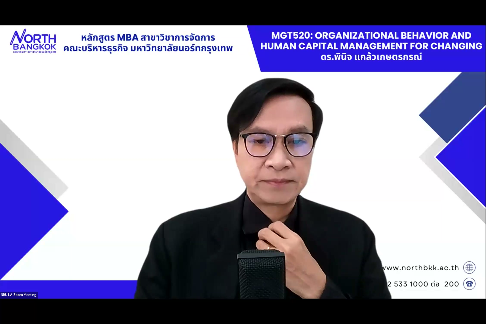

สวัสดีครับ ยินดีต้อนรับเข้าสู่ห้องเรียนออนไลน์วิชา MGT520 วิชา Organization Behavior พฤติกรรมองค์กร ตัวย่อพูดง่ายๆ ว่า OB ในโลกของการจัดการ แนว OB คือดูแลคน อธิบายพฤติกรรมคน ทำนายพยากรณ์พฤติกรรมของคน [?] แล้วก็ควบคุมพฤติกรรมของคนนะครับอธิบายทำนายและควบคุมพฤติกรรมของคน ซึ่งคนมีทั้งหมดสามกลุ่มนะครับ กลุ่มเล็กสุดก็คือคุณลักษณะเฉพาะของบุคคลตัวบุคคลเองนั่นแหละครับ ซึ่งจะกล่าวถึงความแตกต่าง ความแตกต่างของบุคคลนะครับไม่ว่าจะเป็นเพศ อายุ ระดับการศึกษา ทัศนาฏิ ทัก�

## [00:00:30]
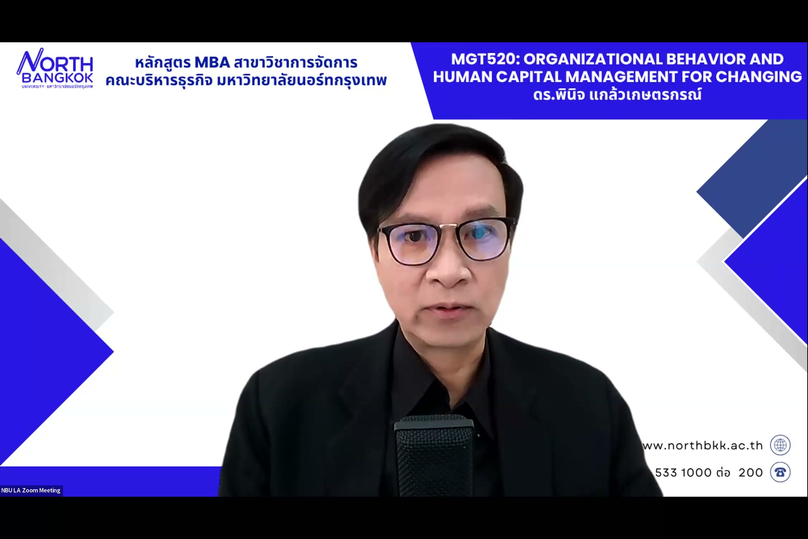

[?] เกี่ยวกับตัวบุคคลทั้งหมดแล้วครับนักศึกษาครับเงื่อนทฤษฎีอะไรที่พูดถึงเรื่องตัวบุคคลที่อาจารย์สอนไปตอนต้นนะครับค่อนข้างเยอะนะตรงนี้ แล้วต่อไปก็คนมารวมกันเป็นกลุ่มนะครับก็พฤติกรรมกลุ่ม ซึ่งเรียนไปแล้วหลังกลางภาคนะครับจะต้องใช้สอบปลายภาคด้วยนะครับแล้วก็สุดท้ายเมื่อกลุ่มมารว

## [00:01:00]
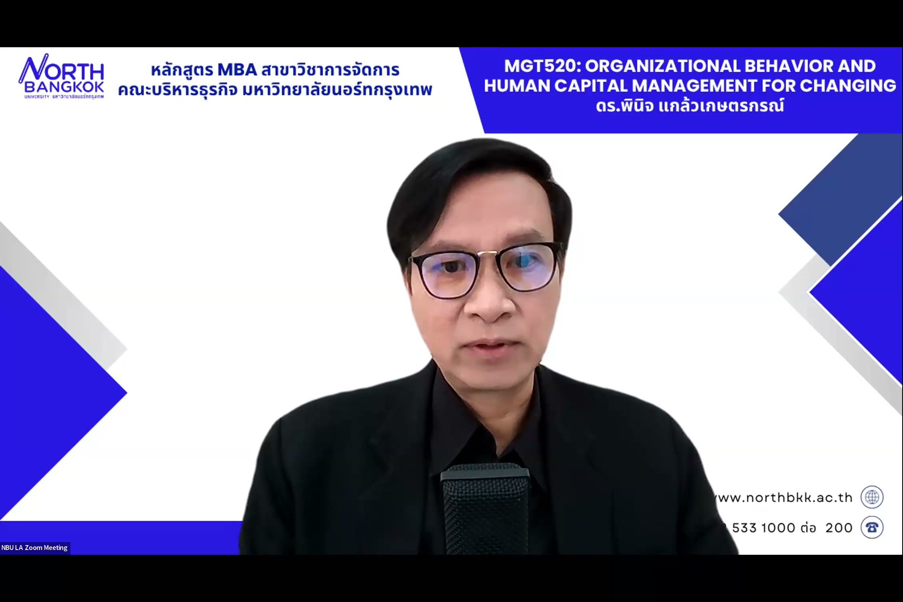

OM เนี่ยเกี่ยวกับการดำเนินงาน มันมาจากคำว่า Operation Management นะครับ การจัดการการปฏิบัติการ เริ่มดำเนินงานแล้วในภาษา OM นะครับ แล้วก็มี OD OD ก็คืOrganization Development เป็นการพัฒนาองค์กรนะครับ ในโลกของการจัดการก็จะมีวนอยู่แบบนี้แหละ เป็นหัวข้อใหญ่นะครับ หัวข้อใหญ่ OB, OM แล้วก็ OD นะครับ

## [00:01:30]

[?] มันก็จะเป็นหัวข้อใหญ่อยู่เท่านี้นะฮะ ส่วนที่เหลือก็แตกกระจายออกไปนะครับ เป็นรายละเอียดของแนวคิด ทฤษฎีการจัดการนะครับ ของแต่ละแนวคิดนะครับ ส่วนเมื่อสัปดาห์ที่แล้วนะครับก็น่าจะจบนะฮะ สอนจบเนอะ เรื่องวัฒนามงกรนะครับ

## [00:02:00]
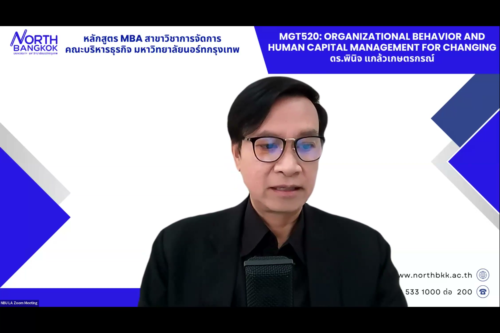

[?] เรื่องนี้ค่อนข้างเป็นภาพรวมนะครับ มองในภาพรวมขององค์กร ซึ่งหลักการสำคัญของวัฒนธรรมองค์กรนะครับ ลองไปดูคลิปที่อาจารย์สอนรอบที่แล้วแล้วกันนะครับ ใครฟังไม่ทัน ไม่เข้าใจก็ลองไปดูคลิปนะครับ วัฒนธรรมองค์กรมันเกิดขึ้นจากการตั้งใจสร้างวัฒนธรรมองค์กรที่ดีนะครับ ตั้งใจสร

## [00:02:30]

[?] อาจจะบอกไว้เหมือนออกตัวไว้ก่อนว่าอะไรที่เป็นเรื่องไม่ดีในองค์กรเขาจะไม่ ไม่ใช้คำว่าวัฒนธรรมนะครับเขาจะไม่ใช้นะ วัฒนธรรมจะเป็นเรื่องสร้างสรรค์นะครับ เป็นเรื่องที่ดี ตั้งใจให้มันเกิดขึ้นมาตั้งใจให้มันเป็น ตั้งใจให้คนในองค์กรมองเห็นภาพเดียวกันปฏิบัติในแนวทางเดียวกัน สร้างให้พนักงาน

## [00:03:00]
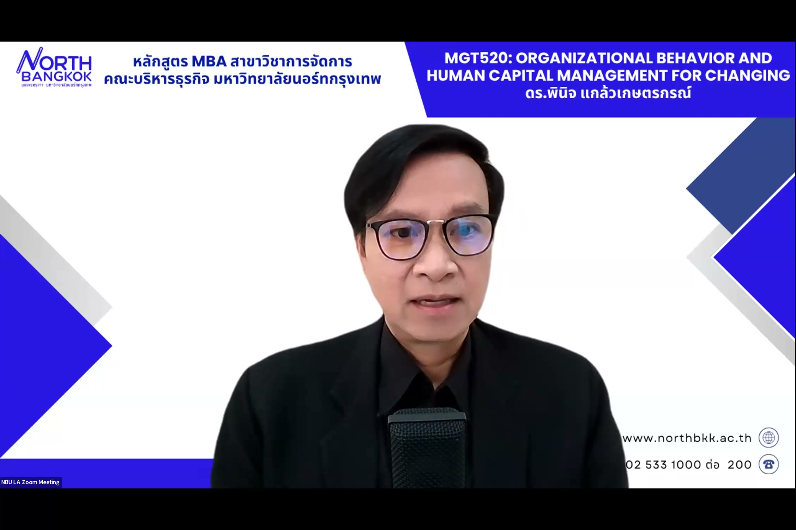

[?] นั่นคือวัฒนธรรมองกรแล้วมันก็ถ่ายทอดรุ่นต่อรุ่น เพราะฉะนั้นการสร้างวัฒนธรรมองกรนักศึกษาไปดูอาจจะมีหลายหัวข้อที่น่าสนใจอย่างเช่นการสร้างเรื่องเล่านะครับ การสร้างเรื่องเล่าให้มีการถ่ายทอดรุ่นต่อรุ่นสู่รุ่นนะเพื่อให้เข้าใจความเป็นมาแล้วก็ความเป็นไปในอนาคตขององค์กรแต่ละองค์ก

## [00:03:30]
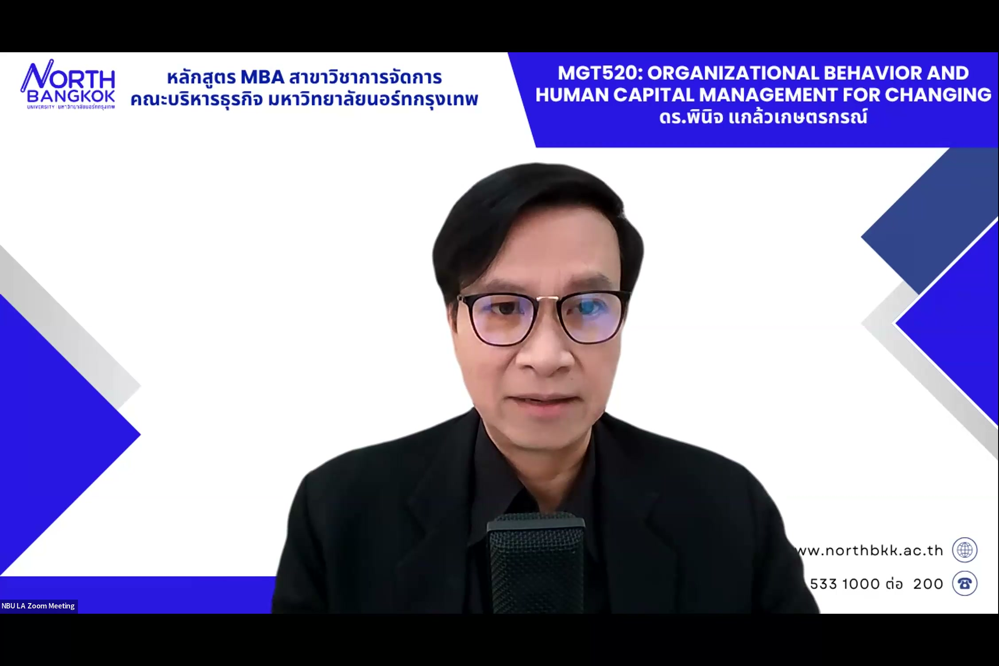

[?] เอ่อยกตัวอย่างเช่นเรื่องเล่าในต่างประเทศน่ะเยอะน่ะหลายองค์กรแต่เรื่องเล่าในประเทศไทยอย่างเช่น เอ่อ มีใครรู้จักราดหน้าเจ๊ไฝ่บ้างนักศึกษาครับใครเคยไปทหารบ้างราดหน้าเจ๊ไฝ่นักศึกษารู้เรื่องเล่าของราดหน้าเจ๊ไฝ่ไหมครับเรื่องนี้ก็จะถูกเล่าต่อไปเรื่อยเรื่อยนะครับจนกว่าเจ๊ไฝ่จะถ่ายท

## [00:04:00]
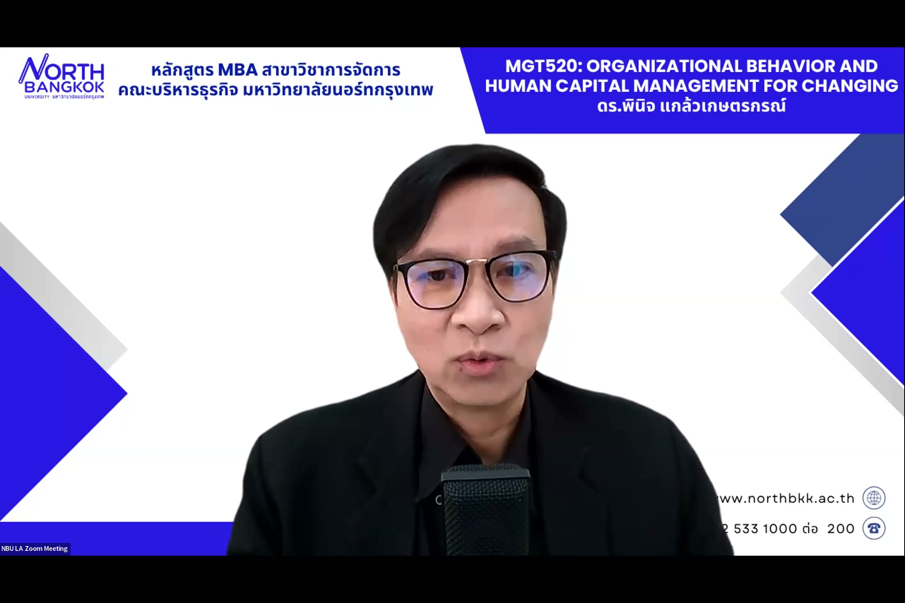

[?] มันเป็นสตอรี่นักศึกษาครับทุกอย่างเมื่อมีสตอรี่มันจะทำให้เกิดความจดจำนะครับ การรับรู้แล้วเกิดความจดจำเป็นเป็นกลยุทธ์เลยนะครับ เป็นกลยุทธ์เลยนะสร้างสตอรี่ขึ้นมา แล้วก็มันจะทำให้คนส่วนใหญ่รับรู้ แล้วก็จดจำรับรู้เข้าไปก่อน แล้วก็จดจำนักศึกษาครับ นั่นราดหน้าเจ๊ไฟ อะ โอเคนัก

## [00:04:30]
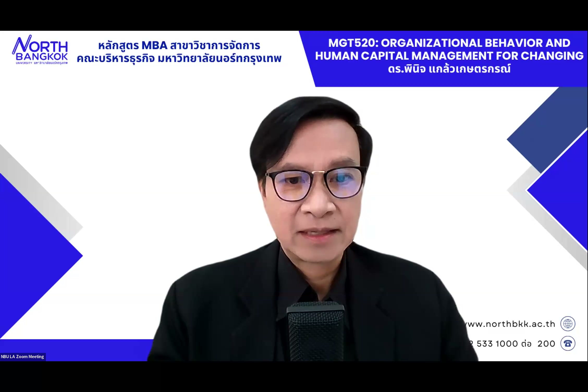

[?] ยังไม่ทราบคะแนนทักเปิดไมค์ได้เลยนะครับ พีลพงศ์ครับอาจารย์ครับ พีลพงศ์แปดสิบครับ พีลพงศ์แปดสิบครับ ขอบคุณครับอาจารย์ครับ คูณด้วยศูนย์จุดสามนะครับจะเป็นคะแนนเต็มสามสิบนะครับ เมื่อกี้เป็นคะแนนร้อยนะครับคูณศูนย์จุดสามจะเป็นคะแนนเต็มสามสิบเปอร์เซ็นต์ เอาตัวไหนคูณครับอาจารย์

## [00:04:48]

## [00:04:52]
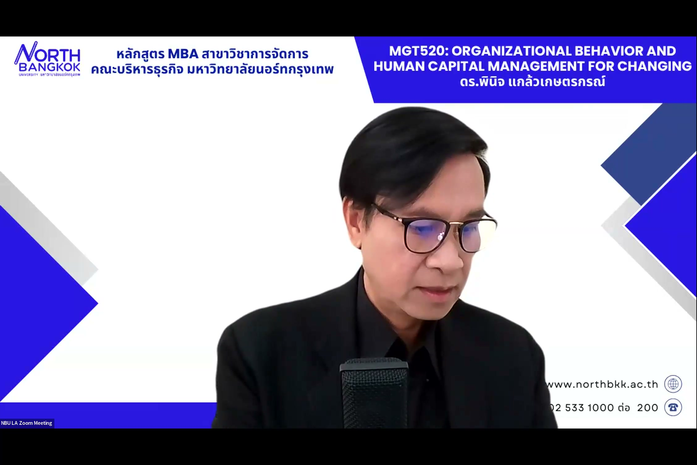

## [00:05:01]

## [00:05:15]

## [00:05:23]

[?] ขอบพระคุณครับจารย์ครับ โอเคครับ มีใครไม่ทราบคะแนนทักได้เลยนะครับ โอเคนะครับ เรื่องที่จะเรียนในวันนี้ครับ ก่อนจะเรียนอาจจะมีเคสสตาดี้ มีเรื่องเล่านะครับ เป็นสไตล์การสอนนะครับ ใช้เคสสตาดี้สัดส่วนใหญ่นะครับ เรื่องนี้ครับ ลองฟังเรื่องนี้ดูนะครับ ลองฟังก่อนนะครับ โอเคไป ผมใช้ตัว

## [00:05:53]
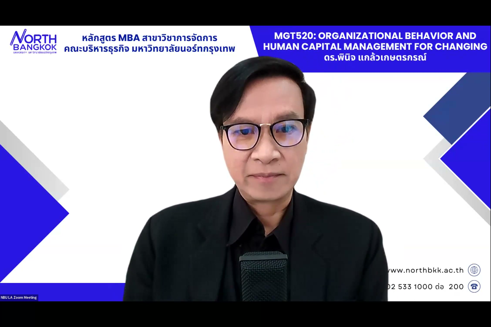

## [00:05:56]

## [00:06:00]

[?] ละครเป็น เป็นมดน้อยแล้วกันนะครับนักศึกษาครับ ใช้แทน แทนชื่อคนแล้วกันนะ จะได้ไม่เผื่อไปตรงกับชื่อใคร ไปพาดพิงเอา เอาเป็นชื่อ story เรื่องนี้ครับ case study เรื่องนี้ใช้เป็นชื่อ ชื่อน่ารักน่ารักนะครับ อ่า โอเคนักศึกษาครับ มดน้อยนะครับ เป็นพนักงานที่ขยันทำงานเก่งโดยไม่ต้องมีระบบมาควบคุมนะครับ โดยไม

## [00:06:30]
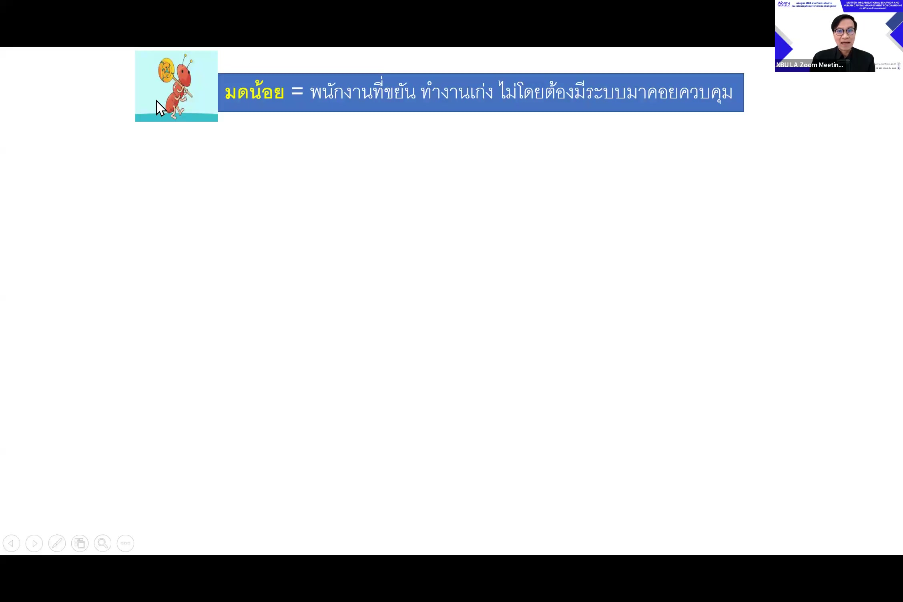

[?] เป็นเจ้าของบริษัทเขาคิดว่า วันหนึ่งนะครับวันหนึ่งเขาก็ เอ๊ะ ขึ้นมานะครับ เอ๊ะใจฉุกคิดนะครับ ฉุกคิด ถ้ามีระบบที่ดี มีหัวหน้าที่ดีมาคอยดูแลจะทำให้มดทำงานได้มีประสิทธิภาพมากขึ้น นักศึกษาเวลาผมเจอคำว่าประสิทธิภาพเมื่อไหร่เนี่ยผมก็อยากให้นักศึกษารู้นะ

## [00:07:00]

[?] ต้องแตกมันออกมาให้ได้นะครับนักศึกษาครับ เข้าใจใช่ไหมครับนักศึกษาว่าเราได้ยินคำว่าประสิทธิภาพแต่ถ้าเราไม่รู้ว่ามันหมายถึงอะไรอ่ะ อาจารย์เชื่อว่า มันทำมันก็จะทำไม่ได้มันจะไม่เข้าใจว่าประสิทธิภาพคืออะไร เพราะฉะนั้นนักศึกษาอาจารย์พูดหลายรอบแล้วเนอะแต่พูดอีกได้นะครับ ไม่เป็

## [00:07:30]
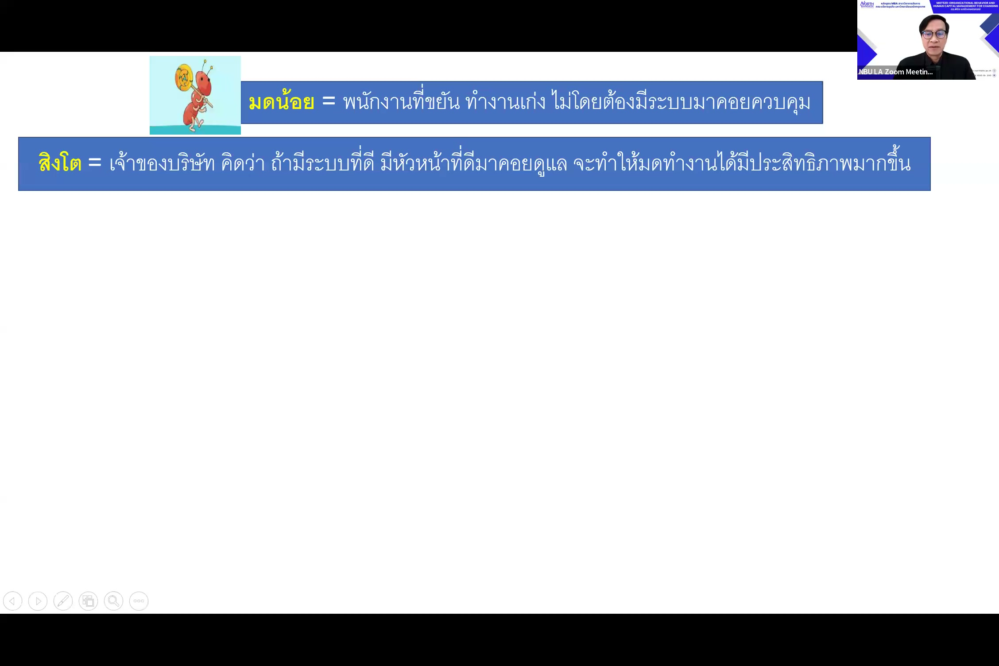

[?] ประโยชน์ที่เกิดขึ้นกับลูกค้าลูกค้าในที่นี้นักศึกษาครับ รวมถึงลูกค้าภายในด้วยนะครับลูกค้าภายใน ลูกค้าภายนอกนี่ก็คือลูกค้าทั่วไปที่ซื้อของนั่นแหละครับนักศึกษาครับ ที่องค์กรต้องการตอบสนองความต้องการของลูกค้าภายนอกนั่นแหละครับแต่ในที่นี้นักศึกษาครับ เราจะรวม

## [00:08:00]

[?] ว่าประสิทธิภาพหมายถึงอะไรแต่ย้ำอีกครั้งแล้วกันครับลูกค้าภายในก็คือแผนกถัดไปนั่นเองครับ แผนกถัดไปแผนกหรือหน่วยงานหรือแผนกงานในองค์กรที่ที่เกี่ยวข้องกับเราอ่ะที่ต้องทำงานสอดคล้องทำงานกับเราอย่างเช่น ฝ่ายการตลาด เอ่อต้องการขอข้อมูลกำลังการผลิตจากฝ่ายผลิตจะได้รู้ว่ากำลังการผล

## [00:08:30]
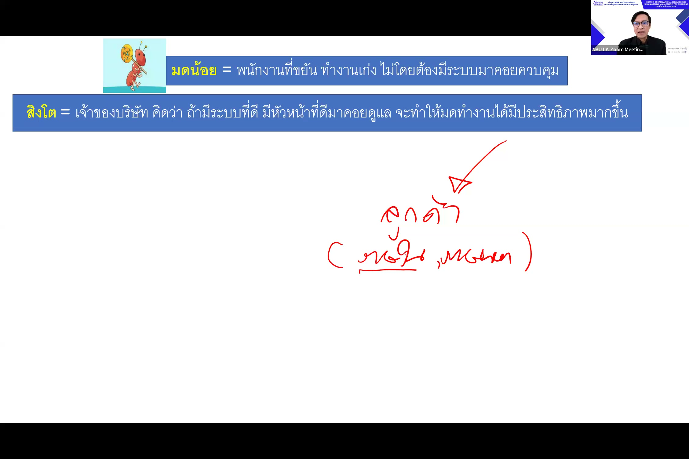

[?] แสดงว่าเขาก็คือเป็นพาร์ทเนอร์เป็นลูกค้ากันแล้วนั่นแหละครับ เราต้อง ฝ่ายผลิตต้องส่งข้อมูลครับฝ่ายผลิตต้องส่งข้อมูล ให้กับ ฝ่ายการตลาด เพราะฉะนั้นฝ่ายการตลาดเป็นลูกค้าของฝ่ายผลิตล่ะ เอ่อ หรือไม่ก็ผมอยู่ฝ่ายคลังสินค้าจะต้อง เอ่อ ฝ่ายอะไหล่ละกัน ฝ่ายอะไหล่ เอ่อ

## [00:09:00]
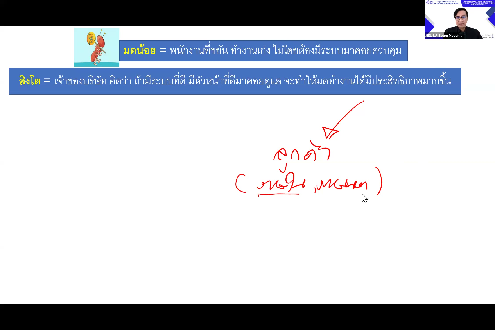

[?] ก็คือแผนกก่อนหน้าหรือหน่วยงานที่เราต้องดูแลเขานะครับต้องสปอร์ตเขา เขาคือลูกค้า เพราะฉะนั้นคำว่าประสิทธิภาพหมายถึงประโยชน์ที่เกิดขึ้นกับสองฝ่ายลูกค้าจะได้ประโยชน์นะครับ ทั้งภายในลูกค้าภายในภายนอกนะครับ ได้คุณภาพประสิทธิภาพปริมาณและเวลานะครับคุณภาพปริมาณและเวลา

## [00:09:30]
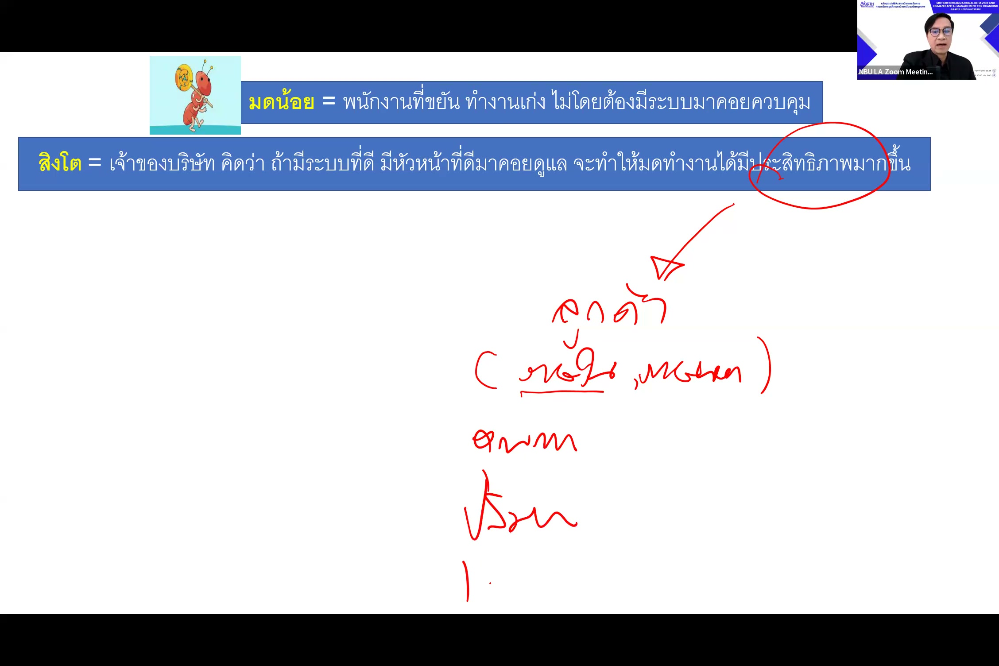

[?] อีกฝ่ายหนึ่งที่รับประโยชน์ครับก็คือผู้ผลิตเองครับ องค์กรเองนะครับตัวองค์กรเองที่ได้คือต้นทุนต่ำนะครับ ต้นทุนต่ำ อันนี้คือสิ่งที่องค์กรได้นะครับต้นทุนต่ำ นั่นคือประสิทธิภาพ เพราะฉะนั้นเมื่อไหร่ที่จะมีคำว่าประสิทธิภาพผมมันปล่อยไม่ได้จริงที่จะต้องพูดรายละเอียดเรื่องน

## [00:10:00]
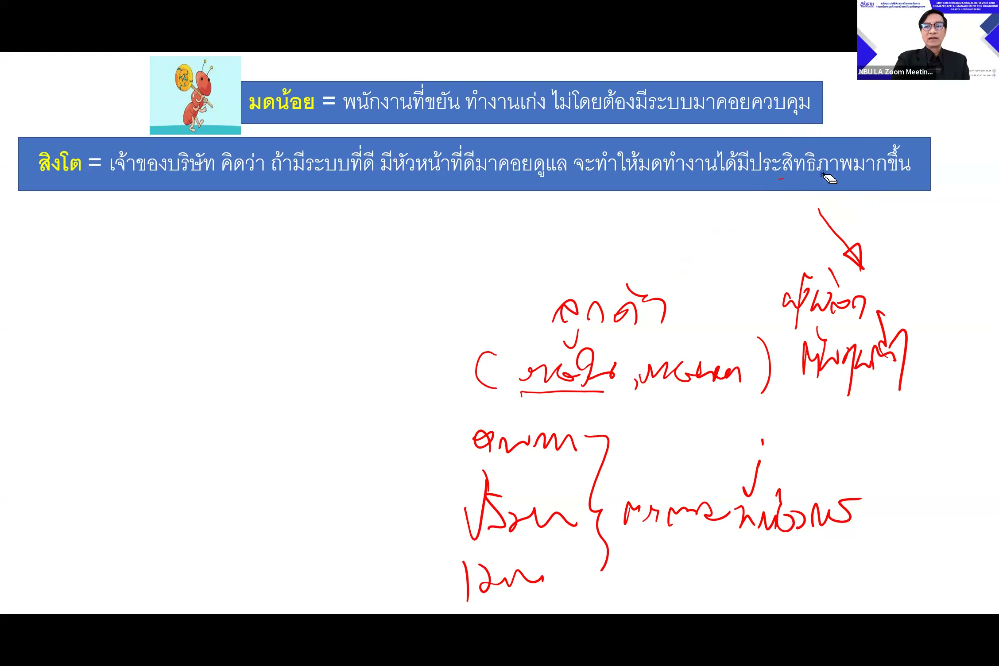

[?] ได้ยินคำว่าประสิทธิภาพแต่ไม่เข้าใจว่ามันคืออะไรแล้วเราจะทำได้ยังไงแค่นั้นเองครับนักศึกษาประสิทธิภาพหมายถึงประโยชน์ที่เกิดขึ้นกับคนสองฝ่ายนะครับ หนึ่งคือตัวลูกค้านะครับลูกค้าภายในภายนอกก็ได้สินค้าตามที่ต้องการทั้งปริมาณคุณภาพและเวลานะครับส่วนอีกคนหนึ่งที่ได้ประโยช

## [00:10:30]

[?] เมื่อลูกค้าพึงพอใจ ลูกค้าเขาซื้อของเรา รายได้เราก็เพิ่ม และเมื่อต้นทุนเราทำให้มันต่ำได้นักศึกษาครับ กำไรก็มาเองครับ รายได้เพิ่ม ต้นทุนลด กำไรก็มาเองนักศึกษา เพราะฉะนั้นเนี่ย ไม่จำเป็นต้องพูดคำว่ากำไรนะครับ เพราะประสิทธิภาพเนี่ยมันเป็นที่มานะเป็นจุด [?] เป็นกระดูกเม็ดแรกนะครับ ที่มาของคำว่ากำไรอยู่แล้วนะฮะ โอเคครับ มดน้อยครับ เป็นพนักงานที่ขยันทำงานเก่งโดยไม่ต้องนะครับ โดยไม่ต้องมีระบบมาควบคุมนะครับ แต่สิงโตในวันหนึ่งก็ฉุกคิดว่าถ้ามีระบบที่ดี มีหัวหน้าที่ดีมาคอยดูแลจะทำให้มดทำงานได้อย่างมีประสิทธิภาพมากขึ้น เขาคิดแบบนี้นะครับ

## [00:11:00]

[?] ผู้จัดการนะครับมาเป็นผู้จัดการเลยนะครับจ้างมาเป็นผู้จัดการ แล้วก็เริ่มต้นตั้งระบบเวลากันตั้งระบบเวลาการทำงาน บันทึกผลงานกำหนดเวลาส่งงานที่แน่นอน ตรวจสอบการขาดลามาสายด้วยครับนั่นคือหน้าที่ของผู้จัดการนะครับ แมลงสาบนะครับ แล้วแมลงสาบเนี่ยทำงานไม่ไหวมันเยอะใช่ไหมครับ แมลงสาบก็เลยไปขอสิ่ง

## [00:11:30]
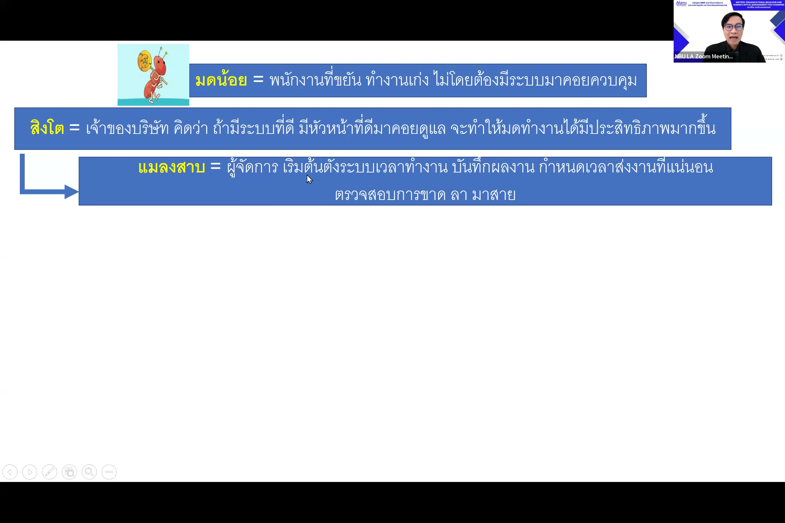

[?] ก็ได้กะลอกมานักศึกษาครับ กะลอกก็จะมาเป็นเลขาส่วนตัวคอยเป็นผู้ช่วยในการเขียนรายงานบันทึกการทำงานของมดน้อยและพนักงานทุกคนครับ ทันนะครับ ต่อไปครับ แมลงสาบเนี่ยเขาคิดว่า ระบบที่ดีมันต้องใช้ไอทีเข้ามาช่วยแมลงสาบนะครับ ระบบที่ดีต้องมีเอ่อไอทีเข้ามาช่วยก็เลยสร้างระบบไอทีขึ้นมา

## [00:12:00]
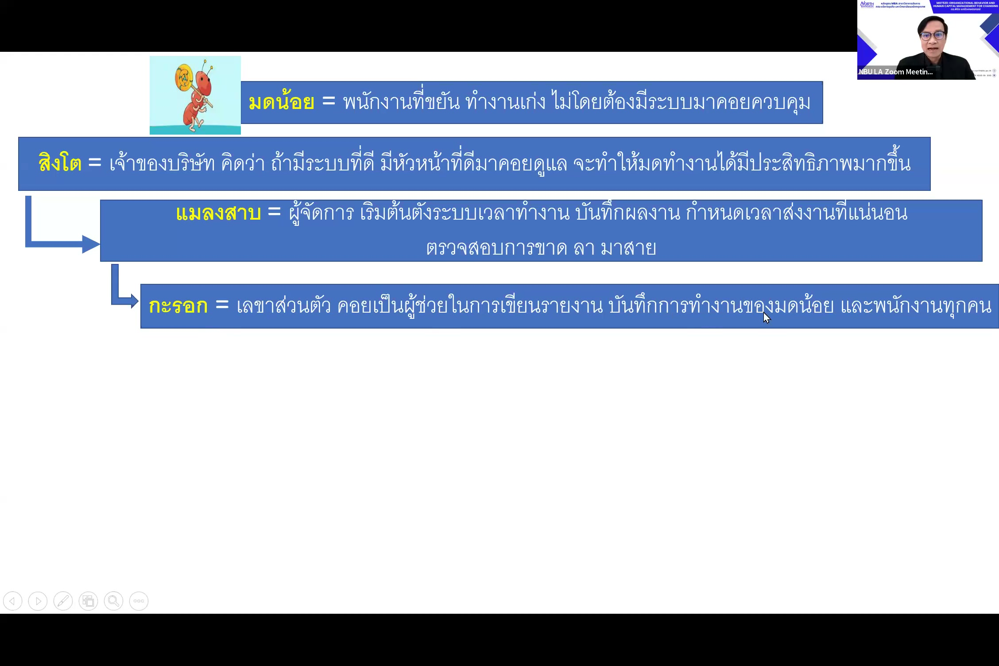

[?] จัดซื้อเครื่องคอมพิวเตอร์และอุปกรณ์โดยจ้างกระแตมาเป็นผู้ดูแลระบบ กระแตก็เลยมาเป็นหัวหน้าไอทีครับนักศึกษามาดูแลระบบนะครับหลังจากนั้นนักศึกษาครับ เหตุการณ์มันมันเกิดขึ้นแบบนี้ครับ มดน้อยเนี่ยครับเริ่มเบื่อหน่ายระบบการทำงาน เบื่อการทำเอกสารเบื่อการประชุมบ่อยบ่อย ไม่มีแรงบันดาลใจ

## [00:12:30]
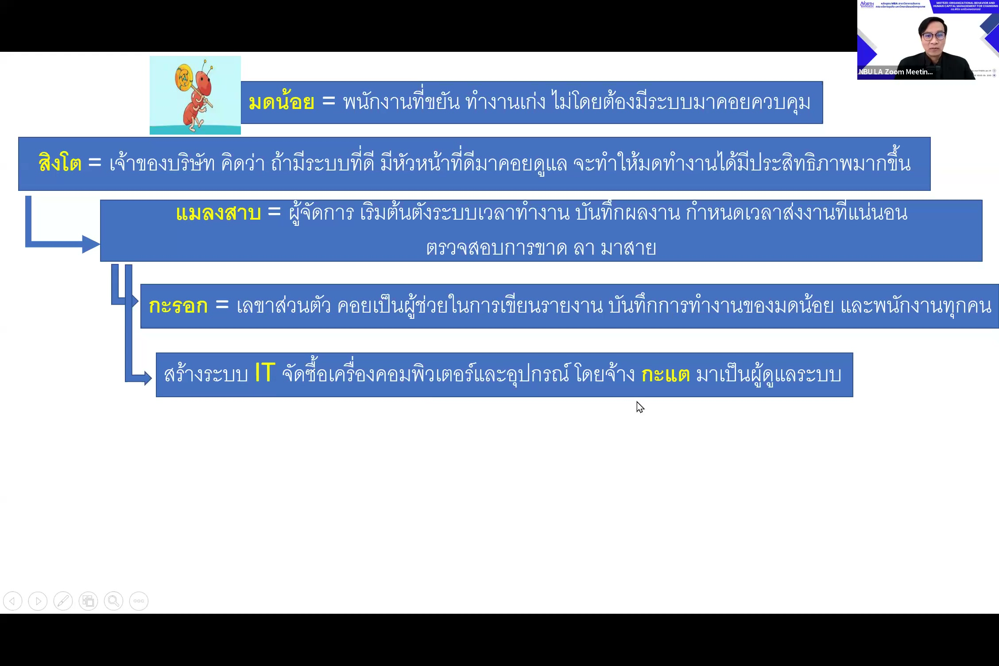

## [00:12:40]

[?] ผลงานแย่ลงเลยโดนตัวทากตัวทากนะครับ แย่งตำแหน่งหัวหน้างานไปทั้งทั้งที่ทำงานช้ามาก แต่เพราะตัวทากทำงานได้แค่ตามที่สั่งนะครับ แถมยังขี้ฟ้องคอยประจบประแจงแมลงสาบตลอดเวลา หลังจากนั้นนักศึกษาครับเมื่อเกิด

## [00:13:10]

[?] เหตุการณ์นี้ขึ้นครับเหมือนเหมือนมีปัญหาเรื่อง เรื่องเอ้าคำเพราะว่า มดน้อย เบื่อนะครับยอดก็น่าจะ ตกอ่ะนะฮะ ก็เลย ไปจ้างตัวแลนด์สิงโตนะครับ ไปจ้างตัวแลนด์มาวิเคราะห์ปัญหา เอ่อ จ้างตัวแลนด์มาวิเคราะห์ปัญหาให้หน่อยว่ามันเกิดอะไรขึ้น เพิ่มประสิทธิภาพการทำงาน

## [00:13:40]

[?] และได้เห็นปัญหาสำคัญคือมีจำนวนพนักงานมากเกินไปครับนั่นก็คือตัวแลนด์วิเคราะห์มาแล้วนะครับ เพราะฉะนั้นเนี่ยตัวแลนด์วิเคราะห์แล้วว่าปัญหาสำคัญคือมีจำนวนพนักงานมากเกินไป นักศึกษาครับ เหตุการณ์ทั้งหมดเนี่ยสิงโตเนี่ยคือเจ้าของบริษัทนะครับ นักศึกษาว่าสิงโตจะแก

## [00:14:10]

## [00:14:40]

เลขบัญชีเลยครับ อ๋อ เลขบัญชีเลย นักศึกษาครับ เรื่องนี้เรื่องจริง แต่อาจารย์เอาชื่อคนออก ใช้ p o l c เข้ามาจัดการ เออ ระบบการจัดการนั่นแหละนะ ก็ ก็อย่างงี้ผมถาม ถามให้มันสโคปมาหน่อยแล้วกันเนอะ โฟกัสหน่อย

## [00:15:06]

[?] สิ่งโตเนี่ยเขาก็เลยจะทำตามที่ตัวแลนด์วิเคราะห์ครับเพราะตัวแลนด์เขาวิเคราะห์ว่านี่ตัวแลนด์เขาถูกจ้างมานะครับ ตัวแลนด์เขาเลยบอกว่ามีจำนวนพนักงานมากเกินไปครับสิ่งโตเขาเลยตัดสินใจง่ายง่ายนักศึกษาสิ่งโตเขาเขาบอกว่างั้นถ้ามากเกินไปก็ต้องเอาออกสิ ก็ต้องเอาออกใช่ไหมอ่ะ อ่ะ ก็แค่นั้นก็ใน

## [00:15:11]

## [00:15:41]
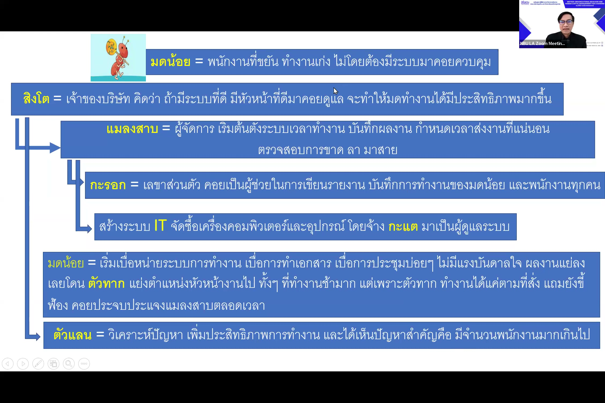

[?] จุดเปลี่ยนอยู่ตรงไหนครับนักศึกษาครับทำไมปัญหานี้คือพนักงานมากเกินไปครับ ต้นทุนหรือเปล่าครับอาจารย์ต้นทุนเพิ่ม ต้นทุนไม่ได้เพิ่มนักศึกษา คืออันนั้นไม่ได้พูดต้นทุนการผลิตนะครับหมายถึงเขากำลัง หมายถึงพวกคนที่ถูกจ้างมาเพิ่มๆใช่ไหม Productivity ไม่เพิ่มแต่ต้นทุนเพิ่ม จุดสำคัญมันอยู่ตร

## [00:16:11]

[?] แมลงสาบที่เขาบอกว่าน่าจะมีระบบไอทีเข้ามาช่วยอะครับนักศึกษาครับ ไอทีถ้าปัจจุบันก็เป็นเอไอแล้วนะครับเมื่อมีระบบไอทีมาช่วยบางอย่างมันก็ไม่ต้องใช้คนเยอะนะครับ นั่นแหละครับแมลงสาบที่เขาจ้างกระแตมาดูแลระบบไอทีเนี่ยคือแมลงสาบเขาเขาคิดก่อนนะ เขาคิดว่าน่าจะมีระบบไอทีก็เลยจ้างกระแตมาดูแลนะ

## [00:16:41]

[?] แมงสาเขาคิดแบบนี้เขาคิดก่อนว่าไอทีเนี่ยมันช่วยได้มันน่าจะช่วยได้ ก็เลยกลายเป็นว่าไอทีทำให้งานบางงานมันไม่ต้องใช้คนจำนวนเท่าเดิมนั่นแหละครับ มันไม่จำเป็นต้องใช้คนจำนวนเท่าเดิมนึกออกไหมครับ นี่คือจุดเปลี่ยนครับมีระบบไอทีเข้ามาช่วย เพราะฉะนั้นนักศึกษาครับตอนเนี้ยต้นทุนมันเพิ่ม

## [00:17:11]

[?] เพราะมันเป็นต้นทุนระบบไอทีครับ น่าจะเยอะนะฮะต้นทุนระบบไอทีนี่ไม่ใช่น้อยน้อยนะ แต่เราบริษัทมันถ้าจะเปลี่ยนจากระบบอนาล็อกระบบทั่วไปมาเป็นไอทีนี่ลงทุนเยอะมากนะครับ อ่ะ ต้นทุนมันเพิ่มแน่นอนครับพอต้นทุนเพิ่มปุ๊บเนี่ย อาสาครับ เอ่อ เมื่อกี้ น่าจะ น่าจะหมายถึงลดคนเป็นการลดต้นทุนที่

## [00:17:41]

[?] เพราะฉะนั้นการลดจำนวนคนเป็นการลดต้นทุนที่เร็วที่สุดนักศึกษาครับ โอเคนะเพราะฉะนั้นเรื่องนี้เนี่ยจุดเปลี่ยนอยู่ที่ระบบไอทีเลยครับ จุดเปลี่ยนเลยนะครับจุดแยกเลยนะ ระบบไอที สิงโตเนี่ยเขาได้รับคำแนะนำจากตัวแลนด์ว่าคนมันเยอะเกินไป แต่ไม่ได้บอกว่าต้องเลิกจ้างนะครับแต่สิงโตเขาไม่คิดเยอะนัก�

## [00:18:09]
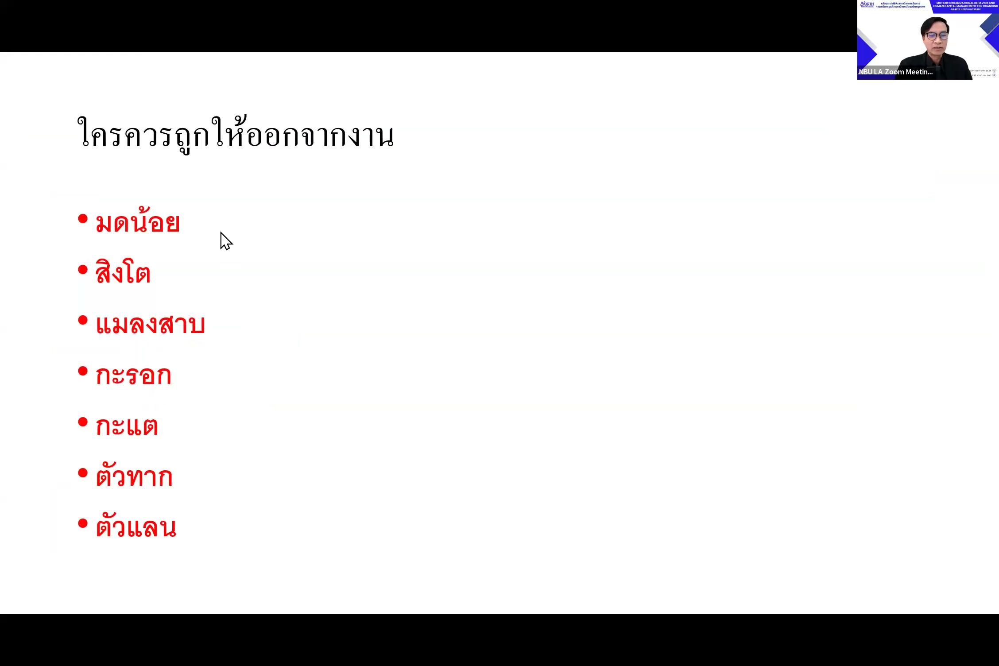

[?] มดน้อย มดน้อยนะครับสอง สิงโต สิงโตเป็นใครนะเจ้าของใช่ไหมครับ แมลงสาบ แมลงสาบเป็นใครใครจำได้บ้าง ผู้จัดการ เอ้อ แมลงสาบจำได้เนอะเป็นผู้จัดการนะครับ กะลอกล่ะ เป็นใคร [?] ผมจำไม่ได้แล้ว ผมว่ามีคนจำไม่ได้ จะรอบเป็นเลขา เก่งมากครับ จำได้เนอะ กระแตครับ เป็นใครครับ ไอทีซัพพอร์ตครับ กระแตเป็นไอทีซัพพอร์ตครับ ตัวทากล่ะ หัวหน้างาน

## [00:18:39]

[?] บรรทัดงานสายประจบได้ไหมครับ เป็นหัวหน้างานใหม่แล้วนะครับ เป็นหัวหน้างานใหม่คืออันนี้ผม ผมไม่ ไม่ ไม่ขยายแล้วกันนะครับผมไม่ขยี้เรื่องตัวทากแล้วกันครับ เพราะว่าผม ผมคิดว่าทุกคนมีเส้นทางของตัวเองมีเวย์ของตัวเองครับ ผมเชื่อแบบนั้นนะครับแล้วผมก็เห็นมาเยอะแล้วนะศึกษาครับ แบบนี้แล้วก็ทำงานเก่ง นัก�

## [00:19:09]
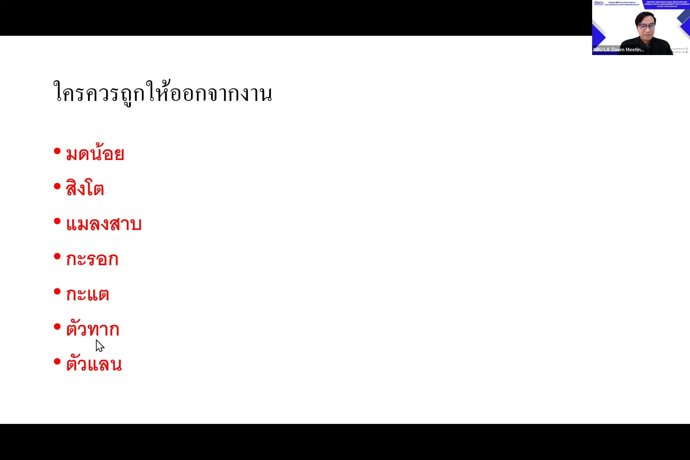

[?] คืออะไรรู้ไหมครับ นักศึกษาเรา เราจำพฤติกรรมตัวทากได้ไหมครับคำว่าทำงานเก่งแต่ละคนไม่เหมือนกัน หัวหน้ามองคนทำงานเก่งไม่เหมือนกันนะครับนักศึกษาครับ เก่ง ตอนนี้ควรเก่งอะไรสถานการณ์นี้ควรเก่งอะไร แต่ละสถานการณ์ควรเก่งอะไรนักศึกษาครับ เขาเรียกว่า เอ่อ ปฏิบัติตามสถานการณ์แล้วกันนะครับ

## [00:19:39]

[?] หน้าที่อะไรตัวแลนด์ เข้ามาตรวจสอบ เข้ามาตรวจสอบ มา มดน้อยเป็นพนักงานที่ขยันทำงานเก่งโดยไม่ต้องมีระบบมาควบคุมครับ สิ่งโตเป็นเจ้าของบริษัทแล้ววันหนึ่งสิ่งโตฉุกคิดว่าถ้ามีระบบที่ดี มีคุณภาพดีคอยดูแลจะทำให้มดทำงานได้มีภาพมากขึ้น แมลงสาบเป็นผู้จัดการครับ

## [00:20:01]
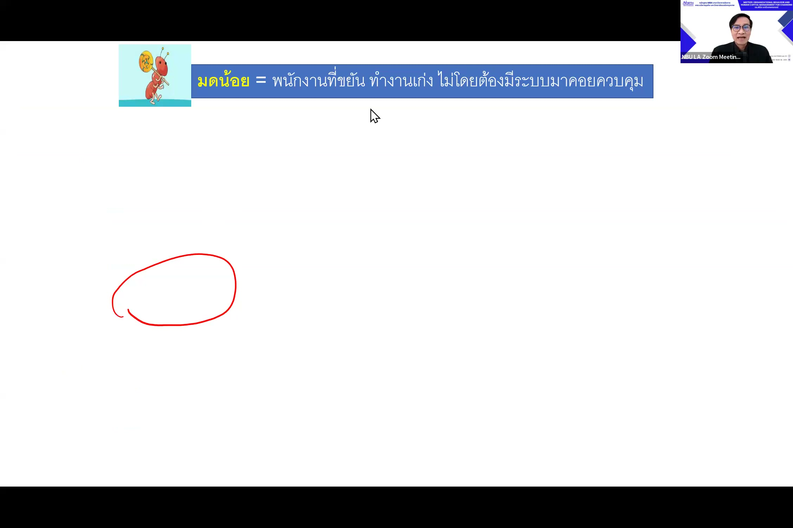

[?] มาตั้งระบบเวลาทำงานบันทึกผลงานกำหนดเวลาส่งงานที่แน่นอนตรวจสอบการขาดงานขาดรามาสายนะครับ แมลงสาบนะครับ กัลลอกนะครับ เป็นเลขาส่วนตัวคอยเป็นผู้ช่วยในการเขียนรายงานบันทึกทำงานของมดน้อยและพนักงานทุกคนแต่พองานมันเริ่มเยอะครับ แมลงสาบก็เลยจัดสร้างระบบไอดีขึ้นมาแล้วก็จ้างกระแตมาเป็นผู้ดูแลระบ

## [00:20:31]
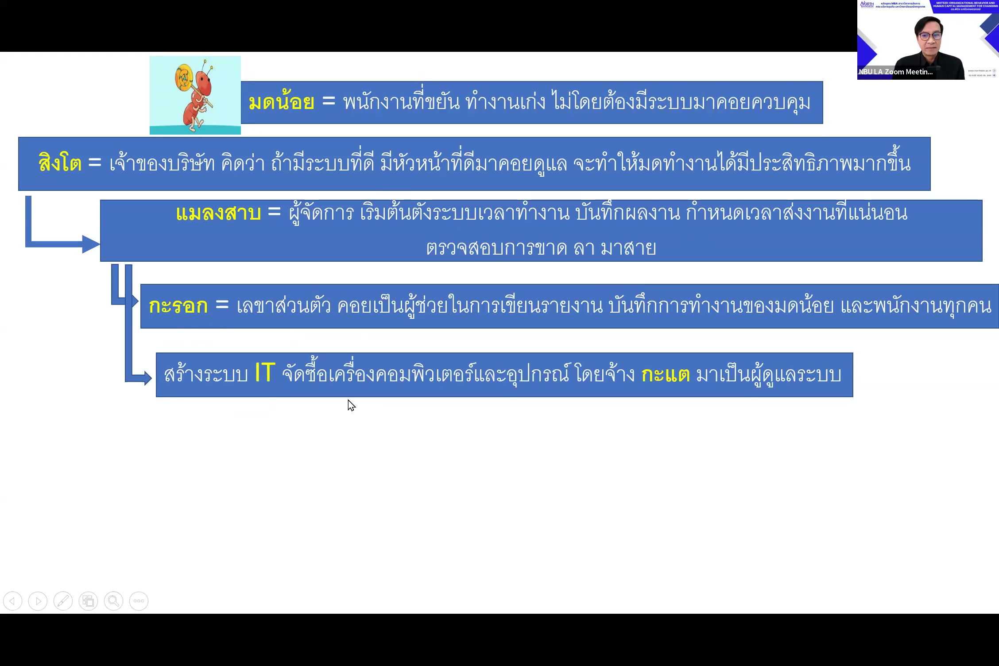

## [00:20:35]
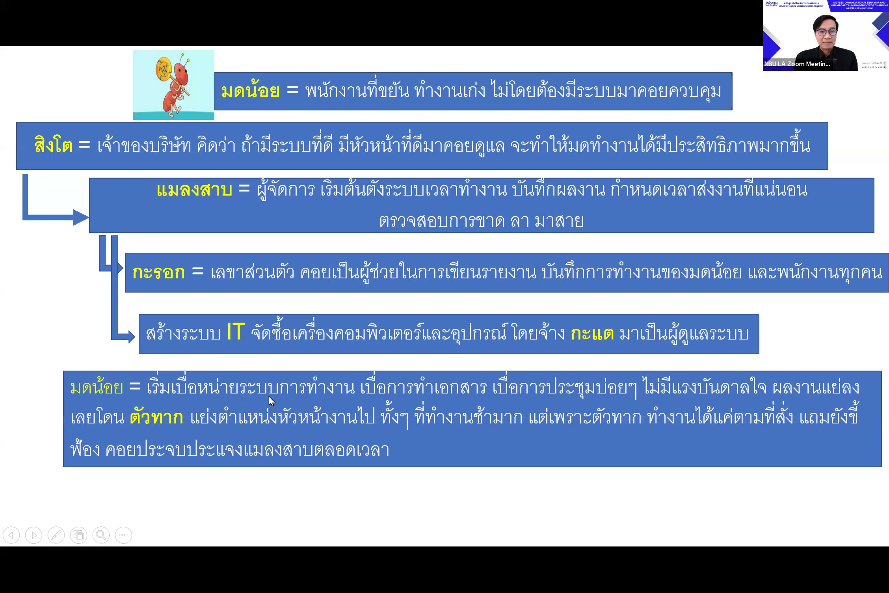

[?] แย่ลงครับตัวทากแย่งตำแหน่งหัวหน้าไปเลยครับนักศึกษาทางที่ทำงานช้ามากตัวทากนะครับ แต่เพราะตัวทากทำงานได้ตามคำสั่งได้ตามคำสั่งนะครับ แต่ในนี้เขียนได้แค่ตามที่สั่งนักศึกษาครับ อย่าสับสนกับประโยคนะครับ คำว่าได้แค่ตามที่สั่งเนี่ยแสดงว่าเขาทำงานได้ตามคำสั่งนะครับนักศึกษาครับ แต่ถามว

## [00:21:05]

[?] นักศึกษาลองนึกซิว่าในองค์กรมีแบบนี้อยู่จริงไหมจริงครับ นักศึกษาเรื่องนี้เป็นเรื่องจริงจากองค์กรครับแถมยังขี้ฟ้องคอยประจบ นักศึกษาอาจจะใช้คำแรงไปนะครับ อย่า อย่า อย่าหลงกลนะครับนักศึกษาอย่าหลงกลกับ ประโยคที่เขียนนะครับนักศึกษาแถมยังขี้ฟ้องหมายถึงอะไรนักศึก�

## [00:21:35]

[?] ไปข้างนอกไปดูงานต่างประเทศห้าวันน่ะนักศึกษาครับนักศึกษากลับมานักศึกษาอยากดู นักศึกษาอยากดูรายงานที่เขียนเป็นเอกสารหรืออยากไปฟังจากตัวทาก อยากดูเอกสารแต่ละแผนกที่เขาเขียนรายงานมาแต่ละแผนกเขียนรายงานมาหรืออยากเรียกตัวทากมาคุยอ่ะนักศึกษาครับ อาจารย์เชื่อว่าหัวหน้าบางคน

## [00:22:05]
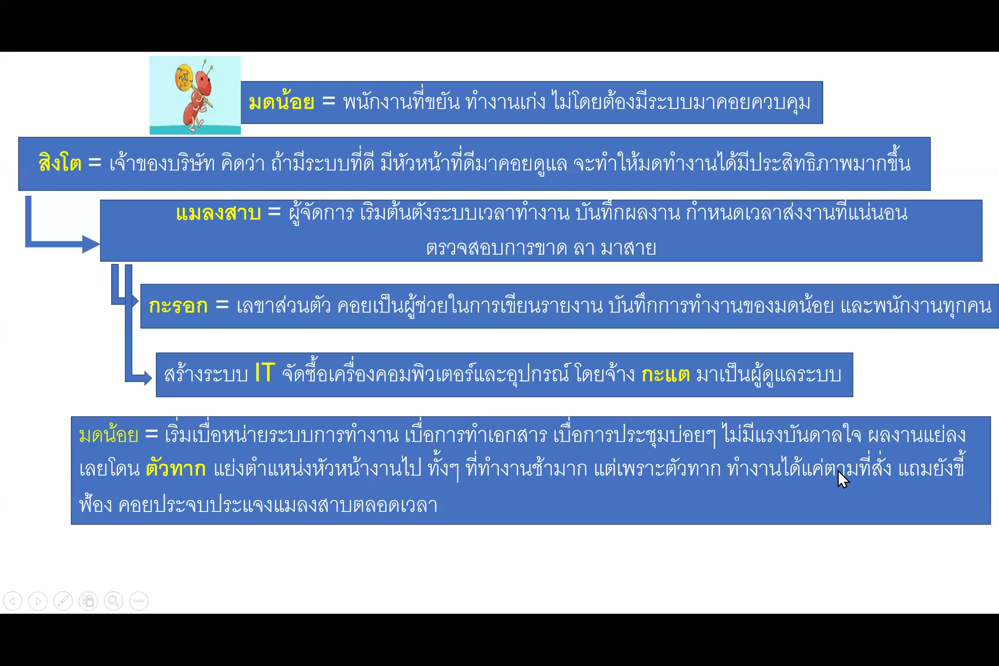

[?] ชอบเรียกตัวทากมาคุยมากกว่านักศึกษา มีหัวหน้าแบบนี้ มีครับนักศึกษาครับ แต่บางคนเขาก็ดูเอกสารก็ แต่เอกสารมันอาจจะอะไรที่เป็น Bad Record ก็อาจจะไม่มีใช่ไหมนักศึกษาครับ แถมยังคอยประจบประแจงแมลงสาบตลอดเวลานักศึกษา ตัวทาก เขาไม่ได้ประจบ คนที่ว่าเขาประจบคือคนอื่นนะครับ คนอื่นว่าเข [?] ไอ้คนที่ประจบอ่ะเขาไม่ได้พูดตัวเขาเองคนอื่นว่าเขาประจบแต่ตัวเขาเองเขาแค่บอกว่าก็ผมมีน้ำใจไง ผมไปเที่ยวมาไงเที่ยวต่างจังหวัดผมไปเที่ยวยุธยามาไงผมก็เลยซื้อ ซื้อสายไหมมาฝากก็แค่นั้นเองอ่ะทำทำไมมาว่าผมประจบล่ะก็แค่ผมไปเที่ยวยุธยา แล้วผมก็ซื้อสายไหมมาฝากอ่ะแล้วผมไม่ได้ฝากคนเดียวไปถามเลยผมฝ

## [00:22:35]
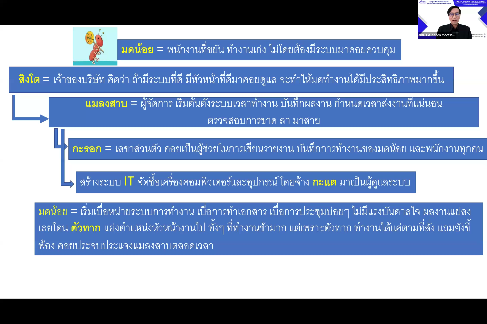

[?] แต่ทำไมมาพูดว่าผมประจบฝากเจ้านายคนเดียวอ่ะทั้งที่จริงจริงผมฝากทั้งแผนกน่ะ ยกเว้นคนที่ผมไม่ชอบเท่านั้นแหละที่ผมไม่ฝากอ่ะ นักศึกษาครับ ก็คนก็ไม่ชอบก็ไม่ได้ฝากไงก็แค่นั้นเองนักศึกษาครับ อ่ะ โอเคนักศึกษาครับ ตัวแลนด์ก็เลยมาวิเคราะห์ปัญหาว่าพนักงานมากเกินไป

## [00:23:05]

[?] นักศึกษาตัวแลนด์เขาอาจจะไม่ได้เข้าใจเรื่องตัวทากว่าขี้ประจบอะไรเขาไม่ได้เข้าใจนะครับ เขาดู เขาดูจากระบบการทำงานเป็นหลักนักศึกษาเขาคิดว่าพนักงานคนมากเกิน มากกว่างาน งานบางงานมันถูกไอทีเข้ามาแทนที่เอาละครับนักศึกษาครับ ใครควรให้ถูก ถูกให้ออกจากงานตามกฎหมายนะครับ ออกถูก คือออกแ

## [00:23:31]
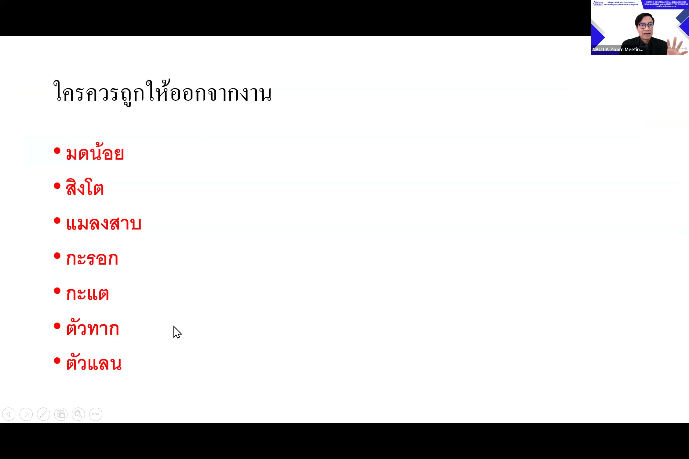

[?] ควรให้หนูออกจากงานหนูคิดว่ามดค่ะ หนูคิดว่ากะลอกค่ะ มีมีมดล่ะมีมดหนึ่งแต้มมีกะลอกอาจารย์พิมพ์กะลอกผิดรึเปล่าไม่รู้เนอะ กะลอกมีสละรอเรือด้วยรึเปล่าไม่แน่ใจนะแต่อาจารย์เชื่อว่าไม่น่ามีนะ กะลอก อะ มา มีใครอีกครับมีมดน้อย มีกะลอก กะลอกนี่อย่ามาใช้ในห้องสอบนะอาสาครับกะลอกไม่เอานะครับ

## [00:24:01]

[?] ทำด้วยตัวเองนะครับ อย่าลอกนะครับ ภาษาหับกะลอกอย่างเดียวเลย มีอีกไหม ผมมองเป็นตัวแลนด์และแมลงสาบอะครับมองเป็นตัวแลนด์กับแมลงสาบ เดี๋ยวผมจะสุดสุดท้ายมันขึ้นอยู่กับแต่ละองค์กรนะ เดี๋ยวผมจะบอกว่าองค์กรนี้เขาเขาเอาใครออก เดี๋ยวผมจะ จะจะบอกทีหลังนะภาษาเรื่องนี้เป็นเรื่องจริงนะครับเขาไม่ใช

## [00:24:31]
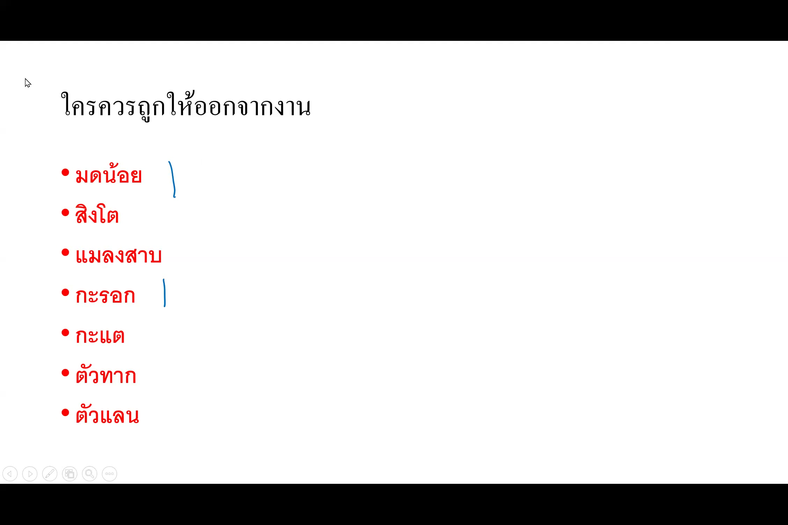

[?] มาคุยก่อนนะครับน้าสาครับ อะ มีอีกมั้ยครับ อะ ย้อนกลับมาที่ตรงนี้น้าสาลองดูสิ สุดท้ายแล้วบริษัทนี้เอาใครออก อาจารย์คะขออนุญาตค่ะ อะ โอเคน้าสา งั้นอาจารย์ให้นาตาลีอธิบายผลสิ ทำไมนาตาลี ปะ ฝ่าค่ะ หนูจะบอกว่ากะล่อมีล่อเรือค่ะอาจารย์ กะล่อค่ะ นาตาลีเปลี่ยนใจแล้วเหรอ

## [00:25:01]
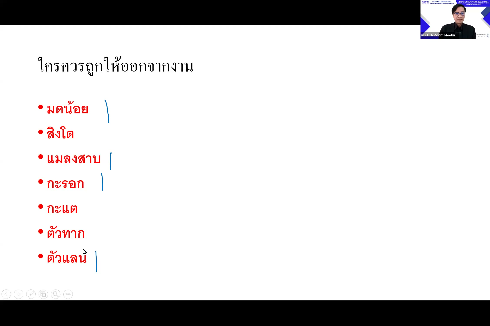

## [00:25:31]

[?] ไม่ หมายถึงว่ากะลอกที่อาจารย์ถามว่ามันมี อ๋อ มันควรเป็นกอลอใช่ไหม ใช่ค่ะ มันควรเป็นกอลอ อาจารย์พิมพ์ผิดใช่ไหม ค่ะ ลอเรือสักกะลอกนะครับ โอเค ค่ะ อะ โอเค ขอบคุณมาก นักศึกษาครับบอกเหตุผลหน่อย ทำไม อะ เมื่อกี้ก่อน เมื่อกี้คนแรกเลยนักศึกษาครับ มดน้อย อะ ทำไมเอามดน้อยออก เพราะว่า

## [00:26:01]
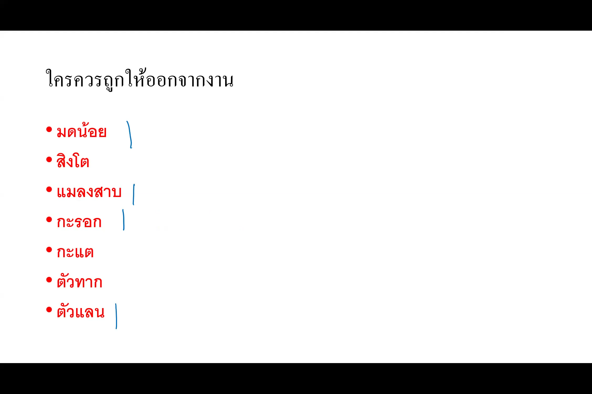

[?] เขาไม่มีประสิทธิภาพในการทำงานเท่าเดิมแล้วอ่ะเขาหมดใจกับบริษัทนี้ไปแล้วอ่ะค่ะถ้าเกิดว่าเอาคนออกยังไงเขาก็ไม่มีความรู้สึกเต็มร้อยเท่าเดิมเท่ากับที่เขาเพิ่งเข้าบริษัทมาใหม่แล้วอ่ะค่ะอ่ะโอเคต่อไปเมื่อกี้ใครบอกกะลอกใช่ไหมนาดาลีใช่ไหมหรือตัวแลนด์นะเมื่อกี้คนที่สองนะครับหนูค่ะนาดา

## [00:26:31]
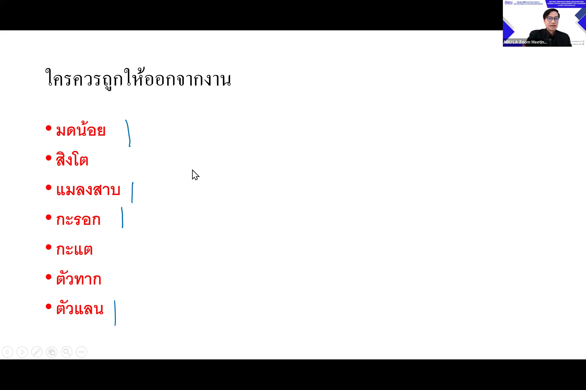

[?] ค่ะ สำหรับความคิดเห็นหนู หนูมองว่าระบบการจัดการไอทีอะค่ะ มันสามารถทำได้ในหลาย ๆ อย่าง เรื่องของการเขียนรายงาน การทำแบบ เอาเลขาออกเลยเหรอ ใช่ค่ะ เอาเลขาออกเลยนะ เดี๋ยวเราใช้ไอทีจับได้ค่ะอาจารย์ เรื่องของภาระงานของแต่ละคน ใช้ AI เลยได้เนอะ วันนี้ AI เลยนะ เอาเลขาออกเลยนะ ขอบคุณค่ะ

## [00:26:39]
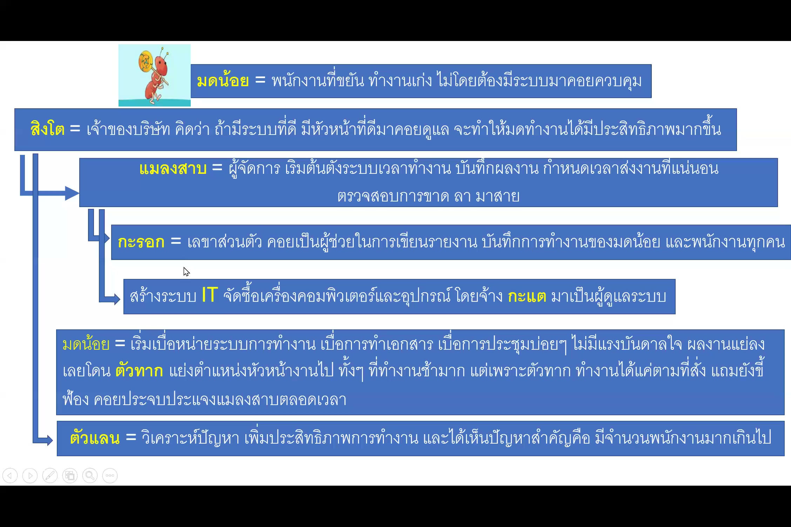

[?] เอาเลขาออกเลยนะ โอเค เจ้านายบางคน แมลงสาบอาจจะ อาจจะถูก เลขาทำงานเลขาจริงๆแล้วกันนะครับ ก็คิดว่าน่าจะไอที AI น่าจะช่วยทำงานแทนได้เลขาส่วนตัว AI นะครับ เลขา AI เดี๋ยวนี้มีนักศึกษาโปรแกรมเลขา AI นักศึกษาลองเคยใช้ไหมครับ โอเคต่อไป มีใครบอกแมลงสาบกับตัวแลนด์นะ คุณพีระพงใช่ไหม

## [00:27:05]

## [00:27:11]

ผมบอกว่าแมลงสาบครับ ในมุมของผมนะครับ เพราะมองว่าเหมือนมุ่งเน้นแต่การจับผิด แล้วก็ไปตรวจสอบเอกสารจนคิดว่าเป็นขั้นตอนบางอย่างที่มันไม่จำเป็น แล้วก็ยังหูเบาด้วย

## [00:27:33]

## [00:27:48]

[?] มีไหม พนักงาน อย่างตัวจริงอย่างมดน้อยเนี่ย หมดไฟ หมดกำลังใจในการทำงานทำให้ผลงานแย่ลงก็ประมาณ ผมว่าประมาณ ถ้าหมดกำลังใจผลงานก็จะแย่ลงไปด้วย กำลังหาสาเหตุว่าที่มดน้อยหมดไฟเพราะ เพราะแมลงสาบนี่แหละ อืม ครับ โอเค มีคนอื่นไหมครับ มีใครอยากคุยไหมครับ มีใครอยากเสนอ แลกเปลี่ยนความคิ

## [00:28:18]
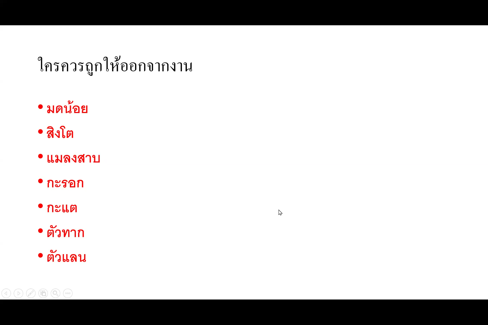

[?] ถ้าไม่มีนักศึกษาครับ บริษัทนี้เอามดน้อยออกครับนักศึกษาครับ บริษัทนี้คุยกับมดน้อยครับนักศึกษาครับ แล้วมดน้อยเขาก็ยินดีที่จะออกโดยได้รับเงินชดเชยนะ ก็โครงการ early retirement ครับ จ้างออกนะ มดน้อยเขาก็ออก ก็ได้จ้างออกไปสิบเท่านักศึกษาของเงินเดือน แล้วเขาก็ออก [?] นักศึกษาพอทราบเหตุผลของบริษัทนี้ไหมอ่ะ ผมต้องย้ำนะพอจะทราบเหตุผลของบริษัทนี้ไหมครับ เมื่อกี้เหมือนเนตติยาใช่ไหม ใช่ค่ะ เนตติยาเหตุผลที่เนตติยาพูดเนี่ยนะครับบอกว่า มดน้อยเขาหมดไฟนักศึกษาครับ จริงๆมดน้อยเขาไม่ได้หมดไฟเพราะตัวเขาเองนะครับมันหมดจากระบบ มันหมดจากระบบที่

## [00:28:43]
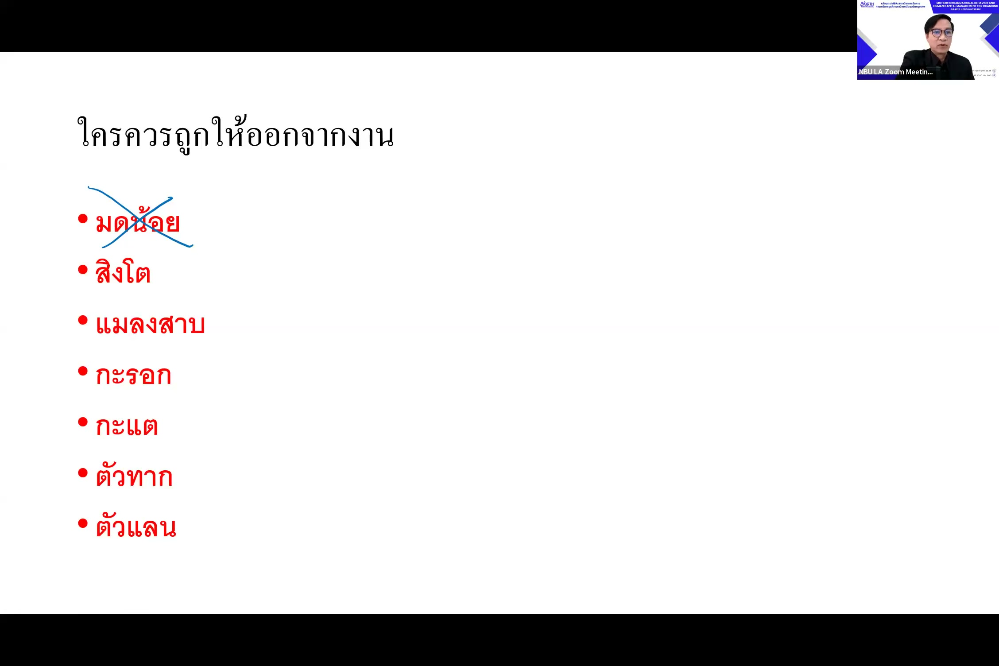

## [00:28:49]

[?] อันนั้นเฉพาะองค์กรนี้เท่านั้นนักศึกษาครับ เพราะฉะนั้นนักศึกษาครับมีหลายองค์กรที่เป็นแบบนี้นะ มีหลายองค์กรที่ทำให้พนักงานบางคนเนี่ยเบื่อ นักศึกษาต้องดูประโยคนี้นะครับ เริ่มเบื่อหน่ายดูตรงกรอบใหญ่ใหญ่ด้านล่างเลยครับ นี่ฮะ เริ่มเบื่อหน่ายระบบการทำงาน เบื่อการทำเอกสาร เบื่อการประชุมบ่อย

## [00:29:19]
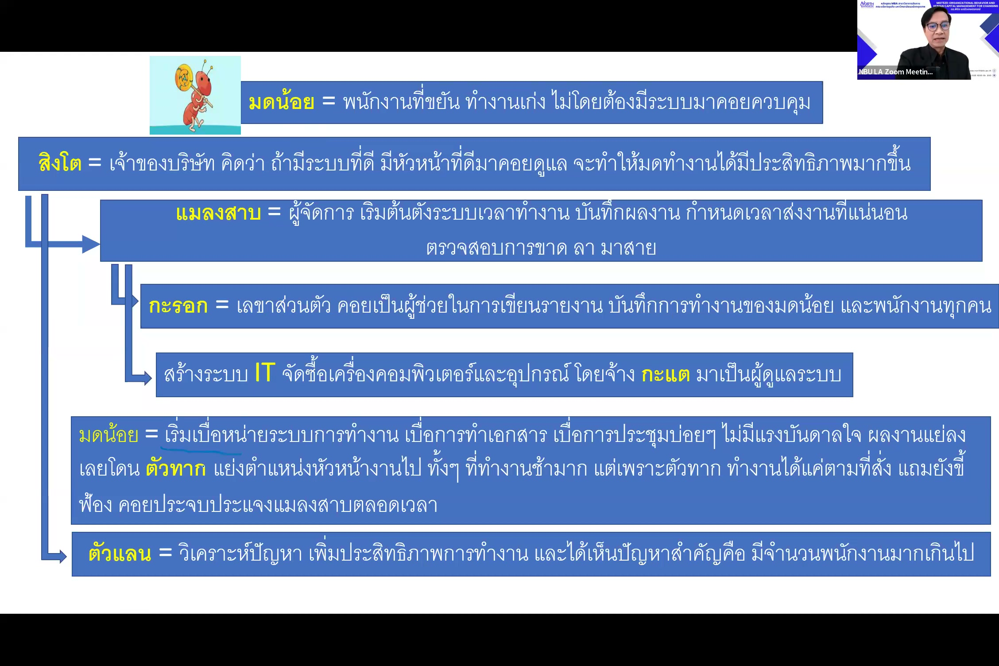

[?] แล้วเราเปลี่ยนเป็นคำว่ามีระบบการทำงานที่ชัดเจนมีระบบเอกสารต้องทำเอกสารเพื่อยืนยันสิ่งที่ทำและมีการประชุมอย่างสม่ำเสมอตามตารางเพื่อติดตามความคืบหน้า ผมเปลี่ยนเลยนะเปลี่ยนเปลี่ยนเปลี่ยนประโยคนะครับนักศึกษาครับเปลี่ยนแค่บางคำนักศึกษาครับ

## [00:29:49]
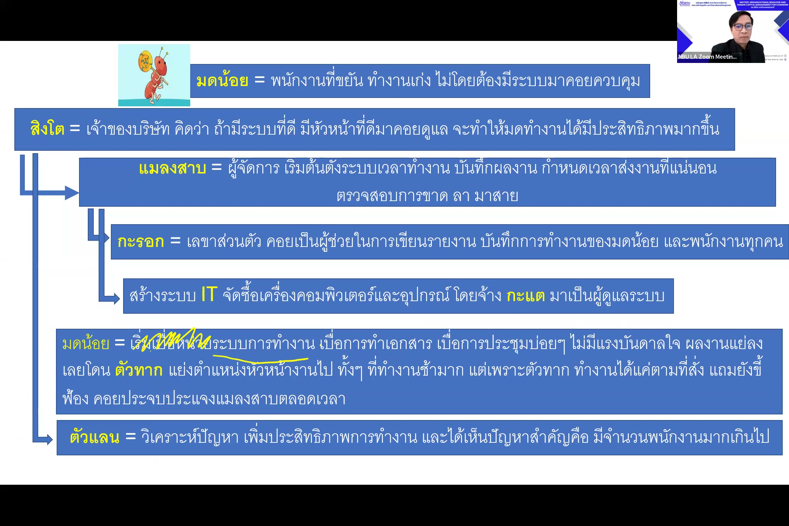

## [00:30:19]

[?] เพราะฉะนั้นถ้าเปลี่ยนเป็นคำว่ามีระบบงานมีระบบการทำงานอย่างเป็นระบบนะครับ การทำงานอย่างเป็นระบบมีการทำเอกสารคือทำรายงาน ทำเอกสารเพื่อความชัดเจนของขั้นตอนการทำงานการปฏิบัติงานนะครับ และหลักฐานแล้วก็มีการประชุมเพื่อติดตามความคืบหน้าอย่างเป็นทางการนะครับ [?] อย่างเป็นทางการบางทีเจ้านายสั่งงานไปแล้วเนี่ยเขาอยากรู้ว่าติดขัดอะไรไหม เขาไม่อยากเดินไปถามถ้าเดินไปถามเนี่ยมันจะกลายเป็นดาบสองคมนะครับ ยังไม่ถึงเวลาจะส่งเลยเดินมาถาม จั๊งเดินมาถามอีกแล้ว ผมผมก็เลยคิดว่า ระแวงเหรอกลัวผมทำไม่ได้เหรอ มันยังไม่ถึงเลยคุณสั่งให้ส่งวันศุกร์ไหมเหรอนี่เพิ่งวันจันทร์เอง

## [00:30:49]
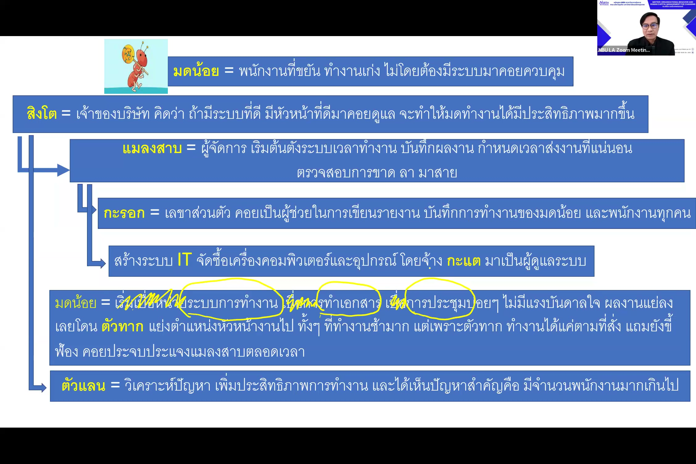

[?] คือไม่ไว้ใจหรือไง อะไรอย่างเงี้ยนักศึกษามันจะมีพนักงานเข้าใจแบบนี้จริงๆ มันก็เข้าใจผิดแบบนี้จริงๆ เจ้านายเขาก็เลยเอางี้พิมพ์มาในไลน์เลยว่า ตารางการประชุมก่อนส่งมอบงาน 2 ครั้ง ครั้งที่ 1 วันจันทร์ ครั้งที่ 2 วันพุธ งั้นพอถึงเวลาก็ต้องเข้ามาประชุมเพื่อรายงานความคืบหน้านักศึกษา

## [00:31:19]

[?] เพราะฉะนั้นส่วนไอ้ไม่มีแรงบันดาลใจผลงานแย่ลงนะครับ ไม่มีแรงบันดาลใจผลงานแย่ลงอะ โอเคครับนะครับ เรามาวิเคราะห์กันนะครับว่าตกลงไอ้คำสามคำเนี้ยมันควรมีไหม ระบบการทำงานที่ชัดเจนจัดทำเอกสารเพื่อการตรวจสอบเพื่อการออดิตอะไรก็ตาม มันต้องมีเอกสารและการประชุมเพื่อรายงานความคืบหน้าติดขัดป

## [00:31:49]

## [00:31:58]
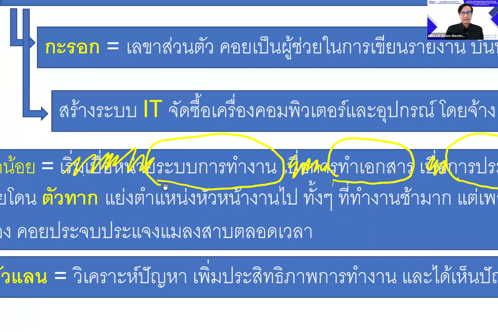

## [00:32:01]
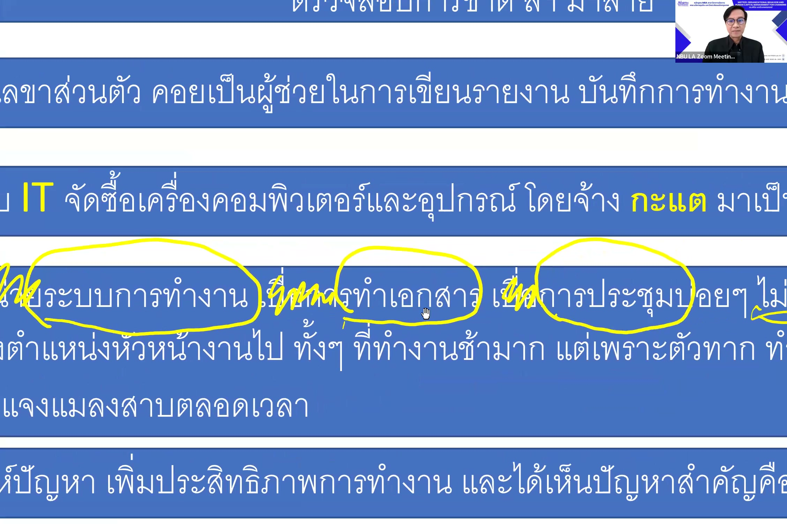

## [00:32:06]
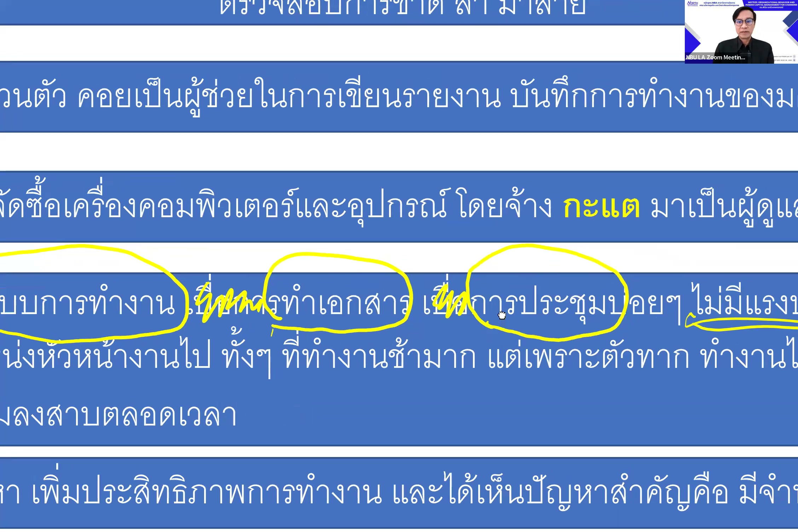

## [00:32:09]
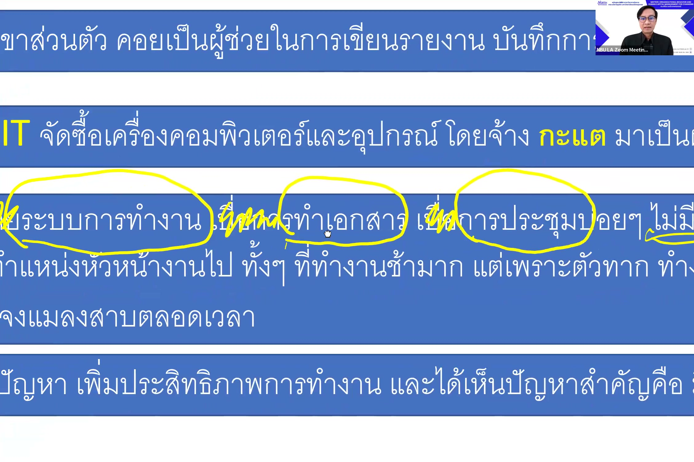

## [00:32:13]
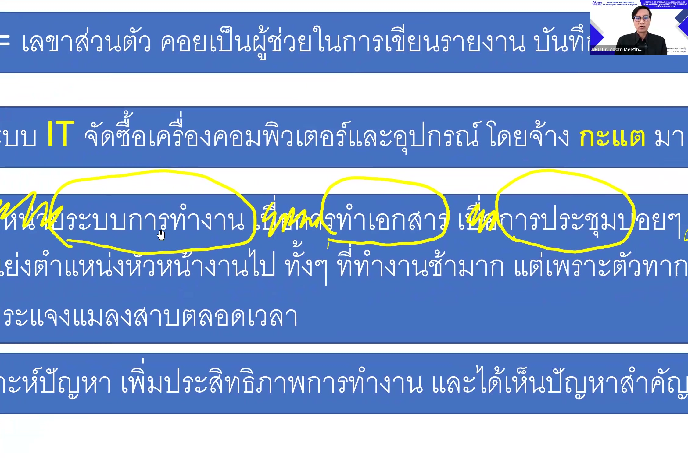

[?] เอกสารการประชุมมีแจ้งเพื่อทราบมีเสนอเพื่อพิจารณามีวาระการประชุมอย่างชัดเจนนักศึกษาคิดว่ามันควรมีไหมนักศึกษาครับ มันควรมีครับนักศึกษาครับมันควรมีเพราะฉะนั้นนักศึกษาครับ มดน้อยบริษัทนี้ให้คุยกับมดน้อยแล้วมดน้อยออกครับนักศึกษาครับเพราะว่า มดน้อยปรับตัว

## [00:32:19]
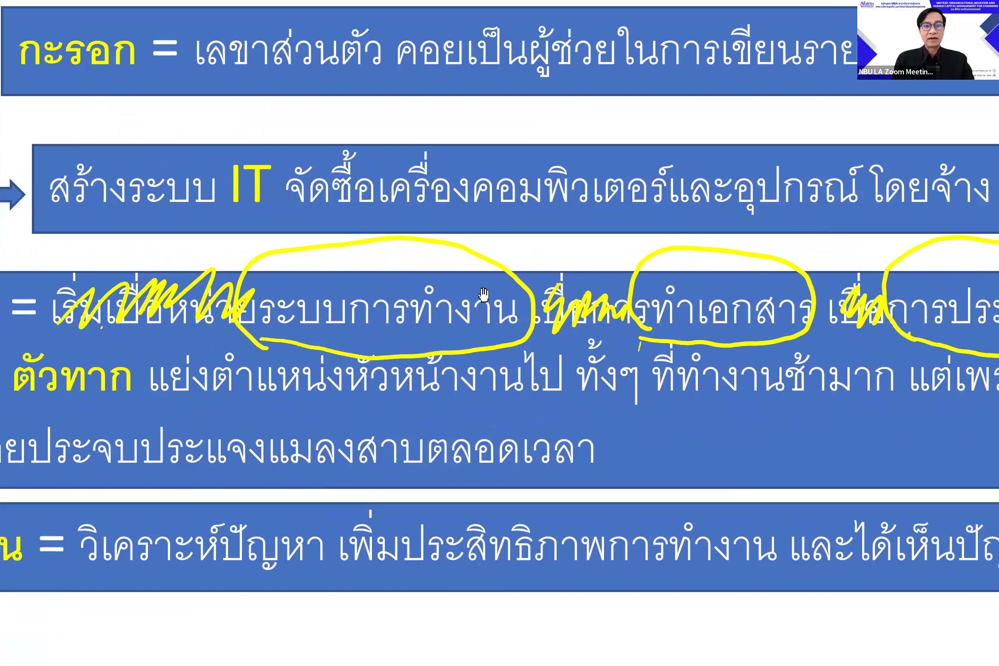

## [00:32:23]
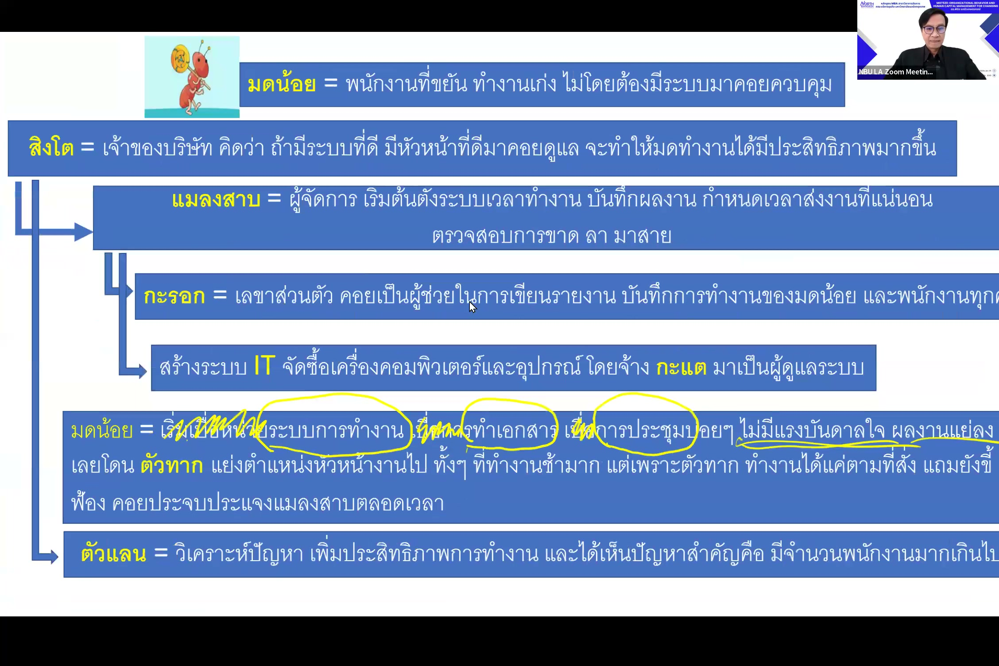

[?] มดน้อยเนี่ยเขาทำงานขยันแล้วก็ทำงานเก่งนะแล้วไม่ต้องมีระบบมาควบคุมด้วยนักศึกษาครับ แต่กลายเป็นว่าถ้าเราย้อนกลับไปเรื่องที่เราเรียนก่อนสอบกลางภาคนักศึกษาครับ ถ้ามดน้อยเขาออกเองขึ้นมาตอนที่เรายังไม่มีระบบนักศึกษาครับ ถ้ามดน้อยเขาเก่งขนาดนี้แล้วเขาอยากไปเปิดบริษัทเองตอนที่ยังไม่มี

## [00:32:53]

[?] สิงโตเดือดร้อนแน่น่ะครับ เดือดร้อน ใช่ สิงโตเดือดร้อนแน่ แล้วค้นคุณภาพไป ใช่ครับ แล้วมดน้อยเราจะดึงเขาไว้ได้ด้วยอะไรอ่ะ น่ะครับ บางทีเรื่องแรงจูงใจน่ะครับเราก็ไม่รู้ว่ามดน้อยเขา

## [00:33:23]
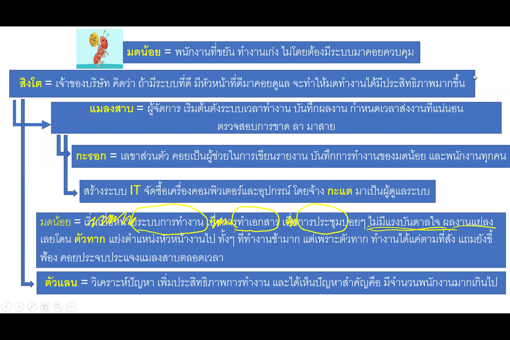

[?] เขาต้องการอะไร บางทีเราเข้าใจผิดว่าเขาต้องการเงินนะ เราเพิ่มเงินเดือนให้เขา อาจจะไม่ใช่ก็ได้นะ มดน้อยเขาอาจจะอยากเติบโต อยากเป็นเจ้าของธุรกิจเอง อยากเอาความสามารถเขาไปใช้กับบริษัทเขาเองก็ได้ แล้วถ้าวันนั้นเขามาลาออกโดยที่สิงโตยังไม่มีระบบ

## [00:33:53]

[?] สิงโตแย่นะครับ บริษัทสิงโตเดือดร้อนเลยนะครับนักศึกษาครับ เพราะฉะนั้นสิงโตเขาคิดถูกแล้วครับว่าต้องสร้างระบบสุดท้ายพอสร้างระบบขึ้นมานักศึกษามันจะมีพนักงานบางคนที่ปรับตัวไม่ได้กับระบบนักศึกษามีอยู่จริงนะครับ ปรับตัวไม่ได้กับระบบพอปรับตัวไม่ได้นักศึกษาประสิทธ

## [00:34:23]

[?] ปรับตัวไม่ได้กับระบบ ไม่ชอบงานเอกสารนักศึกษาครับ คนทำงานเก่งบางคนไม่ชอบงานเอกสารจริงๆ นะครับ มันมีอยู่จริงนะครับ ไม่ชอบงานเอกสารจริงๆ พอเดินเจอเจองานเอกสารเข้าไปนี่ถึงกับ น่าเหยเกนะครับ ไม่ชอบงานเอกสารจริงๆ จริงครับอาจารย์ เออจริงครับ ส่งไปแก้แล้วแก้อีก โดนกลับมาแก้แล้วแก

## [00:34:53]

[?] แอนตี้ด็อกคิวเม้นท์ไปเลยภาษาแอนตี้งานเอกสารไปเลย นั่นแหละครับแล้วก็สุดท้ายบริษัทนี้เขาก็เอามดน้อย คุยกับมดน้อยแล้วก็ให้เออรี่ไป อาจารย์ครับขออนุญาตสอบถามครับ ครับเชิญครับ เรื่องเอ่อสตอรี่เทลลิ้งอันเนี้ยเป็นเรื่องจริงหรือเป็นบทวิเคราะห์ครับ เอ่อมันมาจากจากนิทานเอชอาร์ภาษาของกลุ่

## [00:35:23]

[?] เป็นกรณีศึกษาเพื่อหามุมมองหาประเด็นแล้วเขาก็ระบุว่ามันเป็นเรื่องจริงของบางบริษัทหนึ่งครับ บริษัทบริษัทหนึ่ง อืม อืม โอเค ผมก็กำลังบอกว่าวัฒนธรรมองค์กรเนี่ยมันก็อาจจะเปลี่ยนแปลงไปตามเรื่องเล่าเหล่านี้แหละ ครับ แต่ว่าบางบางวัฒนธรรมองค์กรอาจจะไม่ชอบอย่างที่ว่าก็อาจจะไม [?] แต่มดน้อยเนี่ยเขาคุยเองว่าเออเขาอยากออกเองนะ แต่ความคิดแรกของสิ่งโต สุดท้ายเขาก็บอกว่าเออการเอามดน้อยออกเนี่ยสำหรับบริษัทนี้นะ ด้วยเหตุผลที่ว่ามดน้อยปรับตัวไม่ได้ เขาก็ฟังได้นะครับ ฟังได้นะ สุดท้ายนักศึกษาครับผมเชื่อว่านะครับ หลังจากมดน้อยออกไป ถ้ามดน้อยไปเปิดบริษัทใหม่ หรือเอ

## [00:35:53]

[?] ครับ เออ แล้วบริษัทอื่นก็เป็นแบบนี้มีระบบการทำงาน มีเอกสาร มีการประชุมบ่อยๆ มดน้อยต้องปรับตัวแล้ว มดน้อยต้องปรับตัวครับ มดน้อยต้องรู้แล้วว่าวิถีการทำงานของโลก โลกมันเปลี่ยนไปแล้วอะครับมันเปลี่ยนไปแล้ว อันนี้เวทที่หนึ่งนะ มดน้อยไปสมัครงานที่อื่นนะครับสอง ถ้ามดน้อยไปทำธุรกิจตัวเอง

## [00:36:23]

[?] วันหนึ่งที่มดน้อยเป็นเจ้าของเอง มดน้อยจะรู้นักศึกษาครับ ถ้าหากว่าสิงโตเนี่ยยังต้องพึ่งพามดน้อยอยู่คนเดียวเลย ปรับคนงานแบบมดน้อยนะยังพึ่งพาคนงานเหมือนมดน้อยเนี่ย ถ้าสิงโตอยากรู้อะไรสิงโตก็ต้องเรียกมดน้อยมาคุยใช่ไหมครับ แล้วพอเรียกบ่อยบ่อยก็เกรงใจเดี๋ยวมดน้อยจะโกรธ เดี๋ยว

## [00:36:53]

[?] มากังวลว่ามีอะไรต้อง support อีกไหม มีอะไรติดขัดหรือเปล่า หรือมดน้อย คือเราก็ต้องมั่นใจมดน้อยว่ามดน้อยเขาต้องทำได้ แต่ถ้าพนักงานแบบมดน้อยไม่ใช่มีคนเดียวนักศึกษามันมีหลายคนอ่ะนักศึกษาครับ อ่า งี้นะ สรุป นักศึกษาลองไปตัดสินใจว่าถ้านักศึกษาเป็นสิ่งโต นักศึกษาจะทำระบบ

## [00:37:23]

[?] นักศึกษาจะมีเลขาส่วนตัว นักศึกษาจะมีระบบไอที่ดีไหมนักศึกษาครับ แล้วนักศึกษาจะมีตัวแลนด์มาวิเคราะห์ปัญหาไหม นักศึกษายืนยันว่าควรมี เพราะฉะนั้น มดน้อยจะเป็นตัวเลือกสุดท้ายที่นักศึกษาจะเห็นความสำคัญของเขา แต่มดน้อยจะเป็นตัวเลือกแรกที่นักศึกษาอยากจะแก้

## [00:37:53]

[?] ยากหน่อยนะแต่ถ้าทำได้นักศึกษาครับถ้ามดน้อยเปลี่ยนตัวเองได้นะครับ มดน้อยก็จะเป็นเบอร์หนึ่งเหมือนเดิมนึกออกไหมครับ งั้นนักศึกษาก็เลือกว่าจะให้มดน้อยออกหรือจะลองปรับมดน้อยดูก่อนนักศึกษาครับ ปรับยังไงดีนะนักศึกษาอันนี้ผมไม่ได้คิดมากนะครับอันนี้ผมไม่ได้เตรียมมา เออจะปรับมดน้อยย

## [00:38:23]
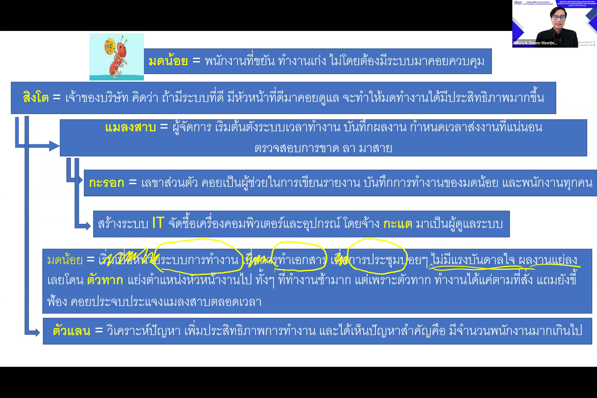

[?] เอาเรื่องอะไรมาปรับดีนักศึกษาลองย้อนไปที่เราเรียนมามีเรื่องอะไรที่น่าจะเอามาใช้อธิบายอธิบายสิ่งที่เกิดกับมดน้อยได้ competency ครับอาจารย์ เรื่อง competency ครับนักศึกษาครับอธิบายเพิ่มอีกนิดครับคุณหมอครับ เรื่องของความรู้ทักษะแล้วก็ attitude ของมดน้อยน่ะอาจจะไม่เข้ากับงานที่ณ ปัจจุบันครับเพราะฉะนั้นต้องมาวิเคร

## [00:38:53]

คืออะไร แล้วก็เสริมสมรรถปะให้ถูกต้องครับ อืม งั้นวิธีที่องค์กรส่วนใหญ่เขาใช้พอทราบไหมครับ เขาใช้วิธีไหนกันอบรมนะครับ ใช้บ่อย

## [00:39:23]

[?] อิสมนา อบรม เออ จัดอบรม มันมีหลายแบบครับในการพัฒนาครับ มีทั้งแบบพี่สอนน้อง มีแต่อบรมมันวิธีแบบแมสที่ง่ายที่สุด เออน่ะง่ายสุดครับ เบสิกสุดแล้วอย่างเช่นอบรมเอไออย่างเงี้ย เพื่อให้พนักงานที่ไม่ทำ ทำเอไอไม่เป็นอ่ะแล้วเมื่อก่อนทำไม่เป็นก็จะอ้างว่าไม่เห็นต้องใช้เลย [?] เขาเรียกว่าช็อคเคาน์เจอร์อะครับ ช็อคช็อคไอที ช็อคเทคโนโลยีอะ ไม่เห็นต้องใช้เลยเราก็ทำแบบนี้อยู่นะนักศึกษาครับ แต่พอเราฝึกจัดฝึกอบรมใช่ไหมนักศึกษาครับ วิธีที่มันแมสหน่อยอะครับแล้วเขาก็มานั่งเรียนด้วยอะ แล้ววิทยากรก็ต้องเลือกวิทยากรที่ที่เข้าใจคนทำงานไม่เป็นนะ เหมือนเริ่มจากสูต

## [00:39:53]

[?] ก็แล้วแต่แต่บริษัทใช้แล้วกันนะครับแต่วิธีถ้าหากว่าคนอย่างมดน้อยมีไม่เยอะนะครับ มีไม่เยอะก็อาจจะพี่สอนน้องหรือไม่ก็เหมือนเอ่อ มีผู้ช่วยก่อนนะครับ ให้ผู้ช่วยเข้าไปดูแลเออผมนึกได้เลยนะครับ มี

## [00:40:23]

[?] อาจารย์อยู่คนหนึ่ง อาจารย์เด็กๆเลยนะ เขาก็เก่งไอทีนะ เก่งเทคโนโลยีน่ะ ใช้ gadget ใช้อะไรเก่งอ่ะนะ เขาออกจากมหาวิทยาลัยนอร์ทกรุงเทพไป แล้วเข้าไปอยู่ที่มหาวิทยาลัยแห่งหนึ่งเอกรัฐบาลนะครับ ในสาขาวิชาเขาเนี่ย นักสันนึกภาพออกใช่ไหมครับ มหาวิทยาลัยรัฐบาล ก็จะมีแต่อาจารย์ระดับ

## [00:40:53]

[?] อยู่มานานน่ะสักครับเขาก็ใช้พวกนี้ไม่เป็นอ่ะ กลายเป็นว่าอาจารย์ที่ไปอ่ะไปสอนนะครับ ไปสอนอ่ะ สอนแบบจับมือทำอ่ะ เพราะถ้าเขาไม่สอนเขาจะเหนื่อยมากเขาพูดนะครับ เขาจะเหนื่อยเพราะเขาต้องทำเองทุกอย่างอ่ะแล้วยิ่งเป็น เป็นงานราชการอ่ะ เขา เขาอยู่ได้ ถึงไม่ทำเขาก็อยู่ได้น่ะสักครับ สุดท้ายเขาก็เลยต้องไปนั่งประกบสอนท

## [00:41:23]

[?] ค่อยค่อยเริ่มทีละเล็กทีละน้อยนะครับไม่ไม่สอนวันเดียวทั้งหมดไม่เอานะครับ วันนี้จะสอนเรื่องนี้เล็กเล็กนิดเดียวใช้เรื่องนิดเดียวนิดเดียวพอ อ่าอีกวันหนึ่งอีกอาทิตย์หนึ่งสอนเรื่องนี้นิดเดียวพอค่อยค่อยปรับค่อยปรับจนจนอาจารย์เรานะพอทำได้นะครับ พอทำได้ นั่นแหละครับนักศึกษาครับเป็นเรื่องที่เกิ

## [00:41:53]
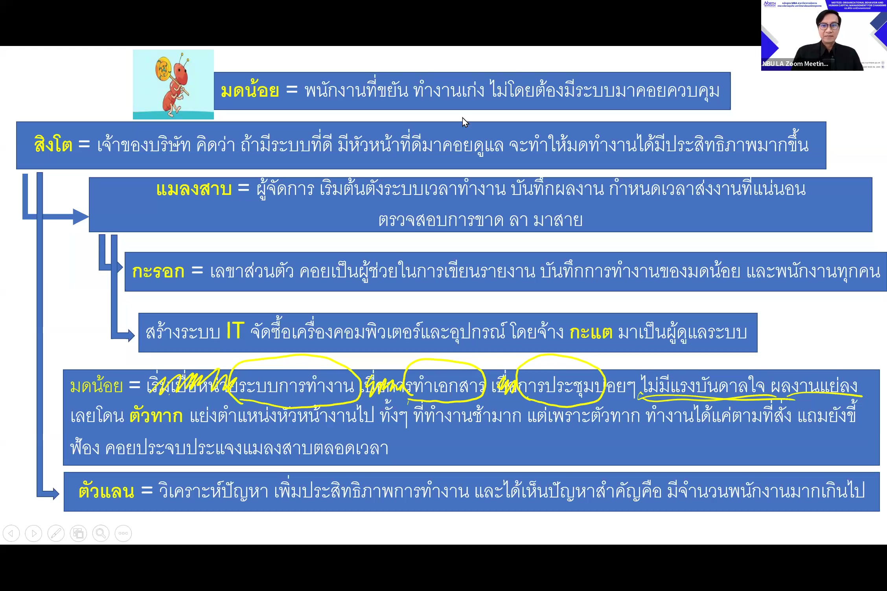

[?] จบเรื่องนี้ครับนักศึกษาครับจบ จบแค่นี้นักศึกษาแต่อาจารย์เชื่อว่าในโลกความเป็นจริงมีอีกเยอะเลยนักศึกษาองค์กรที่เจอเรื่องแบบนี้เยอะมากนักศึกษาครับ เอ้ยแต่มันก็น่าเศร้าตรงที่ว่าเออ น่าเศร้าตรงที่ว่า มีพนักงานเหมือนมดน้อยบางคนเขาก็ไม่อยากออกนะครับแต่เขาถูกให้ออก เออ ม

## [00:42:23]

[?] เขายังไม่ได้เตรียมตัวที่จะออกไปหางานไปอะไรนักศึกษา แต่เขาถูกให้ออก ให้ออกมีนะครับนักศึกษาก็มี น่าเศร้า แต่ถ้ามดน้อยเขายืนยันออกเอง เพราะเขามีลู่ทางก็อันนั้นก็ดีไป แต่หนูเชื่ออยู่อย่างนึงนะคะว่า เงินเดือน 10 เดือนที่ early ได้มาถูกจ้างออกมาเนี่ย แล้วมดน้อยมีความสามารถในการทำงานอยู่แล้ว [?] แต่ทัศนคติของเขาก็คือเขาอาจจะไม่ชอบงานเอกสารเนี่ย แต่ลุงเชื่อว่ามดน้อยสามารถจ้างคนมาทำงานเอกสารทำงานอื่นๆ แทนได้ แต่มดน้อยอาจจะเน้นงานที่แบบที่ได้ประสิทธิผลแบบด้วยตัวเองมากกว่า ขนาดทำงานแบบว่าลุยไปเลยอะไรอย่างเงี้ยได้ยอดได้อะไรไปเลย แต่เอกสารก็อาจจะจ้างคนอื่นมาทำแทนได้อันเนี้ยก็เชื่อว่าไม่ได้

## [00:42:53]
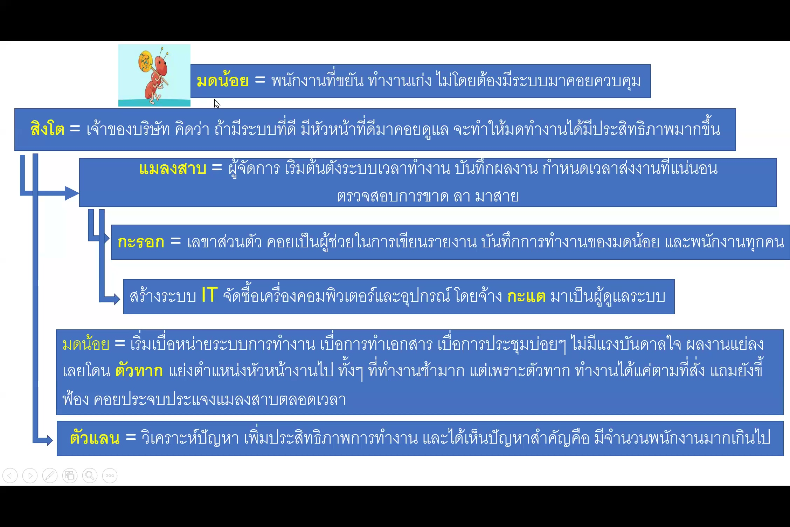

สิงโตต้องเป็นคนจ้างให้แล้วคนที่มาก็คือมาเป็นพนักงานบรรจุเลยนะครับ เพราะฉะนั้นเขากลัวข้อมูลหลุด

## [00:43:23]

[?] หมายถึงหมดน้อยออกมาแล้วออกออกมาแล้วอ่ะค่ะ มดน้อยออกมาแล้วแล้วมาทำเองอ่ะค่ะ อ๋อ มดน้อยเป็นเจ้าของบริษัทเลยใช่ไหม ใช่ใช่ มดน้อยก็จ้างคนอื่นมาทำงานใช้เงินทำงานอ่ะค่ะอาจารย์ แล้วก็ระบบนำระบบเข้ามาช่วยด้วย คือมดน้อยก็จะรู้เลยว่าทำไมสิงโตถึงถึงเลือกมดน้อยออก เพราะวันหนึ่งมดน้อยเป็นเจ้าของเอง

## [00:43:53]

[?] ผมก็เห็นด้วยนะว่าทุกอย่างที่ทำเนี่ยสิงโตทำถูก แมลงสาบทำถูก ทุกคนทำตามหน้าที่นะครับ มีแต่มดน้อยเนี่ยไม่ปรับตัวถ้าผมฟันธงตอนนี้เลยนะ ผมฟันธงเลยแล้วกัน ไม่เอาเทา ไม่เอาขาว ไม่เอาเทาแล้วกันนะผมขาวผมดำไปเลยแล้วกัน ผมว่ามดน้อย ไม่เก่ง เอาแค่นี้นะครับ ถ้ามดน้อยเก่งจริงมดน้อยต้องปรับตัวได้ [?] เอางั้นผมสรุปตาม ตามความเห็นผมแล้วกันตอนนี้นะ เอาความเห็นผมบ้างนะครับนักศึกษาครับ ความเห็นผมบ้าง เพราะงั้นผมว่าถ้ามดน้อยเก่งจริง มดน้อยต้องปรับตัวได้ อืม แค่นั้น ตามนั้นนะครับ จบ โอเค ตามนั้น แต่ถ้าบริษัทใครมีเหตุการณ์แบบนี้เกิดขึ้นนักศึกษาครับ ก็ลองไปดูสิว่าจะใช้วิธีไหน

## [00:44:23]

[?] แล้วมันมีคนอย่างน้อยอยู่จริง ปรับทัศนคติใหม่ ก็ปรับให้เขารู้สึกว่ามันไม่ได้ยากนะครับอาจารย์ เรื่องระบบเรื่องอะไรให้เขามองในมุมอีกมุมหนึ่งนะครับ มองมุมหลายๆมุม อาจจะมีแบบนี้ไหมคะอาจารย์ แบบอัลติ้งค่ะ ไปอบรมสัมมนานอกสถานที่แบบกึ่งเที่ยวกึ่งอบรมอะไรอย่างนี้ ปรับทัศนคติใหม่ด้วย ไม่มีอยู่

## [00:44:53]

[?] แล้วเวลาไปก็ไปเที่ยว มันก็เที่ยวได้ครับ มีบางบริษัทก็มีนะครับ มหาลัยเราก็มีนะ ไปเขียนแผน ไปเขียนแผนสำหรับปีหน้าที่นครนายก เออ ก็มีครับ ก็ไปเขียนแผนหนึ่งวัน อีกวันที่สองก็อัลติ้ง คืนเลยล่ะ คืนตอนเย็นนะ ก็อัลติ้งเลยนะครับ แต่พยายามจะทำให้เสร็จก่อนที่มหาลัยไปถึงจะได้ไม่ต้องเสียเว

## [00:45:23]

[?] ไปสองวันหนึ่งคืนไม่เคยแตะน้ำทะเลเลยนะครับพนักงานบ่นกันอุบเลยนักศึกษาครับ อยู่แต่ในห้องประชุมจริงจริง เอ้าก็มีก็มี เออ ก็มีนักศึกษา โอเค ไม่ ไม่เถียงแล้วกัน มีอยู่จริง มีอยู่จริง ไอ้ทำงานจริงก็มีนะ โอเค อันนี้เคยได้ยินนักศึกษาที่เรียนวันอาทิตย์นี่แหละเขาบ่นให้ฟัง ไม

## [00:45:53]

## [00:46:14]
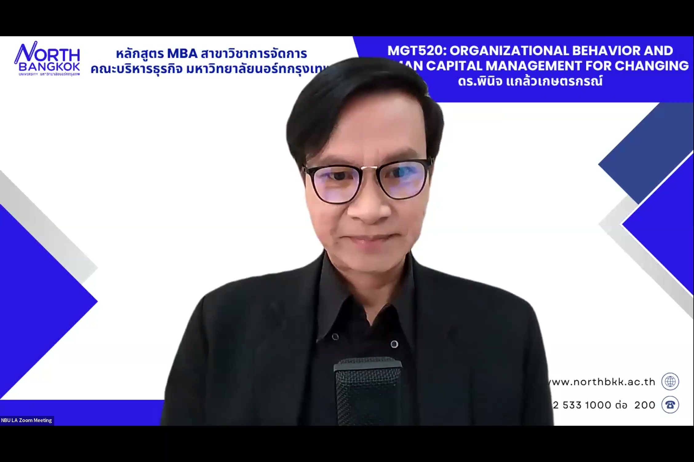

[?] in production ครับ นำเข้าสู่ นักศึกษาเรื่องนี้ครับนักศึกษาครับ อาจารย์ส่ง เอ่อ เอกสารการสอนไปแล้วนะครับนักศึกษาสไลด์ไปแล้ว อ่ะ แชร์หน้าจอนะ ลีเดอร์ชิปครับนักศึกษาครับ ภาวะผู้นำ อ่ะ นักศึกษาครับ ภาวะผู้นำไม่เหมือนกับผู้นำนะครับ ความหมายไม่เหมือนกันนักศึกษาครับ ภาว

## [00:46:44]

## [00:46:50]

## [00:46:54]

## [00:46:59]

[?] อาจจะได้มาจากทำงานมานาน หรือได้มาจากสืบทอดจากครอบครัวนะครับ เป็นผู้นำนะครับ จากการหลายวิธีนะครับ จากการเลือกตั้งนะครับ หลายวิธีนะครับ จากการมีตัวแทนเลือกขึ้นมานะครับ เป็นผู้นำ แต่พอทำงานไปแล้วนะครับ ถึงจะรู้ว่า

## [00:47:29]

[?] มีภาวะผู้นำหรือเปล่านะครับมันเนี่ยไม่เหมือนกัน เพราะฉะนั้นถ้าหากว่าวันนี้อาจารย์จะพูดเรื่องภาวะผู้นำเนี่ยก็ให้รู้ว่ามันไม่ได้เกี่ยวกับตำแหน่งหน้าที่แล้วกันนะครับ มันเป็นภาวะของคนคนนั้นอาจจะไม่ได้มีตำแหน่งอะไรก็ตามนะไม่มีตำแหน่งหน้าที่เลยครับ นี่ฮะ มันเกิดจากทักษะ ความคิด คลาสน

## [00:47:59]

[?] แต่เกือบร้อยทั้งร้อยนั่นแหละครับ เมื่อเขามีพระผู้นำเนี่ยเดี๋ยวสุดท้ายเขาก็จะได้เป็นผู้นำเองนั่นแหละครับ มันเป็นกลไกพื้นฐานนั่นแหละครับเป็นกลไกพื้นฐานนะครับ เมื่อเขามีพระผู้นำเดี๋ยวเขาก็จะเป็นผู้นำได้เองอัตโนมัตินั่นแหละครับ พอได้เป็นผู้นำเมื่อมีตำแหน่งมีอะไรก็ก็ตามตำแหน่งเลยผู้นำต

## [00:48:19]

## [00:48:36]

## [00:48:41]

## [00:48:47]

[?] โอเค นั้นต่อไปนี้ถ้าอาจารย์พูดว่าผู้นำก็คือพอผู้นำแล้วกันนะครับ ถือว่าเป็นตอนนี้นะครับเผื่อผมหลุดคำผู้นำคำเดียวนะฮะ ก็คือพอผู้นำนะครับเป็นความสามารถเผชิญกับภาวะการเปลี่ยนแปลงได้ โดยมีผู้นำเป็นผู้สร้างวิสัยทัศน์เป็นตัวกำกับทิศทางขององค์กร มีความสามารถในการใช้อิทธิพ

## [00:49:17]

## [00:49:23]

[?] ถ้าเป็นผู้นำในองค์กรเนี่ยเขามักจะไม่ใช้อิทธิพลกับคนนะครับนักศึกษาครับ กับ individual นะครับ คนคนเดียวนะครับเขาจะไม่ใช้อิทธิพลหรือไม่ใช้การสั่งการกับคนคนเดียวนะ เขาจะมักจะใช้กับกลุ่ม แล้วกลุ่มน่ะก็คือเหมือนกับเป็นคนนั่นแหละเป็นคนนั่นแหละ กลุ่มหนึ่งกลุ่มก็คือคนหลายคนมารวมกันเป็นกลุ่ม เพร

## [00:49:51]

[?] เหมือนทฤษฎีพระผู้นำนะครับที่มีคนอธิบายไว้นะครับว่า ผู้นำแต่ละแบบมีทฤษฎีอะไรเข้ามา เอ่อ อธิบายบ้างนะครับ เริ่มต้นด้วยทฤษฎีแรกนะครับทฤษฎีคุณลักษณะของผู้นำนะครับ ในอดีตนะครับ ผู้นำที่มีคนบอกว่ามันมาจากภาพลักษณ์นะครับ มาจากบุคลิก มาจาก First Invention นะครับ

## [00:50:05]

## [00:50:12]

## [00:50:19]

[?] แต่กลายเป็นว่า นักทฤษฎีพระผู้นำก็เลยบอกว่ามันไม่ใช่เสมอไปนะครับ บางคนดูท่าทางไม่ได้บุคลิกภาพ ไม่ได้เป็นพระผู้นำเลย ไม่มีเลย แต่กลายเป็นว่าเขาเป็นผู้นำได้อย่างทรงพลังมากๆนะครับ อย่างเนี่ยเขายกตัวอย่างมาเป็นนโปเลียน โบนาปาร์ด เป็นนายพลในช่วงปฏิวัติฝรั่งเศสนะครับ เนลสัน แมนดารานะครับ

## [00:50:49]

## [00:51:01]

[?] อันนี้มหาวิทยาลัยหลายแห่งเอาไปใช้นะครับ คำเนี้ยมหาวิทยาลัยเอาไปใช้ การศึกษาเป็นอาวุธที่ทรงพลังที่สุดที่เราจะนำมาใช้ในการเปลี่ยนแปลงโลกนะครับ อันนี้เป็นคำพูดของเนลแซนด์มาดรานะครับอาจารย์ข้ามไปเลยนะ นักศึกษาไปอ่านเองนะครับตรงนี้เพราะว่าเดี๋ยวมันไม่ทันนะครับ วันนี้เราต้องสองบทนั

## [00:51:17]

## [00:51:24]

## [00:51:27]

## [00:51:35]

## [00:51:40]

[?] รูเตอร์ คิง จูเนียร์ นี่ก็น่าสนใจ นี่มหาตมะคันธีเนี่ยอันนี้ผมอ่านประวัติอ่านนะครับ ผมอ่านอ่านหนังสือของมหาตมะคันธีประวัติของท่านนะครับ ผมชอบ ชอบมากนะครับ ชอบตรงที่ว่าเขาเป็นคนที่ทำให้ประเทศอินเดียเป็นเอกราชโดยที่เขาไม่มีตำแหน่งทางการเมืองไม่มีตำแหน่งทางทหารอะไรเลยนะครับ เป็นคน

## [00:52:10]

[?] เป็นเมืองขึ้นของประเทศอะไรนักศึกษาครับ คำถามครับ ขอคำตอบครับ ใครนึกออกบ้างครับ อังกฤษครับ เป็นของอังกฤษครับนักศึกษาครับ นักศึกษารู้ไหมว่าอังกฤษทำอะไรกับอินเดียบ้างตอนที่อังกฤษเข้าไปปกครองนักศึกษา สิ่งที่อังกฤษทำเนี่ย เอ่อ เล่าได้เนอะ เรื่องนี้มันเผยแ

## [00:52:40]

[?] จนทำให้อินเดียเนี่ยนักศึกษาครับ คือเขาดูดทรัพยากรทุกอย่างในอินเดียเนี่ยกลับอังกฤษหมดเลยนักศึกษาครับ ดูดทรัพยากรทุกอย่าง พลังงาน ป่าไม้ ทองคำ แร่ธาตุ ธรรมชาติต่างๆ คือเขาก็ดูดไปหมดอะ จนอินเดียไม่สามารถทำ เขายกตัวอย่างนะ แค่เข็มกลัดยังทำไม่ได้เลยอะ คือหมดสภาพคว [?] แล้วก็ออกกฎหมายต่างต่างออกมาเพื่อลดทอนความเป็นมนุษย์ มนุษย์เลยน่ะลดทอนความเป็นมนุษย์ของคนอินเดียอย่างเช่น ห้ามคนอินเดียออกมาเดินบนถนนออกมาเดินนอกบ้านตอนเวลาสี่โมงเย็นเป็นต้นไปเพราะเป็นเวลาพักผ่อนของคนอังกฤษ ของทหารอังกฤษ ของคนอังกฤษที่เข้าไปปกครองเข้าไปดูแลประเทศอินเดียน่ะ

## [00:53:10]

[?] เป็นอาหารที่มีมีคุณภาพคุณค่ามากนักศึกษาครับ เกลือเนี่ย มันมีโซเดียมนักศึกษาครับคนเราถ้าขาดโซเดียมเนี่ย กี่วันนะ ถ้าต้องถามคุณหมอประมาณสี่วันถ้าขาดโซเดียมเนี่ย ตัดโซเดียมกี่วันไม่รู้นักศึกษาครับ เดินไม่ได้เลยนะครับร่างกายขาดโซเดียม ใครเคยมีพ่อแม่ผู้ปกครองที่ขาดโซเด

## [00:53:40]

[?] และเวลาที่คนอินเดียไปถ่ายรูปทำบัตรประชาชนต้องทำบัตรใหม่นะครับ ต้องทำบัตรใหม่ สำหรับผู้หญิงเนี่ยเวลาจะถ่ายรูปทำบัตรต้องถอดเสื้อผ้าหมดนะครับ ต้องถอดเสื้อผ้าออกทั้งหมดนะครับเหมือนลดทอนความเป็นมนุษย์ของคนอินเดียจริงๆนะครับ

## [00:54:10]

[?] เพราะฉะนั้นคนอินเดียจะทำอะไรก็ตามต้องขออนุญาตจากคนอังกฤษนะครับไม่ว่าจะทำผลิตสินค้าอะไรก็ต้องต้องขออนุญาตบางอย่างคนอินเดียไม่รู้นะครับ กฎหมายถูกสร้างออกมาแบบไม่ได้เผยแพร่ด้วยซ้ำพอทำปุ๊บก็ผิด มหาธรรมะคันธีก็เลย เอ่อ เริ่มจากก็ต้องไปเรียนที่ ที่ยุโรปน่ะสัสไปเรียนที่ยุโรป แล้วก็โดน

## [00:54:40]

[?] ที่เขาบอกว่านั่งรถไฟขึ้นไปแล้วโดนเขาซื้อรถไฟชั้นหนึ่งที่นั่งชั้นหนึ่ง แต่โดนคนที่นั่งชั้นหนึ่งเนี่ยขับไล่นะครับแล้วก็เจ้าที่รถไฟเนี่ยก็มาขับไล่ด้วยนะครับ ไม่ให้ไม่ให้มานั่งชั้นหนึ่งเขาก็บอกเขาซื้อตั๋วมานะ คนที่เป็นผู้ควบคุมขบวนรถไฟตำรวจรถไฟก็บอกซื้อซื้อก็ซื้อแต่ไม่ให้นั่ง

## [00:55:10]

[?] เหมือนเขาไปเรียนที่อังกฤษนั่นแหละมั้งนักศึกษาครับ เรียนที่อังกฤษสุดท้ายเขาก็โดนขับไปนั่งรถชั้นสามแล้วเขาก็ลง โดน โดนผลักให้ลงนักศึกษาครับแล้วก็รองเท้าก็หลุดอยู่บนรถไฟข้างหนึ่ง

## [00:55:40]

[?] เขาก็ลงมานั่งที่เก้าอี้ที่สายรถไฟด้วยรองเท้าข้างเดียวนะครับ กับของเสื้อผ้าติดมา แล้วเขาก็เลยรู้สึกว่าเขาต้องกลับ ขณะเขาอยู่ยุโรปเขายังโดนแบบนี้ แล้วที่อินเดียล่ะ เขาจะอยู่กันยังไงนะ เขาก็เลยมีไอเดียเริ่มจุดประกายความคิดว่าต้องไป ไปศึกษา เข้าไปปลดปล่อย เขาก็ไปตั้งขบวนการนะครับ

## [00:56:10]

[?] มีอยู่คำนึงคือคำว่าอหิงสาก็มาจากมหาตามคันธีแหละการต่อต้านแบบไม่ใช้กำลังนะอหิงสาวิธีก็คือเขาเดินจากเมืองนึงในอินเดียเพื่อจะไปทะเลต้องใช้เวลาเดินเป็นเดือนน่ะสักครับเขาก็ประกาศเลยว่าเขาจะเดินไปทะเลแล้วจะไปเอาน้ำทะเลมาทำเกลือ [?] เป็นสัญลักษณ์ให้รู้ว่าเขากำลังต่อต้านนะครับ แล้วคนก็มาร่วมเดินในระหว่างทางก็จะมีคนมาร่วมเดินเรื่อย จากหนึ่งเป็นสิบ จากสิบเป็นร้อย จากร้อยเป็นพัน จากพันเป็นแสน จนถึงเมืองที่มีทะเลนะครับ เขาก็เลยเป็นสัญลักษณ์ว่าเขาจะเอาน้ำทะเลจากประเทศเขาเองนี่แหละ มหัทธรรมการทีม เพื่อ

## [00:56:40]

[?] พระราชินีอังกฤษก็เลยอยากรู้ว่าเขาเป็นใคร คนคนนี้เป็นผู้นำการต่อต้านอังกฤษเนี่ยเขาเป็นใคร ไปเชิญมา ก็เดินทางโดยเรือนะครับในขณะที่เดินทางโดยเรือเนี่ย มหาดาบันทีเนี่ยไม่ใช้ของของคนอังกฤษเลย เขาเตรียมมันฝรั่งเตรียมอะไรของเขาไปเองแล้วก็เสื้อผ้าก็ไม่ใช้ เสื้อผ้าของคนอังกฤษก็ทอผ้า

## [00:57:10]

[?] พอถึงที่พระราชวังอังกฤษนะครับก็ก็มีคนเอาเสื้อผ้าจะมาให้ใส่มาแต่บางทีก็ไม่ยอมใส่ก็ใส่เฉพาะผ้าที่เขาทอเอง ผ้าที่เขาใส่นะครับเสื้อผ้าที่ใส่ทอเองนะครับ พอเข้าไปสิ่งที่เขาแอบเข้าไปด้วยซ่อนไว้ในในผ้าก็คือเกลือ เขากำเกลือไว้ในมือพอถึงต่อหน้าพระพักตร์ ราชินีอังกฤษเขาก็

## [00:57:40]

[?] เอ่อ ทิ้งลงบนพื้นนะครับ แบมือแล้วก็เทลงบนพื้นแล้วเขาก็บอกกับประธานอังกฤษว่า นี่คือ นี่คือความเป็นคนของคนอินเดียที่ท่านยึดไปจากพวกเรานะครับ วันนั้นทำให้ข่าวนี้ก็เผยแพร่ออกไปทั่วโลกนะครับ ช่างภาพช่างอะไรก็ถ่ายแล้วก็ทำให้ทั่วโลกเขาก็ประณามอังกฤษนะครับ ก็ อังกฤษก็เลยต้องยอม

## [00:58:10]

[?] ก่อนจะยอมให้เกิดความรุนแรงขึ้นนะครับ อังกฤษออกกฎหมายห้าม ห้ามชุมนุมห้าม โห ออกกฎหมายทุกอย่าง แต่ก็มหาตำนานีก็ยังชุมนุมกันอยู่ดี พอกำลังชุมนุมอยู่เนี่ย อังกฤษก็เลยจะปาปจราจลด้วยกฎหมายที่เขาตั้งขึ้นเองว่าตามขั้นตอนจากเบาไปหาหนัก แต่สุดท้ายไม่มีเบาครับเขาเอารถถังเข้าไปใ

## [00:58:40]

[?] เอารถถังเข้าไปเพื่อจะไปยิงใส่ผู้ชุมนุมนั่นแหละแต่เผอิญในจัตุรัสกลางเมืองเนี่ย รถถังมันเข้าไม่ได้ ทางมันเล็กช่องมันเข้ามันแคบ แคบมัน มันเล็กใช่ไหม ก็เลยจอดรถถังไว้แล้วก็เอากำลังทหารถือปืนอะ วิ่งเข้าไปเข้าไปที่จัตุรัส แล้วก็ ประกาศให้ยุติการชุมนุมสลายการชุมนุมให้ยุ

## [00:59:10]

[?] เขาก็เลย ทหารก็เลยสั่งยิง ยิงส่ายกระสุนเข้าไปในกลางจัตุรัสเลยครับจัดเป็นครึ่งวงกลมนะครับ จัดเป็นครึ่งวงกลมทหารนะ จัดเป็นครึ่งวงกลม แล้วก็ยิงเข้าไปมีคนถามว่าทำไมไม่จัดเป็นวงกลม ถ้าจัดเป็นวงกลมก็จะยิงกันเองนักศึกษา ถ้าวงกลมก็จะยิงใส่กันเองเขาก็จัดเป็นครึ่งวงกลมนะครับ แล้วก

## [00:59:40]

[?] เสียชีวิตเป็นหลายพันคนนะครับแต่อังกฤษออกข่าวว่ามีผู้ชุมนุมเสียชีวิตหลักสิบ แต่มันมีผู้ชุมนุมที่หนีโดดลงไปในบ่อน้ำในกลางจัตุรัสมันจะมีบ่อน้ำครับ บ่อน้ำ บ่อหินนะครับที่ใช้โยกเอาน้ำไปใช้ในอาสา ก็มีคนโดดหนีลงไปตายในนั้นน่ะเป็นร้อยคนนะครับ เป็นร้อยคน หลังจากเหตุการณ์วันนั้นเนี่ย

## [01:00:10]

[?] ชาวอินเดียโกรธมาก ชาวอินเดียทั่วทั้งประเทศเนี้ยก็มีคนเสนอกับมหาตามะทันทีว่า คนอังกฤษเนี้ยมาอยู่ในอินเดียเนี้ยประมาณสองแสนคน แต่คนอินเดียเนี้ยมีเป็นหลายหลายล้าน หลายล้านคนนะครับ คนอินเดียนะครับหลายร้อยล้าน หลายพันล้านคน ถ้าเราหยิบอาวุธหยิบไม้คนละอันเนี้ยคิดว่าเราสู้กับอังก

## [01:00:40]

[?] แต่มหาตรมาทันทีสั่งห้ามว่าเราจะไม่ใช้ความรุนแรงเหมือนกับอังกฤษเพราะถ้าเราใช้ความรุนแรงเราก็จะไม่ต่างอะไร เราจะไม่ต่างอะไรกับกับอังกฤษเลย มหาตรมาทันทีก็เลยไม่ให้ใช้ความรุนแรงก็ยังสู้แบบอหิงสา อหิ อหิมซานะ อหิมซาคนไทยเรียกอหิงสาใช่ไหมนะ คืออหิมซาก็เลยใช้วิธีการต่อต้านแบบไม่ใช้ค

## [01:01:10]

[?] แล้วก็ทำให้ทั่วโลกกดดันกดดันอังกฤษครับสุดท้ายโดนกดดันมากมากเข้า โดนแบนหลายอย่าง ก็ก็เลยรัฐมนตรีอังกฤษก็เลยประกาศปล่อยให้อินเดียเป็นอิสรภาพนะครับ พอหลังจากอินเดียเป็นอิสรภาพนักศาสตร์รู้ไหมว่าจุดจบของมหาตรมาทีผู้ที่ทำให้อินเดียเป็นอิสรภาพคืออะไร มีใครทราบไหมคร

## [01:01:40]

[?] จบเลยน่ะนักศึกษาครับก็คือเสียชีวิตน่ะนักศึกษาครับ ทำไมต้องเสียชีวิตเพราะโดนรอบสังหารนะครับนักศึกษาเพราะอะไรรู้ไหมครับ มหาตมาคันธีไม่ได้คิดไว้ว่าหลังจากได้รับอิสรภาพแล้วเนี่ยจะทำยังไงต่อ ไม่ได้คิดไว้ครับ นักศึกษานึกภาพออกไหมมันก็เลยกลายเป็นศูนยากาศอำนา

## [01:02:10]

[?] ท่านนั่นแหละ ขึ้นเป็นผู้นำไปเลย ท่านมหาธรรมาธีท่านเป็นผู้นำไปเลย มหาธรรมาธีถูกคือถูกเสนอชื่อให้เป็นผู้นำอินเดียแต่มันมีอีกกลุ่มหนึ่งครับนักศึกษาครับ ที่อยากขึ้นเป็นผู้นำเพราะรู้ว่าตอนเนี้ยมันเป็นศุลยกรรมอำนาจถ้าใครขึ้น ใครขึ้นปกครองอินเดียได้ก็มีอำนาจใหญ่สุดแล้

## [01:02:40]

[?] กลุ่มแรกสนับสนมหัตถมาคันธี แต่มหัตถมาคันธีครับท่านบอกว่าไม่ใช่หน้าที่ของท่านนะครับ หน้าที่ของท่านคือ คือท่าน หน้าที่คือประชาชนคนหนึ่งที่ต้องการอิสรภาพท่านก็ทำทุกอย่างตามหน้าที่ของประชาชนคนหนึ่ง ท่านไม่ใช่ผู้นำทางจิตวิญญาณอะไรท่านบอกแบบนี้ ท่านก็เลยไม่อยากเป็นผู้นำ อืม จนวันหนึ่ง

## [01:03:10]

[?] ไปสวดมนต์ในกลุ่มผู้ชุมนุมยังอยู่นะผู้ชุมนุมยังไม่ไปไหนนะครับ ก็ยังศรัทธายังชุมนุมต่อเพื่อเพื่อเรียกร้องให้มหัฐบาลทีเนี่ยรับอำนาจนั้นไปซะ มหัฐบาลทีก็ยังยังไม่ตัดสินใจนะครับ ยังไม่ไปนะ ก็คือเหมือนจะไม่รับอะครับ เหมือนจะไม่รับเพราะท่านบอกว่าท่านทำในนามของประชาชนคนหนึ่งเท่านั้

## [01:03:40]

[?] มหาธรรมะทันทียืนยันครับ บอกว่าฉันจะต้องไปทำหน้าที่ของฉันเหมือนทุกวัน จะไป ท่านก็ออกไปจริงแล้วนักศึกษาออกไปยัง ยังด้านหน้าผู้ชุมนุมแล้วก็นำสวดบ่นนักศึกษาครับในขณะที่ยืนอยู่คนก็ปะปนอยู่นะครับ มีคนคนหนึ่งมายืนยืนใกล้ใกล้ท่านเลยครับ ยืนใกล้ใกล้ท่านเลยแล้วคนคนนั้นก็พูดกับท

## [01:04:10]

[?] พูดประโยคนี้ครับวันนี้ท่านมาช้านะมหัฎปันทีก็หันไปพูดกับคนคนนั้น แล้วก็สบตาคนนั้นแล้วก็ตอบว่าฉันรู้ว่าฉันมาช้า ไอ้คนนั้นก็ยกมือขึ้นมาคือมหัฎปันทีเขารู้เลยว่าคนนี้แหละเป็นมือปืนนะครับ แต่ท่าน แต่มหัฎปันทีก็ไม่โวยวายไม่อะไรแล้วก็บอกไปว่าฉันรู้ว่าฉันมาช้า ไอ้นั่นก็ยิง [?] ยิงใส่มหัฐบาลทีเสียชีวิตตรงนั้นเลยครับ ตรงนั้นเลยนักศึกษาครับ คนที่ยิงเนี่ย มีคนเดาว่า มีคนคิดว่าเป็นอีกฝ่ายหนึ่งนะครับ เพื่อ ฆ่าปิดชีพมหัฐบาลทีก่อนจะได้ไม่มีคู่แข่งมีคนเดาแบบนั้น มีคนพูดนะครับว่า เอ้ย มัน มันน่าจะเป็นคนของคู่แข่งเป็นคนของอีกฝั่งที่ต้องการอำนาจแน่

## [01:04:40]

[?] น่าจะนะครับจนวันนี้ก็ไม่ได้ฟันธงอ่ะ น่าจะเป็นคนฝั่งที่ต้องการให้มาตราบันทีขึ้นจริงจริง แต่ที่เขามายิงเพราะว่ามาตราบันทีเนี่ยปฏิเสธ เหมือน เหมือนเขา เหมือนเขามี มีความรักชาติมีจิตวิญญาณที่รักอินเดียมากมากอ่ะ แล้วโกรธมาตราบันทีว่าคุณท่านไม่รักอินเดียหรอ ถึงไม่รับต

## [01:05:10]

[?] คนที่ยิงก็ตาย ก็ถูกจับ แล้วก็สุดท้ายตาย นั่นแหละครับ มหาตมาคันธี คนธรรมดาที่ไม่มีอำนาจทางการเมืองนะครับ แต่ปลดแอบ ทำให้อินเดียเป็นเอกราชนะครับ คนธรรมดา อันนี้คือคนที่ผมอยากเล่าให้ฟังนะครับ ส่วนคนอื่นก็อยากเล่านะ แต่ไม่ทันนะครับ

## [01:05:40]

## [01:06:01]

[?] Fidel Castro นี่ก็น่าเล่าแต่ไม่เอา เดี๋ยวพอแล้วนักศึกษาครับ เดี๋ยวไป นักศึกษาไปหาอ่านเอาเองแล้วกันเนอะ โอเค นักศึกษาครับ นี่เป็นจดหมายที่มีคนคนหนึ่งครับ ส่งจดหมายไปหา มหาตมะคันธี คือผมก็ไม่คิดว่าเขาจะอยู่ยุคนั้นนักศึกษาครับ แล้วก็ส่งจดหมายไปหาตมะคันธี นักศึกษาดูตรง

## [01:06:06]

## [01:06:09]

## [01:06:13]

## [01:06:43]

[?] ฮิตเลอร์มั้ยคะ เออ นักศึกษาครับฮิตเลอร์เขียนจดหมายส่วนตัวถึงมหาธรรมคัลทีน่ะนักศึกษา เพื่อนเลยน่ะครับใช้คำว่าเพื่อนเลยน่ะ นักศึกษาไปใช้เอไอแปดนะครับว่าจดหมายนี้เขียนว่ายังไงน่ะนักศึกษาครับ ตอนนี้เลยมั้ยใช้เอไอแปดตอนนี้เลยมั้ย ช่วยหน่อยดินักศึกษาครับ นักศึกษา

## [01:07:13]

## [01:07:28]

[?] คนนี้ก็น่าสนใจนักศึกษาครับมีใครรู้จักบ้าง อ่าเดี๋ยวฉันต้องถามก่อน มูฮัมหมัด มูฮัมหมัดยูนูสมีใครรู้จักไหมครับ บังคลาเทศใช่หรอครับอาจารย์ยูนูส งั้นผมเล่าให้ฟังก่อนแล้วกันนักศึกษาครับนี่ครับ นักเศรษฐศาสตร์ชาวบังคลาเทศผมเล่าให้ฟังแบบสั้นสั้นสรุปสรุป

## [01:07:53]

## [01:07:56]

[?] ก็เก่งทางเศรษฐศาสตร์แล้วก็กลับมาเป็นอาจารย์ที่มหาวิทยาลัยแล้วก็สอนวิชาเศรษฐศาสตร์ ในมหาลัยระดับท็อปของอินเดียนักศึกษาครับหรือบังกลาเทศนักศึกษา นักศึกษาครับในขณะที่วันหนึ่งเขาสอนมหาลัยมาประมาณเก้าปีนักศึกษาครับ ปีที่เก้าเนี่ยเช้าวันหนึ่

## [01:08:19]

## [01:08:26]

[?] แล้วถามเหตุผล ทางมหาลัยก็ถามเหตุผลว่าทำไมอาจารย์ลาออก อาจารย์อ่ะ มุหมาดยูนุสก็เลยบอกว่าผมขับผ่านถนนเส้นเนี้ยมาเก้าปีแล้ว แล้วระหว่างทางมันจะมีสลัมขนาดใหญ่อยู่แห่งหนึ่งสลัมขนาดใหญ่ระหว่างทาง ผมไม่เห็นว่าสลัมแห่งนี้มันจะเจริญขึ้นเลยมันยังมีคนจนอยู่เต็มไปหมดในสลัมเนี้ย

## [01:08:56]

[?] เต็มถนนเลย สลัมเนี้ยแสดงว่าเก้าปีที่ผมสอนนักเศรษฐศาสตร์ ออกไปเป็นพันพันคนเนี้ยไม่ได้มาช่วยอะไรเลยนะครับ ไม่ได้ทำให้เศรษฐกิจมันดีขึ้นไม่ได้ทำคน ไม่ได้ทำให้คนจน เอ่อ ลืมตาอ้าปากได้ในระดับเขานะในระดับ ระดับ ระดับเขานะ ระดับที่ควรจะเป็นนะครับท่านก็เลยบอกว่าน่าจะทำผิดพลาดล่ะ ท่านสอนคนเป็

## [01:09:26]

[?] เศรษฐศาสตร์คือการจัดสรรทรัพยากรที่มีอยู่อย่างจำกัดในขณะที่ความต้องการของมนุษย์นั้นไม่จำกัดนะครับ มีไม่จำกัดเพราะฉะนั้นการจัดสรรมันผิดพลาดน่ะท่านก็เลยบอกว่าเศรษฐศาสตร์คนที่เรียนเศรษฐศาสตร์ไม่ได้ทำหน้าที่ของเศรษฐศาสตร์จริงๆ ท่านเลี้ยวรถกลับเลยครับแล้วก็ลา

## [01:09:56]

[?] แล้วท่านก็เริ่มต้นทำสิ่งที่ควรทำนักศึกษาครับคืออะไรนักศึกษาครับ ท่านมีเงินอยู่ก้อนหนึ่งท่านเอาเงินก้อนเนี้ยไปปล่อยกู้ ไปปล่อยกู้ปล่อยกู้ให้กับคนที่ต้องการกู้จริงจริงนักศึกษาครับ นักศึกษาเข้าใจคำนี้ไหมนักศึกษาคิดว่าธนาคารพาณิชย์ทุกวันเนี้ยเขาปล่อยกู้ให้คนที่ต้

## [01:10:26]

[?] ไม่ครับ อันเนี้ยแน่นอนเลย ไม่จริงครับเพราะนักศึกษาครับ คนที่ต้องการกู้จริงจริงเนี่ย ไม่มีหลักทรัพย์ไม่มีหลักฐานค้ำประกัน ไม่มี ไม่มี สินทรัพย์ ทรัพย์สินค้ำประกันอ่ะธนาคารจะให้กู้ได้ไงอ่ะ ธนาคารก็ออกกฎมาว่าต้องมีคนค้ำประกันมีทรัพย์สิน มีอะไร ถ้าเขามีเขาจะอยากกู้ทำ

## [01:10:56]

[?] เขาต้องการให้พวกนักธุรกิจอะไรคือมากู้อ่ะเพื่อไม่ต้องการใช้เงินตัวเองอ่ะ มีบางครั้งต้องไปขอร้องว่า เจ้าสัว กู้ผมเถอะ อย่าใช้เงินสดเลยมีเจ้าสัวอีกคนนึงครับ ต้องการซื้อกิจการกิจการหนึ่งแล้วเขามีเงินสดพอ แบบเหลือเฟื้อนั่นแหละครับ เจ้าสัวคนนี้ เขาเงินสดเขา

## [01:11:26]

[?] เอามาถมประเทศได้ครบเต็มประเทศนะครับเขาซื้อได้เลยเขาใช้ทรัพย์สินเขาใช้เงินสดเขาซื้อก็ได้ กิจการเนี้ยบริษัทเนี้ยมันมันเป็นการที่ของต่างประเทศแต่ตอนเนี้ยเขาจะเขาจะซื้อซื้อคืนนะครับ มันเคยเป็นของเขาแล้วเขาขายไปแล้วเขาจะซื้อคืน [?] ธนาคารเนี่ยวิ่งไปหาเต็มเลยนะฮะท่านกู้เถอะ กู้ผมเถอะ กู้ฉันเถอะ กู้นี่เถอะ กู้สีนี้ไหม กู้สีฟ้าไหม กู้สีเขียวไหม กู้ไหมนักศึกษาครับ กู้เถอะ นักศึกษาครับสุดท้ายเจ้าสัวก็ อะ กู้ก็กู้เพื่อให้เงินมันหมุนเวียนนักศึกษาเข้าใจใช่ไหมครับ ถ้าใช้เงินสดตัวเองไปไปลงทุนไปทำอะไรก็ตามอ่ะ มัน ม

## [01:11:56]

[?] ขอร้องให้เจ้าสัวกู้ เนี่ยนักศึกษาอาจารย์กำลังเล่าว่าธนาคารพาณิชย์เนี่ยมันทำหน้าที่ แปลกๆ ไม่ได้ต้องคนอยากกู้จริงๆ เนี่ย เขาไม่ให้กู้หรอกครับนักศึกษาถ้าไม่มีเงินค้ำประกัน ไม่มีสินทรัพย์ ไม่มีที่ดิน ไม่มีอะไรมาค้ำประกันเนี่ย กู้ไม่ได้ เขาไม่ให้กู้ เพราะธนาคารเขากลัวหนี้ส

## [01:12:26]

[?] เอาเงินที่เขามีก้อนหนึ่งน่ะไปให้คนที่ต้องการกู้จริงจริง กู้ คนที่ต้องการที่ไม่มีเครดิต ไม่มีหลักทรัพย์ ไม่มีความมั่นคงอะไรเลยน่ะไอ้กู้ คือใครรู้ไหมทักษะครับ ก็คือคนที่อยู่ในสลัมนั้นน่ะทักษะครับท่านก็เลยไปเสนอว่า เอ่อ อยากทำอะไร ตอนนี้ว่างงานอยู่ใช่ไหม อยากทำอะไร เขาก็เลยพูดว่าส่วนใหญ่นะครับ อยากค้าขาย

## [01:12:56]

[?] แล้วนักศึกษาว่าคนที่อยู่ในสยามคนพวกเนี้ยเวลาเขาค้าขายนักศึกษาว่าเขาทำธุรกิจโรงแรมไหมเขาจะทำธุรกิจสปาเขาจะทำธุรกิจใหญ่โตไหมเขาทำธุรกิจนำเข้าส่งไม่มีหรอกครับนักศึกษาครับคนเหล่านี้เขาต้องการแค่ทำร้านรถเข็นเล็กเล็กเขาจะทำสตรีทฟู้ดเล็กเล็กเขาจะทำคือเขา

## [01:13:26]

[?] คือมันประมาณนั้นนักศึกษาเขาไม่ได้กู้ต้องการไปทำโรงแรม ไปทำนำเข้าส่งออกก็คือคนที่อยู่ในสลัมเขาก็อยู่ในระดับเขาก็จะเป็นเศรษฐกิจแบบฐานรากนักศึกษา เศรษฐกิจรากหญ้าไม่ใช่ฐานราก เศรษฐกิจรากหญ้าอย่างเช่นอยากทำร้านขายมัตตบะนี่นักศึกษาอยากทำร้านขาย [?] ไอ้กลมกลมแป้งทอดกลมกลมแล้วมีน้ำอยู่ข้างในอ่ะอันนี้ปุริใช่ไหมนักศึกษาใช่ไหม ก็คือเขาทำอยากแบบนั้นน่ะอยากทำร้านรถเข็นเล็กเล็กขายของขายน้ำขายเครื่องดื่มอะไรนักศึกษาเขาทำแค่นั้น แสดงว่าเงินลงทุนมันไม่เยอะมากอย่างสองหมื่นก็ขายได้แล้วนักศึกษา แม่ค้าตลาดเนี่ยสองหมื่นก็ก็ลงทุนได้

## [01:13:56]

[?] เอาไปเลย นักศึกษาทำไมมีคนคนถามว่าเอาแล้วทำไมอาจารย์ไม่กลัวหนี้สูตรเหรอคะ ไม่กลัวเขาไม่ชำระหนี้เหรอ มัวหมายความจริงว่าเขาถามกลับไปว่าถ้าคุณ ไม่มีเงิน แล้วคุณไปหายืมเงินทุกคนที่คุณรู้จักและไม่มีใครให้คุณเลย แม้แต่คนเดียว แม้แต่บาทเดียว ญาติพี่น้องก็ไม่ให้ไม่มีใครให้คุณเลย แม้แต่บาทเดี

## [01:14:26]

## [01:14:56]

[?] และถ้ามีคนคนหนึ่งให้คุณยืมคำถามคือคุณกล้าโกงเขาไหม นักศึกษาคิดว่าคำตอบคืออะไร กล้า ไม่เอาคนไทยสิลุงเอาทั่วไปสินักศึกษาครับ คำตอบคือไม่กล้านักศึกษาเพราะอะไรเขาเป็นคนคนเดียวที่ฉุดคุณขึ้นมาจาก [?] โค้นน่ะนักศึกษาครับฉุดคุณมาจากน้ำน่ะนักศึกษาครับ คือเราอ่ะจะไม่กล้าโกงเขาแต่ที่ไม่จ่ายเพราะอะไรรู้ไหมครับ แต่ที่ไม่จ่ายใช้คำว่าเขาไม่มีจ่ายแล้วเงินที่เขาไปน่ะนักศึกษาครับ มันไม่ได้สร้างกำไรเพื่อจะเอามาจ่ายหนี้มุมหวัดอยู่นู้นเขาก็รู้จุดอ่อนตรงนี้น่ะนักศึกษาครับ เขาก็รู้จุดข

## [01:15:26]

ไม่ใช่โกง แต่แค่ไม่มีจ่ายเขาก็เลยต้องไปแก้ปัญหาตรงนี้ อาจารย์มูฮะหมายก็เลยบอกว่า เพราะฉะนั้นเนี่ยผมให้ยืม แต่ผมจะต้องเข้าไปดูแลเหมือนคุณต้องมาปรึกษาผม คุณต้องมารายงานผมว่าเอาไปทำอะไร ทำยังไง ลูกค้าคือใคร

## [01:15:56]

[?] กำไรคิดเป็นไหม ต้นทุนคิดเป็นไหมนักศึกษาครับ นั่นแหละครับ เขาก็เลยเอา เอาทีมงานนักศึกษาคนที่เห็นด้วยกับเขาเนี่ยมาเป็นทีมงาน อ่า สมมุติผมจะกู้เงินสองหมื่นจากอาจารย์มัวหมัดยูนูสเขาจะไม่ให้ผมจนกว่าผมจะต้องเขียนโครงการอ่ะ เขียนง่ายง่ายนะ เอาง่ายง่ายว่าทำอะไรต้นทุนประมาณเท่าไร จะขายราคา

## [01:16:26]

[?] อันนี้คุณคิดต้นทุนผิดนะคุณต้องขายราคานี้นะ อันนี้ราคาแบบนี้ขายยากนะเขาก็จะเป็นที่ปรึกษาทางทางธุรกิจให้อะครับ จน จนลืมตาอัพคือจนธุรกิจมันมีกำไรขึ้นมาเขาถึงจะเริ่มดึงเงินคืน เขาก็เลยเรียกเงินยืมครั้งนี้ว่าไมโครเครดิตไมโครเครดิตเชี่ยวอะครับไมโครเครดิต จำนวนไม่มาก

## [01:16:56]

[?] แต่ต้องไปดูแล ว่าเอาไปทำอะไร นั่นแหละครับ เพราะฉะนั้นเนี่ยมันก็เลยกลายเป็นว่า มีคนที่ตกงานอยู่ มีธุรกิจ มีงานทำ มีธุรกิจเล็กๆนะครับ มีงานทำ มีการจ้างงานเพิ่มขึ้นอย่างน้อยล้านหนึ่งก็จ้างลูกจ้างหนึ่งคน ตอนแรกๆอาจจะยังไม่จ้างเนอะ แต่ถ้าจ้างได้ก็จ้างหนึ่งคนมาช่วยอย่างเงี้ย ก็เริ่มหมุนเวีย

## [01:17:26]

[?] มีเพิ่มทุนให้ แล้วก็มีการใช้คืนอย่างตรงเวลาแบบเนี้ยค่อยค่อยกลายเป็นว่า นักศึกษาครับ ธนาคารกามินแบงค์ตั้งเป็นธนาคารเลยนะครับ ชื่อกามินแบงค์ของมุฮมัตยูนุสนะครับของอาจารย์มุฮมัตยูนุส ธนาคารกามินแบงค์ นักศึกษาครับ เกณฑ์การดีไม่ดีดูจากตรงไหนรู้ไหม ดูจากตรงที่ว่า

## [01:17:56]

[?] ขอซื้อกิจการของการบินแบงก์นะครับขอซื้อเลยครับนักศึกษาครับ อาจารย์มุหมาดไม่ขายเขาบอกว่าถ้าขายไปคุณก็จะเอาไปทำเหมือนพนักงานพาณิชย์ทุกธนาคารที่ชอบให้คนรวยกู้ไม่ให้คนจนกู้ นั่นแหละครับนักศึกษาครับแนวคิดของอาจารย์มุหมาด ประเทศไทยเราเคยเชิญท่านมาพูดเรื่องนี้นะครับเคยเชิญท่านมาที่เ�

## [01:18:26]

[?] นายกคนหนึ่งนักศึกษาชื่อกองทุนอะไรนักศึกษาครับ ตอบครับ กองทุนหมู่บ้าน ถูกต้องครับผม ถูกต้องนั่นแหละครับ กองทุนหมู่บ้านได้แนวคิดมาจากธนาคารกามินแบงก์นักศึกษาครับแต่กองทุนหมู่บ้านเป็นไงบ้างครับนักศึกษาครับ สำเร็จไหมครับ ไม่สำเร็จครับนักศึกษาผมพูดก็ได้ครับ ไม่สำเร็จเพราะ

## [01:18:56]

[?] กองทุนหมู่บ้านเนี่ย ให้ใครยืมอ่ะก็ให้ชาวบ้าน แล้วก็ไม่คิดจะเอาคืนนะฮะ เหมือน อ่ะ โอเค มันพูดแค่นี้แล้วกัน มันบันทึกเสียงไว้นะฮะ คือก็เหมือนแจกให้คนสนิทก่อนอ่ะรอบในก่อน ใครสนิทกับผมเอาไปก่อนเลยนะฮะ แล้วก็ตีหนี้ศูนย์ไว้ก่อนเลยพวกเนี้ยนะฮะ กองทุนหมู่บ้านจนวันนี้นะฮะ ดูสำนักงานก

## [01:19:26]

ลกล้างตอนนี้นักศึกษาครับล้างเลย มีอาคารด้วยนะ มีเล็ก ๆ นะครับ ประมาณสิบคูณสิบเมตรอ่ะเขียนเลยกองกระดูกบ้าน เดี๋ยวนี้พังหมดแล้วนักศึกษาครับ เละ ไม่ได้เรื่องนักศึกษาสุดท้ายจบ

## [01:19:55]

[?] นั่นแหละครับ โมฮัมหมัด ยูนูส เป็นนักเศรษฐศาสตร์ชาวบางประเทศที่มีชื่อเสียงจากการก่อตั้งธนาคารกามินแบงก์ สิ่งที่เขาทำ ทำผู้ช่วยเหลือคนดังนี้ครับ หนึ่ง การก่อตั้งธนาคารกามินเพื่อให้สินเชื่อขนาดเล็กแก่คนยากจนที่ไม่มีสิทธิ์เข้าถึงสินเชื่อจากธนาคารทั่วไป สิ่งนี้ทำให้ผู้คน [?] สร้างรูปแบบสินเชื่อรายย่อยยูนุชบุกเบิกแนวคิดการให้สินเชื่อรายย่อยครับ เรียกว่าไมโครเครดิตซึ่งเป็นการให้กู้เงินขนาดเล็กแก่คนยากจน โดยเฉพาะผู้หญิงซึ่งเป็นกลุ่มที่มักไม่มีโอกาสการการเข้าถึงทางการเงิน ทั่วไปนะสนับสนุนผู้หญิงและกลุ่มเปราะบาง ยูนุชเชื่อว่าการให้สนับสนุนทาง

## [01:20:25]

[?] สี่ พัฒนาอย่างยั่งยืนครับยูนุชไม่ได้ให้เพียงเงินกู้ครับ แต่ยังสนับสนให้ผู้กู้เรียนรู้การบริหารธุรกิจเล็กเล็ก การพัฒนาทักษะในการทำงานส่งผลให้พวกเขาสามารถสร้างรายได้และออกจากความยากจนได้ในระยะเวลา ในระยะยาว ข้อห้าครับนวัตกรรมทางเศรษฐกิจเพื่อสร้างสังคมนะครับ ยูนุชเน้นก

## [01:20:55]

[?] ผลงานของเขานักศึกษาสุดท้ายเขาได้รับรางวัลโนเบลนะครับ สาขาสันติภาพ ปีสองพันหกยืนยันถึงผลกระทบเชิงบวกที่เขาสร้างขึ้นนะครับ นั่นแหละครับ โมฮัลยูนุส คนนี้นะครับ ดีเนอะนักศึกษาครับอยากให้มีแบบนี้เยอะเยอะจังนะครับ อยากให้มีแบบนี้เยอะเยอะจังฮะ ไม่ใช่ว่าเกิดปัญหาปุ๊บ

## [01:21:25]

## [01:21:28]

## [01:21:32]

[?] เป็นร้อยล้านนะครับ มีปัญหาปุ๊บขอเบิกงบ เบิกแต่งงบอย่างเดียวนะครับ ไม่ แย่จัง มีใครแปลจดหมายนี้เสร็จหรือยังครับ อ่ะ โอเค เรามาถอดบทเรียน ถอดบทเรียนอีกแล้วนะครับ เบื่อจังคำถอดบทเรียนนะครับ คุณลักษณะสำคัญของคนที่เป็นผู้นำมีหกประการดังนี้ครับ หนึ่ง มีพลังและความทะเยอทะยานนะคร

## [01:22:02]

## [01:22:06]

## [01:22:16]

[?] โอ้ นักศึกษาคำนี้ถ้าแปลไม่ถ้า ถ้าตีความผิดผิดเลยนะครับนักศึกษาความปรารถนาที่จะนำผู้อื่น คือความปรารถนาที่จะไม่ใช่เอาชนะนะครับ จะช่วยเหลือนะครับความปรารถนาที่จะช่วยเหลือ สามความซื่อสัตย์มีใจทำยึดมั่นหลักการ สี่เชื่อมั่นตนเอง ห้าเฉลียวฉลาด หกความรอบรู้ในงานก็ตามนะนักศึก

## [01:22:46]

## [01:23:01]

[?] การศึกษาผู้นำที่มหาวิทยาลัยโอไฮโอสเตตนะครับได้จำแนกพฤติกรรมของผู้นำออกเป็นสองมิติ มิติที่หนึ่งครับเป็นพฤติกรรมของผู้นำมุ่งด้านกิจสัมพันธ์นะครับด้านกิจสัมพันธ์ กิจก็คืองานนะฮะสร้างงานมุ่งให้ความสำเร็จขององค์กรเน้นที่งานนะครับอันนี้คือเน้นงาน ถ้าจะพูดสั้นสั้นง

## [01:23:31]

[?] ได้ร้องเรียนหรือเสนอเงื่อนไขการทำงานได้น้อยมาก ก็คือผู้นำแบบนี้ก็คือเน้นการทำงานเป็นหลัก คือปฏิบัติตามเขาคิดมา คุณปฏิบัติ ขอให้งานสำเร็จขอให้งานสำเร็จตามเป้าหมาย สำเร็จตามวัตถุประสงค์ อีกแบบหนึ่งคือเน้นคนนะครับ เน้นคนเป็นพฤติกรรมผู้นำที่มุ่งมิด มุ่งมิดสัมพันธ์นะครั

## [01:24:01]

พูดตามอย่างตั้งใจนะครับ อันนี้คือมุ่งสัมพันธ์ของคน อันแรกแบบมุ่งงาน อันนี้คือทฤษฎีผู้นำแห่งของมหาลัยโอไฮโอนะครับ ทฤษฎีต่อไปครับ

## [01:24:31]

## [01:24:36]

