# 03-ภาวะผู้นำ ep2

_[?] = ช่วงที่ระบบถอดเสียงไม่มั่นใจ ควรเทียบกับวิดีโอ_

## [00:00:00]
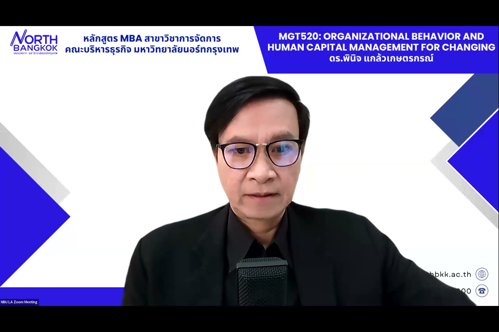

โอเคครับ นักศึกษากลับมาต่อครับทฤษฎีพระผู้นำตัวแรกนะครับ เป็นทฤษฎีพระผู้นำของมหาวิทยาลัยโอไฮโอ ก็มองผู้นำมีสองมิติครับ เป็นด้านเน้นงานนะครับ กับเน้นคนนะครับ

## [00:00:06]

## [00:00:10]
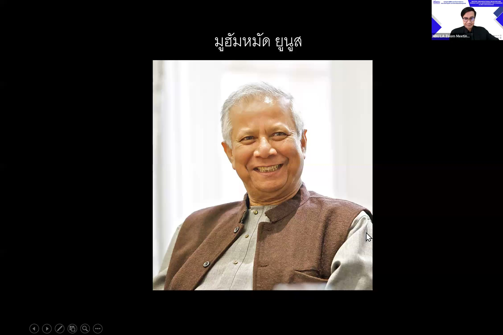

## [00:00:15]
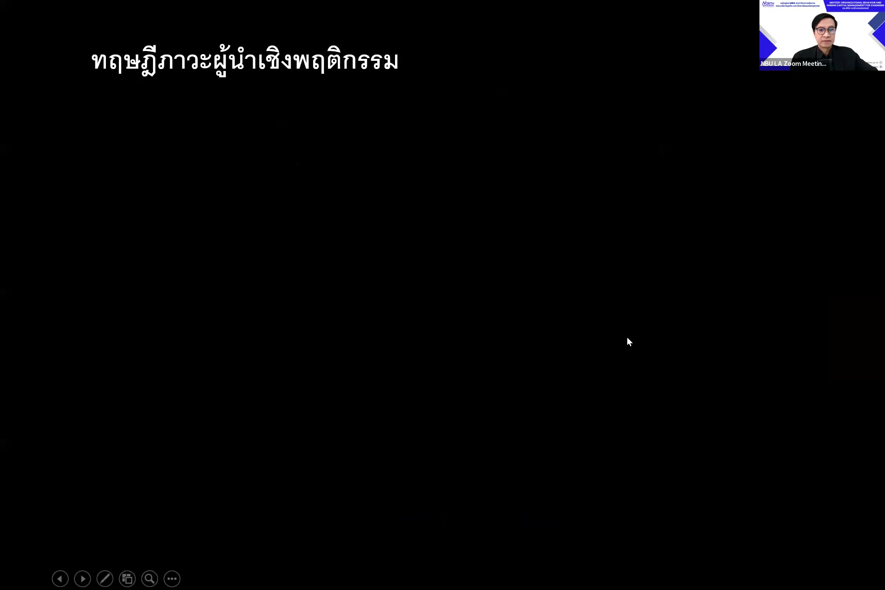

ต่อไปผู้นำของมหาวิทยาลัยมิชิแกนนะครับสรุปแบบผู้นำออกเป็น 3 แบบ ก็คือเน้นงาน มุ่งไปที่ภาระหน้าที่ของผู้นำ ซึ่งได้แก่ การวางแผน การจัดตารางการทำงาน ช่วยประสานกิจกรรมต่าง ๆ ของผู้ใต้บังคับบัญชา จัดหาวัสดุ อุปกรณ์ เครื่องมือ รวมถึงเทคนิควิธีการทำงาน

## [00:00:45]
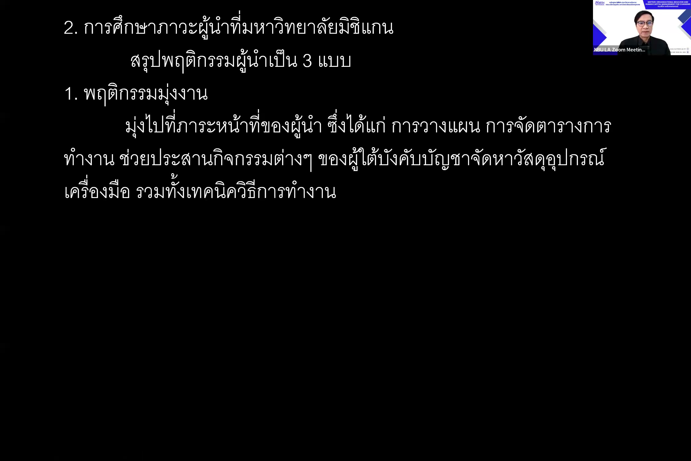

2 มุ่งความสัมพันธ์ หรือมุ่งคนนะครับ ก็คือคล้าย ๆ กับ Ohio นะครับ แต่จะเพิ่มมาอันที่สามนะครับ สำหรับการความสัมพันธ์แบบมุ่งคนก็คือผู้นำที่มีประสิทธิภาพจะเป็นผู้นำที่ห่วงใย สนับสนุน และช่วยเหลือเชื่อมั่นและมีความเป็นเพื่อนดูแลอยู่ห่างห่างอย่างให้เกียรติ สามเพราะผู้นำแบบมีส่วนร่วมนะครับแบบที่สามเพิ่มมานะครับ กระทำโดยให้ผู้ใต้บังคับบัญชาเข้ามามีส่วนร่วมในการพิจารณาและตัดสินใจ

## [00:01:15]

นอกจากนั้นยังช่วยเพิ่มการสื่อสาร เพิ่มความร่วมมือและลดความขัดแย้งนะครับ เดี๋ยวเรื่องความขัดแย้งเราจะเรียนอีกบทหนึ่งเลยนะครับ แต่แบบมีส่วนร่วมนี่มันก็เหมือนกับว่าเอามุ่งคนกับมุ่งงานมารวมกันนั่นแหละครับนักศึกษาครับ แต่มันจะเน้นที่ว่าเข้าไปมีส่วนร่วมเพื่อให้งานออกมาสำเร็จนะครับ

## [00:01:45]
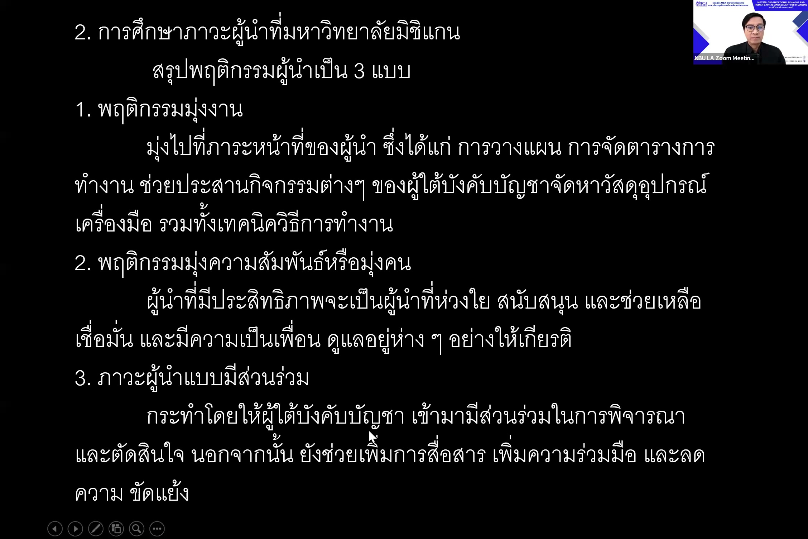

ไปมีส่วนร่วมกับคนเพื่อให้งานออกมาสำเร็จ โดยจะเพิ่มการสื่อสารกับการบริหารความขัดแย้งเข้ามา ต่อไปการศึกษาผู้นำ

## [00:02:02]
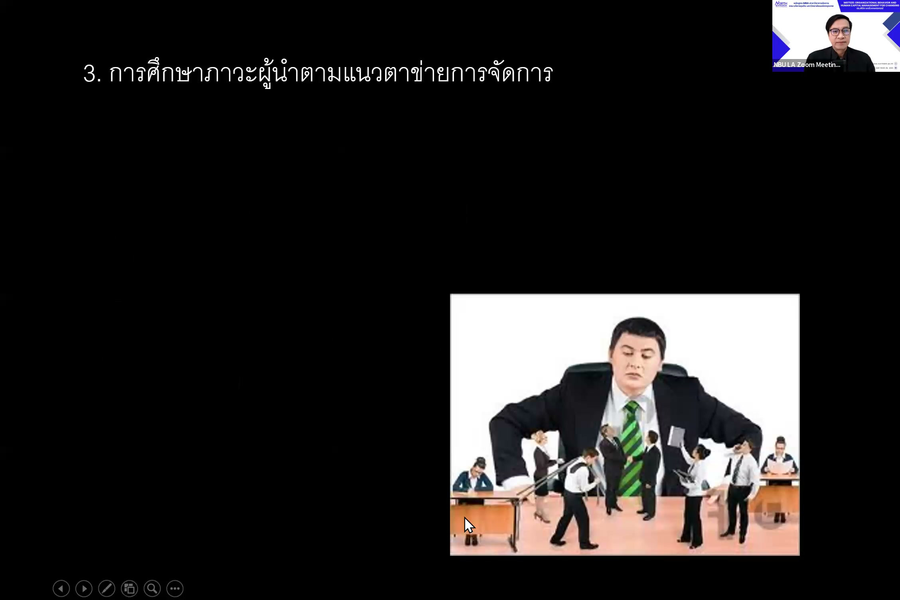

ทฤษฎีที่สามนะครับเป็นผู้นำตามแนวตะข่ายการจัดการเราเรียกว่า นายกฤษฎ์นะครับ นายคือก้าวกฤษฎ์ที่เรียกว่าตะข่ายครับ กฤตที่เรียกว่าตาข่าย เน็ตก็คือตาข่าย กฤตก็คือเป็นตารางครับ กฤตคือเป็นตาราง เพราะฉะนั้นตาข่ายผู้นำเนี่ย หลักการสำคัญเนี่ย อาจารย์ว่า คิดว่าน่าจะเอาไปออกข้อสอบนะ เพราะมันตรวจง่ายดี มันเขียนง่ายด้วยนะ แล้วมันก็ไม่ได้ยาก มันชัดเจนที่ซีมันชัดเจน มีอะไรให้นักศึกษาเขียนด้วย

## [00:02:32]

เขาก็แค่เอาทฤษฎีของ OHIO มานักศึกษาก็คือมุ่งคนกับมุ่งงานเอามาใช้แล้วก็แปลความหมายให้มันเป็นเชิงปริมาณนะครับ โดยใช้ คะแนน 1-9 ก็คือเปลี่ยนจากเชิงคุณภาพให้เป็นเชิงปริมาณ

## [00:02:59]

จัดรูปแบบของผู้นำเนี่ยตามตารางเก้าช่องนักศึกษาครับ เราเรียกตารางเก้าช่องนักศึกษานายกฤตนะครับ ตารางเก้าช่องแบบนี้ครับนักศึกษาดูนะ แล้วก็ใส่ตารางไป แนวตั้งคอลัมน์แนวตั้งห้า แนวนอน เอ้ย คอลัมน์เก้าแถวเก้านะครับ ก็แนวตั้งเก้าแบบนี้ นักศึกษาเก้า ขีดไปเลย แล้วก็แนวนอนก็เก้า

## [00:03:29]
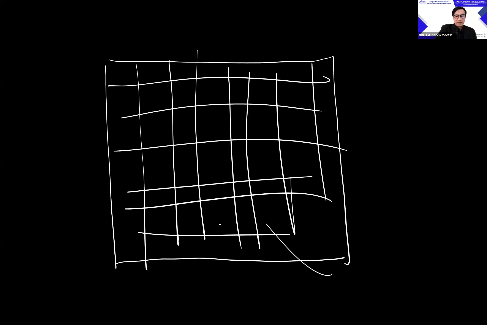

แบบเนี้ยครับ ขีดไปเลยครับนักศึกษาครับอาจารย์ก็ขีดให้นักศึกษาเห็นแบบนี้ครับ อะ แบบนี้เลยนักศึกษาเห็นไหมครับ แนวนอนเก้า แนวตั้งเก้า เพราะงั้นนักศึกษาครับแนวนอนเป็นมิติของ มู่งาน

## [00:03:33]

ใส่ใจงาน เนี่ย แนวนอนจะเป็นใส่ใจงานก็ให้คะแนนหนึ่งถึงเก้า หนึ่งก็คือใส่ใจงานน้อยมากเก้าคือใส่ใจงานมากที่สุดนะครับ ก็คือเปลี่ยนเป็นเชิงปริมาณนะครับให้เห็นเป็นตัวเลข ส่วนแนวตั้งตรงนี้ครับนักศึกษาก็คือใส่ใจคนมี 9 ระดับครับ 1-9

## [00:04:03]

ระดับที่หนึ่งคือใส่ใจคนน้อยมาก ๆ ระดับที่เก้าคือใส่ใจคนระดับสูงเลยนะฮะ สูงที่สุดเลย แบบเนี้ย แค่นั้นเองนะฮะ แล้วเขาก็แบ่งผู้นำออกเป็นทั้งหมดห้าประเภท ห้าประเภทจากตำแหน่งของตารางน่ะสิครับจากตำแหน่งของตาราง อ่า โดย เนี่ยฮะ สีเขียวนะฮะ สีแดง สีเหลือง อ่า สี อ่า สีแดง สีแดงซ้ำนะฮะ อีกสีหนึ่ง แล้วก็ตรงกลางนะฮะ เพราะฉะนั้น ผู้นำ ลักษณะผู้นำมีทั้งหมดเก้าแบบ เอ้ย โทษที ขอโทษ ขอโทษ ห้าแบบ มีห้าแบบ

## [00:04:33]
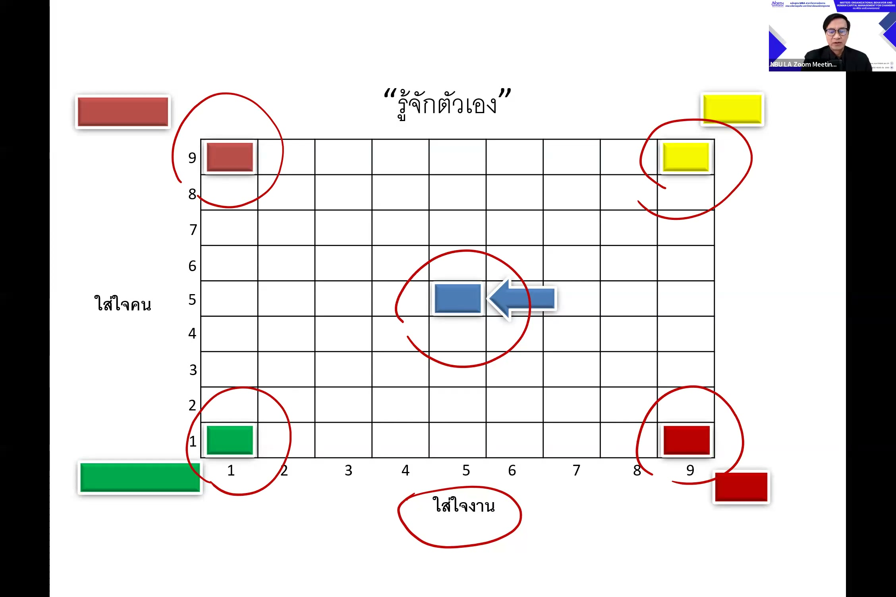

โอเคนักศึกษาครับเพราะฉะนั้นเวลานักศึกษาสร้างตารางถ้าหากว่านักศึกษาต้องสร้างตารางนะครับ นักศึกษาก็ดูว่าถ้ามันเป็นในช่องนี้ค่ะนักศึกษาครับใส่ใจงานแค่หนึ่งเอง ใส่ใจงานน้อยที่สุดเลยแล้วก็ใส่ใจคนก็น้อยที่สุดเลยน่ะครับ มันก็จะอยู่ตำแหน่งตรงนี้น่ะครับ เรามาดูสิว่าผู้นำแบบนี้นะครับถ้าผู้นำมีลักษณะแบบนี้นะครับใส่ใจคนก็น้อยที่สุดใส่ใจงานก็น้อยที่สุดนะครับ นี่ฮะเราเรียกผู้นำแบบหนึ่งหนึ่งนะครับหนึ่งกับหนึ่ง

## [00:05:03]
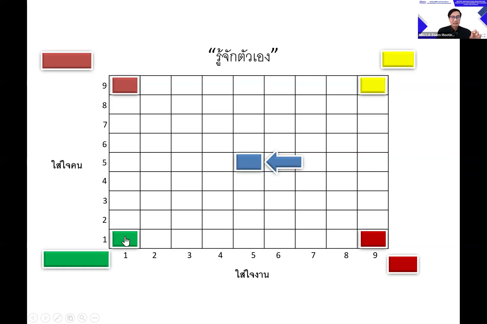

หนึ่งกับหนึ่ง มิติหนึ่งกับหนึ่งนะครับใช้ชื่อว่า ผู้นำแบบปล่อยตามสบายนะครับผู้นำแบบปล่อยตามสบาย งั้นลักษณะผู้นำแบบปล่อยตามสบายเนี่ยฮะจะเป็นแบบนี้ครับนะครับ เนี่ยฮะ

## [00:05:24]
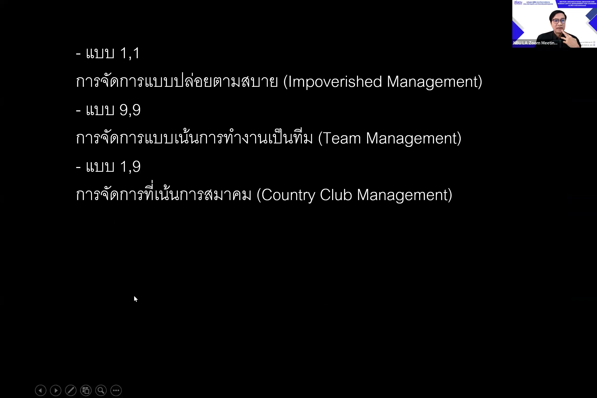

## [00:05:31]

ต่อไปดูตรงนี้ครับนักศึกษาครับตรงนี้นะที่อาจารย์ชี้อยู่นะ ก็คือใส่ใจงานน้อยที่สุดครับแต่ใส่ใจคนมากที่สุดครับนักศึกษาครับ ก็จะเรียกว่าหนึ่งกับเก้า งั้นเราจะเอาคำว่าใส่ใจงานก่อนนะ ปริมาณใส่ใจงานขึ้นก่อนนะศา ก็คือหนึ่ง ใส่ใจงานนี่หนึ่ง แต่ใส่ใจกฎนี่เก้าเลยครับ ก็คือหนึ่งเก้านะครับ หนึ่งกับเก้า เราเรียกแบบนี้ว่าสโมสรนะฮะ สโมสร แต่มันแปลมาจากภาษาอังกฤษคือคันทรี่คลับ คันทรี่คลับนะฮะ คันทรี่คลับ เป็นผู้นำแบบคันทรี่คลับ

## [00:06:01]
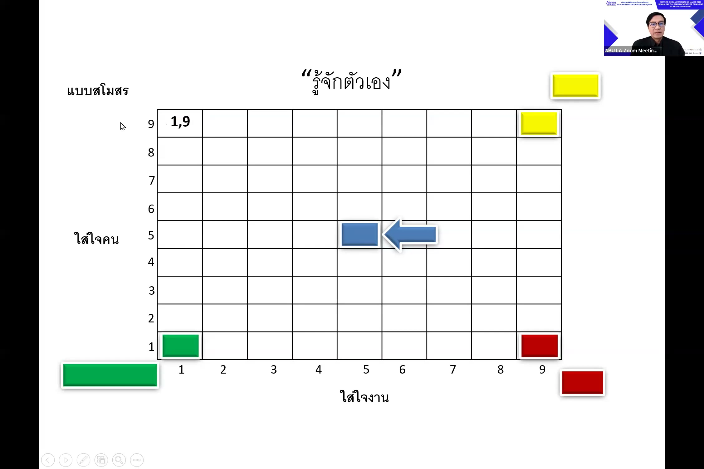

ต่อไปดูช่องนี้ครับนักศึกษาครับช่องนี้เนี่ยใส่ใจงานก่อนนะ เราพูดถึงใส่ใจงานอันดับที่หนึ่งก่อนนะครับก็คือระดับเก้า ใส่ใจงานสูงที่สุดนะครับ ส่วนตัวหลักก็คือใส่ใจคนก็ระดับ 9 เหมือนกันนะครับ อันนี้ก็คือ 9 กับ 9 นะครับ เราเรียกผู้นำแบบนี้ครับว่าผู้นำแบบทีมงานนะครับ แบบทีมเวิร์ค

## [00:06:31]
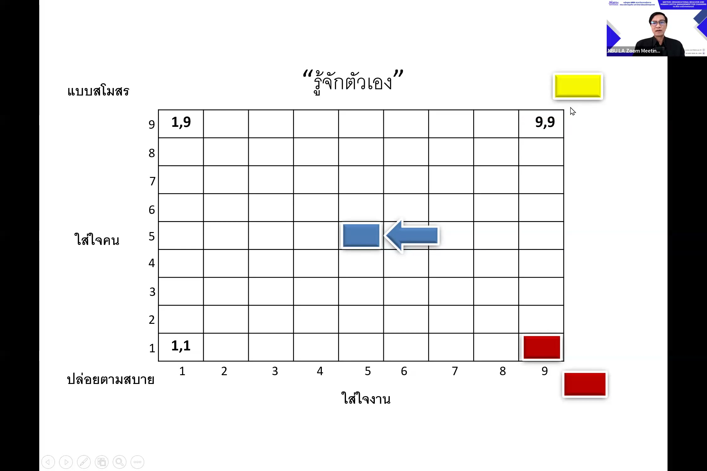

ต่อไปช่องนี้นะครับ เอาพูดถึงปริมาณใส่ใจงานก่อนนะ ใส่ใจงานระดับ 9 นะครับ ใส่ใจงานระดับ 9 แต่ใส่ใจคนน้อยที่สุดคือระดับ 1 นะครับ เราก็เรียก 9 กับ 1 9 กับ 1 เราเรียก หัวหน้างาน หัวหน้าแบบนี้ว่ามู่งานนะครับผู้นำแบบมู่งาน งั้นผู้นำแบบสุดท้ายครับ ตรงกลางนะครับ ตรงกลางก็คือผู้นำแบบ middle of the road นะครับ ทางสายกลางนะครับ middle of the road

## [00:07:01]
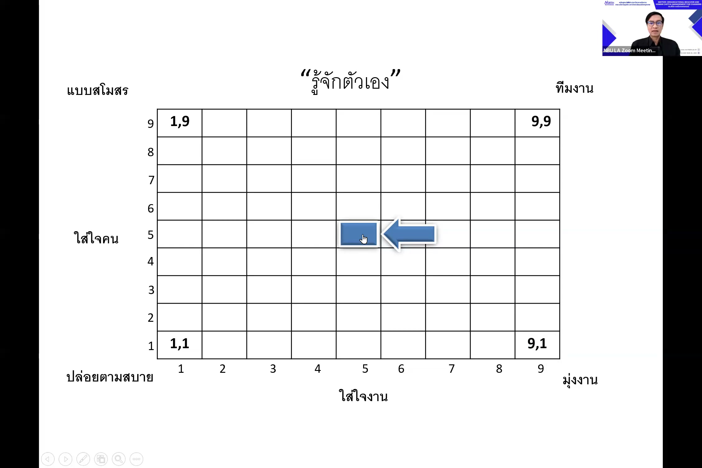

เราเรียกว่ากึ่งกลางทางสายกลางนักศึกษา middle of the road งั้นนักศึกษาเราเป็นผู้นำแบบไหนอืม เราบอกตัวเองก่อนนะครับแล้วก็นักศึกษามีผู้นำ หัวหน้าแบบไหนนักศึกษาก็จะได้รู้ว่า อ๋อ ลักษณะแบบนี้เป็นผู้นำที่อยู่ตัวเลขนี้นั่นเองนักศึกษา เข้าใจนะครับ อ่า มาดูแต่ละแบบครับนักศึกษาครับ อันเนี้ย อันเนี้ยมาจากภาษาอังกฤษนักศึกษาครับ

## [00:07:30]
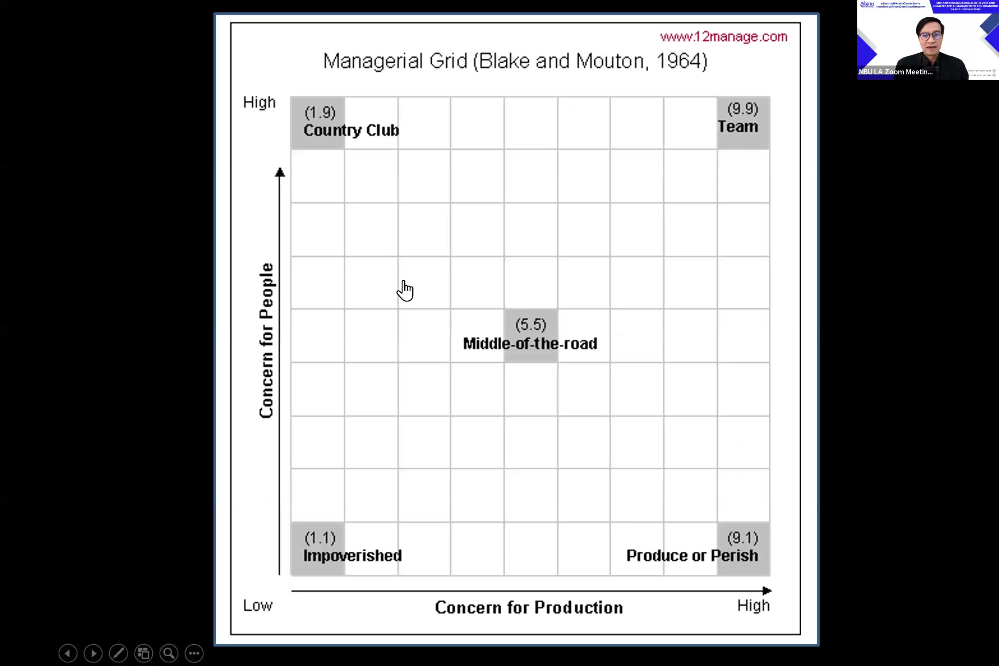

Managerial Grid ครับ Managerial Grid คิดขึ้นมาตั้งแต่ปี 1964 อ่าสักครับใส่ใจงานก่อนอ่าสัก Concern for Production นะครับ Concern เพราะว่าเป็นห่วงใส่ใจอ่าสักครับ ส่วนแนวตั้งเป็น Concern for people ใส่ใจคน ถ้า 1 กับ 1 เนี่ย impoverished impoverished นะครับใส่ใจคนก็น้อย ใส่ใจงานก็น้อย ก็ลักษณะไม่เอาอะไรเลยนักศึกษาครับรอเกษียณนักศึกษาครับ เซฟตัวเองเซฟตัวเอง

## [00:08:00]
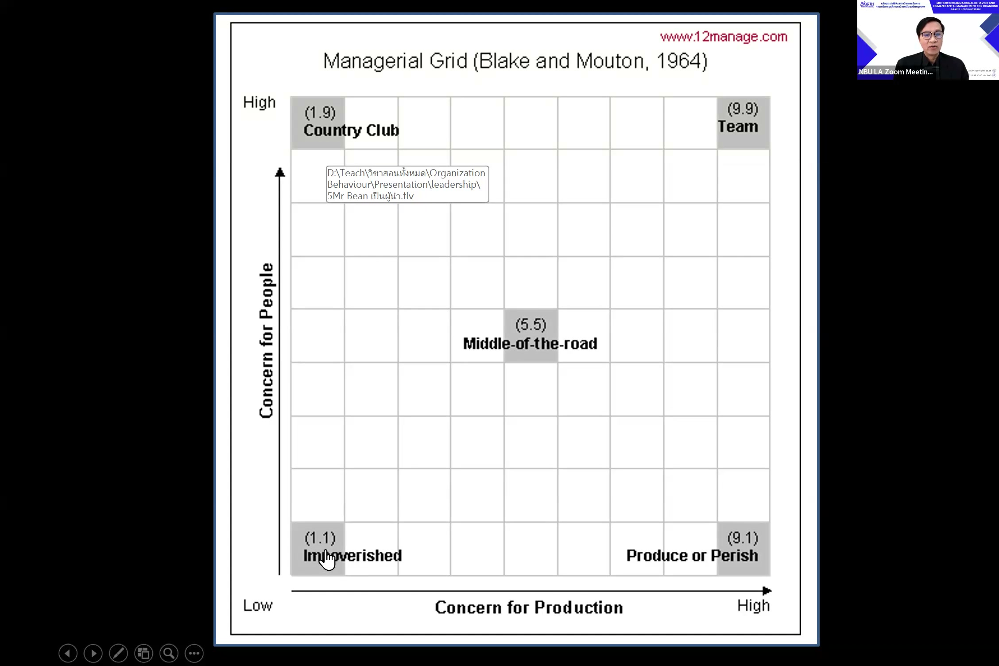

ให้มากที่สุดนะครับ ส่วนหนึ่งเก้าก็คือใส่ใจงานหนึ่ง ใส่ใจคนเก้าเนี่ยเราเรียกว่าคันที่คลับ ถ้าเก้ากับเก้าคือเป็นทีมนะครับแต่ส่วนเก้ากับหนึ่งเนี่ยครับ Produce All Purpose 9 กับ 1 9 คือใส่ใจงานมากเลยครับ คนช่างครับ

## [00:08:30]

คนจะไม่ใส่ใจ เขาจะเหนื่อย จะอะไรไม่สนใจครับ ขอให้งานออกมาสำเร็จตามเป้าหมายก็พอนะครับ มาดูผู้นำแบบเน้นงานเลยนะครับ

## [00:08:41]
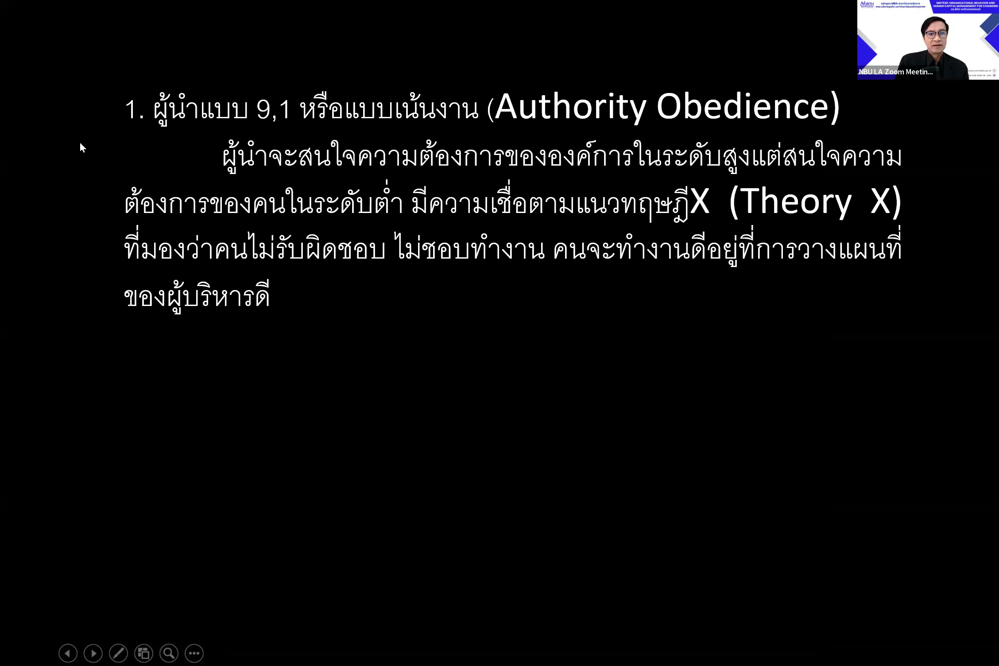

เน้นงานนะครับ เก้ากับหนึ่งนะครับ แบบเน้นงานผู้นำจะสนใจความต้องการขององค์กรในระดับสูง แต่สนใจความต้องการของคนระดับต่ำ มีความเชื่อตามแนวทฤษฎีเอ็กซ์ ความเชื่อตามแนวทฤษฎีเอ็กซ์นะครับ ตรงนี้เคยได้ยินไหมครับ ทฤษฎีเอ็กซ์

## [00:09:11]
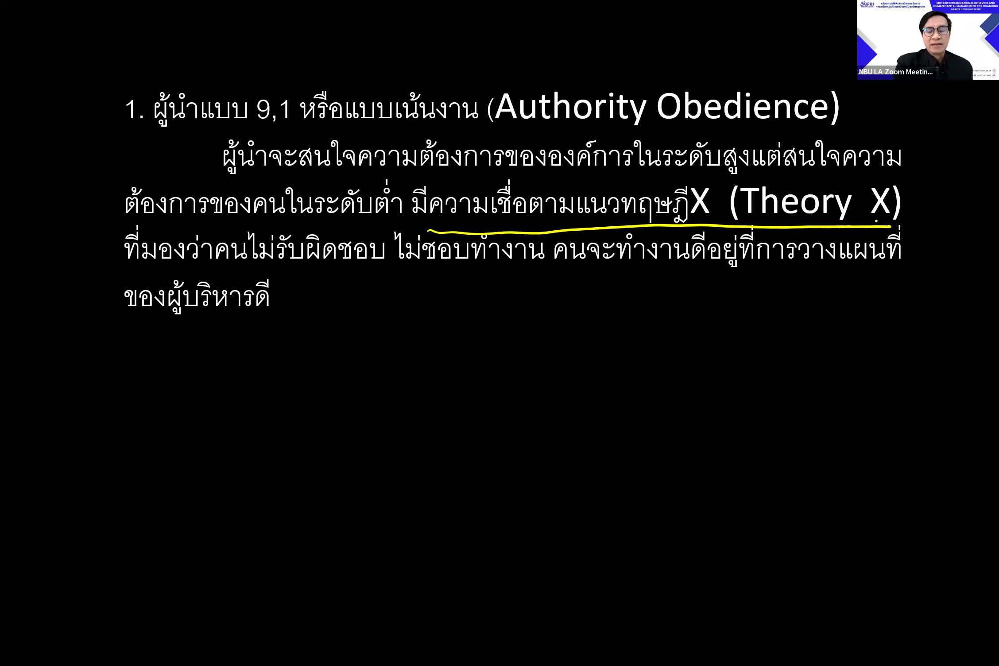

ทฤษฎีเอ็กซ์ก็หมายถึงมองหัวหน้าที่มองคนงานเป็นลบอะครับว่าคนงานมักจะขี้เกียจ หนักไม่เอาเบาไม่สู้ หลบได้เป็นหลบ เลี่ยงได้เป็นเลี่ยง ต้องควบคุมใกล้ชิดตลอดเวลาปล่อยไม่ได้เลย อันนี้คือคนที่มองคนอื่นแบบเอ็กซ์ เอ็กซ์ก็คือกากบาทก็แปลว่าไม่ดีอะนักศึกษาครับ นั่นแหละครับ แต่ถ้าผู้นำมองว่า คนของเราเนี่ยไม่ต้องไม่ต้องเข้าไปดูแลหรอก เขารับผิดชอบได้ เขาทำตามหน้าที่ เขามีความ มีภาวะ เอ่อ มีความรับผิดชอบ เราเรียกว่าการมองแบบวาย

## [00:09:41]
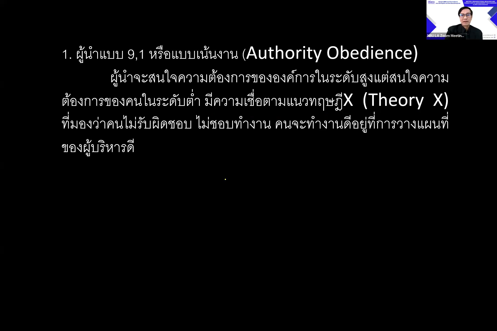

เป็นมุมมองของหัวหน้าแบบวาย เพราะฉะนั้น ผู้นำที่อยู่แบบนี้นะฮะ อยู่ในตำแหน่งที่ 9 กับ 1 ก็คือมองงานสูงที่สุดนะฮะ มองงานมาก่อน ส่วนมองคนเนี่ยต่ำที่สุดนะฮะ มองคนน้อยที่สุดมันเป็นตามแนวคิดที่ดีเอกนะฮะ จำไว้นะครับ

## [00:10:11]
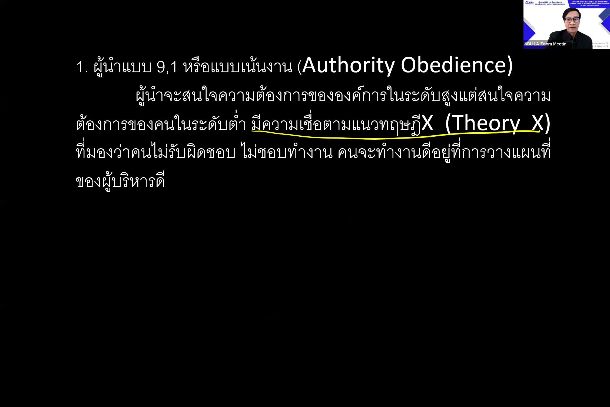

จำไว้นะครับนักศึกษาครับ ถ้าจะเขียนข้อสอบอาจารย์ ถ้าเขียนว่าผู้นำ 9 กับ 1 เนี่ยเป็นผู้นำที่มองลูกน้อง มองผู้ใต้บังคับชาเป็นทฤษฎี X นักศึกษา รับรองได้ว่าอย่างไรก็เต็มนักศึกษาครับ สิบก็เต็มสิบนะครับ แสดงว่าแม่นทฤษฎีแล้วนะครับเพราะฉะนั้นผู้นำแบบนี้เนี่ย จะทำงานดีอยู่ที่การวางแผนของผู้บริหารแล้วก็เอาแผนมาทำตาม ทำตามแผนเขาที่เขาวางไว้ก็พอ ลูกน้องก็ทำตามแผนก็พอนะครับ ต่อไปแบบนี้ครับ ผู้นำแบบหนึ่งกับเก้า เพราะฉะนั้นตัวเลขหนึ่งข้างหน้านะครับ เรามองที่งานก่อนนะครับ ให้นักศึกษาจำไว้นะครับ

## [00:10:41]
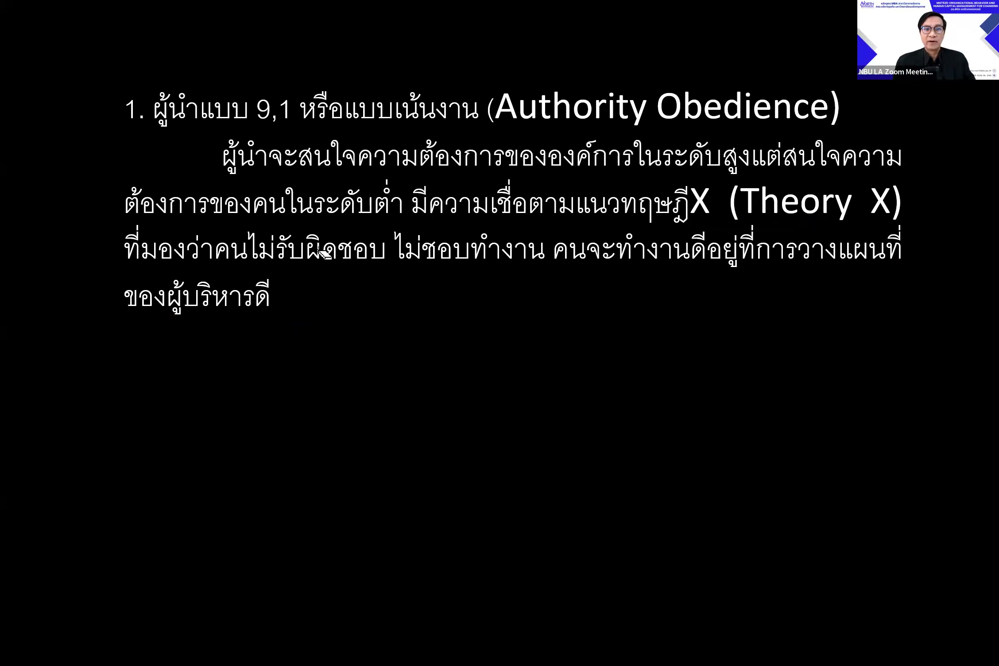

งานแล้วค่อยคนนะสาวมองงานแล้วค่อยมองคน เพราะฉะนั้นงานมองที่หนึ่งคนมองที่เก้าแสดงว่าใส่ใจงานน้อยที่สุดเลย แต่ใส่ใจคนระดับสูงที่สุดนั่นแหละครับที่เราเรียกว่าเน้นคนนั่นแหละครับ คันทรีคลับแมเนจเมนท์นั่นแหละคันทรีคลับแมเนจเมนท์คือคนที่เขาคิดที่ซีมาเขาคงคิด

## [00:11:11]
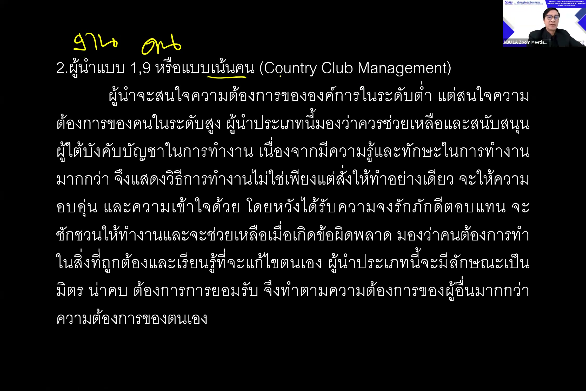

มองมโนภาพอ่ะ นึกภาพว่ามันอยู่ในคลับอ่ะเหมือนทำงานอยู่ในคันทรีคลับ อยู่ในสโมสรอ่ะ คืออยากให้ทุกคนมีความสุขอ่ะอยากให้พนักงานมีความสุข อยากให้พนักงานมี ไม่มีเรื่องร้อนใจอยากให้พนักงานมีความสุข พูดแค่นี้สาธิตกังวลจะกังวลมากเมื่อพนักงานไม่มีความสุข จะกังวลมากใส่ใจ เห็นใจมากกลัวพนักงานจะเหนื่อยประมาณนั้นล่ะครับ เพราะฉะนั้นผู้นำจะสนใจความต้องการขององค์กรในระดับต่ำมากแต่สนใจความต้องการของคนในระดับสูงลูกน้องอยากได้นู่น อยากได้นี่ เราก็

## [00:11:41]
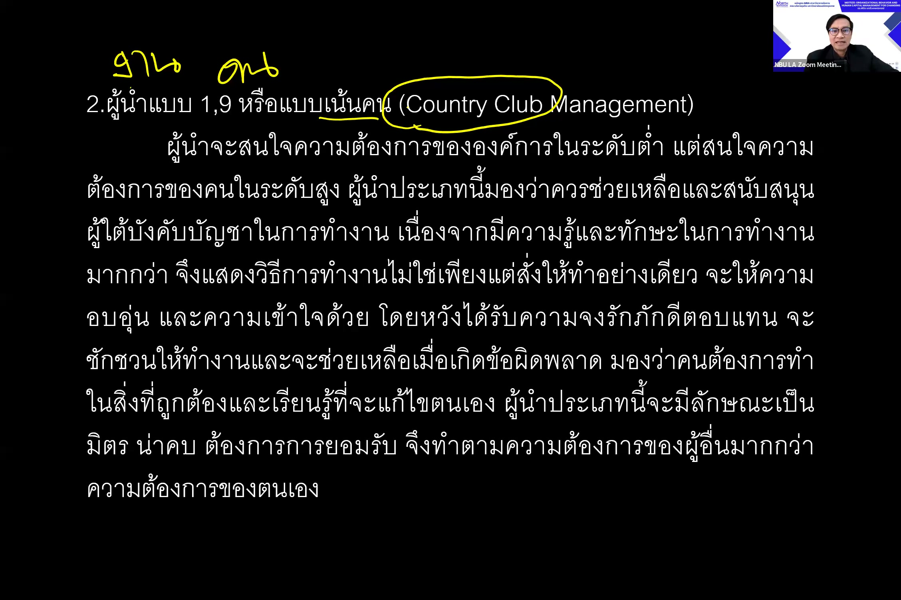

ทำเรื่องขอผู้บริหารไป ลูกน้องอยากได้โต๊ะทำงานใหม่ ลูกน้องอยากได้แอร์เพิ่ม ลูกน้องอยากได้ บางทีเราก็ใส่ใจลูกน้องแล้วก็ ผู้นำประเภทนี้มองว่าควรช่วยเหลือและสนับสนุนผู้ต้านความชาญในการทำงาน เนื่องจากมีความรู้และทักษะในการทำงานมากกว่า จึงแสดงวิธีการทำงานไม่เพียงใช้แต่คำสั่งอย่างเดียว จะให้ความอบอุ่นและความเข้าใจด้วย

## [00:12:11]
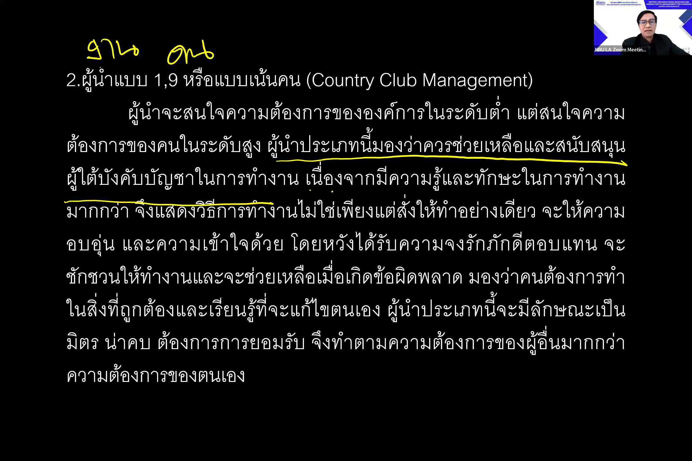

โดยหวังได้รับความจงรักภาคดีตอบแทน นี่ครับ หวังความจงรักภาคดีตอบแทนด้วยนะครับ จะชักชวนให้ทำงานและช่วยเหลือเมื่อเกิดข้อผิดพลาด

## [00:12:27]
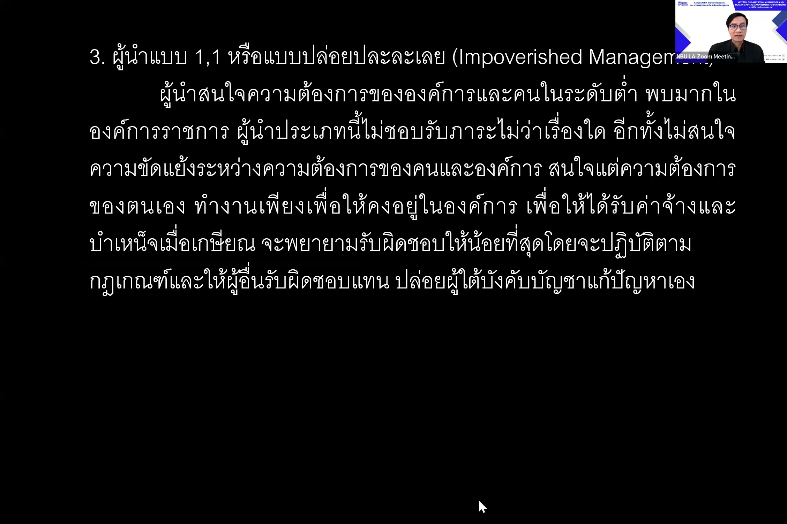

## [00:12:30]
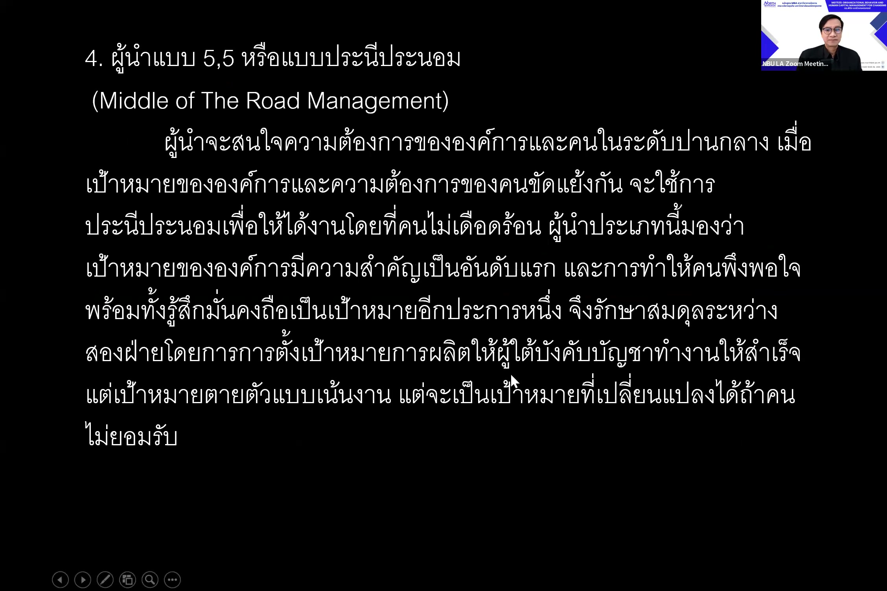

## [00:12:37]
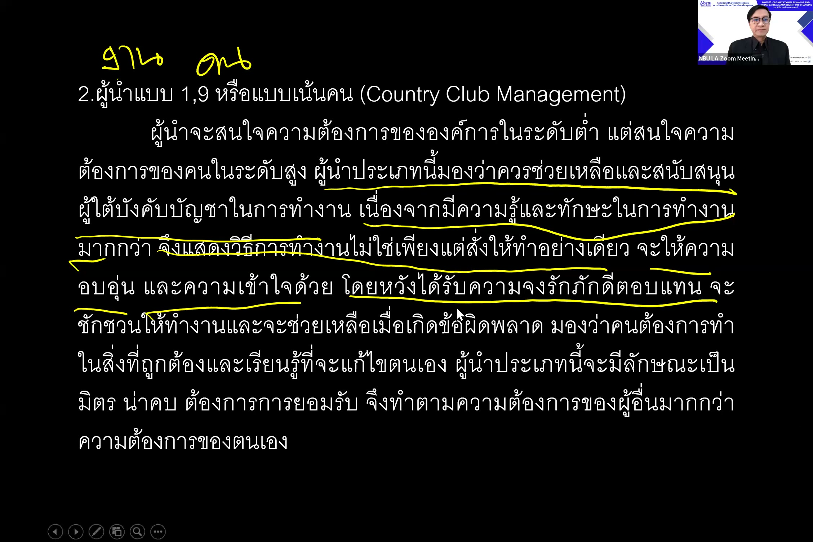

มองว่าคนต้องการทำงานในสิ่งที่ถูกต้องและเรียนรู้ที่จะแก้ไขตนเองผู้นำประเภทนี้มักมีลักษณะเป็นมิตร น่าคบและต้องการการยอมรับต้องการการยอมรับนะครับ จึงทำตามความต้องการของผู้อื่นมากกว่าความต้องการของตนเอง อืม กลัวกลัวลูกน้องไม่รักน่ะสนั่นแหละครับก็ต้องการการยอมรับ แต่ถ้าอีกประเภทหนึ่งแบบแรกน่ะสาธิตไม่สนจะเกียรติก็เกียรติน่ะสาธิตแต่ขอให้งานเสร็จน่ะสาธิตนึกออกไหมครับ

## [00:13:07]
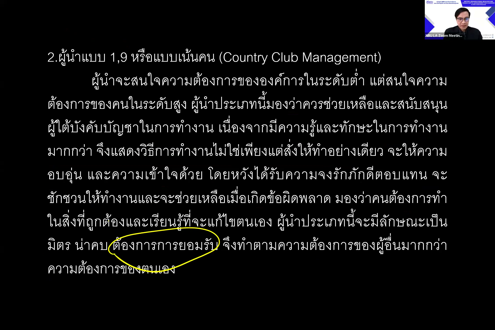

## [00:13:16]
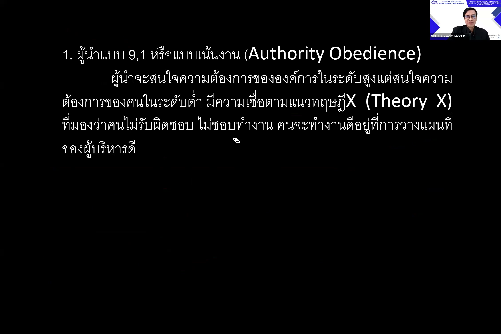

ขอให้งานเสร็จตามเป้าหมายขององค์กรก็พอนะครับจะเกลียดก็เกลียดลุยเลยนะครับ ต่อไปแบบหนึ่งกับหนึ่งนะครับหนึ่งตัวแรกคืออะไรนะครับหนึ่งตัวแรกคือ

## [00:13:23]
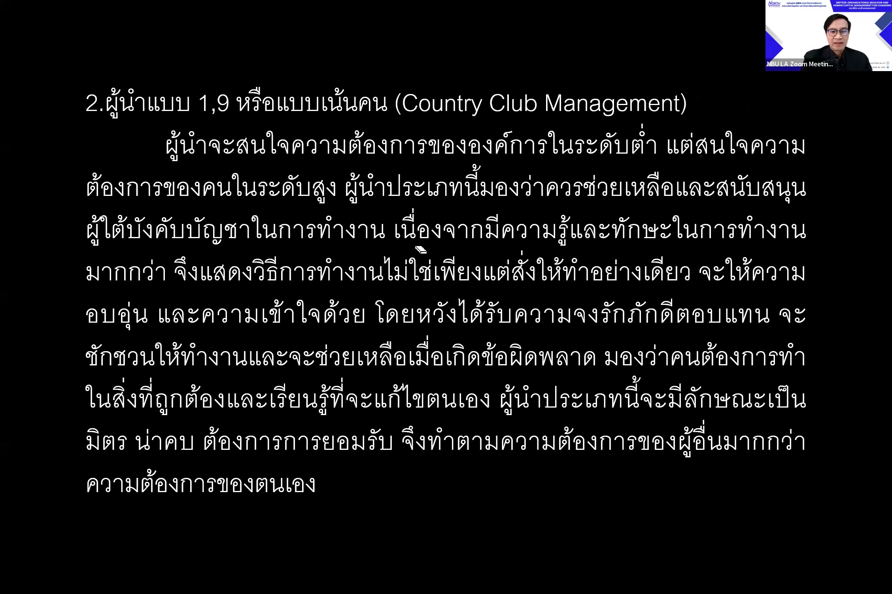

## [00:13:26]

มองมิติของอะไร งานนะฮะ หนึ่งตัวหลังมองมิติของคนนะครับเป็นผู้นำแบบปล่อยปาระเลยครับ ผู้นำสนใจความต้องการขององค์กรในระดับต่ำ ผู้นำนะครับ สนใจความต้องการขององค์กรและของคนในระดับต่ำเลยนะครับ พบมากในองค์กรราชการผู้นำประเภทนี้ไม่ชอบรับภาระไม่ว่าเรื่องใด อีกทั้งไม่สนใจความขัดแย้งระหว่างความต้องการของคนและองค์กร สนใจแต่ความต้องการของตนเองทำงานเพียงเพื่อให้คงอยู่ในองค์กร

## [00:13:56]
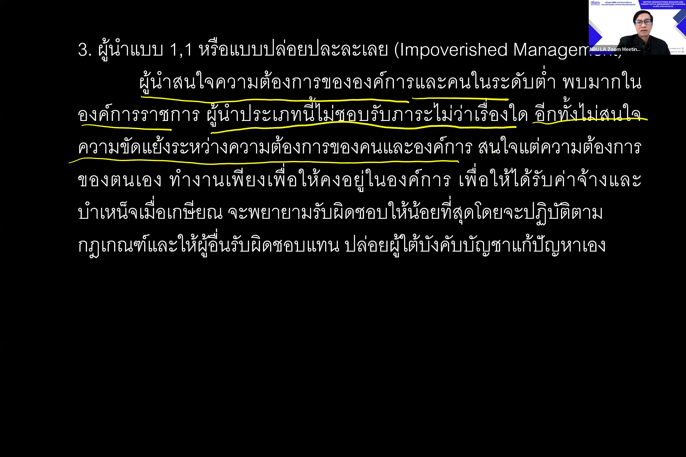

เพื่อให้ได้รับค่าจ้างและบำเหน็จเมื่อเกษียณจะพยายามรับผิดชอบให้น้อยที่สุดโดยจะปฏิบัติตามกฎเกณฑ์และให้ผู้อื่นรับผิดชอบแทนปล่อยผู้ใต้บังคับบัญชาแก้ปัญหากันเอง อันนั้นนะครับ

## [00:14:18]
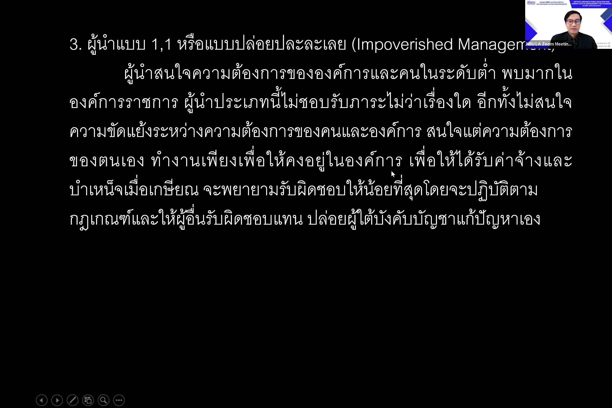

คำเขียนน่ะนะครับมันอาจจะใช้คำให้มันชัดเจนนะฮะ แต่จริงจริงมันอาจจะไม่หนักแบบมันอาจจะ ไม่หนักขนาดนี้ หรือหนักกว่านี้ก็ได้นะครับ ก็ลองดูแล้วกันเนอะ ต่อไปครับ ผู้นำแบบ 5 กับ 5 นะครับ ก็คือปณีปนอมนะครับ Middle of the Road Management นะครับ ปณีปนอม

## [00:14:41]

ผู้นำจะสนใจความต้องการขององค์กรและของคนในระดับปันกลางเมื่อเป้าหมายองค์กรและความต้องการของคนขัดแย้งกันจะใช้การประนีประหนอมเพื่อให้ได้งานโดยที่คนไม่เดือดร้อน ผู้นำประเภทนี้มองว่าเป้าหมายขององค์กรมีความสำคัญเป็นอันดับแรกและการทำให้คนพึงพอใจพร้อมทั้งรู้สึกมั่นคงถือเป็นเป้าหมายอีกประการหนึ่ง จึงรักษาสมดุลระหว่างสองฝ่าย

## [00:15:11]

โดยการตั้งเป้าหมายการผลิตให้ผู้ใต้บัญชาทำงานให้สำเร็จ แต่เป้าหมายตายตัวแบบเน้นงานครับแต่จะเป็นเป้าหมายที่เปลี่ยนแปลงได้ถ้าคนไม่ยอมรับ ก็ดีนะครับ

## [00:15:25]
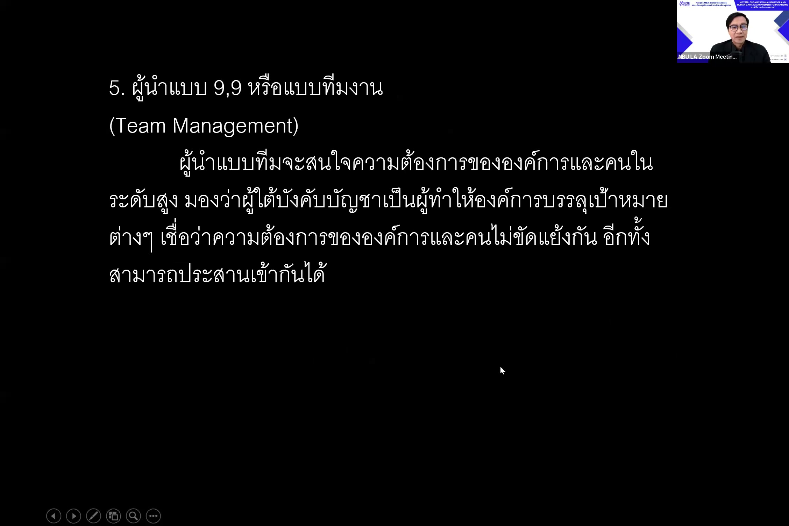

ต่อไป 999 นี่คือทำงานเป็นทีม ก็แถมว่าดีที่สุดแล้วนะครับ 999 ผู้นำที่สนใจความต้องการของคนและองค์กรระดับสูง มองว่าผู้ใช้มวลชาเป็นผู้ทำให้องค์กรบรรลุเป้าหมายต่างๆ เชื่อว่าความต้องการขององค์กรและคนไม่ขัดแย้งกันอีกทั้งสามารถประสานกัน ประสานเข้ากันได้ โอเคนะ อ่านักศึกษาไปดูภาพนี้อีกทีนะ เผื่อนักศึกษาต้อง

## [00:15:47]
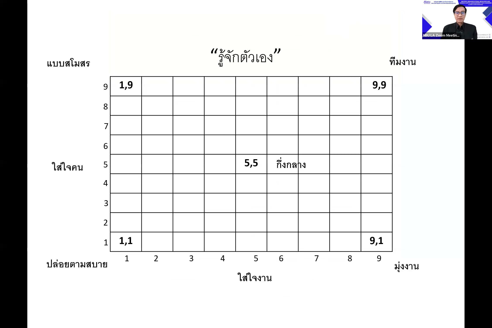

ต้องใช้เขียนข้อสอบนะครับแล้วก็อธิบายนะครับ ก็เลยมีคนถามว่าผู้คิดทฤษฎีนะครับ ถูกถามว่าแล้วแบบไหนมันดีที่สุดล่ะครับแล้วแบบไหนมันดีที่สุดล่ะครับ

## [00:15:56]
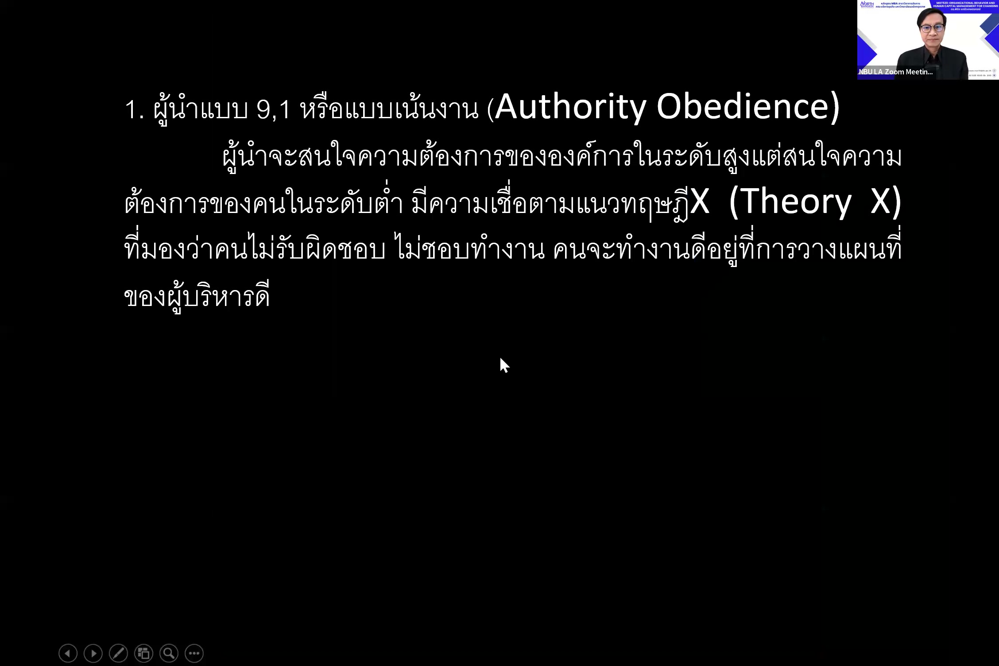

## [00:16:00]
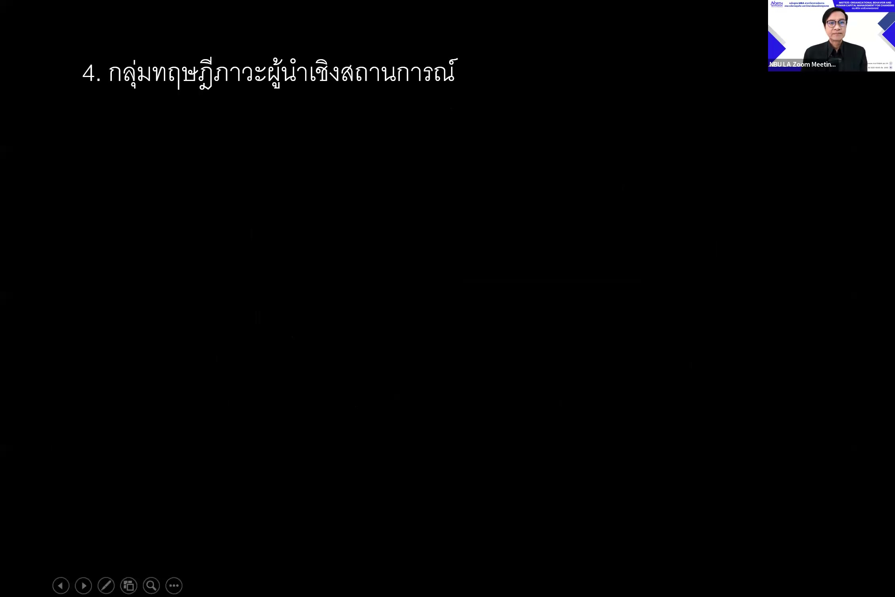

## [00:16:05]
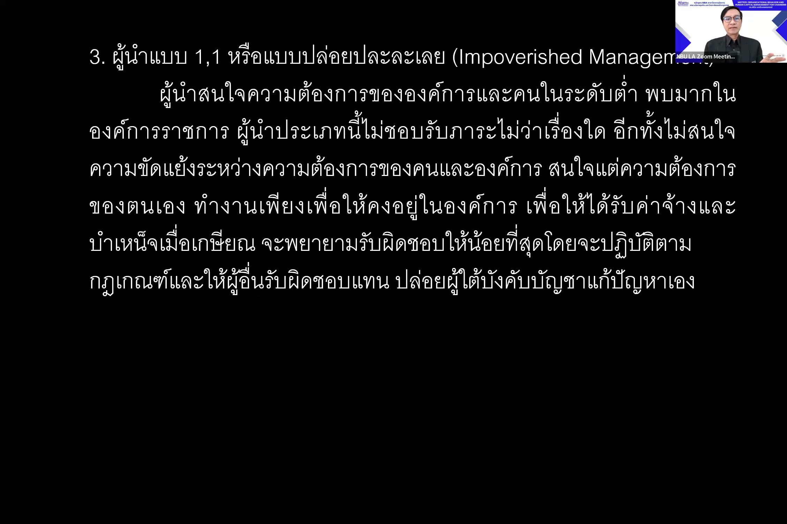

## [00:16:10]
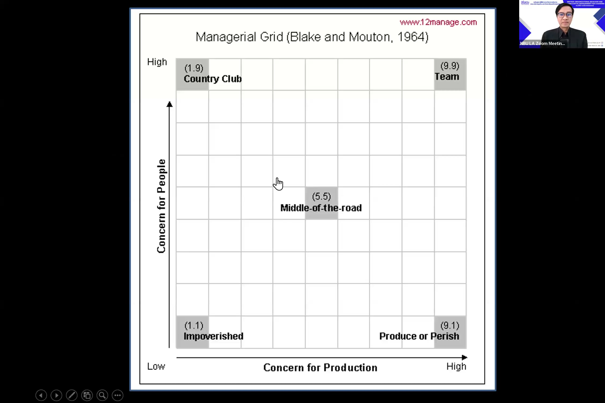

ก็มีคนตอบว่า แล้วแต่สถานการณ์ครับ ไอ้คนที่ตอบว่าแล้วแต่สถานการณ์ครับ มันก็เลยไปเข้ากับทฤษฎีต่อไปครับ ผู้นำ

## [00:16:27]

เชิงสถานการณ์ครับที่สี่พระผู้นำเชิงสถานการณ์ก็คือขึ้นอยู่กับสถานการณ์ครับ แบ่งเป็นผู้ ผู้ที่ ที่มีความคิดเห็นมีแนวคิดเกี่ยวกับว่ามันขึ้นอยู่กับสถานการณ์ไหนควรใช้ผู้นำแบบไหนนะครับ มีคนหนึ่งเขาชื่อทฤษฎีสถานการณ์ของฟีดเดอร์นะครับ เขาบอกว่าหลักการสำคัญคือผู้นำเนี่ยเกิดจากแรงจูงใจของคน พอผู้นำเนี่ยเกิดจากแรงจูงใจของบุคคลการควบคุมสถานการณ์กับความสัมพันธ์ กับสมาชิก

## [00:16:57]
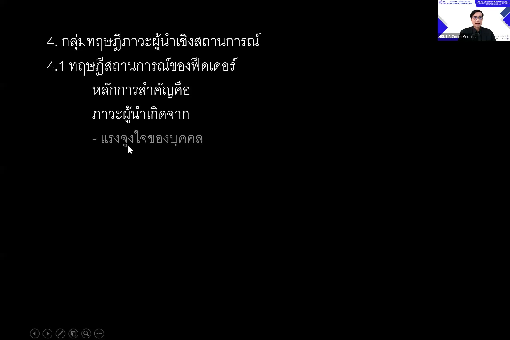

กับโครงสร้างของงานแล้วกับกับตำแหน่งงานก็คือความสัมพันธ์ระหว่างสมาชิกความสัมพันธ์ระหว่างผู้นำกับโครงสร้างของงานแล้วก็ระหว่างผู้นำกับตำแหน่งงานนะครับ เราสามารถควบคุมสถานการณ์ได้อย่างดีนะฮะอาสา ว่าความสัมพันธ์ตอนไหนควรควรสัมพันธ์กับใครมากกว่ากันนะ สัมพันธ์กับสมาชิกกับลูกน้องก่อนไหม ถ้าสถานการณ์แบบนี้ควรสัมพันธ์กับโครงสร้างของงานดูที่งานไหม แล้วก็ดูตำแหน่งงาน

## [00:17:27]
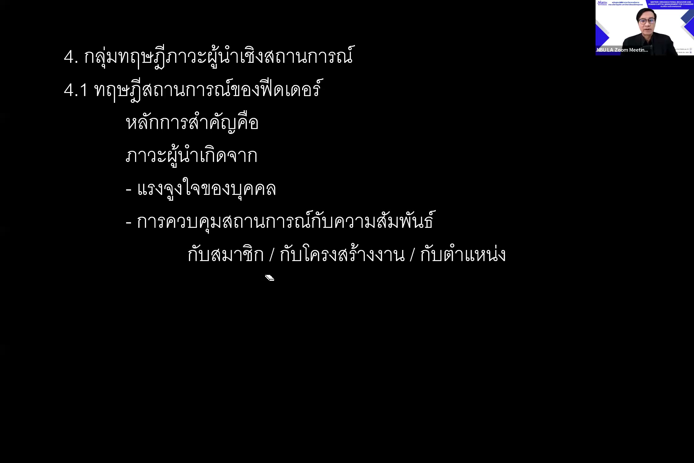

ภาวะผู้นำกับสถานการณ์ที่ต้องควบคุม ก็คือสถานการณ์นี้ต้องการควบคุมระดับสูง ก็ต้องใช้มาตรการควบคุมนะครับ แต่ถ้าสถานการณ์นี้ไม่ต้องควบคุมมากก็ปล่อยปราศรัยเลยได้ ก็ดูสถานการณ์กันเป็นหลักนะครับ นะครับ ควบคุมมาก ควบคุมปานกลาง ควบคุมน้อยนะครับ ต่อไปทฤษฎีภาวะผู้นำเชิงสถานการณ์

## [00:17:57]
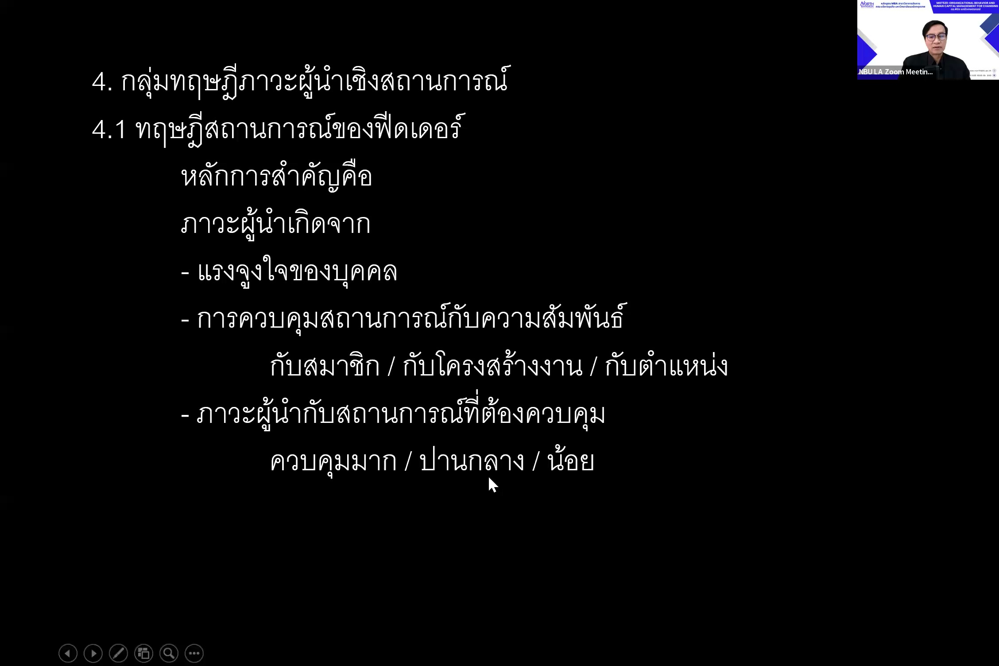

ตัวต่อไปครับ เป็นทฤษฎีวิถีทางเป้าหมายวิถีทางเป้าหมายครับ ผู้นำสี่ประเภทนะครับ เขาแบ่งเป็นผู้นำแบบสนับสนุนผู้นำแบบสั่งการ ผู้นำแบบมุ่งความสำเร็จแล้วก็ผู้นำแบบมีส่วนร่วมก็คล้ายคล้ายกับทฤษฎีก่อนหน้าน่ะ แต่มันจะมีเพิ่มมาว่า เอ่อผู้นำแบบสนับสนุนเนี่ยก็คือ

## [00:18:27]
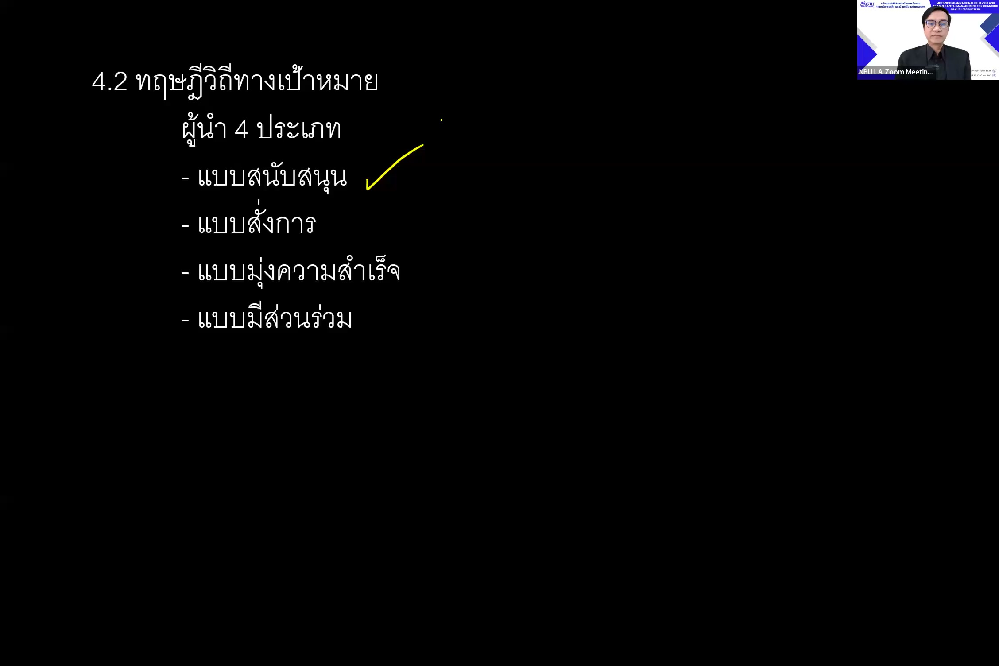

คือนักศึกษาจะนึกออกเวลาเราขาดเหลืออะไรหรือเอ่ยปากอะไรขอสิ่งสนับสนุนอะไรเนี่ยเขาจะสนับสนุนเร็วมากนักศึกษาเร็วมาก ต่อไปครับที่สี่ผู้นำแบบเปลี่ยนสภาพ เน้นการเปลี่ยนแปลงและจูงใจต่อผู้ตาม ทำให้ผู้ตามเห็นความสำคัญของงานโน้มน้าวจิตใจให้เห็นประโยชน์ส่วนรวม แล้วกระตุ้นให้ยกระดับความต้องการ อันผู้นำแบบเปลี่ยนแปลงสภาพนี้ก็คือเปลี่ยนไปตาม เปลี่ยนไปตามแรงจูงใจเปลี่ยนไปตามความต้องการของพนักงานด้วยนักศึกษา แล้วก็เขาพยายามโน้มน้าวจิตใจให้เห็นถึงประโยชน์ส่วนรวมด้วยก็ไม่ได้ทิ้ง มันขึ้นอยู่กับสถานการณ์ด้วยล่ะนักศึกษาครับทฤษฎี

## [00:18:57]

ตามสถานการณ์เลยครับนักศึกษาครับ ถัดไปที่สี่ผู้นำแบบของภาวะผู้นำครับ อืม แบบภาวะผู้นำมีสามแบบนักศึกษาอันนี้เป็นทฤษฎีพื้นฐานที่สุดแล้วนักศึกษาครับก็คือผู้นำแบบเผด็จการ

## [00:19:11]
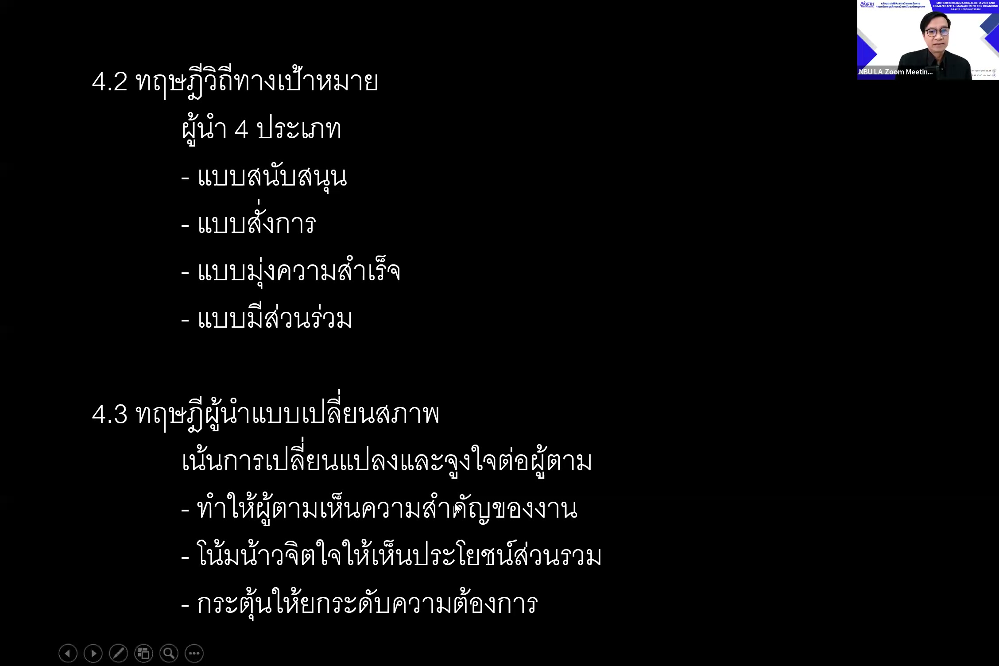

## [00:19:15]
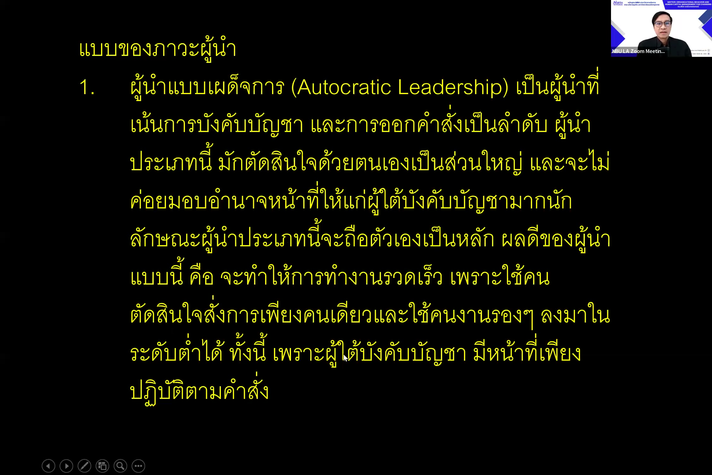

## [00:19:27]

ผู้นำแบบประชาธิปไตยแล้วก็ผู้นำแบบเสรีนิยมนะครับ สามแบบนะครับอันนี้ผู้นำแบบสามแบบเป็นเบสิกสุดแล้วนะครับ ผู้นำแบบผลิตการก็เน้นการบังคับบัญชาออกคำสั่ง

## [00:19:31]
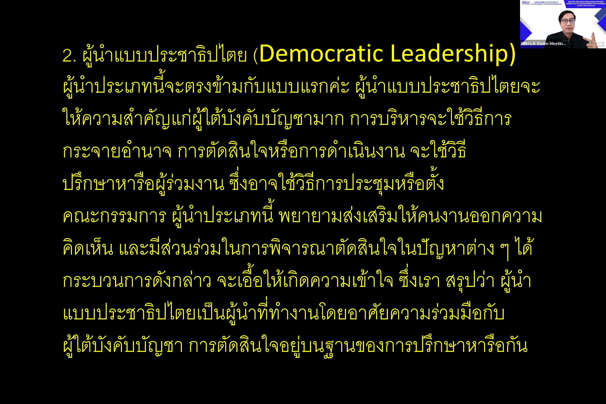

## [00:19:36]
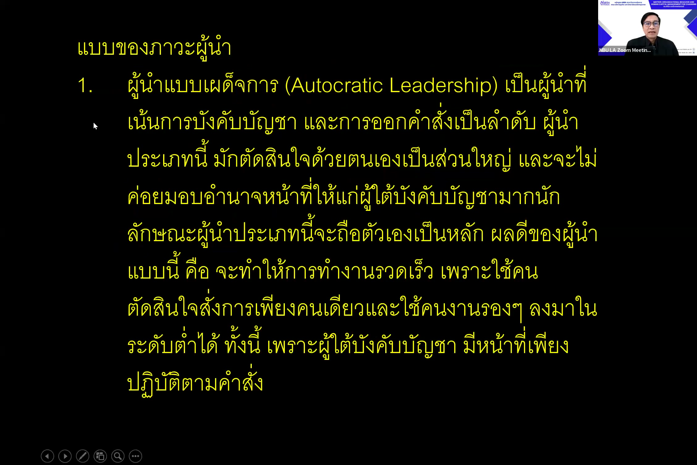

ประเภทนี้มักตัดสินใจด้วยตัวเองเป็นส่วนใหญ่จะไม่ค่อยมอบอำนาจให้ใครนะครับ ก็คือเน้นเผด็จการนะครับเป็นผู้นำที่มักจะคิดมาแล้วนะฮะ แล้วก็สั่งการให้ทำนะครับ ลักษณะผู้นำประเภทนี้จะถือว่าถือตัวเองเป็นหลัก เป็นจุดศูนย์กลางผลดีของผู้นำประเภทนี้คือจะทำให้การทำงานรวดเร็ว นี่ครับนักศึกษาครับ เพราะใช้คนตัดสินใจเพียงคนเดียวสั่งการคนเดียว ข้อดีนะครับคือเร็ว ชัดเจนนะครับ ผู้ปฏิบัติ ผู้บังคับ ผู้ใต้บังคับประชาเพียงแต่ทำตามคำสั่งก็พอ

## [00:20:06]
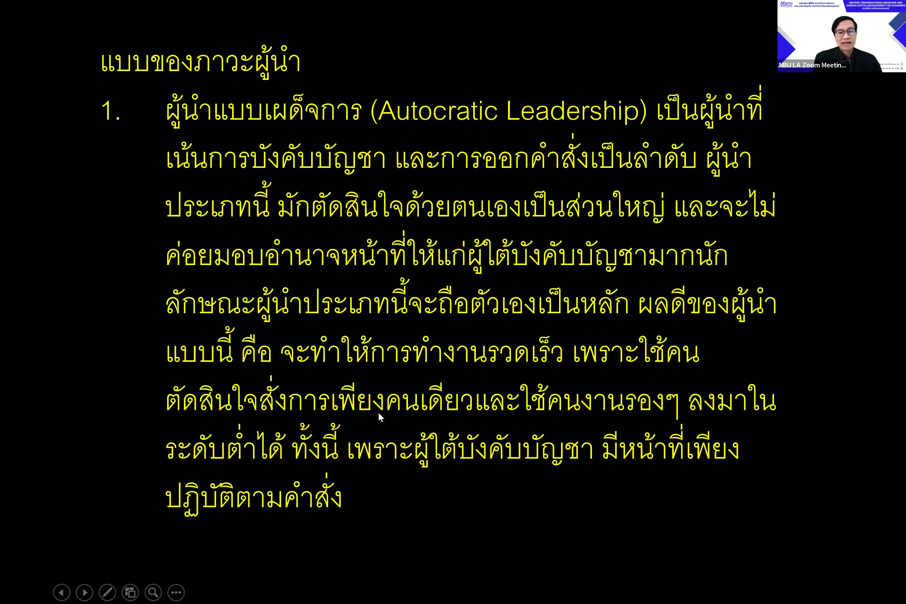

## [00:20:20]

ส่วนผลเสีย คนส่วนใหญ่ไม่ชอบครับโดยเฉพาะอย่างยิ่งผู้นำที่ใช้วิธีจูงใจแบบทางลบอ่ะ นักศึกษาดูตรงนี้นะอันเนี้ยสำคัญมาก negative motivation นะครับ คนส่วนใหญ่ไม่ชอบระบบนี้โดยเฉพาะอย่างยิ่งผู้นำจะใช้วิธีการจูงใจแบบด้านลบโอกาสที่จะให้คนงานเกิดความผิด โอกาสที่คนงานจะเกิดความผิดหวังและเสียขวัญในการทำงานได้มาก คนส่วนใหญ่จะทำแบบขอไปทีที่สำนวนไทยเรียกว่าเช้าชามเย็นชามนะฮะ แรงจูงใจทางลบคืออะไรนะฮะก็คือการลงโทษ นั่นเองครับ negative motivation

## [00:20:50]
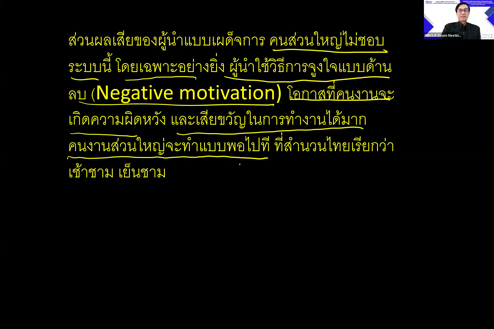

ลงโทษนะครับ ถ้าทำผิดก็ลงโทษทำงานไม่เป็นไปตามเป้าหมายก็ลงโทษนะ ก็ตามนั้น นี่ผู้นำข้อเสียของผู้นำแบบผลิตการต่อไปผู้นำแบบประชาธิปไตยครับdemocratic นะ

## [00:21:15]
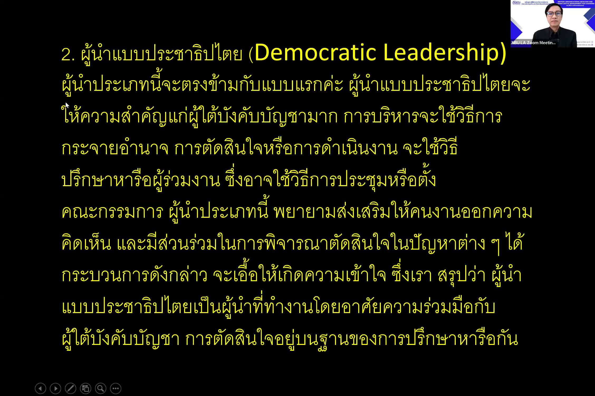

ผู้นำประเภทนี้จะตรงข้ามแบบแบบแรกผู้นำประเภทนี้จะ ก็คือจะให้ให้แสดงความเห็น เปิดโอกาส มีช่องทางการแสดงความเห็นอาศัยความร่วมมือนะครับ จะเอื้อเป็นการสนับสนุนให้เกิดความตั้งใจทำงานร่วมกัน รับ คือยอมรับ ทำให้พนักงานยอมรับในนโยบายก่อน ยอมรับในคำสั่ง ยอมรับในสิ่งที่องค์กรต้องการให้ได้ก่อน เน้นประชาธิปไตย ส่วนเสรีนิยมครับ

## [00:21:45]
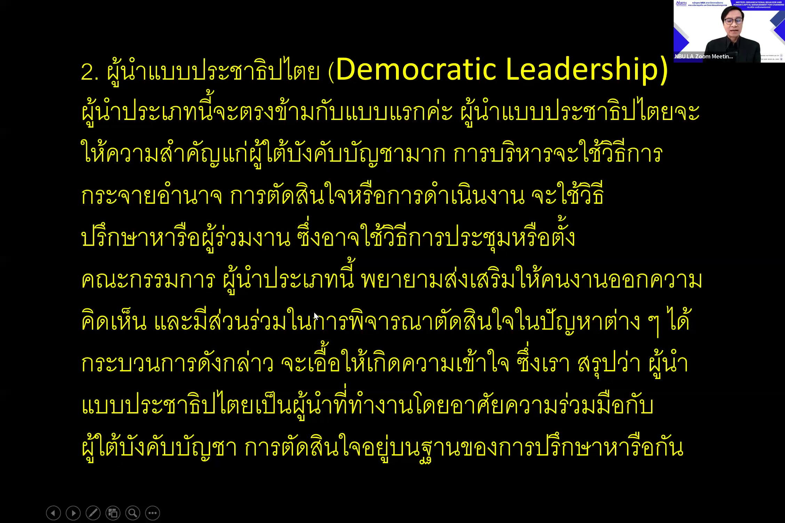

## [00:21:52]
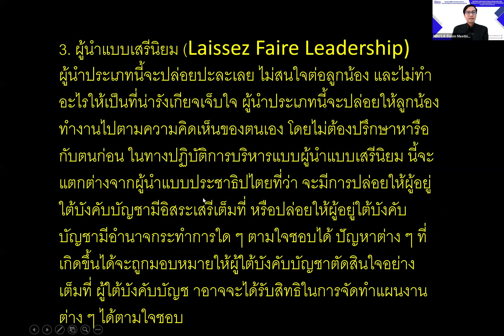

ผู้นำประเภทนี้ปล่อยปะละเลยไม่สนใจลูกน้องและไม่ทำอะไรให้เป็นการรังเกียจแล้วก็เจ็บใจ คือก็ ไม่ทำให้ลูกน้องเกลียดอ่ะครับนักศึกษาประเภทเนี้ยผู้นำประเภทนี้ปล่อยให้ลูกน้องทำงานไปตามความคิดเห็นของลูกน้องเองเลยโดยไม่ต้องปรึกษาหารือกับตนก่อนก็ได้ ก็คือมอบหมายงานไปเลย แล้วก็คุณก็ไปทำเลยครับในทางปฏิบัติการบริหารงานแบบผู้นำแบบเสรีนิยมนี้จะแตกต่างจากผู้นำประชาธิปไตยที่ว่า จะมีการปล่อยให้ผู้อยู่ใต้ประชาธิปไตยมีอิสระเต็มที่

## [00:22:22]

หรือปล่อยให้ผู้ตั้งบัญชาเนี่ยมีอำนาจในการกระทำใดใดตามใจชอบได้นะครับปัญหาต่างที่เกิดขึ้น ถูกมอบหมายก็ผู้ตั้งบัญชาก็ตัดสินใจเองเลยเต็มที่เลยนะครับ ได้รับสิทธิในการจัดทำ ดำเนินการทุกอย่างเลยอันเนี้ยคือเสรีนิยมถ้าถามว่าดีไหมมันก็ดีว่าถ้านักศึกษามีลูกน้องเก่งเก่งก็ก็แบบนี้แหละครับนักศึกษาก็ปล่อยเลยครับถ้านักศึกษามีลูกน้องเก่งก็ปล่อยให้ลูกน้องทำเต็มที่ไปเลยนะตัดสินใจไปเลย นักศึกษาก็เอาเวลาไปทำอย่างอื่นนั่นแหละครับ สามประเภท อันนี้นักศึกษาครับ มันมีหนังสือผมเคยอ่านอยู่เล่มหนึ่งนานมากนักศึกษาครับ มันมีผู้นำแบบแบบหนึ่งเรียกว่าผู้นำแบบ

## [00:22:52]

## [00:22:55]

## [00:22:59]

ศิลปะนักศึกษาครับ ผู้นำแบบมีศิลปะก็คือผู้นำแบบเผด็จการครับ เผด็จการแบบมีศิลปะนักศึกษาครับ คืออะไรรู้ไหมครับนักศึกษาพอเข้าใจไหม ผู้นำแบบเผด็จการแบบมีศิลปะ

## [00:23:11]

ผู้นำเผด็จการแบบมีศิลปะนึกออกไหมครับคือเขาจะคิดมาแล้วตัดสินใจมาแล้ว แต่เวลามาคุยกับผู้ใต้บัญชาเนี่ยเหมือน เหมือน จะให้ผู้ใต้บัญชาเนี่ยมีส่วนร่วมในการตัดสินใจ ออกความเห็น แสดงความเห็น แต่จริง ๆ เขาคิดมาแล้ว เขาตัดสินใจมาแล้วนะครับ

## [00:23:41]

แต่เขามีศิลปะในการโน้มน้าวจิตใจมีศิลปะในการพูดจูงใจให้ลูกน้องคล้อยตามอย่างเต็มใจในท้ายที่สุดนะครับ ในท้ายที่สุด นั่นแหละครับผู้นำแบบผลิตการอย่างมีศิลปะนะครับ อันนี้ไปเสิร์ชดูเจอแน่นอนนักศึกษาลองไปเสิร์ชดูเนอะแต่ถ้าเบสิกมันก็มีแค่สามตัว ผู้นำแบบบริการ ประชาธิปไตย แล้วก็เศรษฐกิจนิยมแต่นักศึกษาลองไปเพิ่มเนอะ ผู้นำแบบ

## [00:24:11]

ผลิตการแต่เหมือนมีประชาธิปไตยเขาจะใช้วิธีการโน้มน้าวจิตใจเก่ง มีการพูดโน้มน้าวจิตใจเขาเรียกพูดอะไรนะ สปีช ภาษาอังกฤษเขาเรียกสปีช สุนทรพจน์ เขามีวิธีการพูด มีสุนทรพจน์ที่คอยตามได้ง่าย คนอื่นคอยตามได้ง่าย

## [00:24:41]

อย่างเช่นผมตัดสินใจมาแล้วว่าผมเลือกโครงการนี้ตัดสินใจมาจากห้องทำงานแล้วผมเลือกโครงการนี้แต่เวลามาประชุมกับผู้ต้านพระบัญชาผมก็จะพูดให้ฟังว่าโครงการนี้ดียังไง มันมีข้อดียังไงก็อัดพูดเยอะเยอะแล้วอีกโครงการหนึ่งที่เป็นตัวเลือกเนี่ยมันมีข้อเสียยังไงนะครับ จนผู้ฟังเนี่ยคล้อยตามเลยว่าเออ งั้นโครงการเนี้ยดีแล้วสุดท้ายผมก็จะบอก อ่า ทุกคนช่วยโหวตหน่อยครับว่าเราจะเลือกโครงการไหนดี

## [00:25:11]

แล้วผมมั่นใจว่าทุกคนจะโหวตตามที่ผมคิดมาตั้งแต่แรกนักศึกษา ถ้าถ้าไม่ใช่นักศึกษาแสดงว่ายังยังศิลปะยังไม่มากพอ ยังการเจรจาต่อรองยังไม่ยังทักษะยังไม่ดีพอ ต้องพูดให้ได้นักศึกษาพูดจูงใจให้ได้นะ นั่นแหละครับ ผู้นำแบบผลิตการอยากมีศิลปะลองเสิร์ชดูนะครับ เราไปอ่านรายละเอียดเอา นักศึกษาครับ ถ้าดูจากการใช้อำนาจนะครับระดับการใช้อำนาจ

## [00:25:30]

## [00:25:35]

ให้นักศึกษาดูจากกรอบสี่เหลี่ยมนี้นักศึกษาครับกรอบสี่เหลี่ยมนี้จะแบ่งเป็นสองมิติ นะครับ มิติของการใช้อำนาจตรงนี้นะครับ การใช้อำนาจของผู้นำแล้วก็ความอิสระของผู้ต้องการบัญชา มันจะสวนทางกันนะฮะ มันจะสวนทางกันเห็นไหมครับ แปรผกผันกัน มันสวนทางกันดูอย่างงี้ครับนักศึกษาครับ ถ้าผู้นำเนี่ยใช้อำนาจมาก ก็คือช่องนี้เลยนักศึกษา ใช้อำนาจมาก พื้นที่การความอิสระของผู้ตามจะน้อยเห็นไหมครับ

## [00:26:05]

เนี่ย อันนี้ผู้นำใช้อำนาจมาก เห็นไหมครับ พื้นที่ของผู้ตามเนี่ยเป็นพื้นที่คว่ำอิสระของผู้ตามก็จะน้อย มันก็จะสวนทางกัน แต่ถ้าผู้นำใช้อำนาจน้อย เห็นไหมครับ พื้นที่การใช้อำนาจของผู้นำน้อย แสดงว่าความอิสระของผู้ตามในการคิดปฏิบัติงานก็จะมากหน่อย มันก็จะทำให้เห็นว่ามันสวนทางกันนะครับระหว่างการใช้อำนาจของผู้นำกับความอิสระของผู้ตามครับ นั่นแหละครับ อันนี้ศึกษาระดับการใช้อำนาจ

## [00:26:35]

เพราะฉะนั้นถ้าผู้นำแชมป์นัดมากก็จะอยู่พื้นที่ตรงนี้นะครับ ก็จะเป็น เป็นผู้นำแบบประชา เอ่อ เป็นแบบ แบบ เอ่อ ผลิตการ อยู่ดีก็ลืม ผู้นำแบบผลิตการนะครับ

## [00:27:01]

แต่ถ้าโซนนี้เป็นต้นไปนะครับ ก็จะเป็นผู้นำแบบประชาธิปไตยนะครับ โซนนี้นะครับ ผู้นำแบบประชาธิปไตย อันนี้จะเป็นเผด็จการ อันนี้จะประชาธิปไตยนะครับ แต่อันนี้จะเป็นแบบเสรีนิยมเนอะ ปล่อยปะระเลยนะ เสรีนิยมก็ จะใช้อำนาจน้อยหน่อยใช้อำนาจน้อยน่ะแสดงว่าพุทธใต้มวลชาก็จะมี อิสระในการทำงานเยอะหน่อยเห็นไหมครับ แบบนี้เพราะฉะนั้นถ้าเมื่อไหร่ที่ ที่นักศึกษาจะนึกถึงว่า

## [00:27:31]

อ๋อ ผู้นำเนี่ย แชมป์นาดมากเลยนะเป็นเผด็จการนะเนี่ย สาธารณสาธารณะต้องนึกถึงสี่เหลี่ยมนี้ไว้เลยครับมันก็จะสวนทางกับความอิสระของพระพุทธมัญชา เพราะฉะนั้นถ้าอาสาเขียนภาพนี้ลงไปในข้อสอบก็แสดงว่าอาสารู้ทฤษฎีแม่นอย่างมาก แม่นทฤษฎีมากๆ อาสาเข้าใจนะครับ แล้วส่วนจะเขียนอธิบายละเอียดอะไรก็เขียนไปตาม ตามความสอดคล้องนักศึกษาครับ แค่นั้นเอง ทันนะครับ แล้วครับนักศึกษาครับ

## [00:28:01]

## [00:28:04]

## [00:28:15]

หัวข้อต่อไปนะครับ สำหรับผู้นำเนี่ยเวลาจะใช้ใครนะครับ เราต้องรู้จักเขาก่อนนะครับไม่ใช่รู้จักชื่อ ไม่ใช่นะครับ หมายถึงรู้ว่าเขาเป็นคนยังไงก่อนแล้วถึงจะใช้เขาได้อย่าง ยังมีประสิทธิภาพจะใช้ได้อย่าง เกิดสมรรถนะสูงที่สุดนะครับที่เขามีนะฮะ เพราะฉะนั้นต้องรู้จักเขาก่อน นักการจัดการเขาก็เลยคิดทฤษฎีนี้มาแบ่ง

## [00:28:45]

เป็นสองมิติครับนักศึกษาครับมิติแรกนักศึกษา ดูที่ศักยภาพของเขาก่อนให้รู้จักศักยภาพของคน คนนั้นก่อนรู้จักศักยภาพของผู้ใต้บัญชาของเราแต่ละคนก่อน ว่าศักยภาพเขาระดับไหนก็ถูกแบ่งออกเป็นระดับต่ำกับสูงเห็นไหมครับ มิติต่อไปครับนักศึกษาครับให้ดูผลงานของเขาก่อน ผลงานที่ผ่านมาของเขาของลูกน้องเรานักศึกษาครับ

## [00:29:15]

ผลงานก็แบ่งออกเป็นผลงานสูงกับผลงานต่ำเห็นไหมครับนักศึกษาครับ เพราะฉะนั้นสองมิติครับนักศึกษาครับรู้จักคนก่อนนะ รู้จักลูกน้องก่อนว่าลูกน้องเรามีศักยภาพสูงไหมลูกน้องเราผลงานที่ผ่านมาเป็นยังไงนักศึกษาครับ แล้วก็มา

## [00:29:45]

แบ่ง แบ่งเป็น เป็นมิตินะครับเป็น กลุ่ม ดังต่อไปนี้ครับ นักศึกษาครับ ถ้าลูกน้องเราที่เรากำลังโฟกัส เรากำลังศึกษา เรากำลังดูอยู่เนี้ย เรากำลังดูอยู่เนี้ย เพื่อจะใช้งานอะไรบางอย่าง เขาแน่นอนนักศึกษาครับ ถ้าลูกน้องเราเนี้ยเป็นคนที่ศักยภาพสูง คือเก่งอ่ะ เก่งมากอ่ะ ลูกน้องเราอ่ะ เป็นคนเก่ง

## [00:30:15]

แล้วผลงานที่ผ่านมาเนี่ยก็สำเร็จเยอะมาก ผลงานเยอะมากนักศึกษาที่ทำมาในอดีตนะครับนักศึกษาครับ อันนั้นมันก็จะเป็นช่องสีส้มเห็นไหมครับ เป็นช่องสีส้มเราจะจัดคนกลุ่มนี้ เรียกเขาว่าเป็นสตาร์นักศึกษาเป็นดาวรุ่ง เป็นดาวรุ่ง ทันไหมครับ ทันนะ อ่ะ ต่อไปนักศึกษาครับถ้าคนของเรานักศึกษาครับ

## [00:30:42]

ที่กำลังศึกษาอยู่ในคนนี้ ศักยภาพต่ำ คือไม่ค่อยเก่งหรอก ไม่เก่ง เป็นคนไม่ได้เก่ง ไม่ได้เก่ง แต่ผลงานที่ผ่านมาเนี่ย สูง ผลงานที่ผ่านมาสูง เราจะเรียกคนกลุ่มนี้ว่า เวิร์คฮอตซ์ ม้างานนะครับ ม้างาน เวิร์คฮอตซ์ นักศึกษาครับ

## [00:31:12]

นักศึกษานึกออกไหมครับพอจะนึกออกไหมว่าคนที่ไม่เก่ง แต่ผลงานสูงนะครับ ผลงานที่ทำสำเร็จมาในอดีตเยอะ ที่สำเร็จในอดีตเยอะ นักศึกษามันหมายถึงอะไร นักศึกษาจำนิทาน มดน้อยได้ไหมครับจำได้ไหมครับ มันคือประมาณไหนนะ มดน้อย คือใคร คือคนที่ทำงานเก่งโดยไม่ต้องบังคับ

## [00:31:42]

## [00:31:56]

คือเขาไม่ได้เก่งนะครับแต่ขยัน ใช่ครับ เขาขยันเขาขยัน แล้วเขาทำตามคำสั่งได้ดีครับ ถ้าบอกไป เออ ถ้าบอกไปหนึ่ง สอง สาม สี่ ห้าเขาก็ทำหนึ่ง สอง สาม สี่ ห้า นะครับ แต่อย่าหวังว่าจะหกเจ็ดแปดด้วยตัวเองไม่เอานะครับ สั่งเขาห้า ใช่ ใช่ครับ หอยทากครับก็คือคนขยันเลยนักศึกษาครับ เป็นคนขยันเลยนะครับเวลานักศึกษา อะ ผมพูดเลยแล้วกันเนอะ เดี๋ยวลืม

## [00:32:26]

เวลานักศึกษาจัดรู้แล้วนายคนนี้เป็นคนแบบนี้ เป็นเวิร์คฮอร์สอยู่ในกลุ่มเวิร์คฮอร์สเวลานักศึกษาจะสั่งงานเขานักศึกษาก็ต้องสั่งให้ถูกนะครับ นักศึกษาต้องสั่งให้ถูกคือต้องสั่งงานให้ จุดจุดครับ จุดจุดจุดเติมคำในช่องว่างครับ สั่งให้ละเอียดไหมค่ะ สั่งให้ละเอียด นักศึกษาครับ นึกออกไหมเวลาเจ้านายสั่งงานแล้วเขาจะพูด

## [00:32:56]

ตบท้ายว่า เข้าใจไหมครับ เนี่ย คนส่วนใหญ่ลูกน้องส่วนใหญ่จะตอบกลับไปว่าอะไรครับ เข้าใจครับ แต่ถามว่าเขาเข้าใจจริงไหมนะครับ ถ้าเป็นคนประเภท เออคนที่อยู่ในกลุ่มเวิร์คฮอตอาจจะไม่ได้เข้าใจจริงนะครับ เพราะฉะนั้นผิดที่หัวหน้านะครับนักศึกษาหัวหน้าต้องสั่งละเอียด มีลัยละอักษร มีขั้นตอนการทำงานที่ถูกต้องขั้นตอนทำงานที่ชัดเจน

## [00:33:26]

เขียนรายละเอียดการทำงานที่ชัดเจนเวลาที่กำหนดเลยเขียนให้ครบนักศึกษาให้ครบนะครับ แล้วเขาจะทำออกมาได้ตามที่นักศึกษาต้องการจริงๆ ถ้านักศึกษามีพนักงานแบบเวิร์คฮอตนะครับ แต่ถ้าพนักงานนักศึกษาเป็นแบบดาวรุ่ง หมายถึงศักยภาพสูง ผลงานสูง แบบสตาร์นักศึกษาก็ไม่ต้องอธิบายละเอียดก็ได้นะครับ นักศึกษาไม่ต้องก็คือเขาจะรู้เองนะครับว่าต้องทำอะไรต่อ นักศึกษาจะสั่งแค่ 1 2 3 4 เดี๋ยวเขา 5 6 7 เองของเขานักศึกษาถ้าเป็นคนกลุ่มนี้นะครับแต่ถ้าเป็นแบบหมางานนะ

## [00:33:56]

ไม่เก่ง แต่ศักยภาพ เออ ศักยภาพต่ำ ไม่เก่งนะครับ แต่ผลงานเยอะแสดงว่าเขาทำตามหน้าที่ ตามขั้นตอน ตามอย่างละเอียดนะครับ แค่บอกเขาให้ละเอียดก็พอนะครับ อะ ต่อครับ กลุ่มต่อไปครับนักศึกษาครับ ศักยภาพต่ำ ไม่เก่ง ผลงานก็ไม่มีน้อยนะฮะ ผลงานก็น้อยเราเรียกคนกลุ่มนี้ว่า

## [00:34:26]

เด็ดวูด วูดที่ประมาณไม้ครับเด็ดป่าย ซากไม้ เป็นกลุ่มซากไม้นั่นแหละครับ เออ ผลไม่เก่ง แต่ผลงานก็น้อยนั่นแหละครับ เขาอาจจะเคยเก่ง อาจจะเคยเก่ง แต่ปรับตัวไม่ได้ในระบบที่มันเปลี่ยนแปลงไป วิธีการทำงานที่เปลี่ยนแปลงไป

## [00:34:56]

องค์กรที่มีการปรับเปลี่ยนวิธีการทำงานใหม่แบบหน้ามือเป็นหลังมืออย่างรวดเร็ว อย่างเช่นเคยทำธุรกิจอาหารมาแต่กลายเป็นว่าขยายไปทำธุรกิจเป็นอาหารแปรรูป เคยขาย เปิดร้านอาหาร แต่วันหนึ่ง ร้านนี้เลยครับนักศึกษาข้าวขาหมู ขายดีมาก แล้วเขาเก่งมากนักศึกษาคนนี้เขาดูแลร้านได้ดีมาก แต่กลายเป็นว่าพอพ่อแม่ยกร้านให้กับ

## [00:35:26]

ลูก ลูกไปเรียนจบเมืองนอกเมืองนามาเรียนจบ Foodside มากลับมาดูแลร้านข้าวขาหมูต่อลูกก็บอกว่าไม่อยากขายแบบหน้าร้านแบบนี้แล้วไม่อยากขายเป็นข้าวขาหมูแล้วอ่ะ อยากขยายเปลี่ยนรูปแบบก็คือทำเป็นฟอสเซนต์นะครับ ทำเป็นระบบแมส โรงงานอ่ะโรงงานทำขาหมู แบบฟอสเซนต์สำหรับส่งออกขายทั่วโลกนะครับ ผู้จัดการคนนั้นก็กลายเป็นทำงานแบบนั้นไม่ได้ เป็นคนละแบบกันก็กลายเป็นเดสวูดไปเลยนักศึกษาครับ เห็นไหม ก็คือมีคนไม่เก่ง แล้วผลงานก็น้อย อันนี้เรื่องปกตินักศึกษาครับ

## [00:35:56]

ถ้านักศึกษาเป็นผู้บริหารหรือเป็นเจ้าขององค์กรเนี่ยเราจะใช้คำว่าให้เขาไปเติบโตที่อื่นเขาอาจจะไปอยู่ที่อื่นแล้วดีก็ได้นักศึกษาครับเขาอาจจะไปอยู่ที่อื่นแล้วเราก็เติบโตได้นักศึกษาครับอาจจะไม่เหมาะกับองค์กรเรานักศึกษาครับ เขาอาจจะไม่เก่งกับสถานการณ์นี้นะครับ เป็นเดดวูดนะครับ ต่อไปนะครับ ช่องต่อไป ช่องสุดท้ายนะครับ ผมงงมากนะครับ ผมงงมากกับคนแบบนี้นะครับ คือคนยังไงนะครับ คนแบบนี้

## [00:36:26]

คือคนยังไง คือคนยังไงครับ เอาคนอื่นบ้างก็ได้นะครับอยาก อยากได้ยินหลายหลายคน อาจารย์อยากสนิทกับทุกคนนะครับอาจารย์อยากสนิทกับทุกคน แต่ถ้าทุกบางคนไม่เคยคุยกับอาจารย์เลย ก็จะว่าผมไม่สนิทไม่ได้นะครับ อยากสนิทกับทุกคนนะครับ มีศักยภาพแต่ไม่สร้างผลงาน แปลกจริงๆ ครับ ต้องมีเหตุอะไรสักอย่าง นั่นแหละสิครับ

## [00:36:56]

มันต้องมีเหตุอะไรสักอย่างนะครับเก่งนะครับ แต่ไม่มีผลงานนะฮะนักศึกษาครับ มีครับ เป็นไปได้ครับจารย์ เป็นไปได้ ใช่ครับ มีครับ มีคนอย่างงี้อยู่จริงครับเป็นไปได้ด้วยครับนักศึกษาครับ เพราะฉะนั้น คุณพิรพงศ์บอกว่ามีเป็นไปได้ มีครับ คุณพิศักดิ์บอกว่ามันน่าจะมีสาเหตุก็คือเราเอาสองคนนี้มารวมกันนักศึกษาครับเอาสอง สองประโยคนี้มารวมกันเลยนักศึกษาครับ

## [00:37:26]

เป็นมดน้อยค่ะอาการ เป็นมดน้อยนะครับ ใช่ครับ เป็นมดน้อย ไม่ยอมรับอะไรบางอย่าง ไม่พอใจอะไรบางอย่าง ไม่พอใจนโยบายนี้ของบุริหารเลยไม่พอใจ ไม่เอาผมไม่ทำเลย ผมนั่ง นั่งฟังเลย นั่งฟังอย่างเดียวผมนั่งเฉยกอดอกเลยนักศึกษาฟังเลยก้มหน้า หยิบโทรศัพท์มาเล่นเฉยเลยนักศึกษา

## [00:37:56]

พอผมไม่ ไม่เห็นด้วยกับนโยบายนี้ไม่เห็นด้วย ผม ผมว่า ไม่ดีแน่แน่แล้วผมก็ขี้เกียจพูดด้วย พูดไปก็ไม่เชื่อผมอยู่แล้ว ผมก็เลยไม่พูดดีกว่า ผมนั่ง นั่งเฉยๆ ดีกว่า ใครอยากทำก็ทำไปเลย ใครทำได้ก็ให้เขาทำไปนะครับ แบบเนี้ยใช้ชื่ออะไรดีนะครับ ใช้ชื่อว่า

## [00:38:26]

Problem ใช่ เด็กมีปัญหานะครับ คนคิดก็เข้าใจเนอะ คนคิดก็เข้าใจ เหมือนชื่อเพลงเลยจ้า ใช่ๆ เด็กมีปัญหานะครับ ก็คือ เขาเก่งนะครับ แต่เขามักจะมีปัญหากับนโยบาย มีปัญหากับระบบ นั่นแหละครับนักศึกษา problem child เพราะฉะนั้นเมื่อนักศึกษารู้แล้วว่าลูกน้องนักศึกษาเป็นแบบไหนเราจะได้ใช้งาน

## [00:38:56]

ให้ถูก ใช้งานให้ถูก ให้เหมาะสมกับคนนะครับ ใช้งานให้เหมาะสมกับคนแล้วกันนะครับ เหนื่อยสุดเลยคนไหนนะครับ เหนื่อยสุดกับประเภทไหนนะครับ ปอเบิ้มชายครับ ปอเบิ้มชาย เหนื่อยหน่อยนะฮะสาม เหนื่อย ไม่ใช่เหนื่อยระบบการ ไม่ใช่เหนื่อยการทำงานของเขานะ แต่เหนื่อยชี้แจงนะฮะสาม เหนื่อยปรับ Mindset เหนื่อยชี้แจงเขาเหนื่อยหน่อยนะครับ แต่เรื่องงานนี้เขาทำได้แต่ขอให้ปรับ Mindset เขาก่อนแล้วกันนะครับ ให้เขาเข้าใจก่อนบางทีเราก็เหนื่อยที่จะพูดนะครับ อย่างซากไม้ไม่ค่อยเหนื่อยไม่ค่อยสร้างปัญหาเท่าไหร่

## [00:39:26]

ไม่ค่อยสร้างปัญหาเท่าไหร่ เพราะเรารู้ว่าเป็นคนยังไง เออ ใช่ครับ แต่ถ้าเรา เรา เรา วัน วันหนึ่งเราอาจจะต้องลดคนงานลงก็คือเป็นกลุ่มแรกภาษาที่โดนโฟกัสนะครับ เป็นกลุ่มแรกที่ควรจะ ควรจะรู้ตัวเองแล้วก็ลงชื่อซะนะซะ ลงชื่อ Early Retire ซะ ลงชื่อเข้าโครงการซะ

## [00:39:56]

ต้องดูตัวเองนะฮะ แต่ถ้านักศึกษาจะโปรโมทก็คือกลุ่มดาวรุ่งนะฮะ ฝากผีฝากไข้นะ ผมใช้คำง่ายๆแล้วกันเนอะ ก็คือกลุ่มดาวรุ่งฝากผีฝากไข้ได้ ก็เลยมีคนถาม เอาล่ะอาจารย์แล้วเด็กมีปัญหาฝากผีฝากไข้กับบริษัทกับเขาไม่ได้เหรอนักศึกษาครับ เอ่อ ยังไม่ได้ครับเป็นลำดับสองแล้วกันนักศึกษา ลำดับแรกนี่ดาวรุ่งนะครับไม่ต้องปรับอะไรเขาเลยนักศึกษาครับ

## [00:40:26]

ฝากผีฝากค่ายได้ ถ้านักศึกษาคิดจะพักผ่อนละ จะไปเที่ยวละ จะท่องเที่ยว จะใช้เงินละ จะเอาเงินไปใช้ละ นักศึกษาก็ฝากกับกลุ่มดาวรุ่งแล้วกันนักศึกษาครับ แล้วมาร์คงานน่ะนักศึกษาครับ พัฒนา แต่ต้องเฉพาะเรื่องนะครับ พัฒนาเฉพาะเรื่องนะครับ กลุ่มม้างานพัฒนาเฉพาะเรื่องแล้วก็ใช้เขาเฉพาะเรื่องนะครับ ใช้งานเฉพาะเรื่อง เฉพาะงานพิจารณาเลือกงานให้เหมาะสมนะครับ กับกลุ่มนี้นะครับ

## [00:40:56]

อาจจะเป็นงานที่ไม่ใช่งานทักษะสูงนะครับไม่ใช่งานทักษะสูง ไม่ใช่งานที่ต้องแก้ปัญหานะครับ ไม่ใช่งานที่ต้องวิเคราะห์นะครับไม่ใช่งานวิเคราะห์ ไม่ใช่งานต้องสังเคราะห์วิเคราะห์นะครับ อืม นักศึกษารู้จักคำว่าสามดีไหม งานสามประเภทสาม Dimension สามดี สามดี ไม่ใช่ Dimension สามดี

## [00:41:26]

ดีตัวแรกเนี่ย ผมอาจจะจำไม่ครบนะ แดนเจอร์ งานอันตรายสอง ดีตัวที่สองคือ เดิร์ตี้ งานสกปรก ไม่ใช่งานสีเทานะหมายถึงการทำงานที่กับ เครื่องจักรกับอะไรที่มันสกปรกกับมี น้ำมัน เครื่องจักร โดนเสื้อ เดอะตี้ งานสกปรก งานที่ต้องเปื้อนอ่ะ งานที่ต้องเปื้อนอ่ะไม่ใช่ทำเป็นทำงานสกปรกนะ ตัวที่สามนี่คืองาน difficult

## [00:41:56]

Difficult ก็คืองานยาก งานหนัก ขอโทษใช้คำว่างานหนัก แต่ difficult มันแปลว่ายาก แต่ในที่นี้เขาให้ใช้คำว่างานหนัก ก็เลยเป็นงานสามดี วันนั้นอาสางานสามดีส่วนใหญ่ก็จะเป็นประเภทม้างานทำได้อาสา ม้างานทำได้ดาวรุ่งเขาทำได้ทุกงานอยู่แล้วแต่อย่าให้เขาทำเลยนะอาสาครับ ให้เขาทำงานที่เหมาะสมกับเขาดีกว่าให้เขารู้สึกท้าทาย

## [00:42:26]

งานท้าทายให้ดาวรุ่งทำน่ะสิครับแต่ถ้างานสามดีให้ม้างานธรรม ส่วนเด็กมีปัญหา อย่าพึ่งให้มันทำ คุยก่อน ถามเขาก่อนว่าเขาสงสัยอะไรไหม ทุกงานเลย ไม่ว่าจะเป็นงาน 3D หรืองานยาก งานท้าทาย ต้องถามเขาก่อนว่าเขาติดอะไรไหม สงสัยอะไรไหม อยากให้ชี้แจงอะไรเพิ่มเติมไหมนะครับส่วนซากไม้นี่ งานสะเปะสะปะนักศึกษางาน งาน เรียกเปื่อยอ่ะ งานที่ไม่ต้องการอ่ะ เดี๋ยวผมสอนหัวข้อต่อไปแล้วกัน สำหรับ

## [00:42:56]

ซากไม้นะครับ เดี๋ยวสอนหัวข้อต่อไป แต่หัวข้อนี้ก่อนนักศึกษาสำคัญมากๆ นะครับ สำคัญตรงที่ว่า ถ้านักศึกษาจะใช้คนทั้งทั้งที่เรายังไม่ได้แบ่งรูปเขาอ่ะ ยังไม่ได้ระบุเลยว่ายังไม่ได้สเตตัสเขาอ่ะเป็นแบบไหนแล้วใช้เขาเนี่ยเดี๋ยวเดี๋ยวมันจะพลาดเอา เพราะฉะนั้นคนที่เป็นมีพระพุทธนามสูงสูงเขาก็จะรู้ว่าก่อนใช้คนต้องรู้จักคนก่อนนะศา เข้าใจนะครับ

## [00:43:26]

พอนักศึกษารู้จักปุ๊บ สมมุตินักศึกษาต้องการพัฒนานะครับ นักศึกษาจะพัฒนา นักศึกษาจะเริ่มพัฒนา อาจจะ problem child เนี่ย อาจจะปรับไปเป็น star ก็ได้นะครับ problem child อาจจะปรับเป็น star ก็ได้ แต่เดสวูดนี่ใหม่ พัฒนาสุดท้ายอาจจะไม่พัฒนาแล้วนะครับ ขี้เกียจพัฒนาแล้วนะครับส่วนม้างานนี่ก็เฉพาะงานนะครับ เฉพาะงาน เลือกเฉพาะให้ตรงกับงานนะครับ

## [00:43:56]

ตามนั้นครับ หัวข้อต่อไปนักศึกษาครับผมจะขึ้นต้นด้วยคำถามแบบนี้ก่อน ให้นักศึกษาสังเกตผมจะบอกว่าแค่ใช้คนให้ตรงกับงานมันยังไม่พอนะนักศึกษาครับ

## [00:44:11]

## [00:44:15]

## [00:44:20]

## [00:44:24]

## [00:44:28]

เราต้องดูก่อนว่า เมื่อกี้ดูคนไปแล้วดูคนแล้วใช่ไหม อันเนี้ยดูงาน เมื่อกี้ดูคนละ อันเนี้ยดูงานถ้าผมจะเริ่มต้นด้วยคำถามว่า งานไหน

## [00:44:40]

ควรทำก่อนทำหลังข้อที่หนึ่ง งานที่สำคัญแต่เร่งด่วนมีเวลาทำน้อย คือนักศึกษาควรใส่ใจงานไหนนะครับควรใส่ใจ ควรใส่ใจงานไหน หนึ่ง งานที่สำคัญแต่เร่งด่วนสำคัญนะครับ แต่เร่งด่วนมีเวลาทำน้อยกับสอง งานที่สำคัญแต่ไม่เร่งด่วนยังมีเวลาเหลือเยอะ คุณจะคาดหวังต่อความสำเร็จกับงานไหนก่อนเพื่อจะทุ่มเทกับงานนั้นอย่างเต็มที่ นักศึกษาทุกคนตอบในใจก่อนนะครับตอบในใจก่อนน่ะ เลือกคำตอบตัวเองก่อนนักศึกษาครับ

## [00:45:10]

คือวันเนี้ยผมได้ยินเสียงอยู่ไม่กี่คนอีกนักศึกษาครับออนไลน์มันก็แค่ห่างกันนะครับ ระยะทางนะครับแต่ความตั้งใจยังเหมือนเดิมนักศึกษาครับ ไม่รู้นักศึกษายังจำคำนี้ได้ไหมนะครับ

## [00:45:40]

เรียนออนไลน์มันก็แค่ห่างเรื่องระยะทางครับแต่ความห่างของความตั้งใจมันต้องมากกว่าเดิมนะ มันต้องตั้งใจมากกว่าเดิมนะ แต่ผมได้ยินคนคุยกับผมไม่กี่คนเองนักศึกษาไม่กล้าคุยหรือไม่กล้าเปิดไมค์หรือยังไงก็ไม่รู้นักศึกษาแต่ฟังอยู่แหละผมเชื่อนะครับ ผมใช้ทฤษฎี y นะฮะ ไม่ใช่ x นะครับ ผมมองว่าเป็น y ผมเชื่อว่ายังฟังอยู่ ก็ขนาดเรียนในห้อง ในห้องก็ยังไม่ค่อยคุยเลยนะ บางคนในห้องยังไม่เคยคุยกับผมเลยนะ ในห้องนะฮะ

## [00:46:10]

อืม แล้วออนไลน์จะ จะเหลือหรอนักศึกษา อ่ะ ใครก็ได้ไม่เป็นไร ซ้ำก็ได้ครับ นักศึกษาลองดูสิว่า หนึ่งค่ะอาจารย์ หนึ่ง อ่า มีคนบอกว่าหนึ่งนะครับจะใส่ใจงานหนึ่ง งานที่สำคัญได้เร่งด่วนมีเวลาทำน้อยนะครับ อ่ะ หนึ่งล่ะ มีคนอื่นไหม สองอ่ะ มีคนบอกว่างานสำคัญแต่ไม่เร่งด่วนจะโฟกัสมากกว่าคาดหวังทำสำเร็จมากกว่ามีคนอื่นไหมครับ หนึ่งครับอาจารย์ครับ หนึ่งอ่ะ มีหนึ่งครับมีคนอื่นไหมครับ

## [00:46:40]

ยังไม่ต้องบอกเหตุผลนะ นักศึกษาเอาบอก สิ่งที่นักศึกษาคิดก่อนเลยครับว่า ระหว่างงานสำคัญ สำคัญทั้งคู่อ่ะแต่เร่งด่วนกับไม่เร่งด่วน นักศึกษาจะคาดหวังต่อความสำเร็จกับงานไหน อ่า มีบางคนตอบหนึ่ง บางคนตอบสอง อ่า ทุกคนตอบมาแล้วนะบางคนไม่ได้เปิดไมค์แต่ผมเชื่อว่าทุกคนมีคำตอบแล้ว งั้นผมถามแบบนี้นักศึกษาสลับกันบ้าง นักศึกษามาเป็นหัวหน้างานบ้างนักศึกษามาเป็นเจ้าของบริษัทบ้าง

## [00:47:10]

นักศึกษาจะคาดหวังความสำเร็จกับงานไหนมากกว่ากัน ถ้านักศึกษาเป็นเจ้าของ ระหว่างงานสำคัญแต่เร่งด่วน กับสำคัญแต่ไม่เร่งด่วน นักศึกษาคาดหวังงานไหนมากครับ ทั้งสองงานค่ะ ไม่เอาสิ เอางานเดียวลูก งานที่หนึ่งค่ะ นักศึกษาครับ ผมฟันธงเลยนักศึกษาครับ งานที่สองครับ งานที่สองครับ เพราะอะไรรู้ไหมครับ

## [00:47:36]

ถ้านักศึกษาครับ ถ้างานที่หนึ่งนะครับมันไม่สำเร็จตามเป้าหมายที่ต้องการร้อยเปอร์เซ็นต์ครับ ไม่ร้อยเปอร์เซ็นต์ครับเมื่อเสร็จแล้วแต่ไม่ร้อยเปอร์เซ็นต์ ถามว่างานที่หนึ่งมีเหตุผลบอกไหมครับว่าทำไมไม่ร้อยเปอร์เซ็นต์งานเนี้ย มีเวลาน้อยค่ะ เออ มันมีเวลาน้อย ถามว่าเจ้าของเขารู้ไหมครับ รู้ค่ะ เขารู้ นักศึกษาครับ มันมีเวลาน้อยถ้าหากว่าทำแล้วมันไม่ได้ร้อยเปอร์เซ็นต์ตามที่ต้องการเนี่ย

## [00:48:06]

คนทำก็ยังบอกได้ว่ามันมีเวลาแค่นี้ได้แค่นี้ก็ถือว่าดีที่สุดแล้วครับท่าน มีเวลาแค่เนี้ย ผมทำได้แค่นี้ พวกเราทำได้แค่นี้ก็ถือว่าดีที่สุด แต่ไม่ต้องพูดคำนี้นะ ไม่ต้องนักศึกษา ผมว่าคนที่เป็นภพผู้นำสูงอะ เขาจะ เขาอาจจะรู้อยู่แล้วว่าเขาคาดหวังเท่าเนี้ย แต่เขาไม่ได้บอกนักศึกษาเขาไม่จำเป็นต้องบอกด้วยนะครับอย่าบอกดีกว่า อย่าบอกนะครับ สมมุติว่างานที่หนึ่งเนี่ยสำคัญแต่เร่งด่วนเนี่ยเวลาผมสั่งงานผมก็สั่งปกตินะศึกษาครับ แต่ผมในใจผมเนี่ยผมบอกว่าขอแปะแปดสิบเปอร์เซ็นต์ก็พอ

## [00:48:36]

แต่ผมไม่จำเป็นต้องบอกลูกน้องว่าผมขอแปดสิบเปอร์เซ็นต์ผมไม่ต้องบอกนะ ถ้าบอกปุ๊บนั่นแหละครับเดี๋ยวลูกน้องจะ ไป เดี๋ยวลูกน้องเขา เขาอาจจะทำได้ร้อยก็ได้นะแต่ถ้าบอกแปดสิบปุ๊บ ได้แปดสิบจริงจริงนักศึกษา เซ็งเลยนักศึกษาเซ็งจริงจริง ถ้าไปบอกว่าผมขอแปดสิบก็ได้มันก็ได้แปดสิบจริง แต่ถ้านักศึกษาไม่บอกเขาเขาอาจจะได้ร้อยก็ได้นะครับเขาอาจจะมีวิธีของเขาก็ได้นักศึกษาเพราะฉะนั้นถ้างานที่หนึ่งสำคัญแต่เร่งด่วนแล้วมันออกมาไม่ได้ร้อยเปอร์เซ็นต์นั

## [00:49:06]

มันก็เป็นเพราะว่าเวลามันเร่งด่วนไงแต่ถ้านักศึกษาทำงานสำคัญแต่ไม่เร่งด่วนแล้วไม่ร้อยนักศึกษาครับ ไม่ร้อยนักศึกษาตอบหัวหน้ายังไงอะครับ ไม่มีข้อแก้ตัวค่ะเจอ ใช่ครับ เรื่องเวลาข้อแก้ตัวเรื่องเวลาไม่มีแล้วนักศึกษาเพราะมันมีเวลาตั้งเยอะแยะทำไมคุณยังทำไม่ร้อยเปอร์เซ็นต์อ่ะ แบบนั้นแหละครับนักศึกษาเพราะฉะนั้น

## [00:49:36]

สุดท้ายแล้ว เออ ไม่ใช่สุดท้าย ขั้นตอนต่อไป เมื่อกี้ หัวข้อเมื่อกี้นะครับ หัวข้อเมื่อสักครู่เนี่ย รู้คนละ ต่อไปต้องรู้งาน นักศึกษาต้องแบ่งงานให้ออกนักศึกษาครับ ว่างานที่กำลังจะให้ลูกน้องทำเนี่ยเป็นงานแบบไหน สำคัญ ไม่สำคัญ เร่งด่วน หรือไม่เร่งด่วน นักศึกษาต้องแบ่งก่อนครับนักศึกษาครับ โอเคนะครับ เรื่องนี้เนี่ย ที่มาคนคิดทฤษฎีนี้เป็นประธานาธิบดี ประธานาธิบดีของสหรัฐอเมริกาชื่อ ไอเซนฮาวน์ คนที่เท่าไหร่ไม่รู้นะครับผมจำไม่ได้ ประธานาธิบดีไอเซนฮาวน์

## [00:50:06]

ถ้าใครว่างว่างมีโทรศัพท์มือถือไว้ใกล้เสิร์ชให้อาจารย์หน่อยก็ได้นะ ไอเซนฮาวน์ เจอไหมครับ ไอเซนฮาวน์ ประธานาธิบดีอเมริกาชื่อไอเซนฮาวน์มันติดในใจนะศาสตร์ถ้าไม่เสิร์ช

## [00:50:21]

## [00:50:51]

คนที่ เจอแล้ว ผมเจอแล้วนะ แต่ผมไม่พูดแล้วกัน ไม่บอกดีกว่า นักศึกษาให้นักศึกษาติดอยู่ในใจจนกว่าจะเสิร์ชเองนักศึกษาครับ ประธานาธิบดี ไวท์ดี ไอเซนฮาวน์ นะครับ เอ่อ เออ เออ ดีมากครับ งั้นนักศึกษาก็จะจะนอนไม่หลับไปเองเองแล้วกันนักศึกษาครับ เพราะฉะนั้นประธานีพิเศษเนี้ยเขารู้สึกกำลัง

## [00:51:21]

เริ่มต้นแบบนี้ครับ เขาเจอปัญหาเขาปวดหัวมากนักศึกษาครับ เขาเครียดมาก งานมันเยอะมาก งานมันประดังประเดเข้ามาเต็มไปหมดนักศึกษาครับ จนเขา นั่งเฉยเฉยแล้วก็คิดได้ว่างานที่มันประดังประเดเข้ามาแสดงว่าเขาไม่ได้แบ่งประเภทงานบางงานเขาไม่ต้องยุ่งก็ได้อ่ะบางงานที่ประดังประเดวูบเข้ามาในหัวเขาเขาไม่ต้องทำก็ได้น่ะงานนั้นน่ะ

## [00:51:51]

แต่เขาเอามาใส่ใจหมดทุกงานเลย เขาก็เลย เอางี้ เราแบ่งงานก่อนออกเป็นกลุ่มดีกว่า แล้วเขาก็แบ่งออกมาชัดเจนมากนักศึกษา อ่ะ ไอเซนฮาวน์ ประธานบดีคนที่สามสิบสี่ใช่ไหมครับนักศึกษา ใช่ไหม สามสิบสี่เนอะ มาเริ่มต้นด้วยมิติด้านเวลาก่อนนะครับ ด้านเวลา ก็คือแบ่งเป็นเร่งเร่งด่วนกับไม่เร่งด่วน

## [00:52:21]

อีกมิติหนึ่งครับ เป็นปัจจัยด้านความสำคัญของงานครับ ก็แบ่งเป็นสำคัญมากกับไม่สำคัญนะครับ สำคัญมากกับไม่สำคัญ สำคัญน้อยก็ได้ ไม่สำคัญก็ได้นะ แต่เอาชัดเจนไปเลย ไม่สำคัญแล้วกันเนอะ ชัดเจนไปเลยนะครับ โอเคนักศึกษาครับ งั้นมาดูสิว่าแต่ละช่องนักศึกษาครับ มันคืองานแบบไหน อ่ะเริ่มต้นที่งานเร่งด่วนก่อนเลยแล้วกันนักศึกษา เร่งด่วน เร่งด่วน แต่ไม่สำคัญ

## [00:52:51]

เร่งด่วน แต่ไม่สำคัญนะฮะ ดูซิว่าเขาออกแบบดีไซน์การทำงานไว้ยังไงนะฮะ เขาให้เป็นงานประเภททรายนะฮะทราย สัญลักษณ์นะ เป็นแบบทราย ต่อไปครับ งานที่เร่งด่วนแล้วก็สำคัญมากเขาให้สัญลักษณ์ไว้ว่ามันเป็นงานเหมือนก้อนกรวด เป็นก้อนกรวดดูสัญลักษณ์ก่อนแล้วกันเนอะ ต่อไปฝั่งนี้ครับงานไม่เร่งด่วนแล้วก็ไม่สำคัญ

## [00:53:21]

ไม่เร่งด่วนและไม่สำคัญเขาให้งานนี้เป็นเหมือนน้ำ สัญลักษณ์คือน้ำของเหลวเลยน้ำเลยนักศึกษาครับ ต่อไปงานไม่เร่งด่วนแต่สำคัญมากไม่เร่งด่วนแต่สำคัญมาก เขาให้เป็นหิน เขาให้เป็นหินเอาล่ะครับ นักศึกษาครับ ทุกคนครับ ถ้าผมจะต้องเอาวัสดุสี่อย่างเนี้ยใส่ลงไปในถังน้ำ ใส่ไปในถังวัสดุสี่อย่างใส่ไปในถัง

## [00:53:51]

เราควรใส่วัสดุอะไรก่อนนะครับ เพื่อให้วัสดุทุกอย่างมันเข้าไปในถังได้พอดีอะครับ ใส่อะไรก่อน อาจารย์ อืม อ่าใส่ก้อนหินลงไปอันดับหนึ่งนะครับใส่ก้อนหินลงไปนะฮะ อันดับสองครับ ก้อนกรวดค่ะ ใส่ก้อนกรวด อันดับสองใส่ก้อนกรวดนะครับอันดับสามครับ

## [00:54:21]

ทรายค่ะ ใส่ทรายลงไปอันดับที่สี่คือน้ำครับทำไมเลือกใส่แบบเนี้ยครับ เพราะว่าเรียงลำดับอ่ะค่ะ ก้อนกรวดมันมีขนาดที่ใหญ่ เอ๊ะไม่ไม่ใช่ หินหินมันมีขนาดที่ใหญ่ที่สุดอะค่ะ เออ พอหินใส่ลงไปปุ๊บกรวดมันจะแทรกลงไปได้ตามช่องว่างของหินใช่ไหมครับ ใช่ หลังจากนั้นเททรายลงไปทรายเพื่อแทรกมันยังมี

## [00:54:51]

พอมีช่องว่างระหว่างหินกับทรายทรายมันก็แทรกได้จนครบพื้นที่ช่องว่างนั้นแล้วค่อยเทน้ำลงไปนะครับ แล้วน้ำก็จะแทรกเป็นกระดูกเลยมันก็ใส่ได้นะครับ แต่ถ้าเราเรียงลำดับงานไม่ถูกนะครับ เรียงลำดับไม่ถูก มันจะใส่ได้ไม่เต็มนักศึกษาไปใส่ทรายก่อนหรือใส่อะไรก่อนก็ตามนักศึกษาครับ

## [00:55:21]

มันจะไม่มีพื้นที่ให้ ให้วัสดุต่อไปใส่นักศึกษาเพราะฉะนั้นเราควรจัดงานแบบนี้เลยครับนักศึกษา เพราะฉะนั้นงานที่นักศึกษาต้องโฟกัสก่อนคือหนึ่งเลยครับนักศึกษาครับ งานที่สำคัญมากแต่ไม่เร่งด่วน เป็นงานที่ต้องการความสำเร็จสูงที่สุดนะครับจัดลำดับงานแบบนี้เลยครับ เป็นงานที่ไม่เร่งด่วนแต่มีความสำคัญมาก ต้องร้อยเปอร์เซ็นต์นะฮะสำเร็จให้ได้ร้อยเปอร์เซ็นต์นะฮะ ต่อไปถ้างานมันสำคัญมากแต่เร่งด่วน อันนี้ผิดพลาดได้ไม่ต้องร้อยเปอร์เซ็นต์

## [00:55:51]

ไม่ไม่ใช่ผิดพลาดได้หมายถึงไม่ได้คาดหวังร้อยเปอร์เซ็นต์นะฮะ จริงจริงเราไม่ได้อยากให้มันผิดพลาดหรอกครับแต่ความคาดหวังไม่ร้อยเปอร์เซ็นต์นะฮะ อืม ต่อไปงานอันดับที่สามงานอันดับที่สามเป็นงานที่ไม่สำคัญนะครับ แต่เร่งด่วนความคาดหวังน้อยลงนักศึกษา นึกออกไหมครับ มันไม่สำคัญเราก็คาดหวังน้อยอยู่แล้ว แล้วมันยังเร่งด่วนอีกแสดงว่ามันก็อาจจะมีข้อผิดพลาดได้เยอะ เพราะมันมีความกดดันด้านเวลาข้อจำกัดด้านเวลา

## [00:56:21]

เราก็จะคาดหวังมันลดลงมาต่อไปงานที่สี่นะครับ งานประเภทนี้คือไม่เร่งด่วนและไม่สำคัญเพราะฉะนั้นงานเนี้ยไม่ต้องทำเองก็ได้นะครับ ไม่ทำเลยก็ได้นะครับตัดออกก่อนก็ได้ตอนนี้นะครับ จะได้ไม่ใช้คำว่าประดังประเดมาเต็มหัวนักศึกษาเข้าใจไหมครับ จะได้ไม่ประดังประเดมาเต็มหัวนักศึกษาครับ ประธานาภิริยา เขาก็เลยจัดลำดับความสำคัญของงานมาแบบเนี้ย เนี่ยแหละครับ

## [00:56:51]

## [00:57:04]

ก็เลยมีคนเอาไปบอกว่ามันเป็นทฤษฎีของขงเบ้งนะครับสอนเล่าปี่เกี่ยวกับนักศึกษา มันก็มีพูดถึงนะครับใน ในตำราสามก๊กก็มีพูดถึงเรื่องนี้นักศึกษาครับ แต่มันไม่ได้อธิบายว่างานเร่งด่วนอะไรชัดเจนประธานธิบดีไอซ์เซนฮาเป็นคนคิดเรื่องนี้น่ะครับ ไม่ใช่ขงเบ้งนะเพราะขงเบ้งไม่มีอยู่จริงน่ะครับ มันเป็น เป็น เป็นเรื่องเล่านะครับ เป็นเรื่องเล่านักศึกษารู้ใช่ไหมว่าของเบงไม่มีอยู่จริงอ่ะ สามก๊กอ่ะ อ่า มันมันตัวละครมันอาจจะมีแต่เรื่องผมไม่แน่ใจว่ามันจริงทั้งหมดหรือเปล่านะหรือเหมือนกับ

## [00:57:34]

เหมือนกับ นิทานของไทยที่ถูกตั้งขึ้นมาอย่างเงี้ยขุนช้างขุนแผนอย่างเงี้ยนักศึกษาครับ ตัวละครอาจจะมีจริงแต่เรื่องราวต่างต่างอาจจะเสริมเติมแต่ง อะ โอเคนักศึกษาเพราะฉะนั้นถ้าใส่งานผิดก็จะใส่ได้ไม่เต็มนะแต่ถ้าใส่ถูกลำดับก็จะใส่ได้เต็มพื้นที่แบบนั้นแหละครับ

## [00:58:04]

นักศึกษาครับ เป็นที่สี่ของประธานดี คนที่สามสิบสี่ Eisenhower นักศึกษาครับ งั้นถ้าย้อนกลับไปคำถามแรกนะครับ นั่นแหละคือคำอธิบายว่าทำไมเราจึงโฟกัสหรือคาดหวัง คาดหวังกับงานที่สำคัญแต่ไม่เร่งด่วนมากที่สุด เพราะอะไรนะครับ เราคาดหวังกับมันมาก

## [00:58:10]

ใส่ใจกับมันมากอันดับแรกเลยครับ เพราะว่ามันมีเวลาเยอะจึงคาดหวังว่าความผิดพลาดจะต้องน้อยที่สุดนะครับ มันมีเวลาเยอะ เพราะฉะนั้นเราต้องไปปรับวิธีการความคิดหมายว่าถ้างานมันสำคัญนะ แต่เร่งด่วนเนี่ย บางทีเวลาเราใช้คนเนี่ยนักศึกษาครับ เราก็อาจจะต้องใช้คนที่เป็นระดับสตาร์หน่อยก็ได้นักศึกษาครับนึกออกไหมครับ

## [00:58:40]

คือต้องใช้คนประเภทสตาร์เลยนะครับ เพราะอะไร งานสำคัญแต่เร่งด่วน หัวหน้าผู้บริหารเจ้าของเนี่ยอาจจะคาดหวังความสำเร็จเนี่ยไม่ร้อยเปอร์เซ็นต์ แต่ถ้าเราใช้คนแบบสตาร์เนี่ยทำนะครับ เราอาจจะมีโอกาสได้ร้อยเปอร์เซ็นต์ก็ได้นะครับ อาจจะมีโอกาสร้อยเปอร์เซ็นต์ก็ได้แต่ถ้างานที่สำคัญแต่ไม่เร่งด่วนนะครับ อันนี้ม้างานได้นะครับ ม้างานทำได้

## [00:59:10]

สตาร์ทำได้อยู่แล้วสตาร์ทำได้ทุกงานอยู่แล้ว แต่ม้างานเนี่ยอาจจะทำงานที่สำคัญแต่เร่งด่วนไม่ได้นะครับ เพราะงานสำคัญแต่เร่งด่วน มันกดดัน มันมีข้อจำกัดด้านเวลา มันอาจจะมีข้อผิดพลาดอะไรที่เกิดขึ้นระหว่างทำงาน แต่การแก้ปัญหาในข้อผิดพลาดนั้น มันไม่มีเวลามากให้แก้ปัญหานะมันต้องแก้ปัญหาอย่างรวดเร็วที่สุดนะศา เพราะฉะนั้นคนที่จะแก้ปัญหาอย่างรวดเร็วที่สุดก็คือต้องระดับ The star นะศาแต่ถ้างานที่สำคัญแต่ไม่ยั่งด่วนเนี้ย

## [00:59:40]

ม้างานทำได้ ละเอียดต้องเขียนขั้นตอนละเอียดเขาจะทำงานแบบไม่ผิดพลาดเลย เข้าใจนะครับอันนี้คือสองมุมมองนะ มุมมองแรกดูคนก่อน มุมมองสองดูงานก่อนเวลาดูงานก็ต้องแบ่งว่าเป็นงาน กลุ่มไหน ดูคนก็ต้องดูว่าคนกลุ่มไหนให้ถูกนักศึกษา นั่นแหละครับ นักศึกษามีใครอยากเสนอแนะ มีใครอยากแสดงความคิดเห็น อยากแชร์ไหมครับนักศึกษา เชิญครับ มีไหมครับ

## [01:00:09]

## [01:00:20]

มีไหม ถ้าไม่มีนักศึกษาครับ เพราะฉะนั้นผมจะสรุปให้นักศึกษาเห็นภาพชัด ๆ นะครับ ด้วยเรื่องราวต่อไปนี้ครับนักศึกษาครับ

## [01:00:36]

## [01:00:49]

## [01:01:19]

เอ่อ เรื่อง ท่านสอนเรื่อง พระผู้นำเนี่ยไม่พูดเรื่องนี้ไม่ได้นะครับ เรื่องสามก๊กนั่นแหละครับ อาจารย์ก็พูดบ่อยในระหว่างสอนนะครับ เราจะมาดูสิว่าสามก๊กมันอธิบายถึงพระผู้นำได้อย่างไรบ้างนะครับ

## [01:01:49]

มาแชร์หน้าจอครับนักศึกษาครับ แต่ก่อนอื่นนะครับผมจะปูสรุป

## [01:02:14]

## [01:02:20]

ภาพรวมให้เข้าใจง่ายง่ายให้ทุกคนเข้าใจก่อนบางคนไม่ไม่เข้าใจไม่เคยไม่เคยรู้เรื่องนี้เลยน่ะสาวงั้นผมจะสรุปให้ฟังสั้นสั้นแล้วรู้เรื่องเลยว่ามันมันคือมีใครบ้างน่ะสาวสามก๊กมีใครบ้าง ให้เข้าใจเลยนะศาสตร์ครับก่อนจะเข้ารายละเอียดเล็กเล็กน้อยนะ อะ พร้อมนะศาสตร์ครับสุดยอดกลยุทธ์และการปกครองคนจากมหากาฬจีนสามก๊ก

## [01:02:50]

ให้นักศึกษาเห็นภาพชัดชัดแบบนี้ครับผมแบ่งออกเป็นสามเป็นก๊กนะครับ เป็นก๊กสามส่วนแบ่งด้วยแม่น้ำแยงซีเกียงแม่น้ำแยงซีเกียงก็คือต้นกำเนิดของแม่น้ำโขงน่ะที่มาถึงประเทศไทยนั่นแหละ

## [01:02:53]

แหย่งสี่เกียงก็คือต้นกำเนิดแม่น้ำโขงนะครับให้เป็นความรู้คนทั่วไปนะครับ อะ โอเคนะครับ มาดูก๊กที่หนึ่งนะครับ เอาภาพมาจากในหนังจีนเรื่องนี้เลยนะครับ เป็นก๊กของโจโฉ โจโฉ เนี่ย กุมอำนาจฮ่องเต้คือเขาไม่ใช่ฮ่องเต้นะ แต่เขา กุมอำนาจเพราะฮ่องเต้ยังเด็กอยู่นะครับ ต่อไปก๊กที่สองนะครับ เป็นก๊กของคุณอาของฮ่องเต้

## [01:03:23]

เป็นก๊กของเหล้าปี่ซึ่งเหล้าปี่เนี้ยจะมีลูกน้องที่สำคัญสำคัญดังนี้ครับ มีขงเบ้ง จูร่ง กวนอู เตียวฮุย มาเชียว ฮ่องตง

## [01:03:53]

อันนี้นักศึกษาครับ คุ้น ๆ ชื่อใครบ้างนะ ขงเบ้งเนอะ คุ้น ๆ ขงเบ้งนักศึกษาครับ กว่าจะได้ขงเบ้งมาไม่ใช่ง่ายนะครับ เดี๋ยวไว้เล่าให้ฟังว่ากว่าจะขงเบ้งกว่าจะมาสวามีพรรคมาทำงานให้เล่าปีเนี่ย เพราะอะไรนะครับ ถ้าอยากรู้ก่อนที่อาจารย์จะเล่านะครับ ไปอ่าน ไปเสิร์ชคำว่าสามเยือนกระท่อมหญ้านะครับ สามเยือนกระท่อมหญ้าลองไปเสิร์ชอ่านนะ

## [01:04:23]

มันจะบอกว่าทำไมขงเบ้งคนเก่งระดับขงเบ้งถึงยอมมาทำงานให้เหล้าปี่โดยที่ทำงานแบบเต็มใจอ่ะนะฮะ ไม่ได้โดนบังคับมานะครับ แต่โจโฉเนี่ยใช้วิธีบังคับอยากหาคนเก่งมาทำงานให้ตัวเองเนี่ย บังคับมาแม้กระทั่งข้าพระทั้งวัดนะครับ เพื่อจะให้คนคนนี้มาทำงานให้กับตัวเองน่ะเพื่อจะให้กวนอูนะครับ

## [01:04:53]

มาทำงาน ถ้าไม่ยอมมาทำงานให้ จะสังหารพระให้หมดวัดเลยนะครับอันนั้น แต่เล่าปี่ไม่ใช่ครับนักศึกษาครับ คนที่มาทำงานให้เล่าปี่เต็มใจทุกคนนักศึกษาครับ อะก๊กที่สามครับ อยู่ฝั่งเขาหนีเขา เอ่อ ถอยร่นไปแล้วก็ไปอยู่ฝั่งอีกฝั่งหนึ่งของแม่น้ำแยงซีเกียงหนีภาวะสงคราม หนีความวุ่นวาย

## [01:05:23]

ไม่อยากให้ราษฎรต้องตกอยู่ในภาคสงครามนะครับ เขาก็เลยหนีออกมาจากการลบล้างฆ่าฟันของสองก๊กนั้นนะครับ เป็นก๊กของซุนกวนครับ ซุนกวน ลูกน้องสำคัญก็คือจิวยี่เป็นแม่ทัพของซุนกวนนะครับ นั่นแหละครับ เพราะฉะนั้นเนี่ย ซุนกวนเนี่ยไม่ต้องการทำสงคราม อยากให้คนราษฎรแล้วก็ราชการข้าราชการทั้งหลายอยู่อย่างมีความสุขนะครับ อยู่อย่างมีความสุขนะฮะแต่ก็ ก็ยังมี

## [01:05:53]

แม่ทัพคนสำคัญอย่างจิวยี่เนี่ยที่ไม่ประมาท ไม่ประมาทเรื่องสงครามก็เป็นสามก๊ก โจโฉ กุมนัดฮ่องเต้ แล้วโจโฉก็คิดว่าเหล้าปีเนี่ยจะ จะยึดอำนาจ โจโฉ ก็เลยต่อต้าน ก็คือทำสงครามกับเหล้าปี่นั่นแหละ ไล่ล่า เหล้าปี่ก็ต้องหนีออกมาจากเมืองนะครับ แล้วก็ไปตั้ง

## [01:06:23]

ตั้งดินแดน ตั้งพรรค ตั้งก๊กของตัวเองนั่นแหละครับ แล้วก็ ก็ยังไม่วายที่จะโดนไล่ล่า ตามล่าโจโช ทหารของโจโชก็ตามล่า นั่นแหละครับ

## [01:06:48]

มีคำพูดสำคัญอยู่คำนึงครับ พูดว่า ทำไมเราไม่มีทหารกล้าเช่นนี้บ้าง ทำไมเราถึงไม่มีทหารกล้าเช่นนี้บ้าง นักศึกษาลองเดาสิครับ เป็นคำพูดของใคร ลองเดา

## [01:07:03]

ทำไมเราไม่มีทหารกล้าเช่นนี้บ้าง โจโฉ พูด ใช่ครับ ถูกต้องครับ โจโฉ พูดครับโจโฉ เขาก็เลย เขาเห็น ตอนนั้น เนี่ย จูโล่ง เนี่ย

## [01:07:33]

เข้าไปในกำลังรบกันอยู่ระหว่างทัพทหารโจโฉกับทหารเหล้าปี่เนี่ย ทหารโจโฉเนี่ยกำลังตีกลุ่มหมู่บ้านหมู่บ้านหนึ่งของก๊กเหล้าปี่อ่ะ แล้วจูโร่งเข้าไปช่วยเพื่อไปช่วยเป็นลูกช่วยลูกของเหล้าปี่อ่ะ ชื่ออาเต๋าอ่ะไปช่วยลูกเหล้าปี่แล้วไปช่วยภรรยาเมียเหล้าปี่ออกมา อย่างกล้าหาญเข้าไปคนเดียวด้วยนะจูโร่งอ่ะเข้าไปคนเดียวด้วย แล้วโจโฉก็มองเห็น มองเห็นตลอดการต่อสู้เลยครับ แล้วหลังจากนั้นพอ เอ่อ มองเห็นการต่อสู้เขาก็พูดกับ

## [01:08:03]

ทหารของเขา แม่ทัพของโจโจก็พูดหันไปบ่นอะ เหมือนกับตัดท้ออะนักศึกษาว่า ทำไมจูโร่งเก่งจัง เขาคือใคร คนนี้คือใคร ทหารกล้าคนนี้คือใคร แล้วทำไมเราไม่มีทหารกล้าเยี่ยงนี้บ้างนะครับ แม่ทัพที่ยืนอยู่ข้างๆก็เลยบอกว่าเขาคือจูโร่งแห่งเสี่ยมซาน โจโฉก็คิดในใจเลยว่าอยากได้ครับ อยากได้จูโร่งมาทำงานให้ ทำไมเราไม่มีแม่ทัพ

## [01:08:33]

ทหารกล้าเช่นนี้บ้างนะฮะ ประโยคนี้ทำให้รู้ว่าโจโฉเนี่ย ไม่มีคนเก่ง

## [01:08:42]

จริงๆเลยอ่ะ อยู่ในทัพเลยนะ ไม่มีในอาสา เพราะอะไรอาสาครับ ทุกคนทำตามหน้าที่ ไม่ได้ทำตาม ไม่ได้ทำตามความ ไม่ทำตาม จากใจ ไม่ได้ทำจากใจน่ะ ทำแค่ตามหน้าที่เพราะกลัวความผิด กลัวการลงโทษที่เรียกว่าแรงจูงใจทางรบอ่ะ กลัวการถูกลงโทษ ก็เลยไม่มีทหารที่สู้ด้วยใจเลยน่ะศาสตร์ครับ ไม่มีเลย

## [01:09:12]

เหตุการณ์นั้นมันเป็นตามนี้ครับนักศึกษาลองดูครับ นักศึกษามองเห็นภาพไหมครับ เห็นไหมครับ

## [01:09:16]

## [01:09:22]

## [01:09:25]

## [01:09:29]

เห็นครับ เห็นครับ อ่าโอเคภาพมาเสียงมาน่ะ มาโอเคครับ ไปดูครับใช้เวลาไม่ถึงหนึ่งนาทีครับผม ตัดมา

## [01:09:37]

## [01:09:41]

## [01:09:44]

## [01:09:48]

## [01:09:51]

## [01:09:54]

## [01:09:57]

## [01:10:01]

มันผู้นั้นเป็นใคร เดี๋ยวจูโน่งแห่งเสียงศาลครับ

## [01:10:04]

## [01:10:08]

## [01:10:11]

## [01:10:14]

แค่ไหนกองทัพข้าไม่มีทหารกล้าเยี่ยงหนีบ้างหรอก นี่ครับ นักศึกษาครับ

## [01:10:20]

## [01:10:23]

## [01:10:26]

## [01:10:29]

## [01:10:32]

ทำไมกองทัพเราถึงไม่มีฐานกล้าเยี่ยงนี้บ้างนะครับ เท่าที่อาจารย์เล่า introduction ไปอ่ะ แสดงว่าผู้นำแบบโจโฉเนี่ยคือเน้นงาน ส่วนผู้นำแบบ เหล้าปี่เนี่ย เน้นคน เน้นความสัมพันธ์ของคน อ่า โอเค ต่อนะครับ โจโฉ ก็เลยอิจฉาเหล้าปี่ อิจฉา คือสไตล์เขามันไม่ใช่แบบเล่าปีเลยน่ะคนละเรื่องเลยน่ะ มาดูครับ สิ่งที่โจโฉเขาต้องการคือสิ่งนี้ครับ

## [01:11:02]

## [01:11:10]

ข้าฆ่าเขาคงทำเลย นิสัยกลอุมไม่เคยแทงใครข้างหลัง เจ้าปี่ไม่พ่ายศึกมากครั้ง

## [01:11:14]

## [01:11:17]

แต่คนมีความสามารถยังคงพักดีต่อเขาสักวันพวกมันทั้งหมดจะต้องมารับใช้ข้อ นี่ครับ ประโยคสำคัญคือ นี่ครับเหล้าปี่แม้พ่ายศึกมากครั้ง

## [01:11:21]

## [01:11:24]

## [01:11:28]

เก้าปีไม่พ่ายศึกมากครั้งแต่คนมีความสามารถยังคงพักดีต่อเขา แต่คนมีความสามารถยังคงพักดีต่อเขานั่นแหละครับถ้าพูดง่ายง่ายว่าเขาทำไมคนยังไปทำงานกับฝั่งคนแพ้อยู่อ่ะ

## [01:11:38]

## [01:11:43]

ถ้าพูดง่ายๆเนอะ ทำไมยังมีคนเก่งถึงไปสมัครอยู่ในพรรคนี้ ไปการเมืองอีกแล้ว ไม่เอาดีกว่า ทั้งๆที่รู้ว่าพรรคนี้แพ้เรื่อง เอาไม่เอา ก็ว่าจะไม่เอา ไม่พูดแล้วนะ ทำไมคนเก่งยังไปทำงานกับฝ่ายแพ้อยู่อีกน่ะสักครับ นั่นแหละครับเป็นสิ่งที่โจโฉเขาสงสัยมากน่ะสักครับ

## [01:12:09]

ได้ศึกมากครั้ง แต่คนมีความสามารถยังคงพักดีต่อเขา สักวันพวกมันทั้งหมดจะต้องมารับใช้ข้อ นี่นะครับ พูดไว้เป็นสัญญานะครับ สักวัน

## [01:12:13]

## [01:12:16]

## [01:12:20]

พวกเขาทั้งหมดต้องมารับใช้ค่าใช้คำนี้นักศึกษาครับ งั้นผมถาม ถามแบบแบบนักศึกษาไม่ต้องไม่ต้องรู้เรื่องก็ได้ เดาเอา นักศึกษาคิดว่าโจโฉทำสำเร็จไหมครับคิดว่าโจโฉทำสำเร็จไหมครับ

## [01:12:29]

ไม่สำเร็จ ไม่สำเร็จครับ คือคนที่เขียนอยู่ตรงเนี้ยทั้งหมดครับ นักศึกษาคิดว่าโจโฉทำให้เขามาทำงานให้ครบทุกคนไหมครับนักศึกษาครับ ไม่ครับ ไม่สำเร็จขาดคนเดียวนักศึกษาครับขาดคนเดียวเขาตายก่อน

## [01:12:45]

ป่วยก่อน ป่วย นักศึกษาเขาป่วยเสียชีวิตก่อน เสียชีวิตจาก ตรากตามสงครามจนร่างกาย หมดแรงน่ะนักศึกษาครับป่วยอ่ะครับนักศึกษาครับ เพราะว่าทำสงครามตลอดชีวิตเลยนักศึกษาครับที่เหลือไปหมดแล้วนักศึกษาครับ แต่ไปด้วยการบังคับนะครับ

## [01:13:15]

ด้วยการยึดวัดนี้เป็นเป็นตัวประกันถ้าไม่มาจะฆ่าพระทีละองค์เลยนักศึกษาเป็นแบบนั้นจริงจริงนะครับ ยึดเมืองนี้หมดถ้าไม่ทำจะฆ่าราษฎรนักศึกษาทุกคนแล้วโจโฉ เนี่ย เขาไปทำ ไปสร้าง สร้างฮวงซุ้ย สร้างที่ ที่ฝังศพอ่ะ ไว้ในถ้ำ ไว้ในถ้ำถ้ำขนาดใหญ่แล้วก็สร้างเป็นที่บรรจุกระดูกให้ทุกคนเลยนะครับ เขาบอกว่าทุกคนจะต้องมาตายที่ที่เขาเตรียมไว้ให้

## [01:13:45]

โจโฉเขาคิดแบบนี้แล้วเขาทำ ทำ ทำได้แบบไล่ทีละคนทีละคน แต่มีเหลือหนึ่งคนที่ไม่ทันมาเสียชีวิตก่อนก็คือกวนอูนักศึกษาคือกวนอู ป่วย ตากตำทำงานตากตำสงครามหนักจนร่างกาย ร่างกาย หมดแรงไปเองนะครับ สาธารณะป่วยที่เหลือได้หมดครับ มาทำงานกับโจโชในท้ายที่สุดนะครับโจโชก็เสียชีวิตด้วยป่วยนะครับ สาธารณะโจโชก็ป่วยนะครับ เป็นไมเกรนเป็นเส้นเลือดในสมองโจโชครับ

## [01:14:15]

คิดเยอะนะครับ สุดท้ายมีคนสรุปไว้ว่าตายเพราะป่วยหมดอะทุกคนนะครับ สรุปแบบนี้เลยครับ สุขภาพไม่แข็งแรงเลยนะครับ เพราะว่าตากต่ำ ใช้ร่างกายหนัก ใช้ความคิดหนัก อะ โอเคนะครับ

## [01:14:37]

โจโฉอิจฉาเล่าปี่นะครับ เขาบอกว่าทำไมแม้พ่ายศึกมากครั้งแต่ก็ยังมีคนเก่งมาสมองมีพรรค นั่นแหละครับ อ่า ต่อไป โข่งเบ้งเนื้อสายครับ รู้ว่าสู้แบบเนี้ยไม่ไม่ไหวแน่เลยคิดถึงซุนกวนอีกก๊กหนึ่งครับที่ย้ายไปอยู่ไกลโพสต์เลยอาจารย์อีก ฝั่งแม่น้ำแยงสี่เกียงเพื่อหนีภาวะสงครามไม่อยากให้ราษฎรตกอยู่ในภาวะสงครามครับ อยากอยู่อย่างสงบสุข เอ็งสองคนจะแก่งแย่งอะไรบัลลังก์ก็เรื่องของเอ็ง ฉันจะมาอยู่ก๊ก

## [01:15:07]

ไกลไกลสร้างสร้างเมืองสร้างอะไรของฉันสงบสุขนะครับ แต่ขงเบ้งเนี่ยยังจะไปชวนเขามาร่วมรบด้วยนะครับ ขงเบ้งไปชวนมาร่วมรบ นักศึกษาครับ เวลาที่ขงเบ้งเข้าไปถึงไปหาซุนกวน แล้วซุนกวนก็เรียกท่านแม่ทัพทั้งหมด เรียกข้าราชการตัวแทนพลเรือนทั้งหมดมาประชุม แล้วซุนกวนก็บอกว่า

## [01:15:37]

ขงเบ้ง ผู้ ผู้ ผู้เนี้ย ท่านผู้เนี้ยคือชื่อขงเบ้ง อยู่ฟังเล่าปีกำลังจะมาชวนก๊กเราร่วมรบด้วย นักศึกษาว่าข้าราชการนี้เข้ามาประชุม พูดจะคิดยังไงนักศึกษาคิดว่าเขาพอใจไหมครับ ไม่พอใจครับ ไม่พอใจเขาก็เลยบอกว่า ขงเบ้งก็เลยบอกว่า จะไปชวนเฉยเฉยไม่ได้คงไม่มีใครมาแน่

## [01:16:07]

และข้าราชการของซุนกวนคงไม่ยอมให้ร่วมรบแน่ ถ้าเข้าสภาก็คือไม่ผ่านสภาแน่แน่ ขงเบ้งก็เลยต้องคิดวิธีการสร้างแรงจูงใจครับนักศึกษาครับ ต้องมีแรงจูงใจ ต้องจี้จุดนะครับนักศึกษาครับต้องจี้จุด โข่งเบ้งก็เลยไปสืบนะครับนักศึกษาจนรู้ว่า ปมด้อยนะครับนักศึกษาปมจุด เป็นปม ปมในความคิดของซุนกวนคืออะไร

## [01:16:37]

ซุนกวนเนี่ยนักศึกษาครับ รับตำแหน่ง รับตำแหน่งมาจากพ่อจากพี่ชายครับนักศึกษาจากพ่อจากพี่ชาย ที่ราษฎรอยู่เย็นเป็นสุขทุกวันเนี้ยไม่ใช่ซุนกวนเป็นคนกุยทางมานะครับ ไม่ใช่นะครับเป็นพ่อและพี่ชายของซุนกวนนะครับ เป็นคนกุยทางพาราษฎรผ่านหนี

## [01:17:07]

หนีผ่านแม่น้ำยังซีเกียงแล้วก็มาตั้งรกรากที่นี่ครับ ซุนกวนรับตำแหน่งแล้วก็ดูแลต่อเพราะฉะนั้นของเบงก็เลยรู้ว่าปมในใจของซุนกวนคือคิดว่า ข้าราชการลูกน้องราษฎรเนี่ยไม่ได้มองเขาว่าเป็นฮีโร่ครับ มองพ่อเขามองพี่เขาเป็นฮีโร่ตัวเขาเองแค่มารับตำแหน่ง นั่นแหละคือปมในใจของซุนกวน

## [01:17:37]

นักศึกษานึกออกใช่ไหมครับของเบ้งก็เลยจี้ที่ปมนี้ครับ ว่าถ้าอยากพิสูจน์ อยากพิสูจน์ ให้ทุกคน ให้ลูกน้องผู้ตั้งบัญชาราษฎรรู้ว่าเขาเก่งจริงไม่ใช่มาจากพ่อกับพี่ชายต้องพิสูจน์ให้เห็น ด้วยการร่วมทำสงครามครั้งนี้อย่างมีเกียรติอะไรอย่างเงี้ยก็หัวก็พูด อัดจีเข้าไปน่ะนักศึกษาครับจนซุนกวน say yes นักศึกษาครับ ยอมตกลงครับร่วมทางสงครามด้วย แต่คงเบ้งเนี่ยฉลาดพอที่จะรู้ว่า

## [01:18:07]

ซุนกวนคนเดียวไม่สามารถทำสงครามได้ ต้องแม่ทัพจิวยี่ครับ เพราะจิวยี่คือคนคุมทหารทั้งหมดของกกซุนกวนครับ ขงเบ้งก็เลยไปคุยกับจิวยี่ด้วย จิวยี่เนี่ย อาสา ขงเบ้งไม่ต้องคุยกันเลยนะ ซุนกวนสั่งก็ได้ ยังไงจิวยี่ก็ต้องทำ แต่ขงเบ้งเขา เขาฉลาดเรื่องคน อาสา เขารู้ว่าอยากให้จิวยี่เนี่ยทำงาน

## [01:18:37]

ให้สุนควรก็ต้องไปคุยกับจิวยี่ให้จิวยี่เหมือนผลิตการอย่างมีศิลปะสุนควรสั่งการจิวยี่ก็ทำนะครับ แต่สุนควรจะต้องไม่ใช้วิธีการสั่งการแบบผลิตการครับต้องให้จิวยี่เห็นด้วยก่อน เขาก็เลยคุยกัน ขงเบ้งกับซุนกวนก็เลยไปคุยกับจิวยี่ไปอธิบายไปอะไรให้ ไปโน้มน้าวจิตใจสุดท้ายจิวยี่เขาก็เชื่อมั่นครับ เชื่อมั่นในขงเบ้งครับ

## [01:19:07]

ยอมร่วมรบด้วยครับนะครับ แต่ทหาร แต่ข้าราชการนะ พวกข้าราชการนะ พวก ถ้าเป็นสมัยนี้ก็พวกสส นักการเมือง พวกรัฐมนตรีทั้งหลายเนี่ยไม่เห็นด้วยเลย จะไปทำไม ร่วมรบทำไม จะพาคนไปตายอะไร โอ้โห ก็อัดใหญ่นะครับ

## [01:19:24]

## [01:19:29]

ทัพโจโฉมีมามากน้อยแค่ไหน กองทัพอมหิต ทหารแปดแสน กำลังบุกทั้งทางบกและทางน้ำ เอาไว้จะสู้ไหว้แล้วแบบนี้ไม่มีทาง โจโฉมไม่แค่จะเอาชนะเล่าปี

## [01:19:34]

## [01:19:38]

## [01:19:41]

แต่ต้องการไปชิดงอกก๊กอีกด้วย อ้าว มันจะโจมตีเราเหรอเนี่ย มันมีอย่างไรด้วยล่ะ มันเลือกอะไร

## [01:19:45]

ท่านอ๋องปกครองแดนใต้อันกว้างใหญ่ มีคนเก่งมากมาย หากว่ามุ่งมั่นจะต่อต้านการรุกรานของโจวโจ๋ล่ะก็ รีบเตรียมทัพเถอะ ท่านอ๋อง อย่าทำสึกเลย บางครั้งเชษฐาของท่านยังมีชีวิต เขาคอยเตือนข้าเสมอว่าไม่มีสิ่งอื่นใด

## [01:19:52]

## [01:19:55]

## [01:19:59]

## [01:20:02]

สำคัญยิ่งไปกว่า เนี่ย อ้างพี่ชายเนี่ย อ้างพี่ชายนะครับ ยิ่ง ยิ่งทำให้ซุนกวน ยิ่ง ไม่พอใจอ่ะ ยิ่งไปจี้ปมส่วนกวนว่าอะไรก็อ้างพี่ อ้างพ่อ อ้างพี่ชายน่ะ สันติสุขของชาวงอกงอกงอก ใช่ ใช่ ใช่ เราสู้ไม่ไหวหรอกเถอะน้องได้โปรดเถอะ พวกเราจะพากันไปตายโปรด

## [01:20:14]

## [01:20:18]

นั่นแหละครับนักศึกษาครับงั้นให้ดูแค่นี้พอ สุดท้ายร่วมรบครับนักศึกษาครับอ่ะ ข้ามมาดูนี้เลยนักศึกษาครับ ไอ้ตรงปกป้องรับผิดแทนลูกน้องเนี่ยเป็นเรื่องของ

## [01:20:22]

## [01:20:27]

## [01:20:44]

## [01:20:48]

## [01:20:56]

จิวยี่นักศึกษาครับผมเล่าให้ฟังเลยละกันนะครับ เออ วันหนึ่งทัพของจิวยี่อ่ะจิวยี่ที่อยู่ฝั่งซุนกวนนะครับนักศึกษาครับ ทหารของจิวยี่เนี่ยเขาไปขโมย ขโมยวัวของชาวบ้าน

## [01:21:16]

ชาวบ้านเขามาฟ้องจิวยี่เขาเลยเรียกทหารมายืนแล้วก็หาคนผิด หาคนผิดซึ่งมีหลักฐานว่ามีทหารอยู่สองสี่คนนะสถานที่เท้าเปื้อนโคลน รองเท้าเปื้อนโคนจิวยี่ก็รู้แล้วว่าสี่คนนี้เป็นขโมยจิวยี่ก็เลยถามแม่ทัพอีกคนนึงว่า เออ ฝ่ายกฎหมายหรือประมาณเนี้ยเป็นที่ปรึกษานะว่าโทษคืออะไร

## [01:21:46]

ที่ปรึกษาก็เลยบอกว่าโทษคือประหารชีวิตจิลยี่ก็เลยบอกว่าทหารทุกคน ทุกคนนะครับไม่ใช่สี่คนนั้นนะ ทหารทุกคนวิ่งไปที่ วิ่งไปที่ต้นไม้ต้นนั้น ซึ่งต้นไม้ต้นนั้นอยู่ในน้ำ อยู่ในโคลน ทหารทุกคนก็วิ่ง ๆ วิ่งไป แล้วก็ขึ้นมายืนที่เดิม ทำให้ทหารทุกคน รองเท้าเปื้อนโคลนทุกคนเลย ก็เลยเหมือนทำลายหลักฐานสี่คนนั้นน่ะให้สี่คนนั้นคือไม่รู้แล้วว่าใครขโมยน่ะ สาธุบอกไหมครับ ก็เลยมีคนบอก เฮ้ยเหมือนปกป้องลูกน้องตัวเองหรือเปล่า อย่างเงี้ยลูกน้องทำผิดทำไมแบบนี้ได้ แต่ไม่ใช่ครับจิลยี่เขารับผิดเอง

## [01:22:16]

เขาก็เลยไปขอโทษกับชาวบ้านนั้นครับ ไปคุกเข่าขอโทษชาวบ้านเลยว่าเขาเป็นคนผิดที่ดูแลลูกน้องไม่ดี ถ้าจะลงโทษก็ให้ลงโทษเขาคนเดียว จนชาวนาคนนั้นน่ะ ชาวบ้านน่ะก็เลยบอกว่า งั้นไม่เอาผิดเลยละกัน ไม่เอาผิดครับ ก็สุดท้ายเขาก็เอา เอาวัวคืนชาวบ้านไป

## [01:22:46]

แล้วก็เอาเข้าศาลอะไรให้ด้วยนะครับก็ถือว่าเป็นการชดเชยความผิดนั้นนะครับ เนี่ยคือรับผิดแทนลูกน้องอ่ะจิวยี่ครับ รับผิดแทนลูกน้อง

## [01:22:53]

แต่มันก็มันปกป้องคนผิดนะครับ ก็ถ้าเป็นยุคนี้ก็ไม่ดีเท่าไหร่นะครับแต่ต้องรับผิด รับผิดแทนลูกน้องสิ ถึงจะดี แต่ไม่ใช่ว่าปกป้องด้วยแล้วก็ไม่รับผิดด้วย แล้วก็อันเนี้ยไม่ดีนะครับ โอเคนะครับ

## [01:23:17]

เดี๋ยวไม่ทัน จริงจริงอาจารย์ตัดมาครบสนุกสนุกนักศึกษาเดี๋ยวเอาไว้ เอาไว้สัปดาห์หน้าอาจารย์อาจจะให้ดูอีกครั้งแล้วกันนะนักศึกษา อะ โอเคนักศึกษาเพราะฉะนั้นสรุปง่ายง่ายแบบนี้ครับนักศึกษาผู้นำ

## [01:23:31]

อย่างโจโฉเขาเรียกผู้นำแบบผลิตการ ผู้นำแบบเล่าปีเนี่ย ผู้นำแบบประชาธิปไตย อืมส่วนผู้นำแบบซุนกวนเนี่ย ผู้นำตามสถานการณ์นะฮะ ตามสถานการณ์

## [01:24:01]

โจโฉ เนี่ย ผู้นำแบบเน้นงานนะครับ มุ่งงาน เหล้าปี่ เนี่ย ผู้นำแบบมุ่งคน ส่วนซุนกวน เนี่ย ผู้นำแบบตามสมการนะครับ ผู้นำแบบ ตามสถานการณ์ปรับเปลี่ยนได้ตามสถานการณ์นะครับ อะ โอเคนะ ฉะนั้นก็เปรียบเทียบให้เห็นชัดชัดแล้วกันแต่ถ้าใครไม่เคยรู้เรื่องสามก๊กเลย ฟังอาจจะไม่เข้าใจนะครับ ไม่เป็นไรนะ ไม่เป็นไร เอาเท่าที่อาจารย์สอนมาไม่ว่าจะเป็นเรื่องดูคนให้เป็น โดยการแบ่งคนออกเป็น 4 กลุ่ม 2 มิตินะครับ มิติศักยภาพนะครับ กับผลงานส่วนแบ่งงานให้ออกนะครับ ก็จากทฤษฎีของประธานาธิบดีผลที่ 34 ของ Eisenhower นะครับ

## [01:24:31]

สามสี่หรือสามเจ็ดนะครับผมลืมสามสิบสี่ สามสี่ของ ไอซ์เซนฮาว์นะครับ ตามนั้น
